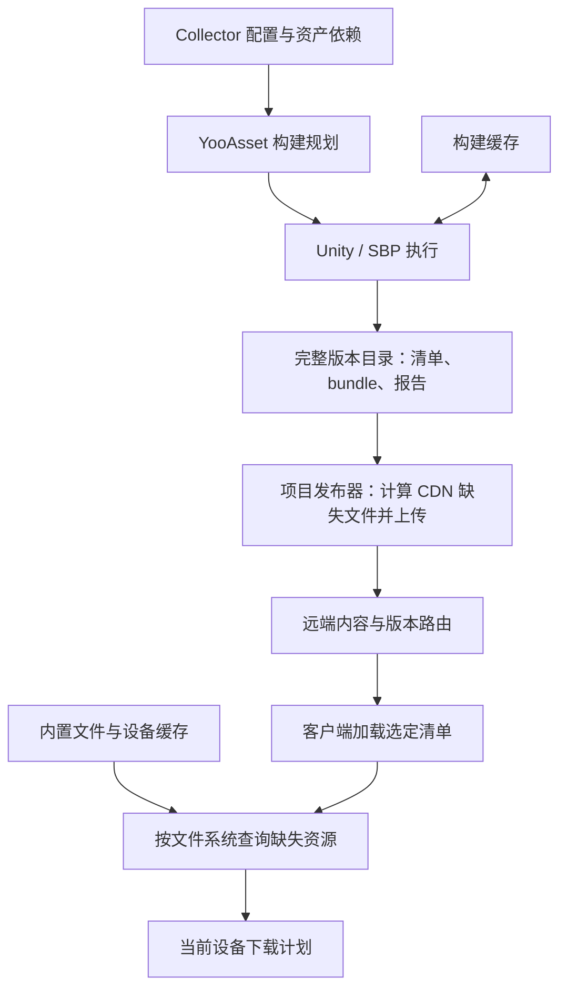
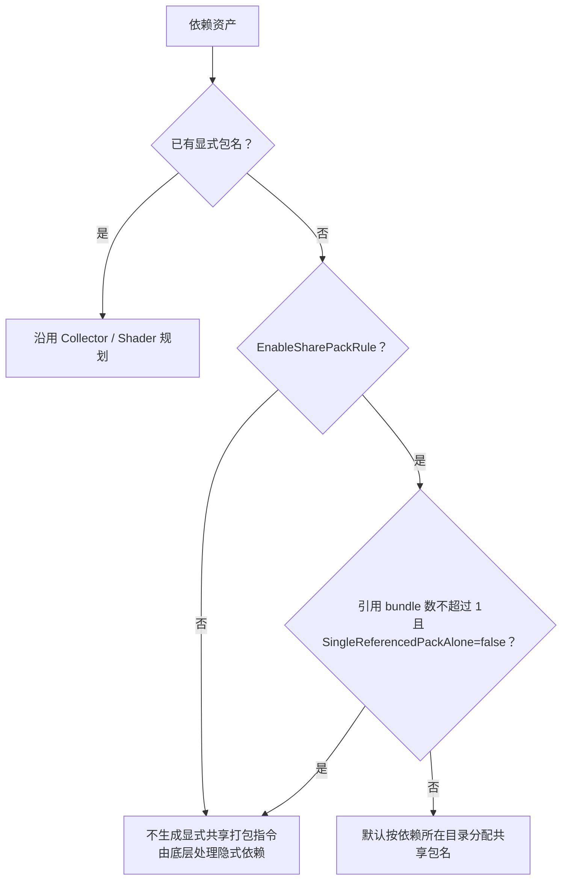

> 专题首页：[YooAsset 资源管理与交付]() · [两个系统的对比与选型]()

资源更新只改了一张贴图，构建目录却再次出现整个 Package 的 bundle。团队很容易据此判断：框架又把所有资源重新构建了一遍，上传和客户端下载也必然是全量。

这个推断混合了四个不同的问题：本次规划覆盖哪些资源，底层执行复用了哪些缓存，版本目录交付哪些文件，用户设备还缺哪些文件。目录包含全部文件，只回答了第三个问题。

**YooAsset 的版本产物可以完整，而构建执行可以复用缓存；CDN 上传和客户端下载还各有自己的差异集合。** 本篇沿构建入口把这四层拆开，再用产物实验验证它们之间的关系。

> 版本基线：官方仓库 YooAsset **3.0.6**，固定提交 [`3b4cfb36cc2e81b9558ab74d65fee2cf2eac2804`](https://github.com/tuyoogame/YooAsset/tree/3b4cfb36cc2e81b9558ab74d65fee2cf2eac2804)。源码位于 `Assets/YooAsset/`；本文是源码核查与实验方案，未执行 Unity 构建，也没有构建时长或下载量实测。

## 一、先区分规划、执行、发布与消费

一次资源构建至少有四份不同的集合：

| 集合 | 回答的问题 | 不能据此推断什么 |
|---|---|---|
| 构建规划 | 当前 Package 应包含哪些显式资产、bundle 和依赖 | 这些文件都必须重新序列化 |
| 本次实际执行的工作 | Unity/SBP 哪些阶段命中缓存，哪些重新计算 | 新版本目录只含变化文件 |
| 新版本发布集合 | 该版本清单及其需要的文件 | CDN 必须重新上传已存在的同内容文件 |
| 某台设备的下载集合 | 当前清单、筛选范围与本地可用资源共同决定的缺失文件 | 等于上一次构建到本次构建的差异 |



因此，讨论“增量”时必须补上宾语：是增量执行、差异上传，还是设备按需下载。缺少这个限定，构建性能、发布存储和热更流量会被混成一个指标。

## 二、Collector 定义内容，不直接写 AssetBundle

3.0.6 的实际类型名是 `BundleCollectorSetting → BundleCollectorPackage → BundleCollectorGroup → BundleCollector`。Package 是构建单元，Group 组织规则，Collector 指向文件或目录。源码没有要求把所有规则归成固定的“五维”；应分别看包级开关、组激活和收集器规则。

收集器通过路径枚举候选资产，经过忽略规则和过滤规则，再生成地址、逻辑包名及依赖列表。递归依赖来自 `command.AssetDependency.GetDependencies(mainAssetPath, true)`；依赖数据库是可选的收集加速手段，和 SBP 构建缓存是两回事。[收集实现](https://github.com/tuyoogame/YooAsset/blob/3b4cfb36cc2e81b9558ab74d65fee2cf2eac2804/Assets/YooAsset/Editor/BundleCollector/BundleCollector.cs#L150-L314)

### 三种收集器的关键区别是是否成为加载入口

| 类型 | 参与构建 | 写入清单的资产列表 |
|---|---|---|
| `MainAssetCollector` | 是 | 是，可成为代码加载入口 |
| `StaticAssetCollector` | 是 | 否 |
| `DependAssetCollector` | 仅保留被 Main/Static 主资源依赖的资产 | 否 |

`DependAssetCollector` 不是“把目录里所有资源强制保留”的机制。`TaskGetBuildMap.RemoveZeroReferenceAssets` 会移除其中未被引用的资产，并把它们记入报告的 `IndependentAssets`。`StaticAssetCollector` 也不能简单等同于“未被直接加载的共享依赖”：它是主动参与构建的主资源，只是不作为清单资产入口。[类型契约](https://github.com/tuyoogame/YooAsset/blob/3b4cfb36cc2e81b9558ab74d65fee2cf2eac2804/Assets/YooAsset/Editor/BundleCollector/ECollectorType.cs#L9-L30)、[零引用剔除](https://github.com/tuyoogame/YooAsset/blob/3b4cfb36cc2e81b9558ab74d65fee2cf2eac2804/Assets/YooAsset/Editor/BundleBuilder/BuildTasks/TaskGetBuildMap.cs#L155-L201)

### 地址规则和打包规则解决不同问题

地址决定“调用方怎样找资产”；逻辑包名决定“哪些显式资产合并成同一个构建指令”。内置地址规则包括 `AddressDisable`、`AddressByFileName`、`AddressByGroupAndFileName`、`AddressByFolderAndFileName`。本版没有内置的 `AddressByFilePath` 类，而且启用可寻址时，主资源 address 以 `Assets/` 开头会被拒绝。资产路径加载和 address 规则不应混写。[地址规则](https://github.com/tuyoogame/YooAsset/blob/3b4cfb36cc2e81b9558ab74d65fee2cf2eac2804/Assets/YooAsset/Editor/BundleCollector/DefaultRules/DefaultAddressRule.cs#L6-L58)、[包级地址校验](https://github.com/tuyoogame/YooAsset/blob/3b4cfb36cc2e81b9558ab74d65fee2cf2eac2804/Assets/YooAsset/Editor/BundleCollector/BundleCollectorPackage.cs#L133-L153)

打包规则则通过 `IBundlePackRule` 生成规则结果，包含逐资源、逐目录、顶层目录、Collector、Group，以及原始文件、视频和 Shader 等规则。原始文件规则需要配合相应构建管线，不能理解为在任意 AssetBundle 管线中切换一个开关即可。[内置打包规则](https://github.com/tuyoogame/YooAsset/blob/3b4cfb36cc2e81b9558ab74d65fee2cf2eac2804/Assets/YooAsset/Editor/BundleCollector/DefaultRules/DefaultBundlePackRule.cs#L54-L222)

## 三、共享依赖不是无条件自动抽包

假设 `HeroA.prefab` 和 `HeroB.prefab` 被分别打包，并引用同一材质。首先要判断材质有没有被 Collector 显式分配包名；如果有，规划沿用该归属。如果没有，再看共享打包开关。

`TaskGetBuildMap` 先录入显式收集资产，再补充依赖及其引用 bundle 集合，处理自动 Shader 收集，最后在 `EnableSharePackRule` 为真时为仍无包名的依赖执行共享打包。默认共享规则按依赖资产所在目录生成共享包名。若引用 bundle 数不超过一个且 `SingleReferencedPackAlone=false`，不单独分配包名，交由底层管线作为隐式依赖处理。[构建映射与条件](https://github.com/tuyoogame/YooAsset/blob/3b4cfb36cc2e81b9558ab74d65fee2cf2eac2804/Assets/YooAsset/Editor/BundleBuilder/BuildTasks/TaskGetBuildMap.cs#L20-L153)、[共享规则](https://github.com/tuyoogame/YooAsset/blob/3b4cfb36cc2e81b9558ab74d65fee2cf2eac2804/Assets/YooAsset/Editor/BundleBuilder/BuildTasks/TaskGetBuildMap.cs#L221-L244)



尤其要注意，`BuildParameters` 类型默认 `EnableSharePackRule=false`，`SingleReferencedPackAlone=true`。Editor 窗口、样例或项目构建脚本可以另行赋值，因此判断项目行为时必须读取实际参数，而不能只记住类型默认值。[参数默认值](https://github.com/tuyoogame/YooAsset/blob/3b4cfb36cc2e81b9558ab74d65fee2cf2eac2804/Assets/YooAsset/Editor/BundleBuilder/BuildParameters.cs#L66-L93)

这修正了两种常见误解：漏配 DependCollector 不等于一定重复打包；存在自动共享机制也不等于当前配置必然启用了它。共享布局还会改变依赖扇出、加载粒度和变更波及范围，必须用实际构建报告确认。

## 四、SBP 任务链如何把规划变成文件

本篇聚焦 `ScriptableBuildPipeline`。3.0.6 还存在 `LegacyBuildPipeline`、RawFile、ArchiveFile、EditorSimulate、InstantAsset 等管线，不能沿用“只有 Builtin 和 SBP 两种”的旧概括。Legacy 路径调用 Unity 的 `BuildPipeline.BuildAssetBundles`；SBP 路径调用 `ContentPipeline.BuildAssetBundles`。[Legacy 执行入口](https://github.com/tuyoogame/YooAsset/blob/3b4cfb36cc2e81b9558ab74d65fee2cf2eac2804/Assets/YooAsset/Editor/BundleBuilder/BuildPipeline/LegacyBuildPipeline/BuildTasks/TaskBuilding_LBP.cs#L29-L48)、[SBP 执行入口](https://github.com/tuyoogame/YooAsset/blob/3b4cfb36cc2e81b9558ab74d65fee2cf2eac2804/Assets/YooAsset/Editor/BundleBuilder/BuildPipeline/ScriptableBuildPipeline/BuildTasks/TaskBuilding_SBP.cs#L39-L80)

SBP 的 YooAsset 外层任务顺序是：

```text
Prepare → GetBuildMap → Building → VerifyBuildResult
        → Encryption → UpdateBundleInfo → CreateManifest
        → CreateReport → CreatePackage → CopyBundledFiles → CreateCatalog
```

这里的 `Building` 内部才进入 Unity SBP 的任务链。外层构建任务和 SBP 内部任务不是同一层，报告成功也不等于上传或运行验收成功。[完整外层链](https://github.com/tuyoogame/YooAsset/blob/3b4cfb36cc2e81b9558ab74d65fee2cf2eac2804/Assets/YooAsset/Editor/BundleBuilder/BuildPipeline/ScriptableBuildPipeline/ScriptableBuildPipeline.cs#L34-L49)

### 缓存复用有直接源码依据

`ScriptableBuildParameters.GetBundleBuildParameters()` 明确设置 `buildParams.UseCache=true`，并传入可选的缓存服务器配置。准备阶段仅在 `ClearBuildCacheFiles=true` 时调用 SBP `BuildCache.PurgeCache(false)` 并删除当前 Package 根目录。默认 `ClearBuildCacheFiles=false`。[SBP 参数](https://github.com/tuyoogame/YooAsset/blob/3b4cfb36cc2e81b9558ab74d65fee2cf2eac2804/Assets/YooAsset/Editor/BundleBuilder/BuildPipeline/ScriptableBuildPipeline/ScriptableBuildParameters.cs#L89-L115)、[清缓存条件](https://github.com/tuyoogame/YooAsset/blob/3b4cfb36cc2e81b9558ab74d65fee2cf2eac2804/Assets/YooAsset/Editor/BundleBuilder/BuildPipeline/ScriptableBuildPipeline/BuildTasks/TaskPrepare_SBP.cs#L15-L30)

这足以否定“每次强制重新生成所有 bundle 字节”的表述，但不能据此承诺某次构建全部命中缓存。Unity/SBP 版本、目标平台、导入结果、依赖变化、构建参数和加密过程都可能影响实际工作量。缓存命中需要构建日志佐证，不能从文件修改时间或总时长单独反推。

### 内置检查有范围，也有开关

框架已有参数合法性、未保存场景、规则类型、重复收集与地址冲突等检查；资源路径 Unicode 格式字符检查受 `EnableAssetPathValidation` 控制。SBP 的 `VerifyBuildingResult` 则比较“计划 bundle 名称集合”和“Unity 返回 bundle 名称集合”，发现多出或缺失的 bundle 时失败。[结果检查](https://github.com/tuyoogame/YooAsset/blob/3b4cfb36cc2e81b9558ab74d65fee2cf2eac2804/Assets/YooAsset/Editor/BundleBuilder/BuildPipeline/ScriptableBuildPipeline/BuildTasks/TaskVerifyBuildResult_SBP.cs#L18-L68)

这项检查不证明 bundle 已通过真机加载，也不负责资源预算、线上版本兼容性或 CDN 完整发布。项目可以在已有检查之上建立规则，不必从“框架完全没有构建分析”出发另造一整套工具。

## 五、完整版本目录里实际有什么

默认目录由 `BuildParameters` 定义，工作目录与版本目录分开：

```text
{BuildOutputRoot}/{BuildTarget}/{PackageName}/
├── OutputCache/                 # 管线工作输出，可供后续构建使用
├── {VersionA}/                  # A 的完整版本产物
└── {VersionB}/                  # B 的完整版本产物
```

路径中没有默认的 `{BuildPipeline}` 层。版本输出目录已经存在时，准备阶段会报错；实验应使用新版本名，不要把覆盖同一版本号当成正常流程。[目录定义](https://github.com/tuyoogame/YooAsset/blob/3b4cfb36cc2e81b9558ab74d65fee2cf2eac2804/Assets/YooAsset/Editor/BundleBuilder/BuildParameters.cs#L222-L251)、[目录检查](https://github.com/tuyoogame/YooAsset/blob/3b4cfb36cc2e81b9558ab74d65fee2cf2eac2804/Assets/YooAsset/Editor/BundleBuilder/BuildTasks/TaskPrepare.cs#L39-L54)

在默认空 `PackageFilePrefix` 下，`DemoPackage` 的 `v1` 主要文件为：

| 文件 | 来源与用途 |
|---|---|
| `DemoPackage_v1.bytes` | 二进制清单；包含该版本资产、bundle、标签等索引信息 |
| `DemoPackage_v1.hash` | 清单文件 CRC32 的文本值；不能当成数字签名 |
| `DemoPackage.version` | 内容为当前版本字符串 |
| `DemoPackage_v1.report` | JSON 格式构建报告，扩展名是 `.report` |
| bundle 文件 | 当前构建规划中的全部交付文件 |
| `buildlogtep.json`、可选 `link.xml` | SBP 包创建任务复制的日志与防裁剪配置 |

文件前缀可配置，所以不能把 `PackageManifest_{version}.bytes` 写成 3.0.6 固定命名；本版清单创建任务也没有默认写出一份对应的 manifest JSON。[文件名函数](https://github.com/tuyoogame/YooAsset/blob/3b4cfb36cc2e81b9558ab74d65fee2cf2eac2804/Assets/YooAsset/Runtime/Settings/YooAssetConfiguration.cs#L60-L136)、[清单落盘](https://github.com/tuyoogame/YooAsset/blob/3b4cfb36cc2e81b9558ab74d65fee2cf2eac2804/Assets/YooAsset/Editor/BundleBuilder/BuildTasks/TaskCreateManifest.cs#L83-L112)

`TaskCreatePackage_SBP` 最终遍历构建映射，复制**所有** Package bundle 到本次版本目录，而非只复制相对前一版本变化的文件。这说明版本目录是完整交付集合，不说明底层没有复用缓存。[创建版本目录内容](https://github.com/tuyoogame/YooAsset/blob/3b4cfb36cc2e81b9558ab74d65fee2cf2eac2804/Assets/YooAsset/Editor/BundleBuilder/BuildPipeline/ScriptableBuildPipeline/BuildTasks/TaskCreatePackage_SBP.cs#L19-L36)、[复制全部 bundle](https://github.com/tuyoogame/YooAsset/blob/3b4cfb36cc2e81b9558ab74d65fee2cf2eac2804/Assets/YooAsset/Editor/BundleBuilder/BuildTasks/TaskCreatePackage.cs#L22-L30)

### 文件标识必须与实际交付字节对应

逻辑 bundle 名来自收集规划；最终远端文件名由 `EFileNameStyle` 决定，可选 `HashName`、`BundleName`、`BundleName_HashName`。这不是可任意替换的 `IFileNameStyle` 接口。[文件命名实现](https://github.com/tuyoogame/YooAsset/blob/3b4cfb36cc2e81b9558ab74d65fee2cf2eac2804/Assets/YooAsset/Runtime/ResourcePackage/BundleFileNaming.cs#L17-L46)

SBP 路径分别记录 Unity 返回的 hash/CRC，以及交付源文件的 MD5、CRC32、大小。若经过加密，交付源文件指向加密结果。远端文件名所用 `FileHash` 来自交付文件 MD5，因此随机化密文也可能使未变明文产生不同文件标识。[信息更新](https://github.com/tuyoogame/YooAsset/blob/3b4cfb36cc2e81b9558ab74d65fee2cf2eac2804/Assets/YooAsset/Editor/BundleBuilder/BuildTasks/TaskUpdateBundleInfo.cs#L36-L66)、[SBP hash 计算](https://github.com/tuyoogame/YooAsset/blob/3b4cfb36cc2e81b9558ab74d65fee2cf2eac2804/Assets/YooAsset/Editor/BundleBuilder/BuildPipeline/ScriptableBuildPipeline/BuildTasks/TaskUpdateBundleInfo_SBP.cs#L21-L61)

## 六、动手验证：三次构建，分别检查三层差异

以下实验需要在专用 Unity 测试项目执行。它是复现方案，**本文没有执行，也不提供虚构的耗时、命中率或变化文件数**。

1. 固定 Unity、YooAsset、SBP、平台、压缩和加密参数。记录 Collector 配置，使用 `BundleName_HashName`；保留构建缓存，明确设定 `EnableSharePackRule`。
2. 创建两个分别打包的 prefab，让它们引用同一材质与贴图；另建一组不引用该材质的独立资源。先构建 `v1`。
3. 不改资产，用新版本号构建 `v2`；保留日志、两个版本的 `.report` 和完整文件清单。
4. 只修改共享贴图内容，构建 `v3`。不要预设“只变一个 bundle”：依赖布局、引擎输出和加密都可能扩大变化集合。
5. 在 Bundle Reporter 中导入报告，检查 `BundleContents`、`DependBundles`、`ReferenceBundles`；在 SBP 日志中检查缓存复用，分别记录规划、执行、产物差异。

下面的标准库脚本读取两份真实 `.report`，核对新版本文件，并给出逻辑 bundle 的变化集合。保存为 `compare_reports.py`，运行 `python compare_reports.py old.report new.report`：

```python
import hashlib
import json
import sys
from pathlib import Path

old_path, new_path = map(Path, sys.argv[1:3])
old = json.loads(old_path.read_text(encoding="utf-8-sig"))
new = json.loads(new_path.read_text(encoding="utf-8-sig"))
before = {b["BundleName"]: b for b in old["BundleInfos"]}
after = {b["BundleName"]: b for b in new["BundleInfos"]}
old_files = {(b["FileName"], b["FileHash"]) for b in before.values()}
for bundle in after.values():
    path = new_path.parent / bundle["FileName"]
    with path.open("rb") as stream:
        digest = hashlib.file_digest(stream, "md5").hexdigest()
    assert digest == bundle["FileHash"], path
    assert path.stat().st_size == bundle["FileSize"], path
changed = [name for name, b in after.items()
           if name not in before or before[name]["FileHash"] != b["FileHash"]]
new_files = [b for b in after.values()
             if (b["FileName"], b["FileHash"]) not in old_files]
print(json.dumps({
    "new_version_bundle_count": len(after),
    "changed_logical_bundles": sorted(changed),
    "removed_logical_bundles": sorted(before.keys() - after.keys()),
    "files_absent_from_old_version": [b["FileName"] for b in new_files],
    "bytes_absent_from_old_version": sum(b["FileSize"] for b in new_files)
}, ensure_ascii=False, indent=2))
```

脚本要求 Python 3.11 及以上；它验证报告与交付文件的一致性，MD5 在此用于对照构建标识，不是安全认证。报告字段来自 [`ReportBundleInfo`](https://github.com/tuyoogame/YooAsset/blob/3b4cfb36cc2e81b9558ab74d65fee2cf2eac2804/Assets/YooAsset/Editor/BundleReporter/ReportBundleInfo.cs#L12-L74)。

如何解释输出：

| 观察 | 可以得出的结论 | 仍需额外证据 |
|---|---|---|
| `v2` 仍有完整 bundle 集合 | 新版本目录没有退化成差异补丁目录 | 是否命中 SBP 缓存，要看日志 |
| `v1/v2` 文件标识相同 | 对应交付字节相同，可研究服务器复用 | CDN 实际是否已有文件、URL 布局是否允许复用 |
| `v3` 部分 bundle hash 改变 | 存在可观测的变化集合 | 不能保证所有设备只下载这部分 |
| 旧设备只请求部分文件 | 当前设备有一部分资源可用 | 冷缓存设备、清理缓存设备和不同标签需分别测试 |

若发布路径按版本目录隔离，同名文件位于不同 URL，服务器不会仅因 hash 相同就自动共享；项目可选择服务端复制、对象复用或稳定内容寻址，但需要发布器和存储策略配合。客户端则根据选定版本及内置/缓存可用性生成下载计划：不需要先拿两份旧新 manifest 做一遍差分才具备下载能力。冷缓存设备仍可能需要当前范围的全部资源。[下载计划构造](https://github.com/tuyoogame/YooAsset/blob/3b4cfb36cc2e81b9558ab74d65fee2cf2eac2804/Assets/YooAsset/Runtime/ResourcePackage/FileSystemHost.cs#L253-L296)

## 七、构建成功之后还有交付边界

完整清单描述的是当前版本应有的内容。Bundle Reporter 提供资产与 bundle 查询、依赖关系和大小信息；它不是自动宣布预算合格的审批器。把超大包、首包依赖、共享资源扇出等规则加在已有报告上，比另写一套收集语义更容易保持一致。[报告结构](https://github.com/tuyoogame/YooAsset/blob/3b4cfb36cc2e81b9558ab74d65fee2cf2eac2804/Assets/YooAsset/Editor/BundleReporter/BuildReport.cs#L20-L38)

报告也要按字段来源解释：`DependBundles` 来自构建后的依赖关系，`BundleContents` 则从构建映射中收集显式资产与未单独命名的依赖。它适合定位可疑布局，不能代替对最终 bundle 序列化内容的逐对象审计。[包内列表生成](https://github.com/tuyoogame/YooAsset/blob/3b4cfb36cc2e81b9558ab74d65fee2cf2eac2804/Assets/YooAsset/Editor/BundleBuilder/BuildBundleInfo.cs#L172-L190)

发布器还应保存版本到源码修订、Unity/SBP、配置与产物哈希的映射，校验清单引用文件可达，再切换用户会看到的版本选择。回滚需要旧清单及其引用内容仍可取得，也需要客户端代码与内容兼容；一个完整本地目录本身不能保证线上可回滚。

因此，不能在没有同条件实验的情况下断言“比另一框架更安全”“构建必然更慢”或“无状态所以一定可复现”。本版源码能够证明的是规则规划、SBP 缓存启用、完整版本输出，以及这些层之间的调用关系。性能、弱网效果和发布可靠性需要各自的证据。

继续阅读：[能力边界与项目契约]()。构建期负责把内容规则变成可核查的版本；发布和设备消费需要继续沿各自的身份与状态验证。
