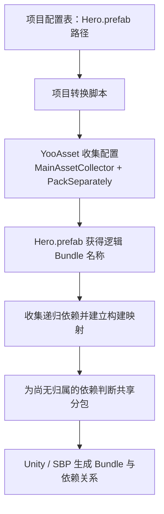
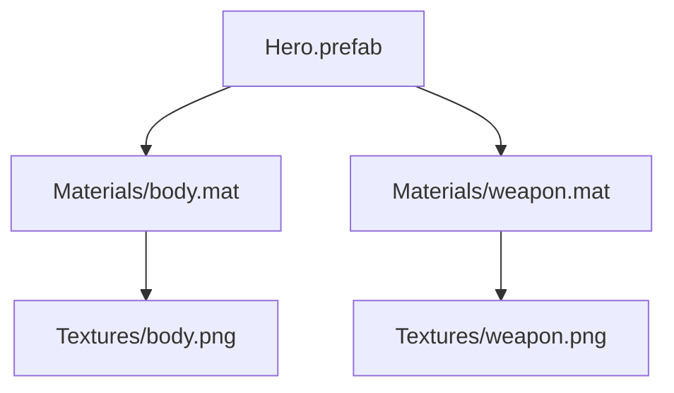
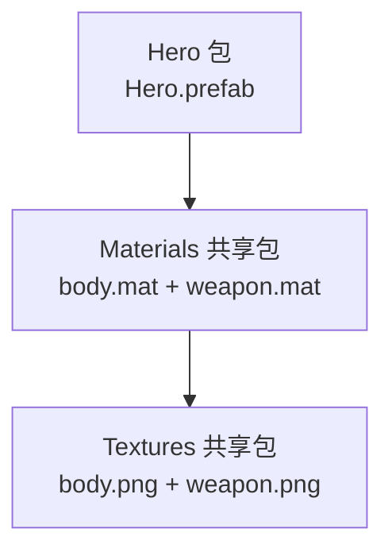
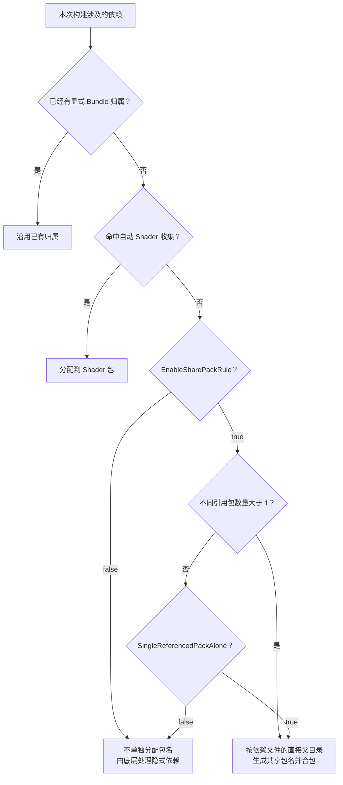
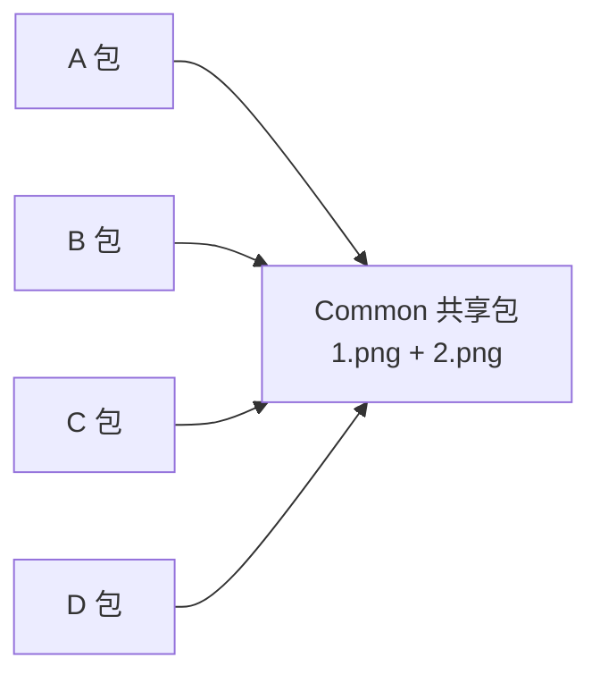
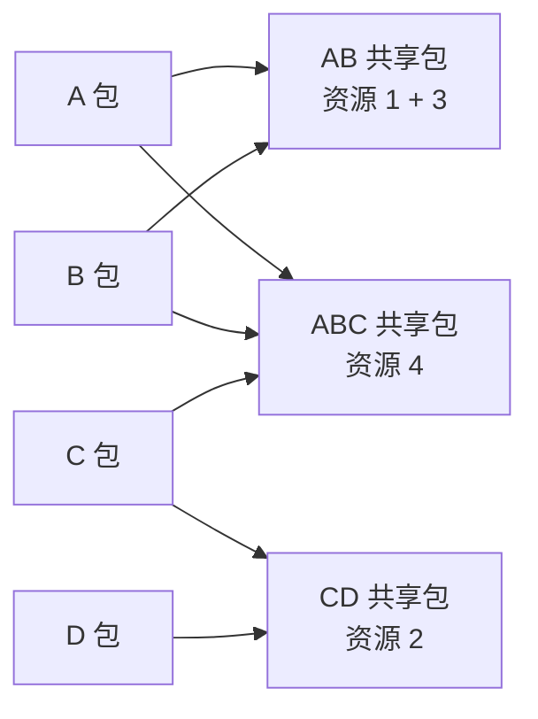
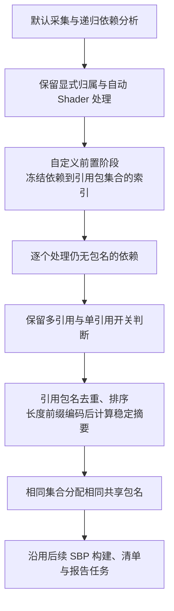

> 专题首页：[YooAsset 资源管理与交付]() · 后续阅读：[资源收集、构建与产物]()

配置了一个 Prefab 的采集路径，最后为什么会出现材质包、纹理包？两个资源分别只供 A、B 和 C、D 使用，为什么又会进同一个共享包？

回答这些问题，需要把两个决定分开：**先决定一个资源是否单独分包，再决定它与哪些资源合包。** 引用它的 Bundle 数量参与第一个决定；默认共享规则使用它自身的直接父目录完成第二个决定。

本文沿一个 Prefab 逐步增加引用方，画出资源关系和分包结果。版本基线为 **YooAsset 3.0.6**，固定提交 [`3b4cfb36cc2e81b9558ab74d65fee2cf2eac2804`](https://github.com/tuyoogame/YooAsset/tree/3b4cfb36cc2e81b9558ab74d65fee2cf2eac2804)。示例是基于源码条件的推演，未执行本文的 Unity 对照构建、设备加载或性能实验；按引用包集合分组是后文讨论的自定义方案；本文提供参考代码，尚未在 Unity 中编译运行或接入项目。

## 一、先确定 Prefab 自己属于哪个 Bundle

假设项目通过配置表维护运行时资源路径。表中的一行指向 `Assets/Probe/Hero.prefab`，项目脚本把它转换成一个 `MainAssetCollector`，并使用 `PackSeparately`。配置表转收集器是项目自己的集成步骤，YooAsset 接收的是生成后的收集配置。



`PackSeparately` 以资产路径去掉扩展名后的结果生成逻辑包名。本文把这个包简称为 **Hero 包**。它表示 Prefab 的显式分包归属，不表示它引用的全部材质、纹理也已经被分配到这个包。

如果把规则换成 `PackDirectory`，同一直接父目录下的显式采集资源会生成相同包名；换成 `PackGroup`，同组的显式资源会按组名合包。**Group 是规则组织层，一个 Group 并不天然等于一个 Bundle。** 资源的 Address 是运行时查找入口，也不决定它属于哪个 Bundle。[内置打包规则](https://github.com/tuyoogame/YooAsset/blob/3b4cfb36cc2e81b9558ab74d65fee2cf2eac2804/Assets/YooAsset/Editor/BundleCollector/DefaultRules/DefaultBundlePackRule.cs#L54-L138)

接下来始终使用逐 Prefab 分包，避免在一个例子中同时改变多个条件。

## 二、一个 Prefab 怎样产生目录共享包

假设 Hero 引用两个材质，每个材质引用一张纹理。路径统一以 `Assets/Probe/` 为起点：

```text
Assets/Probe/
├── Hero.prefab
├── Materials/
│   ├── body.mat
│   └── weapon.mat
└── Textures/
    ├── body.png
    └── weapon.png
```

这棵树只表示文件位置。实际的引用关系如下，箭头表示左边的资源引用右边的资源：



先固定例子的边界：材质和纹理都没有被其他 Collector 显式分包；没有第二个 Prefab 或场景引用它们；这些普通依赖都能够参与 AssetBundle 构建。Shader 的自动收集另有专门路径，不纳入这张简图。

现在使用下面的构建参数：

```csharp
EnableSharePackRule = true;
SingleReferencedPackAlone = true;
```

Hero 已经获得包名。YooAsset 再为它的依赖登记引用方：这里四个依赖都只被 **Hero 这一个 Bundle** 引用。由于允许单引用依赖独立分包，它们也会进入自动共享分包阶段。

默认规则取的是**每个依赖文件自身的直接父目录**：

| 依赖文件 | 直接父目录 | 分包结果 |
|---|---|---|
| `body.mat`、`weapon.mat` | `Assets/Probe/Materials` | 同一个 Materials 共享包 |
| `body.png`、`weapon.png` | `Assets/Probe/Textures` | 同一个 Textures 共享包 |

于是形成三个包。下图只画材质和纹理产生的包依赖，省略 Shader 等其他内容：



这里虽然使用了“共享包”这个名称，却还没有两个使用方；它是自动共享分包规则产生的包。**包名含有 share，并不能证明其中所有资源都被多个包引用。**

目录不会被整体无条件收进去。`Materials` 下另有一个完全未被引用、也未主动采集的 `unused.mat`，它不会仅因目录相同就进入这个共享包。依赖还要先进入本次构建的资源集合。

### 父目录究竟算到哪一级

`Textures/body.png` 的直接父目录是 `Textures`，`Textures/UI/icon.png` 的直接父目录则是 `Textures/UI`。默认规则不会把整个 `Textures` 子目录树一并合成一个共享包。

共享包名来自目录路径的格式化。比如 Package 为 `DemoPackage` 且 `UniqueBundleName=true` 时，材质目录对应的逻辑包名为：

```text
demopackage_share_assets_probe_materials.bundle
```

发布文件还可以按 `FileNameStyle.HashName` 使用哈希命名；文件名变化不改变“先按逻辑包名合包”的过程。[共享规则的父目录计算](https://github.com/tuyoogame/YooAsset/blob/3b4cfb36cc2e81b9558ab74d65fee2cf2eac2804/Assets/YooAsset/Editor/BundleBuilder/BuildTasks/TaskGetBuildMap.cs#L221-L244)、[共享包名格式化](https://github.com/tuyoogame/YooAsset/blob/3b4cfb36cc2e81b9558ab74d65fee2cf2eac2804/Assets/YooAsset/Editor/BundleCollector/CollectRules/IBundlePackRule.cs#L90-L105)

## 三、两个开关分别控制什么

`BuildParameters` 的类型默认值是 `EnableSharePackRule=false`、`SingleReferencedPackAlone=true`。Editor 窗口或项目构建代码可以覆盖它们，因此要读取实际入口传入的参数。[参数定义](https://github.com/tuyoogame/YooAsset/blob/3b4cfb36cc2e81b9558ab74d65fee2cf2eac2804/Assets/YooAsset/Editor/BundleBuilder/BuildParameters.cs#L71-L80)

第一个开关决定是否执行自动共享分包；第二个开关决定是否也为单引用依赖独立分包。下表针对**没有显式包名的普通依赖**：

| `EnableSharePackRule` | `SingleReferencedPackAlone` | 只有一个引用包 | 有两个或更多引用包 |
|---|---|---|---|
| `false` | 任意 | 不自动分配共享包名 | 不自动分配共享包名 |
| `true` | `false` | 保留为隐式依赖，随引用包构建 | 自动分配共享包名 |
| `true` | `true` | 自动分配共享包名 | 自动分配共享包名 |

关闭自动共享分包不会让依赖消失。YooAsset 不为它生成独立的显式打包指令，底层 Unity/SBP 仍需处理主资源的隐式依赖。跨包引用又未显式分包时，可能产生重复内容，需要核对构建产物。

完整判断顺序如下。图中 Shader 路径指包级 `AutoCollectShaders` 开启后，对未被显式采集的 Shader 的自动处理：



对应 `TaskGetBuildMap.CreateBuildMap`：先录入收集器资源，再登记依赖与引用包，填充依赖列表，处理自动 Shader 收集，最后为仍无包名的依赖执行共享分包。[构建映射顺序](https://github.com/tuyoogame/YooAsset/blob/3b4cfb36cc2e81b9558ab74d65fee2cf2eac2804/Assets/YooAsset/Editor/BundleBuilder/BuildTasks/TaskGetBuildMap.cs#L28-L150)

### 引用数统计的是 Bundle，不是 Prefab 数或运行次数

给例子增加 `HeroB.prefab`，让它也引用 `body.mat`。只有 Hero 与 HeroB 分别属于两个不同 Bundle，才会为相关依赖登记两个引用包。

如果两个 Prefab 通过 `PackGroup` 合进同一个 Bundle，即使两个 Prefab 都引用 `body.mat`，对该依赖也只增加一个不同的引用包。运行时实例化一百次，不会因此改变构建期引用数。

引用登记使用包名去重。收集器的依赖查询包含递归依赖，所以引用计数不局限于 Prefab 文件直接指向的材质，也会覆盖通过材质访问的纹理。这是收集阶段的包引用集合，不是运行时访问统计。[引用包登记](https://github.com/tuyoogame/YooAsset/blob/3b4cfb36cc2e81b9558ab74d65fee2cf2eac2804/Assets/YooAsset/Editor/BundleBuilder/BuildTasks/TaskGetBuildMap.cs#L60-L90)、[引用数去重](https://github.com/tuyoogame/YooAsset/blob/3b4cfb36cc2e81b9558ab74d65fee2cf2eac2804/Assets/YooAsset/Editor/BundleBuilder/BuildAssetInfo.cs#L123-L154)

## 四、同目录的资源由 AB、CD 分别使用，为什么仍然合包

继续扩大例子。A、B、C、D 表示四个不同的主资源 Bundle；下面两个纹理都没有显式包名：

```text
Assets/Probe/Common/
├── 1.png     ← A、B 引用
└── 2.png     ← C、D 引用
```

共享开关开启后，两张纹理都满足多引用条件。默认规则接下来只取它们的直接父目录；两者都是 `Assets/Probe/Common`，所以生成同一个共享包名：



**默认共享规则不以引用包集合是否相同作为合包条件。** 这里 `SingleReferencedPackAlone` 取任何值都不改变结果，因为 1 和 2 都被两个不同的包引用。

当加载 A 的资源需要 1，且整个 Common 共享文件还未在设备上可用时，就需要取得包含 1 和 2 的这个文件。文件下载或本地打开的粒度是 Bundle，但不能把这进一步等同为“2 必然被加载成内存中的 Unity 对象”。文件获取、Bundle 加载和资产对象加载需要分别判断，参见[单次加载流程导读]()。

如果这些资源本来就一起使用、一起更新，合包可能合适；如果 AB 与 CD 是互不相关的功能，同目录合包可能扩大首次下载与更新范围。目录结构由此成为默认共享分包策略的一部分。

## 五、按引用包集合分组，怎样得到 AB 包和 CD 包

可以把自定义规则改为：对符合共享条件、尚无归属的每个依赖，取得引用它的包集合；集合完全相同的依赖合包。

| 资源 | 引用包集合 | 自定义分组结果 |
|---|---|---|
| 1 | `{A, B}` | AB 共享包 |
| 2 | `{C, D}` | CD 共享包 |
| 3 | `{B, A}` | 与 1 同包，顺序不影响集合 |
| 4 | `{A, B, C}` | 单独的 ABC 共享包 |



此时 1 和 2 即使在同一目录，也分属两个共享包；1 和 3 即使在不同目录，也可以合包。比较的是**引用包集合完全相等**，只有部分重叠不合并。

### 3.0.6 提供扩展点，没有这个现成开关

`TaskGetBuildMap` 的 `PreProcessPackShareBundle`、`ProcessingPackShareBundle`、`PostProcessPackShareBundle` 是可重写的方法。默认 `GetShareBundleName` 是私有方法，因此不能仅靠重写这个私有方法替换目录键，需要扩展共享处理阶段。[共享处理扩展点](https://github.com/tuyoogame/YooAsset/blob/3b4cfb36cc2e81b9558ab74d65fee2cf2eac2804/Assets/YooAsset/Editor/BundleBuilder/BuildTasks/TaskGetBuildMap.cs#L204-L253)

实现时还要处理两处接口边界：

- `BuildAssetInfo` 的引用包集合字段是私有的，公开接口只提供数量；不能假设有一个可以直接读取包名集合的属性。可以在共享前置阶段，从已采集资源的 `AllDependAssetInfos` 反向建立“依赖路径 → 引用包名集合”，并在分配共享包之前冻结原始包名，避免把刚生成的共享包混入本轮分组依据。
- 默认 `ScriptableBuildPipeline` 在内部创建任务列表，没有公开的任务替换参数。项目需要接入自定义构建任务列表，用扩展的构建映射任务替换默认任务，其余构建、清单、报告和包创建步骤保持对应关系。只定义扩展类而继续调用原管线，不会自动生效。

普通 `IBundlePackRule` 接收的输入是资产路径、采集路径、Group 和用户数据，不包含全局引用包集合。因此，这个方案应在掌握依赖关系的构建映射阶段完成，不能只在 Collector 下拉框中增加一个规则名就认为已经接通。[资源构建信息](https://github.com/tuyoogame/YooAsset/blob/3b4cfb36cc2e81b9558ab74d65fee2cf2eac2804/Assets/YooAsset/Editor/BundleBuilder/BuildAssetInfo.cs#L11-L49)、[规则输入](https://github.com/tuyoogame/YooAsset/blob/3b4cfb36cc2e81b9558ab74d65fee2cf2eac2804/Assets/YooAsset/Editor/BundleCollector/CollectRules/IBundlePackRule.cs#L7-L43)、[默认任务列表](https://github.com/tuyoogame/YooAsset/blob/3b4cfb36cc2e81b9558ab74d65fee2cf2eac2804/Assets/YooAsset/Editor/BundleBuilder/BuildPipeline/ScriptableBuildPipeline/ScriptableBuildPipeline.cs#L18-L49)

### 把扩展分成前置索引、逐资源分配和管线接入

扩展放在项目的 Editor 代码中；使用 asmdef 时，需要引用 `YooAsset.Editor`。不需要修改默认目录规则，也不需要改运行时加载器。我们只替换构建映射任务，让后续 SBP、清单和报告继续消费新的资源归属。



例如源资源分别位于 A、B、C、D 包中，前置索引记录的是：

```text
1.png -> { A.bundle, B.bundle }
2.png -> { C.bundle, D.bundle }
3.png -> { A.bundle, B.bundle }
```

这张索引在共享包命名之前建立。本次分组始终使用这些原始引用方；不能给 1 分完包后，又把刚生成的 AB 共享包当成 3 的引用方。也不需要根据最终共享包关系反复重算分组。

下面给出两段配套参考代码，采用上文 3.0.6 的公开类型和扩展方法。**它们已经按固定源码核对接口，但尚未在 Unity 中编译或运行，也未接入任何项目的正式打包入口。** 示例针对普通 AssetBundle 依赖，保留原框架的显式归属和自动 Shader 处理；RawFile、场景专门约束、分组体积上限及升级兼容仍需按项目要求处理。

### 第一步：派生构建映射任务，建立反向索引

继承 `TaskGetBuildMap_SBP` 可以继续使用它已有的 `IBuildTask.Run`，由基类调用 `CreateBuildMap`；我们重写共享处理的两个阶段。私有的 `_referenceBundleNames` 无须反射读取，前置阶段可从公开的递归依赖列表重建同样的原始引用集合。

```csharp
using System;
using System.Collections.Generic;
using System.Globalization;
using System.Security.Cryptography;
using System.Text;
using YooAsset.Editor;

public sealed class ReferenceSetBuildMapTask : TaskGetBuildMap_SBP
{
    private readonly Dictionary<string, SortedSet<string>> references =
        new Dictionary<string, SortedSet<string>>(StringComparer.Ordinal);
    private readonly Dictionary<string, string> identities =
        new Dictionary<string, string>(StringComparer.Ordinal);

    protected override void PreProcessPackShareBundle(
        BuildParameters parameters, CollectCommand command,
        Dictionary<string, BuildAssetInfo> assets)
    {
        references.Clear();
        identities.Clear();

        foreach (BuildAssetInfo source in assets.Values)
        {
            // 主动采集的 Main、Static、Depend 资源已经有包名。
            // CollectorType.None 是补入的依赖，不作为原始引用方。
            if (source.CollectorType == ECollectorType.None ||
                !source.HasBundleName() || source.AllDependAssetInfos == null)
                continue;

            string originalBundle = source.BundleName;
            foreach (BuildAssetInfo dependency in source.AllDependAssetInfos)
            {
                string path = dependency.AssetInfo.AssetPath;
                if (!references.TryGetValue(path, out var owners))
                {
                    owners = new SortedSet<string>(StringComparer.Ordinal);
                    references.Add(path, owners);
                }
                owners.Add(originalBundle);
            }
        }
    }

    protected override void ProcessingPackShareBundle(
        BuildParameters parameters, CollectCommand command,
        BuildAssetInfo asset)
    {
        // 基类只会把尚无 Bundle 归属的资源传到这里。
        string path = asset.AssetInfo.AssetPath;
        if (!references.TryGetValue(path, out var owners) || owners.Count == 0)
            throw new InvalidOperationException("Missing reference set: " + path);
        if (owners.Count != asset.GetReferenceBundleCount())
            throw new InvalidOperationException("Reference count mismatch: " + path);

        if (owners.Count <= 1 && !parameters.SingleReferencedPackAlone)
            return; // 沿用单引用依赖留在引用包中的语义。

        // SortedSet 已按 Ordinal 排序。长度前缀避免连接歧义。
        var key = new StringBuilder();
        foreach (string owner in owners)
            key.Append(owner.Length.ToString(CultureInfo.InvariantCulture))
               .Append(':').Append(owner);
        string canonical = key.ToString();

        string digest;
        using (var sha = SHA256.Create())
            digest = BitConverter.ToString(
                sha.ComputeHash(Encoding.UTF8.GetBytes(canonical)))
                .Replace("-", "").ToLowerInvariant();

        string identity = "refset_v1_" + digest;
        if (identities.TryGetValue(identity, out var previous) &&
            !StringComparer.Ordinal.Equals(previous, canonical))
            throw new InvalidOperationException("Reference-set hash collision.");
        identities[identity] = canonical;

        var rule = new BundlePackRuleResult(
            identity, DefaultBundlePackRule.AssetBundleFileExtension);
        asset.SetBundleName(rule.GetShareBundleName(
            command.PackageName, command.UniqueBundleName));
    }
}
```

引用索引的键是依赖资产路径；分组标识的输入则只有引用包集合。因而 1 和 3 会生成同一个标识，2 得到另一个标识。`SortedSet` 同时完成去重和固定排序，`{A,B}` 与 `{B,A}` 的输出一致。

名称中的 `refset_v1` 表示这套自定义算法的版本。保留完整 SHA-256，并在本次构建内校验“同一标识是否对应同一集合”；不要把 `string.GetHashCode()` 当作跨进程稳定的内容身份。正式工具还应输出“共享包名 → 原始引用集合 → 资源列表”的可读映射，便于排查哈希名称背后的分组原因。 示例的 `identities` 只校验引用集合之间的摘要冲突；正式接入还应检查最终包名是否与已有显式包名冲突，或为 `share_refset_v1_` 保留专用命名空间。

当 `SingleReferencedPackAlone=true` 时，集合只有 `{A}` 的未分包依赖也会归入一个 A 专属的引用集合包；设为 `false` 时，这些依赖不独立命名。**换了分组键，并不意味着两个开关的语义也要跟着改变。**

### 第二步：在真正执行的任务列表中替换默认任务

默认 `ScriptableBuildPipeline` 的任务列表由私有方法创建。继承一个新任务后继续调用原来的 `new ScriptableBuildPipeline().Run(...)`，执行的仍是默认 `TaskGetBuildMap_SBP`。

项目可以显式构造 3.0.6 的对应任务列表，只替换第二项：

```csharp
using System.Collections.Generic;
using YooAsset.Editor;

public static class ReferenceSetBuild
{
    public static BuildResult Run(ScriptableBuildParameters parameters)
    {
        var tasks = new List<IBuildTask>
        {
            new TaskPrepare_SBP(),
            new ReferenceSetBuildMapTask(), // 唯一替换的构建阶段。
            new TaskBuilding_SBP(),
            new TaskVerifyBuildResult_SBP(),
            new TaskEncryption_SBP(),
            new TaskUpdateBundleInfo_SBP(),
            new TaskCreateManifest_SBP(),
            new TaskCreateReport_SBP(),
            new TaskCreatePackage_SBP(),
            new TaskCopyBundledFiles_SBP(),
            new TaskCreateCatalog_SBP()
        };
        return new BundleBuilder().Run(parameters, tasks, true);
    }
}
```

最后在项目原有资源构建入口，保留平台、输出目录、Package、版本、压缩及拷贝设置，把执行调用替换为：

```csharp
// parameters 是原入口已经完整填写的 ScriptableBuildParameters。
parameters.EnableSharePackRule = true;
BuildResult result = ReferenceSetBuild.Run(parameters);
// 保留原入口对 result.Success 和失败原因的处理。
```

`SingleReferencedPackAlone` 继续使用项目明确选择的值。这个示例从代码入口调用，不会自动在 YooAsset 窗口增加一种策略；如果团队还要通过窗口选择，需要另外接入对应的编辑器视图。

升级 YooAsset 时，应重新对照默认任务列表和共享处理接口。这里复用了框架的后续任务，但项目维护了一份显式任务装配；新增、删除或调整默认阶段后，需要同步检查这份装配，不能只升级包版本就认为自定义管线自动跟进。


## 六、三种选择分别付出什么代价

### 单引用依赖独立分包的收益与代价

`SingleReferencedPackAlone=true` 时，一份依赖从只被 A 引用变为被 A、B 引用，默认目录规则下通常仍归到原共享包，减少了引用数量变化引起的归属迁移。仅修改主资源、依赖内容未变时，分开的依赖文件也有机会继续命中缓存。具体哪些 Bundle 字节改变，仍以构建结果为准。

代价是可能增加独立文件和依赖边，也可能把同目录中分别属于不同主资源的专属依赖合包。按需加载要评估随之产生的文件请求、下载范围和包管理成本。

设为 `false` 时，单引用依赖随所属包构建，通常更贴近“加载一个 Prefab 就取得它的专属内容”。真正跨包共享的依赖仍会提取。但是，当后来增加第二个引用包时，这份依赖可能从原包迁出，影响原包与新共享包的更新范围。

### 引用集合分组也有更新成本

按引用包集合分组可以把 AB 专用内容与 CD 专用内容分开，减少无关内容合包。但不同组合越多，可能产生越多共享包。某个资源从 `{A,B}` 变成 `{A,B,C}` 时，它的分组标识也变了；这既可能改变新组，也可能改变它离开的旧组。

目录分组对路径组织敏感，集合分组对引用关系变化敏感。两者都没有无条件最优的结论。需要限制超大组、检查依赖环及包数量，并结合资源生命周期决定是否进一步按类型、体积或功能拆分。

| 项目条件或目标 | 优先比较的策略 | 要观察的代价 |
|---|---|---|
| Prefab 专属依赖多，按需加载明显 | 共享开关开启、单引用开关关闭 | 新增引用方时的资源迁移与更新范围 |
| 希望单引用与多引用之间归属较稳定 | 共享开关开启、单引用开关开启 | 独立包数量、同目录合包后的请求和下载范围 |
| 同目录混有互不相关功能的共享依赖 | 显式分包、调整目录，或验证引用集合分组 | 组合数量、引用变化、维护与排错成本 |

这些是选择实验起点的依据，不是 Android、WebGL 或某个游戏项目的性能结论。内置资源与远端资源也要分别评估。

## 七、用最小对照构建验证分包结果

先只创建本文的 Hero、两个材质和两张纹理，确保所有引用有效，并确认这些依赖没有被其他 Collector 显式分包。固定 Package、目标平台、采集规则和其余参数，每轮使用新的资源版本名：

| 轮次 | 条件 | 应重点核对的源码预期 |
|---|---|---|
| A | 共享关，单引用开关任意 | 普通依赖没有自动共享包指令 |
| B | 共享开、单引用关 | Hero 专属普通依赖没有独立共享包指令 |
| C | 共享开、单引用开 | 材质按 Materials 归组，纹理按 Textures 归组 |
| D | 基于 B 增加独立分包的 HeroB，复用 body 材质 | body 材质及其递归纹理依赖满足多引用提取条件 |
| E | 再构造同目录 AB、CD 两组纹理 | 默认规则仍合入同一目录共享包 |

如果实现了集合分组，再单独增加一轮验证 AB、CD 分离，以及 `{A,B}` 与 `{B,A}` 的分组标识一致。自定义代码未接入之前，不能期待默认构建产生这项结果。

先看报告中的实际构建参数、逻辑包名、`DependBundles` 和 `BundleContents`；需要证明内容冗余或字节贡献时，再检查最终序列化产物。`BundleContents` 来自构建映射，不等于已经完成了逐对象的物理内容审计。[报告包内列表来源](https://github.com/tuyoogame/YooAsset/blob/3b4cfb36cc2e81b9558ab74d65fee2cf2eac2804/Assets/YooAsset/Editor/BundleBuilder/BuildBundleInfo.cs#L172-L190)

最后分别记录冷缓存加载一次 Hero 的请求文件、总下载字节，以及改一处 Prefab 属性或一张纹理后的 Bundle 哈希变化。只有这些记录才能把“包分开了”进一步连接到首次加载、缓存复用和更新成本。

检查某份资源的归属时，按这四步回查即可：

1. 它是否已被 Collector 或 Shader 规则分配包名？
2. 实际构建是否开启共享分包？
3. 它被几个不同的包引用，是否允许单引用独立分包？
4. 当前共享规则以目录还是自定义集合生成包名，哪些依赖因此合包？

看清这些条件，再进入[构建链路与完整版本产物]()：分包规划决定内容边界，后续构建、发布与设备缓存共同决定最终交付成本。
