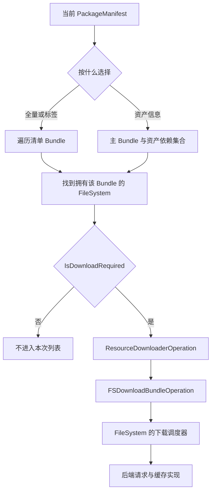
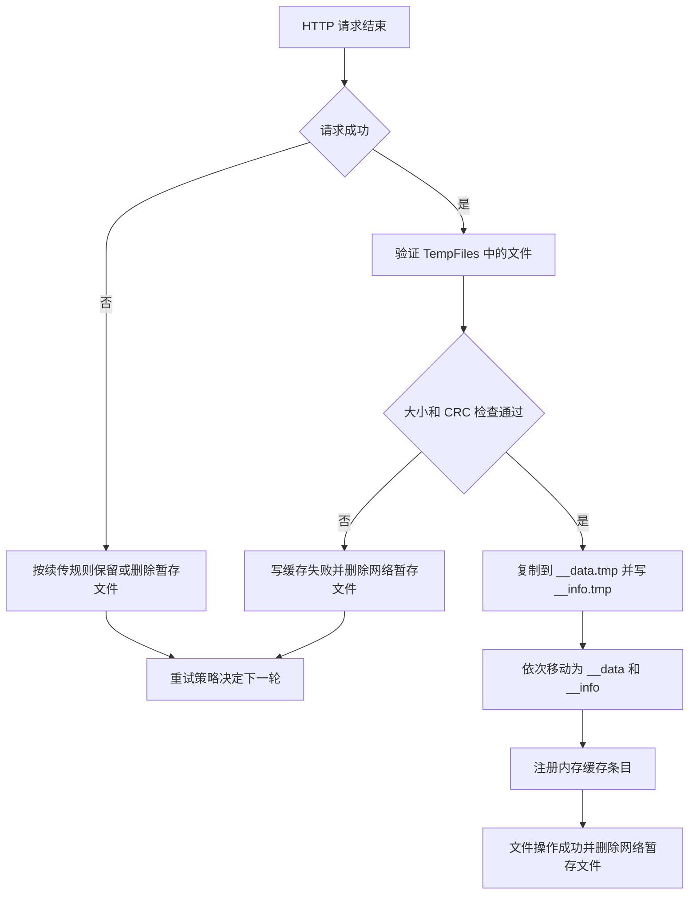

> 专题首页：[YooAsset 资源管理与交付]() · [两个系统的对比与选型]()

下载成功、文件留在磁盘、下次启动仍能识别、进入场景不再联网，是四个不同的判断。

把它们合成一个“缓存命中”，很容易写出看似完整、故障时却无法解释的更新流程：下载进度到了 100%，场景加载仍然失败；应用重启后没有重新下载，损坏的资源却一直留着；小游戏预下载返回成功，第二次进入仍然出现网络请求。

这些现象需要沿一条交付链拆开：**选择哪些文件 → 调度请求 → 接收字节 → 验证并提交 → 启动重建缓存索引 → 按当前版本清理**。每一段只对自己的状态负责。

> **版本与证据边界**：本文核对官方 YooAsset **3.0.6**，固定到提交 [`3b4cfb36cc2e81b9558ab74d65fee2cf2eac2804`](https://github.com/tuyoogame/YooAsset/tree/3b4cfb36cc2e81b9558ab74d65fee2cf2eac2804)。正文使用 3.x 原生 Options API。后半部分的磁盘布局与 Range 续传专指 **SandboxFileSystem + SandboxBundleCache + 默认 UnityWebRequest 后端**；不把它们推广到浏览器或小游戏平台缓存。文末是可复现实验设计，本文没有运行 Unity、CDN 或真机实验。

## 一、先把三个对象分开：下载集合、请求任务、缓存条目

一次“下载关卡资源”至少涉及三个对象。

| 对象 | 回答的问题 | 不足以证明什么 |
|---|---|---|
| 下载集合 | 根据清单、标签或资产依赖，本次还缺哪些 Bundle？ | 不保证所有平台都支持主动下载 |
| 请求任务 | 具体 URL 的请求是否结束、是否允许重试？ | HTTP 成功不等于本地缓存提交成功 |
| 缓存条目 | 当前缓存实现是否承认某个 BundleGuid 已可用？ | 不等于每次查询都重新读取完整文件 |

框架把下载做成可显式调度的操作，但这不意味着资源加载永远不会触发网络。在没有开启 `DisableOnDemandDownload` 时，Sandbox 的异步加载遇到缓存缺失会进入下载路径；开启该选项则会报告失败。预下载的价值是把指定集合的等待提前到可控阶段；“以后绝不联网”还要求后续实际加载的集合、版本、缓存状态都满足条件。[SFSLoadPackageBundleOperation](https://github.com/tuyoogame/YooAsset/blob/3b4cfb36cc2e81b9558ab74d65fee2cf2eac2804/Assets/YooAsset/Runtime/FileSystem/Services/SandboxFileSystem/Operations/SFSLoadPackageBundleOperation.cs#L39)



这里最重要的边界是 `IsDownloadRequired`：列表不只是清单筛选结果，还受拥有该 Bundle 的文件系统控制。因此 `TotalDownloadCount == 0` 只能证明这次操作没有待处理项，不能脱离文件系统配置解释成“所有资源已在本地”。[FileSystemHost 创建列表](https://github.com/tuyoogame/YooAsset/blob/3b4cfb36cc2e81b9558ab74d65fee2cf2eac2804/Assets/YooAsset/Runtime/ResourcePackage/FileSystemHost.cs#L283)

## 二、按标签下载和按资产依赖下载，解决不同的准备问题

标签适合表达内容分组，例如首章、语音包、活动资源。资产信息适合表达下一步要加载的入口，例如一个场景或一个预制体。

3.0.6 的两个入口都叫 `CreateResourceDownloader`，通过 Options 区分：

```csharp
// 前提：package 已完成初始化，并成功加载目标版本清单。
// 并发数、重试预算来自项目配置；这里不提供通用最优值。
var byTag = package.CreateResourceDownloader(
    new ResourceDownloaderOptions("chapter-1", concurrency, retryBudget));

AssetInfo entry = package.GetAssetInfo("BattleScene");
if (!entry.IsValid)
{
    UnityEngine.Debug.LogError(entry.Error);
    yield break;
}
var byEntry = package.CreateResourceDownloader(
    new BundleDownloaderOptions(entry, true, concurrency, retryBudget));

// 选择本次真正需要的一个操作；创建操作本身不会开始下载。
byEntry.DownloadProgressChanged += args =>
    UnityEngine.Debug.Log($"{args.CurrentDownloadCount}/{args.TotalDownloadCount}");
byEntry.StartDownload();
yield return byEntry;

if (byEntry.Status != EOperationStatus.Succeeded)
{
    UnityEngine.Debug.LogError(byEntry.Error);
    yield break;
}
```

这个示例是协程片段，不包含初始化或版本选择策略。事件参数与 `StartDownload` 的定义见 [DownloaderOperation](https://github.com/tuyoogame/YooAsset/blob/3b4cfb36cc2e81b9558ab74d65fee2cf2eac2804/Assets/YooAsset/Runtime/ResourcePackage/Operations/DownloaderOperation.cs#L64)。

需要特别注意两个源码细节：

1. **按标签时，未打标签的 Bundle 也会进入候选集合。** 它们被视作公共依赖；已打标签的 Bundle 使用 `HasAnyTag` 匹配。因此按一个标签下载的体积，不等于编辑器里该标签直接标记资源的大小之和。[标签筛选](https://github.com/tuyoogame/YooAsset/blob/3b4cfb36cc2e81b9558ab74d65fee2cf2eac2804/Assets/YooAsset/Runtime/ResourcePackage/FileSystemHost.cs#L409)
2. **`BundleDownloaderOptions` 中的布尔值不是“是否包含入口资产自身依赖”的总开关。** 入口资产所属 Bundle 和 `GetAllAssetDependencies` 返回的依赖始终被收集；设为 `true` 时，还收集主 Bundle 中其他主资产的依赖。集合用 BundleGuid 去重，再经过文件系统的下载需求过滤。[依赖筛选](https://github.com/tuyoogame/YooAsset/blob/3b4cfb36cc2e81b9558ab74d65fee2cf2eac2804/Assets/YooAsset/Runtime/ResourcePackage/FileSystemHost.cs#L441)

这也解释了为什么进入某个场景前，按场景入口计算准备集合通常更直接；标签则需要配合构建期标签传播与公共依赖组织来检查。二者都以 Bundle 为交付单元，不是逐个资产文件传输。

### 同一个 API，在不同文件系统下含义不同

原生 Host 配置中的 Sandbox 可以把远端文件下载到沙盒；内置文件系统的 `IsDownloadRequired` 返回 `false`，内置文件解包另有 `CreateResourceUnpacker`。Editor 文件系统可以产生模拟下载需求，不能拿模拟结果证明真实 HTTP、落盘和断点续传。WebServer 文件系统也不把主动下载当作自己的职责。[内置判定](https://github.com/tuyoogame/YooAsset/blob/3b4cfb36cc2e81b9558ab74d65fee2cf2eac2804/Assets/YooAsset/Runtime/FileSystem/Services/BuiltinFileSystem/BuiltinFileSystem.cs#L404)、[Editor 判定](https://github.com/tuyoogame/YooAsset/blob/3b4cfb36cc2e81b9558ab74d65fee2cf2eac2804/Assets/YooAsset/Runtime/FileSystem/Services/EditorFileSystem/EditorFileSystem.cs#L265)、[WebServer 判定](https://github.com/tuyoogame/YooAsset/blob/3b4cfb36cc2e81b9558ab74d65fee2cf2eac2804/Assets/YooAsset/Runtime/FileSystem/Services/WebServerFileSystem/WebServerFileSystem.cs#L261)

WebNetwork 是否支持主动下载，取决于有没有配置 `IWebPreloadStrategy`。没有策略时返回 `false`，有策略时才查询平台预下载缓存状态。具体模式如何装配这些文件系统，见[文件系统与运行模式]()。[WebNetwork 判定](https://github.com/tuyoogame/YooAsset/blob/3b4cfb36cc2e81b9558ab74d65fee2cf2eac2804/Assets/YooAsset/Runtime/FileSystem/Services/WebNetworkFileSystem/WebNetworkFileSystem.cs#L316)

## 三、并发有两层，暂停也不等于切断网络

上层 `DownloaderOperation` 管理本次资源集合，构造时把 `MaximumConcurrency` 限制在 1～32。运行时每帧最多创建一个 `FSDownloadBundleOperation`，将初始化开销分摊到多帧；发现终局失败项后停止补充新文件，等待在途操作结束，再结算失败。[上层调度](https://github.com/tuyoogame/YooAsset/blob/3b4cfb36cc2e81b9558ab74d65fee2cf2eac2804/Assets/YooAsset/Runtime/ResourcePackage/Operations/DownloaderOperation.cs#L145)

下层 `DownloadSchedulerOperation` 是文件系统持有的调度中心。它按 BundleGuid 复用下载任务并增加引用，同时受 `DownloadMaxConcurrency` 和每帧启动限额约束。Sandbox 默认这两个值都是 8，但默认值不是吞吐量最优值；多个上层下载器也不会因此各自获得独立的网络额度。[调度中心与任务复用](https://github.com/tuyoogame/YooAsset/blob/3b4cfb36cc2e81b9558ab74d65fee2cf2eac2804/Assets/YooAsset/Runtime/DownloadSystem/Operations/DownloadSchedulerOperation.cs#L101)、[Sandbox 参数默认值](https://github.com/tuyoogame/YooAsset/blob/3b4cfb36cc2e81b9558ab74d65fee2cf2eac2804/Assets/YooAsset/Runtime/FileSystem/Services/SandboxFileSystem/SandboxFileSystem.cs#L83)

因此实际请求节奏由本次操作上限、文件系统上限、每帧启动限额以及任务复用共同决定。只调高一个 `concurrency`，无法据此推断速度会提高。需要在目标平台记录总耗时、失败率、请求排队和主线程开销，再确定配置。

`PauseDownload` 只阻止上层继续派发，已经创建的下载仍会推进；`ResumeDownload` 恢复派发。`CancelDownload` 会终止该操作的子下载，但底层任务按引用共享，不能将它理解成“立刻断开所有相关请求且删除所有半成品”。[暂停、恢复、取消](https://github.com/tuyoogame/YooAsset/blob/3b4cfb36cc2e81b9558ab74d65fee2cf2eac2804/Assets/YooAsset/Runtime/ResourcePackage/Operations/DownloaderOperation.cs#L355)、[零引用任务终止](https://github.com/tuyoogame/YooAsset/blob/3b4cfb36cc2e81b9558ab74d65fee2cf2eac2804/Assets/YooAsset/Runtime/DownloadSystem/Operations/DownloadSchedulerOperation.cs#L121)

### 进度和错误回调应怎样解释

`TotalDownloadBytes` 来自选中 Bundle 的清单大小；`CurrentDownloadBytes` 汇总已完成项和在途项报告，续传时可能包含原有字节，不是本次实际消耗流量。重试会重置单项报告，因此 UI 不能默认进度永远单调递增。[统计与进度](https://github.com/tuyoogame/YooAsset/blob/3b4cfb36cc2e81b9558ab74d65fee2cf2eac2804/Assets/YooAsset/Runtime/ResourcePackage/Operations/DownloaderOperation.cs#L147)、[重试重置](https://github.com/tuyoogame/YooAsset/blob/3b4cfb36cc2e81b9558ab74d65fee2cf2eac2804/Assets/YooAsset/Runtime/FileSystem/Services/SandboxFileSystem/Operations/SFSDownloadBundleOperation.cs#L141)

`DownloadFileStarted` 表示上层派发了一个文件操作，尚不等于后端此刻已发请求。`DownloadError` 在整体失败结算时报告一个失败项，不是每次 HTTP 失败的实时通知；`DownloadCompleted` 在成功、失败和主动取消时都可能触发。业务应检查成功标记或最终 `Status`，不能把“完成事件”直接当作进入游戏的许可。[事件触发位置](https://github.com/tuyoogame/YooAsset/blob/3b4cfb36cc2e81b9558ab74d65fee2cf2eac2804/Assets/YooAsset/Runtime/ResourcePackage/Operations/DownloaderOperation.cs#L216)

## 四、Sandbox 的下载完成，要经过验证和提交

先给出真实的目录模型。以下以文件系统的 `packageRoot` 为起点，根路径可以由项目配置：

```text
{packageRoot}/
├── ManifestFiles/
├── TempFiles/
│   └── {BundleGuid}                 # 网络下载暂存文件，无 .temp 后缀
└── BundleFiles/
    └── {BundleGuid 的前两个字符}/
        └── {BundleGuid}/
            ├── __data              # 已提交的资源文件
            ├── __info              # 二进制信息文件
            ├── __data.tmp          # 缓存提交过程中的临时文件
            └── __info.tmp          # 缓存提交过程中的临时信息
```

`BundleGuid` 在此版本直接返回 `FileHash`，不是额外对 BundleName 和 Hash 再计算一个 GUID。网络暂存文件与缓存提交临时文件是两组不同的文件；不能用一个 `.temp` 概念代替它们。[BundleGuid](https://github.com/tuyoogame/YooAsset/blob/3b4cfb36cc2e81b9558ab74d65fee2cf2eac2804/Assets/YooAsset/Runtime/ResourcePackage/PackageBundle.cs#L48)、[目录与暂存路径](https://github.com/tuyoogame/YooAsset/blob/3b4cfb36cc2e81b9558ab74d65fee2cf2eac2804/Assets/YooAsset/Runtime/FileSystem/Services/SandboxFileSystem/SandboxFileSystem.cs#L317)、[缓存分片路径](https://github.com/tuyoogame/YooAsset/blob/3b4cfb36cc2e81b9558ab74d65fee2cf2eac2804/Assets/YooAsset/Runtime/BundleCache/Services/SandboxBundleCache/SandboxBundleCache.cs#L203)

`__info` 也不是记录 Hash 的文本。写入顺序是 magic、格式版本、CRC、文件大小、创建时间、最后访问时间，预期结构长度为 36 字节。Hash 参与条目标识，未作为字段写入这个信息文件。[信息文件写入](https://github.com/tuyoogame/YooAsset/blob/3b4cfb36cc2e81b9558ab74d65fee2cf2eac2804/Assets/YooAsset/Runtime/BundleCache/Services/SandboxBundleCache/Operations/SBCWriteCacheOperation.cs#L100)



新文件入库时，`SBCWriteCacheOperation` 将清单中的大小和 CRC 交给 `VerifyTempFileOperation`。实际工具函数检查文件存在、大小以及 CRC；大小或 CRC 为零分别表示跳过相应检查。**这条路径没有再读取整个文件计算 `FileHash`，不能称作 Size + CRC + Hash 三重内容校验。**[写入前验证](https://github.com/tuyoogame/YooAsset/blob/3b4cfb36cc2e81b9558ab74d65fee2cf2eac2804/Assets/YooAsset/Runtime/BundleCache/Services/SandboxBundleCache/Operations/SBCWriteCacheOperation.cs#L57)、[实际检查函数](https://github.com/tuyoogame/YooAsset/blob/3b4cfb36cc2e81b9558ab74d65fee2cf2eac2804/Assets/YooAsset/Runtime/BundleCache/Services/SandboxBundleCache/FileVerifyHelper.cs#L18)

提交过程先复制数据并写信息临时文件，再分别移动到正式文件，最后注册内存条目。源码的临时文件设计缩短了不完整正式文件暴露的窗口，但两次移动不是整个目录的单一事务；不能据此宣称断电时数据和信息一定同时提交。下次启动仍需要扫描和验证。[提交顺序](https://github.com/tuyoogame/YooAsset/blob/3b4cfb36cc2e81b9558ab74d65fee2cf2eac2804/Assets/YooAsset/Runtime/BundleCache/Services/SandboxBundleCache/Operations/SBCWriteCacheOperation.cs#L85)

## 五、续传是有条件的恢复尝试，不能只看 HTTP 状态码

Sandbox 的 `ResumeDownloadMinimumSize` 默认是 `long.MaxValue`，即通常不会启用续传。项目通过 `EFileSystemParameter.DownloadResumeMinimumSize` 设置阈值后，文件大小达到阈值才走续传分支。Sandbox 初始化明确不支持 WebGL，所以这不是一项能直接照搬到小游戏的磁盘能力。[默认阈值](https://github.com/tuyoogame/YooAsset/blob/3b4cfb36cc2e81b9558ab74d65fee2cf2eac2804/Assets/YooAsset/Runtime/FileSystem/Services/SandboxFileSystem/SandboxFileSystem.cs#L101)、[平台限制](https://github.com/tuyoogame/YooAsset/blob/3b4cfb36cc2e81b9558ab74d65fee2cf2eac2804/Assets/YooAsset/Runtime/FileSystem/Services/SandboxFileSystem/Operations/SFSInitializeOperation.cs#L38)

续传分支会检查暂存文件：长度小于目标文件才保留并设为偏移；长度大于或等于目标大小则删除。默认后端用追加方式打开目标文件，偏移大于零时设置 `Range: bytes={offset}-`，并配置终止时保留文件。[创建续传请求](https://github.com/tuyoogame/YooAsset/blob/3b4cfb36cc2e81b9558ab74d65fee2cf2eac2804/Assets/YooAsset/Runtime/FileSystem/Services/SandboxFileSystem/Operations/Internal/DownloadAndCacheFileOperation.cs#L159)、[默认后端](https://github.com/tuyoogame/YooAsset/blob/3b4cfb36cc2e81b9558ab74d65fee2cf2eac2804/Assets/YooAsset/Runtime/DownloadSystem/Services/UnityWebRequest/UnityWebRequestFile.cs#L38)

| 条件 | 源码中的处理 | 应保留的判断边界 |
|---|---|---|
| 支持 Range，返回正确的剩余字节 | 按追加结果进入缓存验证 | 206 本身不能替代文件验证 |
| 带 Range 请求却收到 200 | 没有单独的 200 回退重建请求分支 | 若后端追加了全量响应，大小校验可发现溢出；实际 Unity/CDN 行为需实验确认 |
| 续传请求失败且 HTTP 为 416 | 删除网络暂存文件，操作失败，交给上层重试判断 | 有重试预算且策略允许时，下一轮才有机会从零开始 |
| 续传网络失败且非 416 | 保留暂存文件 | 后续重试可能继续续传，并非所有失败都会清文件 |
| 请求成功但缓存验证失败 | 写缓存失败，随后删除网络暂存文件 | 后续重试不应继续追加已知不合格的完整结果 |
| 未启用续传 | 创建请求前删除暂存文件，失败时也删除 | 不能承诺重启自动接着已下载字节继续 |

这些分支见 [DownloadAndCacheFileOperation](https://github.com/tuyoogame/YooAsset/blob/3b4cfb36cc2e81b9558ab74d65fee2cf2eac2804/Assets/YooAsset/Runtime/FileSystem/Services/SandboxFileSystem/Operations/Internal/DownloadAndCacheFileOperation.cs#L89)。原文常见的“服务器不支持 Range 就自动全量恢复”把最终可能通过重试恢复，与收到 200 当场主动切换混成了一件事。

### 重试与地址容灾是策略，不是固定的三次重下

`RetryCount` 是首次尝试之后的重试预算。默认策略对大多数 4xx 不重试，但允许 408、416、429；网络无 HTTP 状态码的失败可重试；等待时间按上一轮增加一秒、最多十秒。项目可以替换策略，因此不能把“第三次失败就是持续故障”写成框架结论。[重试控制器](https://github.com/tuyoogame/YooAsset/blob/3b4cfb36cc2e81b9558ab74d65fee2cf2eac2804/Assets/YooAsset/Runtime/DownloadSystem/DownloadRetryController.cs#L49)、[默认策略](https://github.com/tuyoogame/YooAsset/blob/3b4cfb36cc2e81b9558ab74d65fee2cf2eac2804/Assets/YooAsset/Runtime/DownloadSystem/Policies/DefaultDownloadRetryPolicy.cs#L20)

远端服务提供候选 URL 列表，默认 URL 策略以失败计数轮转候选；成功时不增加计数。它不是只认识两个固定属性的下载器。还需注意：请求成功会先反馈 URL 策略，随后才进入缓存验证，所以内容校验失败不等价于一次触发地址轮转的 HTTP 失败。[候选地址选择](https://github.com/tuyoogame/YooAsset/blob/3b4cfb36cc2e81b9558ab74d65fee2cf2eac2804/Assets/YooAsset/Runtime/DownloadSystem/Policies/DefaultDownloadUrlPolicy.cs#L21)、[反馈顺序](https://github.com/tuyoogame/YooAsset/blob/3b4cfb36cc2e81b9558ab74d65fee2cf2eac2804/Assets/YooAsset/Runtime/FileSystem/Services/SandboxFileSystem/Operations/Internal/DownloadAndCacheFileOperation.cs#L89)

## 六、启动复验与下载验证，是两套入口

Sandbox 初始化扫描 `BundleFiles` 的分片目录，找到候选条目后按配置验证，通过才加入内存索引；失败会删除条目目录。运行时 `IsCached` 查询的是内存字典，不是每次重新计算 CRC。[扫描](https://github.com/tuyoogame/YooAsset/blob/3b4cfb36cc2e81b9558ab74d65fee2cf2eac2804/Assets/YooAsset/Runtime/BundleCache/Services/SandboxBundleCache/Operations/Internal/SearchCacheFilesOperation.cs#L87)、[验证后注册或删除](https://github.com/tuyoogame/YooAsset/blob/3b4cfb36cc2e81b9558ab74d65fee2cf2eac2804/Assets/YooAsset/Runtime/BundleCache/Services/SandboxBundleCache/Operations/Internal/VerifyCacheFilesOperation.cs#L73)

| 启动验证等级 | 实际检查 |
|---|---|
| `Low`，Sandbox 默认 | `__data` 与 `__info` 存在；信息文件长度、magic、格式版本可用 |
| `Middle` | 以上检查，再按信息文件记录检查数据大小 |
| `High` | 以上检查，再按信息文件记录检查 CRC |

这条启动路径依据 `__info` 读取期望大小与 CRC，不是逐条对活动清单重新比较 Hash/CRC/Size；它也不执行全文件 Hash 重算。[等级分支](https://github.com/tuyoogame/YooAsset/blob/3b4cfb36cc2e81b9558ab74d65fee2cf2eac2804/Assets/YooAsset/Runtime/BundleCache/Services/SandboxBundleCache/Operations/Internal/VerifyCacheFilesOperation.cs#L137)

因此同样长度的损坏文件，在默认 Low 下可能仍被注册，Middle 也未必发现；High 才会执行 CRC 检查。这是启动 I/O 成本与检测强度之间的选择，不能把默认启动描述成“完整校验所有缓存”。CRC 本身也不承担可信来源认证，发布链路与来源可信性需要另行设计。

## 七、清缓存依据当前清单，回滚保留策略要由项目定义

3.0.6 使用 `ClearCacheAsync(new ClearCacheOptions(...))`。`ClearUnusedBundleFiles` 在 Sandbox 中通过 `EvictionUnusedPolicy` 筛选：当前传入清单不包含该 BundleGuid，就成为删除目标。它判断的是清单引用关系，不是资源句柄是否仍被引用，也不是“最近很少加载”。[清理调用](https://github.com/tuyoogame/YooAsset/blob/3b4cfb36cc2e81b9558ab74d65fee2cf2eac2804/Assets/YooAsset/Runtime/ResourcePackage/Operations/ClearCacheOperation.cs#L66)、[Unused 策略](https://github.com/tuyoogame/YooAsset/blob/3b4cfb36cc2e81b9558ab74d65fee2cf2eac2804/Assets/YooAsset/Runtime/BundleCache/Policies/EvictionUnusedPolicy.cs#L11)

```csharp
// 项目已确认当前版本生效，并完成需要保留的回滚资源判断后执行。
var clear = package.ClearCacheAsync(
    new ClearCacheOptions(ClearCacheMethods.ClearUnusedBundleFiles));
yield return clear;
if (clear.Status != EOperationStatus.Succeeded)
    UnityEngine.Debug.LogError(clear.Error);
```

Bundle、Manifest 是不同清理对象；源码还有按地址、按标签和自定义淘汰策略入口。覆盖安装初始化也可以按 `InstallCleanupMode` 清理指定类别，所以“框架任何情况下都不主动清缓存”并不准确。[策略选择](https://github.com/tuyoogame/YooAsset/blob/3b4cfb36cc2e81b9558ab74d65fee2cf2eac2804/Assets/YooAsset/Runtime/BundleCache/Services/SandboxBundleCache/SandboxBundleCache.cs#L175)、[覆盖安装清理](https://github.com/tuyoogame/YooAsset/blob/3b4cfb36cc2e81b9558ab74d65fee2cf2eac2804/Assets/YooAsset/Runtime/FileSystem/Services/SandboxFileSystem/Operations/SFSInitializeOperation.cs#L60)

工程上应在确认版本切换和保留策略后安排清理，并避免与相关清单写入、文件使用相互争用。单纯“新版本下载完再清”仍不足以保证可离线回滚：当前清单不引用的旧文件，恰好可能是回滚需要的文件。若项目要保留上一个可用版本，应显式维护保留集合，而不是把 unused 当成整个发布系统的安全判据。磁盘清理与运行时资源卸载也不是同一件事，后者见[句柄与卸载]()。

## 八、小游戏预下载不能套用原生磁盘续传模型

3.0.6 的微信样例让 `WechatFileSystem` 继承 `WebNetworkFileSystem`，并注入 `WechatPreloadStrategy`。策略创建 GET 请求，设置 `wechatminigame-preload: 1`，将缓存工作交给平台适配层。它的 `IsBundleCached` 保守返回 `false`，注释说明避免主动调用 `WX.GetCachePath` 带来的同步开销。[样例装配](https://github.com/tuyoogame/YooAsset/blob/3b4cfb36cc2e81b9558ab74d65fee2cf2eac2804/Assets/YooAsset/Samples~/Mini%20Game/Runtime/WechatFileSystem/WechatFileSystem.cs#L34)、[预下载策略](https://github.com/tuyoogame/YooAsset/blob/3b4cfb36cc2e81b9558ab74d65fee2cf2eac2804/Assets/YooAsset/Samples~/Mini%20Game/Runtime/WechatFileSystem/WechatPreloadStrategy.cs#L19)

这会带来两个不能省略的解释：

- 再次创建下载器时，查询返回 `false` 不证明平台没有缓存；请求可能由平台自行命中已有缓存。
- `PreloadWebFileOperation` 以 HTTP 请求结果判定完成，没有再验证平台实际落盘；源码也注明 URL 与平台缓存规则不匹配时，HTTP 成功可能未写缓存。成功后的字节报告使用清单大小回填，不能拿它当真实流量统计。[预下载完成判断](https://github.com/tuyoogame/YooAsset/blob/3b4cfb36cc2e81b9558ab74d65fee2cf2eac2804/Assets/YooAsset/Runtime/FileSystem/Services/WebNetworkFileSystem/Operations/Internal/PreloadWebFileOperation.cs#L74)

这一链路没有走 Sandbox 的 `TempFiles/{guid}`、`DownloadHandlerFile` 追加和本地 CRC 提交流程。是否持久化、缓存配额、失败后的恢复、再次加载是否发网，都需要在实际平台插件、缓存规则与设备上确认。官方样例提供的是接入边界，不能据此断言微信、抖音和普通浏览器具有相同的断点续传行为。

## 九、动手验证：把每个保证变成可观察的条件

下面是实验方案，**不是本文已完成的测试结果**。使用独立测试包与可删除的专用缓存根；固定同一份清单和同一份资源，保留请求头、响应码、文件大小、操作错误和最终状态。

### 实验一：中断后到底续不续

条件：原生播放器使用 Sandbox、默认 UnityWebRequest 后端；选一个足够观察中途状态的大文件；测试服务端能控制 Range 响应。显式把 `DownloadResumeMinimumSize` 设到不高于该文件大小。

1. 首次下载到一半时断网或终止进程，记录 `TempFiles/{guid}` 是否存在及其长度。不要用 `PauseDownload` 代替中断，因为暂停仍允许在途文件完成。
2. 重启后用同一清单重新创建下载器，记录请求的 Range 偏移和服务端响应。正确的续传实验应观察到偏移对应原有文件长度，并在后续缓存验证通过后出现正式条目。
3. 分别让服务端返回正确 206、忽略 Range 返回完整 200、对非零 Range 返回 416。对照暂存文件去留、重试次数和终局状态，核实恢复路径。
4. 将阈值恢复默认值，再重复一次，验证未启用续传时创建请求会清理原暂存文件。该组用于证明配置生效，不用于评估最优速度。

预期来自前述源码分支；尤其 200 场景应记录 Unity 后端的真实写入行为，不能把“最后重试成功”当成“当次自动回退”的证据。

### 实验二：损坏在什么时候被发现

条件：先完整下载并关闭程序，备份测试缓存；待测 Bundle 的清单 CRC 为非零。每轮从同一备份恢复，避免上一轮删除缓存影响下一轮。

1. 只翻转 `__data` 中一个字节，保持长度和 `__info` 不变；分别以 Low、Middle、High 初始化。
2. 记录初始化验证日志、条目目录是否被删除、重新创建下载器的文件数。预期 Low 和 Middle 不因这次同长修改而通过 CRC 检出，High 会因 CRC 不匹配拒绝条目。
3. 另做截短 `__data` 的变体：Middle 和 High 应检测大小不符；Low 的结构检查不承担该检查。
4. 另做删除 `__info` 的变体：三个等级都应拒绝该条目。启动验证会删除不合格目录，检查前先保留副本。

这里应分别报告“初始化注册”“文件内容检查”和“后续资产加载”三层结果。加载失败不能自动说明下载器校验失败，初始化通过也不能自动说明资产可解码。

### 实验三：清理条件和小游戏缓存分别验证

原生侧准备 v1、v2 两份清单，使一个旧 BundleGuid 只存在于 v1。切换到 v2 后执行 `ClearUnusedBundleFiles`，检查旧目录是否删除，并再尝试离线回到 v1。这个实验验证的是保留策略的后果，不能只检查清理操作返回成功。

小游戏侧单独记录平台、转换插件版本、URL、预下载请求、平台缓存证据与后续加载网络记录。分别测试冷缓存、二次进入、进程重启。预期下载器成功只表示当前实现判定预下载请求成功；只有平台缓存和后续加载观察，才能支持“预下载确实降低了后续网络等待”的判断。

下载器解决任务调度，缓存实现决定文件何时可用，发布系统决定哪些版本值得保留；把这三层分别验证，故障恢复才有可靠的依据。
