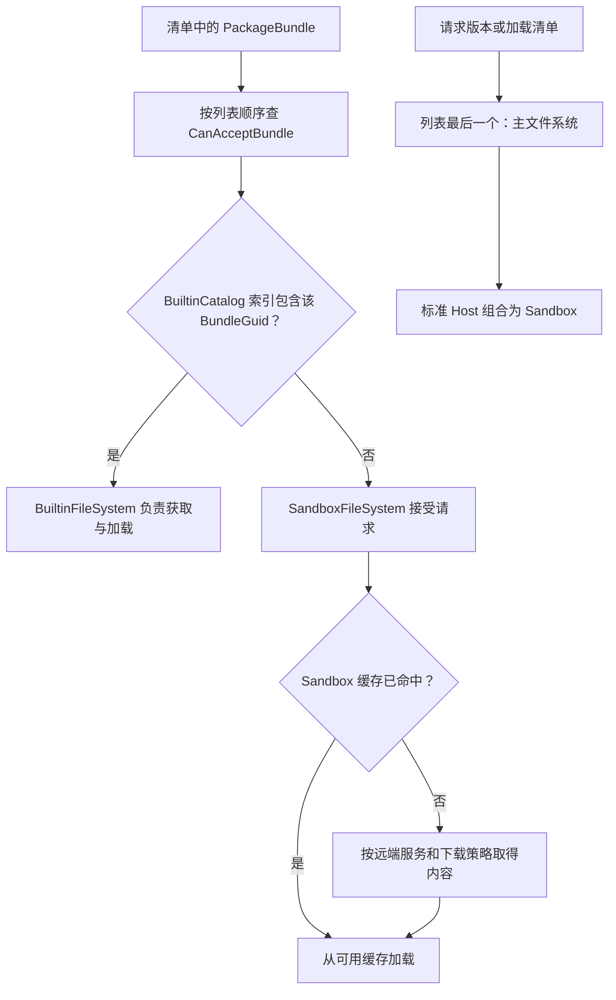
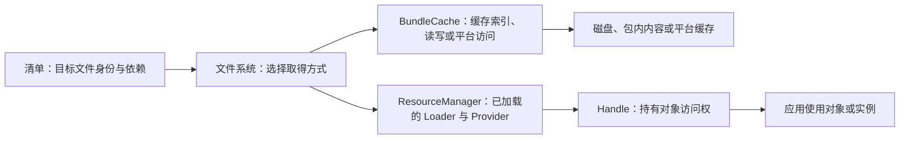

> 专题首页：[YooAsset 资源管理与交付]() · [整体架构与初始化]()

同一行资源加载代码，在编辑器里可能直接取得工程资源，在安装包里读取内置内容，在联机环境下等待下载，在小游戏里又交给平台接口。调用方仍然需要一个 Prefab，但文件来自哪里、缓存怎样命中、失败能否恢复，已经发生了变化。

理解这种差异，需要把“资源是什么”与“由哪里提供资源文件”分开。运行模式组织一组文件系统，清单确定目标文件的身份，文件系统决定怎样满足这个文件请求。

> 版本基线：YooAsset **3.0.6**，提交 `3b4cfb36cc2e81b9558ab74d65fee2cf2eac2804`。本文描述原生 3.x 文件系统；2.x 的 `Default*` 名称和工厂接口不能直接替换到下文中使用。

## 一、文件系统既要提供内容，也要回答路由问题

这里的文件系统不只是一个路径拼接器。`IFileSystem` 包含初始化、版本请求、清单加载、Bundle 加载、文件就绪、下载和清理操作，还需要回答：是否接受某个 Bundle、它是否需要下载或解包。

读取离线内容和从网络取得内容，正是通过这组契约接到上层操作。接口在这个版本是 `internal`；做深度定制时，需要同时核对程序集可见性和官方扩展方式，不能把它当成任意业务程序集都可直接实现的公开接口。见 [IFileSystem](https://github.com/tuyoogame/YooAsset/blob/3b4cfb36cc2e81b9558ab74d65fee2cf2eac2804/Assets/YooAsset/Runtime/FileSystem/Interfaces/IFileSystem.cs#L7)。

| 文件系统 | 主要提供什么 | 需要区分的条件 |
|---|---|---|
| `EditorFileSystem` | 编辑器模拟资源环境 | 模拟成功不证明构建后的文件、网络与平台行为正确 |
| `BuiltinFileSystem` | 安装包内的资源，及必要的解包流程 | 接受 Bundle 和需要解包是不同判断 |
| `SandboxFileSystem` | 可写缓存与远端内容获取 | 本地尚无文件时仍可接受请求，再决定是否下载 |
| `WebServerFileSystem` | Web 平台包内内容的获取 | Web 路径与缓存行为不同于原生磁盘访问 |
| `WebNetworkFileSystem` | Web 远端及平台策略支持的内容获取 | 主动预下载能力取决于是否配置预下载策略 |

最后两行尤其不能套用原生磁盘下载的假设。文件系统名称相似，不代表相同的文件 API、缓存额度或下载完成语义。

## 二、运行模式怎样组合文件系统

在 `InitializePackageOperation` 中，Options 类型决定运行模式，随后把对应参数交给 `FileSystemHost.InitializeAsync`。文件系统按列表顺序逐个建立和初始化；失败会结束初始化操作。见 [运行模式分支](https://github.com/tuyoogame/YooAsset/blob/3b4cfb36cc2e81b9558ab74d65fee2cf2eac2804/Assets/YooAsset/Runtime/ResourcePackage/Operations/InitializePackageOperation.cs#L95)和 [文件系统初始化操作](https://github.com/tuyoogame/YooAsset/blob/3b4cfb36cc2e81b9558ab74d65fee2cf2eac2804/Assets/YooAsset/Runtime/ResourcePackage/Operations/Internal/InitializeFileSystemOperation.cs#L65)。

| Options | 传入的文件系统顺序 | 通常用于 |
|---|---|---|
| `EditorSimulateModeOptions` | Editor | 编辑器迭代 |
| `OfflinePlayModeOptions` | Builtin | 只使用内置内容 |
| `HostPlayModeOptions` | Builtin、Sandbox | 原生联机内容交付 |
| `WebPlayModeOptions` | WebServer、WebNetwork | WebGL 及对应平台策略 |
| `CustomPlayModeOptions` | 调用方提供的参数列表 | 需要明确路由顺序的定制环境 |

表中顺序来自两项参数都提供的配置。内部双参数重载会忽略空参数，定制配置必须至少提供有效文件系统，不能只根据模式名称猜实际列表。

例如，联机参数可以这样建立。`remoteService` 由调用方提供，实现 3.x 的 `IRemoteService.GetRemoteUrls(fileName)`：

```csharp
static HostPlayModeOptions CreateHostOptions(IRemoteService remoteService)
{
    return new HostPlayModeOptions
    {
        BuiltinFileSystemParameters =
            FileSystemParameters.CreateDefaultBuiltinFileSystemParameters(),
        CacheFileSystemParameters =
            FileSystemParameters.CreateDefaultSandboxFileSystemParameters(
                remoteService)
    };
}
```

`CacheFileSystemParameters` 是这个版本 Options 的实际属性名，工厂返回的实际文件系统则是 `SandboxFileSystem`。名称不同，需要沿工厂方法确认最终类型。见 [FileSystemParameters 工厂](https://github.com/tuyoogame/YooAsset/blob/3b4cfb36cc2e81b9558ab74d65fee2cf2eac2804/Assets/YooAsset/Runtime/FileSystem/FileSystemParameters.cs#L143)。

## 三、Bundle 归属与主文件系统使用了两种顺序规则

`FileSystemHost` 的 Bundle 路由从列表开头遍历，找到第一个 `CanAcceptBundle` 返回 `true` 的文件系统，就把它与 Bundle 描述组成 `BundleInfo`。主文件系统却取列表最后一个元素，用来执行版本和清单等主流程。见 [FileSystemHost](https://github.com/tuyoogame/YooAsset/blob/3b4cfb36cc2e81b9558ab74d65fee2cf2eac2804/Assets/YooAsset/Runtime/ResourcePackage/FileSystemHost.cs#L113)。



Builtin 的接收条件检查自己的 Bundle 缓存是否知道这个 `BundleGuid`，内置索引在初始化时由 `BuiltinCatalog` 建立。因此，只往目录中拷贝文件或删除文件，不足以改变索引中的归属。Sandbox 则作为兜底直接接受请求。兜底接收不意味着文件已经存在，下载需求还要单独查询。见 [Builtin 接收条件](https://github.com/tuyoogame/YooAsset/blob/3b4cfb36cc2e81b9558ab74d65fee2cf2eac2804/Assets/YooAsset/Runtime/FileSystem/Services/BuiltinFileSystem/BuiltinFileSystem.cs#L399)和 [Sandbox 接收与下载条件](https://github.com/tuyoogame/YooAsset/blob/3b4cfb36cc2e81b9558ab74d65fee2cf2eac2804/Assets/YooAsset/Runtime/FileSystem/Services/SandboxFileSystem/SandboxFileSystem.cs#L377)。

因此，文件路由并不是每次加载时都“从磁盘找一遍，失败后再找网络”。Host 先依据 Bundle 身份和接收规则选所属文件系统，然后由该系统内部执行取得内容的流程。选中后失败是否恢复，要继续看具体操作，不能把列表当成自动容灾链。

## 四、BundleCache 与 ResourceManager 管理不同状态

3.0.6 把 `BundleCache` 作为独立层使用。Builtin 内部有内置和解包缓存；Sandbox 有可写 Bundle 缓存；Web 文件系统也有各自的缓存实现。它们的操作再向上提供 Bundle 访问结果。



文件在缓存中，可以减少后续内容获取工作；它不等于对应对象仍被 ResourceManager 持有。反过来，释放对象句柄也不会自动表示磁盘缓存被清除。磁盘占用与运行时对象内存应分别观察和管理。

清理内容缓存，进入[下载器与缓存系统]()；回收已经加载的资源，进入[资源生命周期]()。

## 五、Web 与小游戏需要另查预下载条件

`WebNetworkFileSystem` 无条件接受兜底请求，但 `IsDownloadRequired` 在没有配置 `PreloadStrategy` 时直接返回 `false`。这表达的是当前文件系统不支持主动预下载，不足以证明远端内容已经缓存。

配置预下载策略后，它才会将候选 URL 和 Bundle 描述交给策略查询缓存，并据此决定是否预下载。见 [WebNetworkFileSystem 判断路径](https://github.com/tuyoogame/YooAsset/blob/3b4cfb36cc2e81b9558ab74d65fee2cf2eac2804/Assets/YooAsset/Runtime/FileSystem/Services/WebNetworkFileSystem/WebNetworkFileSystem.cs#L310)。

因此，在 Web 环境看到下载器数量为零，应同时检查运行模式、预下载策略及其查询结果。应用仍可能在实际加载时走网络或平台请求。需要把“下载器认为无需预下载”和“当前场景所有内容已经本地就绪”分开记录。

## 六、动手验证文件归属

以下实验用于一个隔离测试工程，记录的是预期观察，不是已经获得的设备结果。

1. 在同一目标版本中准备资源 A、B，并由构建报告确认二者分属不同 Bundle。通过 3.0.6 的内置文件拷贝流程生成只包含 A Bundle 的内置子集，并同步生成匹配的 `BuiltinCatalog`：A 的 BundleGuid 在索引中，B 的不在。目标清单仍引用两者；不要仅手动增删 Bundle 文件。
2. 使用标准 Host 组合，并给 Sandbox 指定一个全新的可写测试目录。不要清理实际用户缓存。
3. 在 `FileSystemHost.GetOwnerFileSystem` 设置断点，分别加载 A、B。预期 A 被 Builtin 接收，B 落到 Sandbox。记录两份资源的 `BundleGuid`，确认比较的是同一个构建版本。
4. B 首次加载成功后重启测试，再观察它的文件路由与缓存判断。它仍由 Sandbox 接收，内部缓存状态则与首次运行不同。
5. 改变 A 的内容并生成新目标版本，但保留旧内置文件。新 Bundle 身份不一定被旧内置目录接收；应以新清单中的身份核对，不能只看资源名字相同。

实验报告至少附构建版本、内置文件列表、运行模式、缓存目录和实际所属文件系统。判断是否访问网络时，另附请求记录；仅靠加载耗时变短不足以证明缓存命中。

## 七、定制文件系统先明确哪些契约

定制前应写清它接受什么 Bundle、版本和清单由谁提供、缓存由谁负责、内容获取失败怎样退出，以及平台加载结果如何卸载。还要确认它放进列表之后，是否遮蔽了后续文件系统，是否改变了主文件系统。

运行模式解决的是组合问题，文件系统解决的是内容取得问题。保持这条边界，平台差异才不会渗透成每一个业务加载调用里的条件分支。
