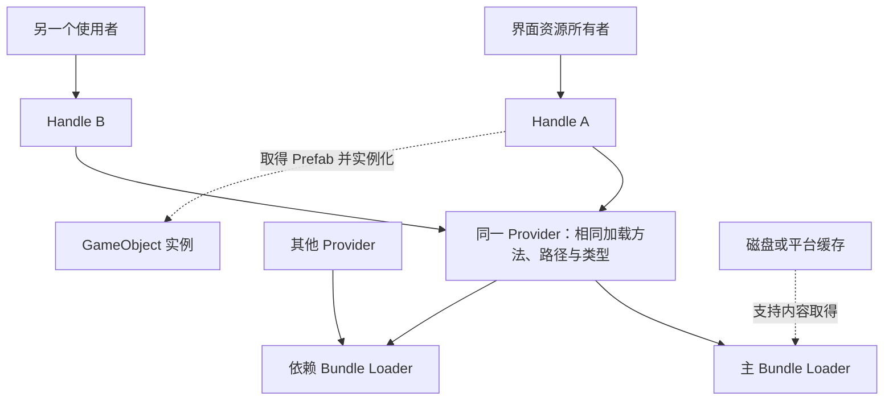
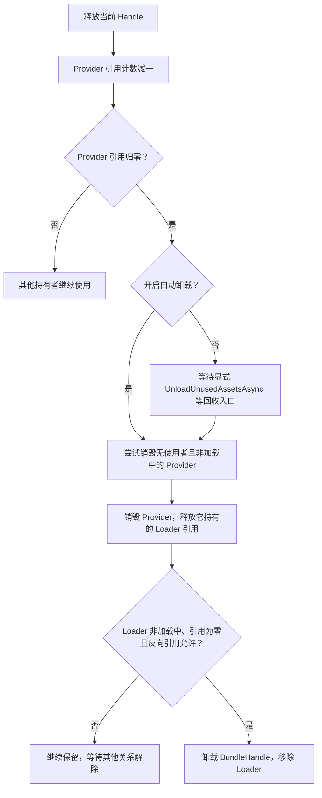

> 专题首页：[YooAsset 资源管理与交付]() · [运行时加载链路]()

一个界面关闭了，资源句柄也释放了，内存却没有立刻下降。这时继续补一次 Release，或者直接强制卸载整个包，都可能把问题扩大。

判断资源是否可以回收，需要先找出持有关系：应用还在使用什么，哪些 Handle 仍有效，Provider 是否完成，相关 Bundle 是否还被其他资源或 Bundle 引用。进程内存曲线只能描述最终现象，无法单独回答这些问题。

> 版本基线：YooAsset **3.0.6**，提交 `3b4cfb36cc2e81b9558ab74d65fee2cf2eac2804`。本文使用默认依赖回收分支，未启用 `YOOASSET_EXPERIMENTAL`。示例验证步骤尚未附 Unity 实测结果。

## 一、五种生命周期应分别记录

| 对象或内容 | 谁管理 | 结束的含义 |
|---|---|---|
| GameObject 实例 | 应用及 Unity 对象系统 | 应用不再使用这个实例 |
| Handle | 发起加载的资源所有者 | 释放一次资源访问的持有关系 |
| Provider | ResourceManager | 对应加载结果不再被有效 Handle 持有，且符合销毁条件 |
| Bundle Loader | ResourceManager 与依赖关系 | 相关 Provider 和 Bundle 引用允许卸载 |
| 缓存文件 | 文件系统及 BundleCache | 内容缓存清理策略决定是否删除 |

这些关系可以从一份 Prefab 请求开始观察：



实例使用的纹理等对象可能来自依赖 Bundle。应用应让其资源持有期覆盖实例的实际使用期，不能因为 `Instantiate` 已经返回就认定原加载句柄再也没有作用。

## 二、重复加载可以复用 Provider，但各自拥有 Handle

在 3.0.6 中，`LoadAssetAsync` 使用加载方法名和 `AssetInfo.AssetKey` 组成 Provider 键，先查已有 Provider，仅在找不到时创建。`AssetKey` 包含资源路径与资源类型。随后每次调用仍创建自己的 Handle。

`ProviderBase.CreateHandle` 会增加 Provider 的引用计数并记录 Handle。释放时对应地移除记录和递减引用。应由每个所有者释放自己持有的那一个 Handle，而不是只释放某个全局缓存中的最后一个变量。见 [Provider 复用](https://github.com/tuyoogame/YooAsset/blob/3b4cfb36cc2e81b9558ab74d65fee2cf2eac2804/Assets/YooAsset/Runtime/ResourceManager/ResourceManager.cs#L219)与 [Handle 计数](https://github.com/tuyoogame/YooAsset/blob/3b4cfb36cc2e81b9558ab74d65fee2cf2eac2804/Assets/YooAsset/Runtime/ResourceManager/Providers/ProviderBase.cs#L275)。

同资源使用不同类型或不同加载方法时，不应套用这次 Provider 复用的结论；场景也有单独的实例编号与句柄管理路径。

## 三、Release 做了什么，接下来还需要什么

`HandleBase.Release()` 首先检查句柄有效性，然后通知 Provider 释放该 Handle。Provider 引用归零时，Release 会调用 `TryUnloadBundle`；最后断开这个 Handle 到 Provider 的关联。

`TryUnloadBundle` 只有在 `AutoUnloadBundleWhenUnused` 开启时，才主动尝试回收相关 Bundle。该选项默认是 **false**。因此，释放句柄之后是否立即尝试卸载，首先是一个配置条件。见 [Release](https://github.com/tuyoogame/YooAsset/blob/3b4cfb36cc2e81b9558ab74d65fee2cf2eac2804/Assets/YooAsset/Runtime/ResourceManager/Handles/HandleBase.cs#L27)、[自动卸载分支](https://github.com/tuyoogame/YooAsset/blob/3b4cfb36cc2e81b9558ab74d65fee2cf2eac2804/Assets/YooAsset/Runtime/ResourceManager/Providers/ProviderBase.cs#L316)和 [默认初始化选项](https://github.com/tuyoogame/YooAsset/blob/3b4cfb36cc2e81b9558ab74d65fee2cf2eac2804/Assets/YooAsset/Runtime/ResourcePackage/Operations/InitializePackageOptions.cs#L17)。



自动卸载表示“尝试满足回收条件”，不是无条件卸载。加载中的 Provider 不允许普通销毁；Bundle Loader 也要检查引用计数和反向引用 Bundle 是否已销毁。默认分支中互相引用的 Bundle 还可能阻止普通回收。见 [Loader 回收条件](https://github.com/tuyoogame/YooAsset/blob/3b4cfb36cc2e81b9558ab74d65fee2cf2eac2804/Assets/YooAsset/Runtime/ResourceManager/Operations/Internal/LoadBundleOperation.cs#L246)。

显式 `UnloadUnusedAssetsAsync` 会调用多轮零引用回收，以处理依赖链解除的先后关系，并根据时间片让出执行。它不是扫描并删除磁盘缓存的操作。

## 四、实例与 Handle 的所有权要一起设计

`AssetHandle.InstantiateSync` 从已经加载的对象创建 GameObject；这个核心入口没有为每个实例自动挂载一个负责 Release 的业务所有者。`InstantiateAsync` 操作也持有传入的 Handle，而不是为调用方自动设计实例池的持有规则。见 [AssetHandle](https://github.com/tuyoogame/YooAsset/blob/3b4cfb36cc2e81b9558ab74d65fee2cf2eac2804/Assets/YooAsset/Runtime/ResourceManager/Handles/AssetHandle.cs#L72)与 [InstantiateOperation](https://github.com/tuyoogame/YooAsset/blob/3b4cfb36cc2e81b9558ab74d65fee2cf2eac2804/Assets/YooAsset/Runtime/ResourceManager/Operations/InstantiateOperation.cs#L32)。

界面可以持有一个 Handle，直到这个界面的实例销毁后再释放。对象池则可以由池持有资源 Handle，直到池中活动和休眠实例都已清空，再归还资源。多个实例共享一个 Handle 是一种应用层策略，需要一个明确的总所有者。

下面展示创建到销毁的基本顺序。实际界面通常将 `handle` 与 `instance` 存在自己的生命周期对象中，而不是立即销毁：

```csharp
IEnumerator CreateThenClose(ResourcePackage package, string location)
{
    var handle = package.LoadAssetAsync<GameObject>(location);
    yield return handle;
    if (handle.Status != EOperationStatus.Succeeded)
    {
        Debug.LogError(handle.Error);
        handle.Release();
        yield break;
    }

    GameObject instance = handle.InstantiateSync();
    // 界面使用期间，由同一个所有者保留 handle。
    // 这里仅演示关闭阶段：先结束实例使用，再归还资源持有关系。
    Object.Destroy(instance);
    yield return null;
    handle.Release();
    yield return package.UnloadUnusedAssetsAsync();
}
```

示例使用 `System.Collections`、`UnityEngine` 和 `YooAsset` 命名空间，并假定 Package 的清单已激活。`Destroy` 后让出一帧只是展示普通 GameObject 的销毁顺序；应用还需结束异步回调、其他组件和对象池对资源的使用。

## 五、全量卸载是一次需要协调的切换

`UnloadAllAssetsAsync` 与零引用回收不同。它会协调场景句柄、Provider 和 Bundle Loader 的强制销毁请求，还可以选择释放所有资源句柄、锁定新的加载请求，以及等待引擎底层的未使用资源卸载。

```csharp
var options = new UnloadAllAssetsOptions(
    shouldReleaseHandles: true,
    shouldLockLoading: true,
    shouldWaitUnloadUnused: true);
var unload = package.UnloadAllAssetsAsync(options);
yield return unload;
if (unload.Status != EOperationStatus.Succeeded)
    Debug.LogError(unload.Error);
```

这里的加载锁覆盖卸载操作的过程。操作结束后，应用仍要自行控制下一次加载和新清单的激活顺序。`shouldReleaseHandles` 也不会替应用销毁所有使用这些资源的 GameObject。

3.0.6 的 `shouldWaitUnloadUnused` 决定是否等待 `Resources.UnloadUnusedAssets()` 完成。操作在不等待时也会发起这项引擎操作，只是提前报告自己的完成；因此完成时间的含义随选项改变。见 [UnloadAllAssetsOperation](https://github.com/tuyoogame/YooAsset/blob/3b4cfb36cc2e81b9558ab74d65fee2cf2eac2804/Assets/YooAsset/Runtime/ResourceManager/Operations/UnloadAllAssetsOperation.cs#L86)。

切版本前，应先停止旧业务请求、结束实例使用，再处理句柄和卸载。已经被全量卸载失效的 Handle 不能继续访问，应用中的资源所有者需要同时清空它的持有记录。

## 六、动手验证共享与回收

准备两个 Prefab A、B，共享同一材质和纹理；构建报告必须确认这些对象的实际 Bundle 布局。用 Host 或 Offline 的真实构建产物进行实验，避免以编辑器模拟的结果代替 Bundle 回收验证。

| 操作 | 预期观察 | 需要额外确认 |
|---|---|---|
| 用相同类型连续加载 A 两次 | 两个有效 Handle 持有同一 Provider 的结果 | 用调试器核对 Provider 与引用，不能只比较对象名字 |
| 释放第一个 Handle | 第二个 Handle 仍有效 | 不对第一个已释放 Handle 查询状态或对象 |
| 释放第二个，自动卸载关闭 | 资源具备被回收的条件，但未因此保证立刻卸载 | 记录 Provider、Loader 和实际依赖 |
| 显式执行零引用回收 | 符合条件的 Provider 和 Loader 被移除 | 共享依赖、反向引用及循环关系可能阻止卸载 |
| 保留 B 的持有关系，再释放 A | 共享内容可能继续保留 | 以实际构建布局与引用关系为准 |
| 销毁全部实例并结束所有持有关系后回收 | 相应加载记录可以减少 | 进程内存、Unity 对象和磁盘缓存分别记录 |

再以开启自动卸载的新会话重复实验，比较卸载尝试的触发时机。实验记录应包含配置、操作顺序、调试器引用信息和 Profiler 数据；不能用“系统内存没有马上下降”单独推断 Handle 泄漏。

## 七、把资源回收放进明确的所有权边界

推荐按界面、场景或对象池建立资源所有者。每个所有者能够回答：它持有哪些 Handle，哪些实例仍在使用资源，停止请求后如何处理迟到的完成回调，以及何时把资源还给包裹。

框架的引用计数检查的是框架已知的关系。应用只有把实际使用期转换成正确的 Handle 持有期，引用计数才具有工程意义。
