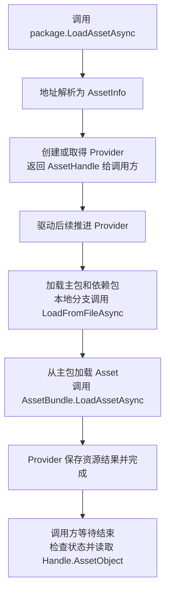

> 专题首页：[YooAsset 资源管理与交付]()

从这行代码开始：

```csharp
var handle = package.LoadAssetAsync<GameObject>("hero_prefab");
```

`package` 是一个已经初始化并激活 Manifest 的 `ResourcePackage`。示例地址 `hero_prefab` 已经配置到清单中，对应 `Assets/Probe/Hero.prefab`，构建时未开启用 Address 替换资产路径的选项。我们跟踪第一次加载它的成功路径，看看这次请求怎样取得 Prefab 资源对象。

本文采用 **YooAsset 3.0.6**，源码固定到 `3b4cfb36cc2e81b9558ab74d65fee2cf2eac2804`。具体文件加载选用 Windows、本地文件、未加密 AssetBundle 的离线分支。联网下载、解密和编辑器模拟会经过不同的文件获取或加载实现；它们可以在看清这条路径后再读。

## 一、先认识底下的两个 Unity 接口

假设资源包及其依赖已经准备好，用 Unity 原生 API 加载 Prefab，成功路径可以写成下面的协程片段。`bundlePath` 是磁盘上的包文件路径，`assetPath` 是包中资产的加载名称，示例采用完整工程路径 `Assets/Probe/Hero.prefab`。

```csharp
// 协程片段：省略失败处理与资源释放，只展示两次加载。
AssetBundleCreateRequest bundleRequest = AssetBundle.LoadFromFileAsync(bundlePath);
yield return bundleRequest;
AssetBundle bundle = bundleRequest.assetBundle;

AssetBundleRequest assetRequest = bundle.LoadAssetAsync<GameObject>(assetPath);
yield return assetRequest;
GameObject prefab = assetRequest.asset as GameObject;
```

两次请求的结果不同：

| 调用 | 立即返回 | 成功完成后取得 |
|---|---|---|
| `AssetBundle.LoadFromFileAsync(bundlePath)` | `AssetBundleCreateRequest` | `bundleRequest.assetBundle`，即访问包内容的 `AssetBundle` 对象 |
| `bundle.LoadAssetAsync<GameObject>(assetPath)` | `AssetBundleRequest` | `assetRequest.asset`，这里是 Prefab 资源对象 |

这两个阶段分别是**加载资源包**和**加载包中的资源**。拿到 Prefab 后还可以调用 `Instantiate` 创建场景实例，那是后续的使用动作。Unity 官方文档给出了这两个接口及其连续调用示例：[LoadFromFileAsync](https://docs.unity3d.com/2022.3/Documentation/ScriptReference/AssetBundle.LoadFromFileAsync.html)、[LoadAssetAsync](https://docs.unity3d.com/2022.3/Documentation/ScriptReference/AssetBundle.LoadAssetAsync.html)。

回到 YooAsset：调用方只提供一个资源地址，它需要先确定资源属于哪个包、准备包及其依赖，再完成上面第二次加载，最后把结果提供给 Handle。

## 二、入口先解析地址，然后返回 Handle

打开 `ResourcePackage.LoadAssetAsync<TObject>`，入口只有三步：

```csharp
public AssetHandle LoadAssetAsync<TObject>(string location, uint priority = 0)
    where TObject : UnityEngine.Object
{
    CheckInitialized();
    AssetInfo assetInfo = ConvertLocationToAssetInfo(location, typeof(TObject));
    return LoadAssetInternal(assetInfo, false, priority);
}
```

第一行检查 Package 初始化成功、当前有激活的 Manifest。第二行让 Manifest 查询 `AssetsByLocation`，把 `hero_prefab` 解析为资产记录，并带上请求类型 `GameObject`，生成 `AssetInfo`。因此，`hero_prefab` 是查找资源的地址，此时并不是要交给 `LoadFromFileAsync` 的磁盘路径。

第三行进入 `LoadAssetInternal`。它标记本次请求的加载方法，再交给 `ResourceManager.LoadAssetAsync`。传入的 `false` 表示这里不执行强制同步等待。

这一段先解决“请求哪一个资源”。还没有走到 Unity 的两次加载。[入口与内部转发](https://github.com/tuyoogame/YooAsset/blob/3b4cfb36cc2e81b9558ab74d65fee2cf2eac2804/Assets/YooAsset/Runtime/ResourcePackage/ResourcePackage.cs#L584)、[清单查询](https://github.com/tuyoogame/YooAsset/blob/3b4cfb36cc2e81b9558ab74d65fee2cf2eac2804/Assets/YooAsset/Runtime/ResourcePackage/PackageManifest.cs#L301)、[初始化检查](https://github.com/tuyoogame/YooAsset/blob/3b4cfb36cc2e81b9558ab74d65fee2cf2eac2804/Assets/YooAsset/Runtime/ResourcePackage/ResourcePackage.cs#L1002)

## 三、ResourceManager 为这次加载建立工作对象

接着读 `ResourceManager.LoadAssetAsync`。下面摘出正常请求的部分，省略了加载锁和无效地址的错误分支：

```csharp
string providerKey = nameof(LoadAssetAsync) + assetInfo.AssetKey;
ProviderBase provider = GetAssetProvider(providerKey);
if (provider == null)
{
    provider = new AssetProvider(this, providerKey, assetInfo);
    provider.InitProviderDebugInfo();
    _providerDict.Add(providerKey, provider);
    AsyncOperationSystem.StartOperation(PackageName, provider);
}

provider.Priority = priority;
return provider.CreateHandle<AssetHandle>();
```

第一次请求时，没有现成的 Provider，于是创建 `AssetProvider`。先把它理解为**负责把这个资源加载出来的工作对象**：它保存资源信息，等待资源包准备好，再提取资源对象。

创建它时，基类 `ProviderBase` 的构造函数会根据清单取得主包和依赖包的 Loader，并登记持有关系。Loader 是负责某个 Bundle 加载工作的操作对象。这里只需要记住：**Provider 需要的包列表已经准备好了，后续更新会推进这些 Loader；它们不要求按包逐个完成。**

`StartOperation` 把 Provider 加入 Package 调度器的待执行列表，并立即调用它的启动方法。`ProviderBase.InternalStart` 在这里把步骤设为 `StartBundleLoader`。

最后，`CreateHandle<AssetHandle>` 创建关联这个 Provider 的 Handle。外部的 `handle` 此时就能拿到了；资源加载工作后面继续推进。如果已有可复用且完成的 Provider，请求也可能直接取得已经完成的结果。本文继续沿第一次加载的分支往下看。[请求创建](https://github.com/tuyoogame/YooAsset/blob/3b4cfb36cc2e81b9558ab74d65fee2cf2eac2804/Assets/YooAsset/Runtime/ResourceManager/ResourceManager.cs#L200)、[Provider 构造与启动](https://github.com/tuyoogame/YooAsset/blob/3b4cfb36cc2e81b9558ab74d65fee2cf2eac2804/Assets/YooAsset/Runtime/ResourceManager/Providers/ProviderBase.cs#L101)、[加入调度器](https://github.com/tuyoogame/YooAsset/blob/3b4cfb36cc2e81b9558ab74d65fee2cf2eac2804/Assets/YooAsset/Runtime/AsyncOperation/AsyncOperationScheduler.cs#L65)

到这里，地址已解析、加载工作对象已登记、Handle 已返回；本次首次加载还没有调用 Unity 的两个加载接口。

## 四、函数已经返回，接下来由谁执行

后续的入口在 `YooAssetsDriver.Update`。它调用 `YooAssets.Update`，后者更新 `AsyncOperationSystem`；异步系统更新调度器，调度器再调用操作的 `UpdateOperation`。

对这个请求来说，调度器推进的是刚才创建的 Provider：

```text
YooAssetsDriver.Update
  → YooAssets.Update
    → AsyncOperationSystem.Update
      → Package 调度器.Update
        → Provider.UpdateOperation
          → ProviderBase.InternalUpdate
```

`UpdateOperation` 会调用具体操作的 `InternalUpdate`。有一步还没完成时，`InternalUpdate` 可以直接 `return`，保留当前步骤，后续更新再接着检查。这个 `return` 结束的是本次更新，不会把整个资源请求当作已经完成。

因此，读这段源码要区分两种顺序：调用 `LoadAssetAsync` 时执行的入口代码，以及之后由驱动反复执行的更新代码。代码里几个连续的 `if` 也可能在同一次更新中向下推进，不能把一个状态固定理解为一帧。[驱动入口](https://github.com/tuyoogame/YooAsset/blob/3b4cfb36cc2e81b9558ab74d65fee2cf2eac2804/Assets/YooAsset/Runtime/YooAssetsDriver.cs#L23)、[调度器更新](https://github.com/tuyoogame/YooAsset/blob/3b4cfb36cc2e81b9558ab74d65fee2cf2eac2804/Assets/YooAsset/Runtime/AsyncOperation/AsyncOperationScheduler.cs#L78)、[操作更新入口](https://github.com/tuyoogame/YooAsset/blob/3b4cfb36cc2e81b9558ab74d65fee2cf2eac2804/Assets/YooAsset/Runtime/AsyncOperation/AsyncOperationBase.cs#L246)

## 五、Provider 先等主包和依赖包准备好

现在回到 `ProviderBase.InternalUpdate`。它按三个主要步骤推进：

| 步骤 | 做什么 | 什么时候继续 |
|---|---|---|
| `StartBundleLoader` | 启动构造时取得的主包和依赖包 Loader | 启动后进入等待步骤 |
| `WaitBundleLoader` | 更新这些 Loader，检查完成状态和结果 | 全部成功后取得主包的 `BundleHandle` |
| `ProcessBundleHandle` | 调用 `InternalProcessBundleHandle` | 交给 `AssetProvider` 从主包提取目标资源 |

主包和依赖包都会被启动。Provider 等待它们全部成功后，才开始提取 Prefab；这里没有要求先把依赖包全部加载完成，再启动主包。底层并发限制仍可能让实际工作排队。

只要有 Loader 尚未完成，Provider 就保留等待步骤，下一次更新继续检查；如果某个 Loader 失败，Provider 会记录失败并结束这次请求。[Provider 的更新步骤](https://github.com/tuyoogame/YooAsset/blob/3b4cfb36cc2e81b9558ab74d65fee2cf2eac2804/Assets/YooAsset/Runtime/ResourceManager/Providers/ProviderBase.cs#L130)

## 六、Loader 最后怎样调用 Unity 加载 Bundle

进入 `LoadBundleOperation.InternalUpdate`。它先检查 Bundle 加载并发额度，再通过 `BundleInfo.CreateBundleLoader` 创建文件系统的加载操作。

为什么还要经过文件系统？因为清单记录的是需要哪个 Bundle，具体从内置目录、缓存还是网络取得它，要由对应的文件系统处理。本文选定的离线路径进入 `BuiltinFileSystem`。

在 Windows、无需解包、未加密的本地 AssetBundle 分支中，可以沿下面这条路径继续找：

```text
LoadBundleOperation
  → BFSLoadPackageBundleOperation       内置文件系统的包加载操作
    → BBCLoadAssetBundleOperation       从内置缓存条目取得本地路径
      → LoadLocalAssetBundleOperation   调用 Unity 加载包文件
        → AssetBundle.LoadFromFileAsync
```

第一次看时，可以先找到最后一层的 `LoadFromFile` 方法：异步分支执行的正是本文开头的第一个 Unity 接口。

```csharp
_createRequest = AssetBundle.LoadFromFileAsync(_options.FilePath);
```

随后，该操作在更新时检查 `_createRequest.isDone`。完成后取得 `_createRequest.assetBundle`，检查结果是否为空；成功时，把 Unity 的 `AssetBundle` 对象封装为 YooAsset 的 `AssetBundleHandle`。

这个结果沿加载操作返回到 Loader，最终成为 Provider 的 `LoadedBundleHandle`。此时资源包已经可以访问，下一步才是从它里面加载 Prefab。

这里的 `AssetBundleHandle` 是内部访问资源包的封装；业务代码先前拿到的 `AssetHandle` 关联的是整个资源加载请求。两者代表的阶段不同。[Loader](https://github.com/tuyoogame/YooAsset/blob/3b4cfb36cc2e81b9558ab74d65fee2cf2eac2804/Assets/YooAsset/Runtime/ResourceManager/Operations/Internal/LoadBundleOperation.cs#L85)、[转交文件系统](https://github.com/tuyoogame/YooAsset/blob/3b4cfb36cc2e81b9558ab74d65fee2cf2eac2804/Assets/YooAsset/Runtime/ResourcePackage/BundleInfo.cs#L43)、[内置文件系统操作](https://github.com/tuyoogame/YooAsset/blob/3b4cfb36cc2e81b9558ab74d65fee2cf2eac2804/Assets/YooAsset/Runtime/FileSystem/Services/BuiltinFileSystem/Operations/BFSLoadPackageBundleOperation.cs#L40)、[内置缓存操作](https://github.com/tuyoogame/YooAsset/blob/3b4cfb36cc2e81b9558ab74d65fee2cf2eac2804/Assets/YooAsset/Runtime/BundleCache/Services/BuiltinBundleCache/Operations/BBCLoadAssetBundleOperation.cs#L55)、[Unity 包加载与结果检查](https://github.com/tuyoogame/YooAsset/blob/3b4cfb36cc2e81b9558ab74d65fee2cf2eac2804/Assets/YooAsset/Runtime/BundleCache/Operations/Common/LoadLocalAssetBundleOperation.cs#L42)

## 七、包就绪后，再调用 Unity 加载 Asset

Provider 进入 `ProcessBundleHandle`，调用 `AssetProvider.InternalProcessBundleHandle`。它先向主包的访问封装创建资源加载操作：

```csharp
_loadAssetOp = LoadedBundleHandle.LoadAssetAsync(MainAssetInfo);
_loadAssetOp.StartOperation();
AddChildOperation(_loadAssetOp);
```

普通 `AssetBundleHandle` 会创建 `ABHLoadAssetOperation`。进入这个操作的 `InternalUpdate`，就能看到第二个 Unity 接口：

```csharp
_request = _assetBundle.LoadAssetAsync(_assetInfo.AssetPath, _assetInfo.AssetType);
```

对当前例子，参数是资产路径 `Assets/Probe/Hero.prefab` 和类型 `GameObject`，而非最初传入的地址别名 `hero_prefab`。

这项子操作由 `AssetProvider` 后续更新中的 `_loadAssetOp.UpdateOperation()` 调用继续推进，不是另外交给 Package 调度器独立更新。在正常异步分支，它检查 `_request.isDone`，然后读取 `_request.asset`。结果非空时，`ABHLoadAssetOperation` 成功；为空时记录加载失败。

现在，本文开头的两次 Unity 加载已经接上了：第一次得到包对象，第二次得到包中的 Prefab 对象。[AssetProvider](https://github.com/tuyoogame/YooAsset/blob/3b4cfb36cc2e81b9558ab74d65fee2cf2eac2804/Assets/YooAsset/Runtime/ResourceManager/Providers/AssetProvider.cs#L14)、[包封装创建资源操作](https://github.com/tuyoogame/YooAsset/blob/3b4cfb36cc2e81b9558ab74d65fee2cf2eac2804/Assets/YooAsset/Runtime/BundleHandle/Services/AssetBundleHandle/AssetBundleHandle.cs#L44)、[Unity 资源加载与结果检查](https://github.com/tuyoogame/YooAsset/blob/3b4cfb36cc2e81b9558ab74d65fee2cf2eac2804/Assets/YooAsset/Runtime/BundleHandle/Services/AssetBundleHandle/Operations/ABHLoadAssetOperation.cs#L58)

## 八、Prefab 怎样成为 Handle 的加载结果

`AssetProvider` 每次更新都会推进 `_loadAssetOp`，并检查它是否完成。成功后执行：

```csharp
AssetObject = _loadAssetOp.Result;
SetSuccess();
```

`AssetObject` 保存在 Provider 上。`AssetHandle.AssetObject` 读取的就是关联 Provider 的这个属性；Handle 的 `Status`、`IsDone` 也来自 Provider。

`SetSuccess` 设置 Provider 的成功状态，并通知有效 Handle 的 `Completed` 回调。

调用方可以在协程里这样使用结果：

```csharp
// 协程片段：package 已就绪，hero_prefab 已登记在当前清单中。
var handle = package.LoadAssetAsync<GameObject>("hero_prefab");
yield return handle;

if (handle.Status != EOperationStatus.Succeeded)
{
    Debug.LogError(handle.Error);
    handle.Release();
    yield break;
}

GameObject prefab = handle.AssetObject as GameObject;
Debug.Log(prefab.name);
// 示例只读取资源，不创建场景实例；使用结束后释放本次持有关系。
handle.Release();
```

`yield return handle` 能等待，是因为 Handle 实现了 `IEnumerator`，其等待状态关联 Provider。写成 `await handle` 时，Handle 的 `GetAwaiter` 则委托给 Provider 的 Awaiter。两种写法都依赖前面的加载流程继续推进。3.0.6 的 Awaiter 不把业务失败自动抛成异常，等待结束后仍需要检查 `Status` 和 `Error`。

成功返回的仍然是 Prefab 资源对象。若接下来创建场景实例，应让资源的持有期覆盖实例的使用期；具体销毁、Release 与卸载顺序见[生命周期篇]()。[Provider 成功与回调](https://github.com/tuyoogame/YooAsset/blob/3b4cfb36cc2e81b9558ab74d65fee2cf2eac2804/Assets/YooAsset/Runtime/ResourceManager/Providers/ProviderBase.cs#L327)、[Handle 读取结果](https://github.com/tuyoogame/YooAsset/blob/3b4cfb36cc2e81b9558ab74d65fee2cf2eac2804/Assets/YooAsset/Runtime/ResourceManager/Handles/AssetHandle.cs#L54)、[Handle 的等待入口](https://github.com/tuyoogame/YooAsset/blob/3b4cfb36cc2e81b9558ab74d65fee2cf2eac2804/Assets/YooAsset/Runtime/ResourceManager/Handles/HandleBase.cs#L155)、[Awaiter](https://github.com/tuyoogame/YooAsset/blob/3b4cfb36cc2e81b9558ab74d65fee2cf2eac2804/Assets/YooAsset/Runtime/AsyncOperation/OperationAwaiter.cs#L10)

## 九、按这个顺序设置断点

下面是依源码整理的跟踪步骤，尚未提供这组断点的运行记录。准备已完成初始化并激活清单的离线 Package，使用真实构建产物；在新的加载会话中首次请求示例资源，避免命中先前的 Provider 或 Loader。

| 断点 | 观察什么 |
|---|---|
| `ResourcePackage.LoadAssetAsync<TObject>` | `location` 是什么，请求类型是什么 |
| `ResourceManager.LoadAssetAsync` | 是否创建新的 `AssetProvider`，返回的 Handle 关联谁 |
| `ProviderBase.InternalUpdate` | `_steps` 怎样从启动包加载进入等待，再进入资源提取 |
| `LoadLocalAssetBundleOperation.LoadFromFile` | 最终交给 Unity 的磁盘路径是什么 |
| `ABHLoadAssetOperation.InternalUpdate` | 哪一刻调用包的 `LoadAssetAsync`，传入的资产路径和类型是什么 |
| `AssetProvider` 的结果赋值处 | Unity 的资源结果怎样进入 `AssetObject` |
| 调用方等待之后 | Handle 的状态和 Prefab 结果是什么 |

某个断点没有命中时，先检查选定路径是否成立：是否命中了已有加载结果，是否使用了编辑器模拟，或者包是否经过解包、下载或解密分支。不要只根据方法名称推断所有模式都会调用 `LoadFromFileAsync`。

一次加载从入口到结果的主干可以这样回看：



看清这条路径后，再读[运行时加载与请求复用]()，讨论第二次请求如何共享 Provider、多个资产如何共享 Loader。文件获取与初始化的细节分别见[文件系统篇]()和[初始化篇]()。
