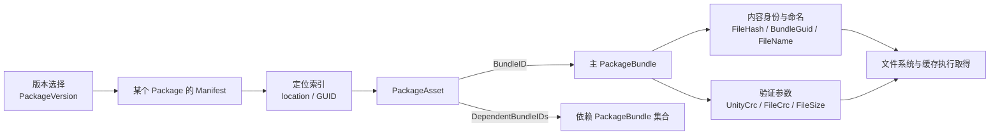
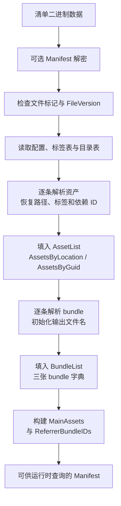
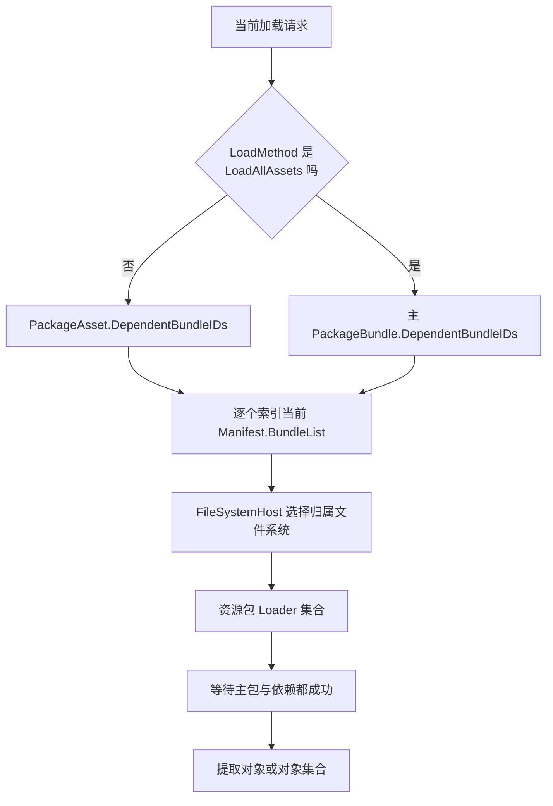

> 专题首页：[YooAsset 资源管理与交付]() · [两个系统的对比与选型]()

“这个资源在不在包里”和“这个文件可不可以用”，看似都在查 Manifest，实际回答的是不同问题。

地址找不到，可能是定位索引不包含这个名字；版本有变化，未必需要重新下载所有 bundle；文件名或 Hash 对得上，也不能单独证明缓存没有损坏。若把这些现象统称为“三层校验”，清单就会被误写成既决定版本、又比较差量、还自动保证安全的万能表。

**Manifest 的核心价值是把逻辑资产、资源包内容和验证参数联系起来；真正执行取得、缓存和验证工作的，是使用这张表的其他组件。**

> 源码基线：YooAsset **3.0.6**，固定提交 `3b4cfb36cc2e81b9558ab74d65fee2cf2eac2804`。本篇只陈述该版本源码能证明的结构与职责；文末实验尚未运行，没有以源码结构推导跨框架性能排名。

运行时消费这些记录的过程见[请求到 bundle 就绪]()；文件来源与缓存路由见[文件系统与运行模式]()。

## 一、先建立模型：一张清单连接三类信息

资源系统需要维护三种关系：

1. **定位关系**：业务输入的 location 对应哪个资产记录。
2. **内容关系**：这个资产位于哪个主包、需要哪些依赖内容，包文件又属于哪个内容身份。
3. **验证关系**：取得的数据是否符合预期格式、大小和校验值。

版本字符串属于“选择哪份清单”的控制信息；它不是资产地址，也不是文件校验码。资源包列表下标是清单内部引用；它不是跨版本稳定 ID，更不是跨 Package 引用。

图中的每个箭头都有明确作用域。同一份 Manifest 的 `BundleList[3]` 与另一份 Manifest 的 `BundleList[3]` 没有身份相等的含义。内容相等要看内容标识与构建约定，不能看列表位置。

## 二、二进制文件和运行时对象不是同一层

3.0.6 的 `PackageManifest` 包含 `FileVersion`、定位配置、输出命名样式、构建包类型、构建管线、Package 名称/版本/备注，以及 `AssetList`、`BundleList`。列表之外，还有五张运行时字典：

| 字典 | 查询方向 |
|---|---|
| `AssetsByLocation` | location → `PackageAsset` |
| `AssetsByGuid` | 资产 GUID → `PackageAsset`，受 `IncludeAssetGuid` 控制 |
| `BundlesByBundleName` | 逻辑资源包名 → `PackageBundle` |
| `BundlesByFileName` | 输出文件名 → `PackageBundle` |
| `BundlesByGuid` | BundleGuid → `PackageBundle` |

这意味着“bundle 只有列表，不需要字典”并不准确：ID 引用确实走列表下标，但文件名、逻辑包名与 GUID 查询另有索引。[完整字段定义](https://github.com/tuyoogame/YooAsset/blob/3b4cfb36cc2e81b9558ab74d65fee2cf2eac2804/Assets/YooAsset/Runtime/ResourcePackage/PackageManifest.cs#L14)

磁盘上也不是这些对象的原样转储。`DeserializeManifestOperation` 先处理可选解密，读取文件标记与格式版本，再读取全局标签表、目录表和资产/资源包记录。资产路径由目录索引和文件名还原，GUID、Hash 用专用读取方法恢复；运行时字典在读取记录时填入。最后还构建每个 bundle 的 `MainAssets` 与反向引用 `ReferrerBundleIDs`。[解析入口与文件头](https://github.com/tuyoogame/YooAsset/blob/3b4cfb36cc2e81b9558ab74d65fee2cf2eac2804/Assets/YooAsset/Runtime/ResourcePackage/Operations/Internal/DeserializeManifestOperation.cs#L60)、[记录解析](https://github.com/tuyoogame/YooAsset/blob/3b4cfb36cc2e81b9558ab74d65fee2cf2eac2804/Assets/YooAsset/Runtime/ResourcePackage/Operations/Internal/DeserializeManifestOperation.cs#L137)、[索引与反向引用构建](https://github.com/tuyoogame/YooAsset/blob/3b4cfb36cc2e81b9558ab74d65fee2cf2eac2804/Assets/YooAsset/Runtime/ResourcePackage/Operations/Internal/DeserializeManifestOperation.cs#L354)

资产与 bundle 的解析循环会检查 `IsBusy` 并允许退出当前更新，因此不能把全流程描述成“零成本的一次字典构建”。但反向关系等初始化仍有自己的遍历工作。是否达到帧预算，需要结合记录规模与设备测量。

## 三、location 如何变成资产：别名是索引策略

定位查询本身很短：`ConvertLocationToAssetInfo(string location, System.Type assetType)` 检查空输入后，对 `AssetsByLocation` 执行 `TryGetValue`，成功则创建 `AssetInfo`，失败则返回包含错误的无效 `AssetInfo`。[定位查询源码](https://github.com/tuyoogame/YooAsset/blob/3b4cfb36cc2e81b9558ab74d65fee2cf2eac2804/Assets/YooAsset/Runtime/ResourcePackage/PackageManifest.cs#L301)

决定哪些字符串能命中的关键，在反序列化时的字典构建：

- 先添加资产路径映射。
- `SupportExtensionless` 开启时，再尝试加入去后缀路径；冲突路径会发出警告并保留已有映射。
- `EnableAddressable` 开启且没有替换资产路径时，再加入非空 Address。
- 未开启地址模式且 `LocationToLower` 开启时，字典使用 `StringComparer.OrdinalIgnoreCase`。它不依赖每次查询先把输入转成小写。
- `IncludeAssetGuid` 决定是否读取、建立 GUID 索引；并不是每份 Manifest 必然包含 GUID。

这些规则均来自[字典创建与填充源码](https://github.com/tuyoogame/YooAsset/blob/3b4cfb36cc2e81b9558ab74d65fee2cf2eac2804/Assets/YooAsset/Runtime/ResourcePackage/Operations/Internal/DeserializeManifestOperation.cs#L278)。因此，“开启 Address 后只认 Address”“关闭 Address 后只认带后缀完整路径”都过于绝对。

还要单独看 `ReplaceAssetPathWithAddress`：运行状态下启用此选项时，解析器将 `AssetPath` 设置为 Address，并跳过原文件名解析。此时不能继续假定原工程路径一定留在内存里，也不能把普通地址别名规则原样套过来。解析器还明确拒绝地址模式同时开启 `LocationToLower`、以及未开启地址模式却要求替换路径的组合。[路径替换与配置约束](https://github.com/tuyoogame/YooAsset/blob/3b4cfb36cc2e81b9558ab74d65fee2cf2eac2804/Assets/YooAsset/Runtime/ResourcePackage/Operations/Internal/DeserializeManifestOperation.cs#L121)

这是一种工程约定：业务层可以用稳定地址隔离工程路径变化，但地址唯一性、去后缀冲突和构建配置必须成为内容生产的检查项，不能留到加载失败时才猜。

## 四、资产依赖与资源包依赖为什么各存一份

`PackageAsset` 的真实字段是 `Address`、`AssetPath`、`AssetGuid`、`BundleID`、`DependentBundleIDs`，标签在运行时恢复为 `PackageTags`。其中 `DependentBundleIDs` 标注为框架层收集查询结果。[PackageAsset 定义](https://github.com/tuyoogame/YooAsset/blob/3b4cfb36cc2e81b9558ab74d65fee2cf2eac2804/Assets/YooAsset/Runtime/ResourcePackage/PackageAsset.cs#L11)

`PackageBundle` 也有 `DependentBundleIDs`，源码标注为引擎层构建查询结果。它不是冗余副本：加载一个资产和加载整个 bundle 的全部资产，所需依赖集合可能不同。[PackageBundle 定义](https://github.com/tuyoogame/YooAsset/blob/3b4cfb36cc2e81b9558ab74d65fee2cf2eac2804/Assets/YooAsset/Runtime/ResourcePackage/PackageBundle.cs#L43)

`FileSystemHost.GetDependentBundleInfos` 在 `LoadAllAssets` 时使用主包的 bundle 依赖集合，其他分支使用资产依赖集合，再为每个依赖构造 `BundleInfo`。[依赖选择源码](https://github.com/tuyoogame/YooAsset/blob/3b4cfb36cc2e81b9558ab74d65fee2cf2eac2804/Assets/YooAsset/Runtime/ResourcePackage/FileSystemHost.cs#L194)

整数数组让运行时能够直接枚举已记录的结果，不意味着工程中的依赖图只有一层。反向引用仍参与卸载判断；包内循环依赖、构建结果变化和依赖收集策略，也不会因为最终记录是数组而消失。更不能把这里的 ID 解读成另一个 Package 中的 bundle ID。

## 五、把版本、身份和完整性拆成五个问题

### 1. 我选择哪份清单：PackageVersion

`RequestPackageVersionAsync` 从主文件系统请求版本，并把结果字符串交给调用方。该操作本身没有执行“与当前版本不同才自动更新”的完整决策。随后加载哪个版本、是否允许更新、失败怎样回退，是更新流程的控制逻辑。[请求版本源码](https://github.com/tuyoogame/YooAsset/blob/3b4cfb36cc2e81b9558ab74d65fee2cf2eac2804/Assets/YooAsset/Runtime/ResourcePackage/Operations/RequestPackageVersionOperation.cs#L43)

`LoadPackageManifestAsync(LoadPackageManifestOptions options)` 才加载指定版本清单；对应操作发现当前激活清单已经是同版本时，会直接成功返回，否则委托主文件系统加载，并在成功后激活新 Manifest。[加载清单操作](https://github.com/tuyoogame/YooAsset/blob/3b4cfb36cc2e81b9558ab74d65fee2cf2eac2804/Assets/YooAsset/Runtime/ResourcePackage/Operations/LoadPackageManifestOperation.cs#L52)

这解释了为什么已发布版本应保持不可变：同一版本字符串下替换内容，可能与客户端“已是该版本”的判断相冲突。版本字符串本身也没有在这里承担大小排序或语义版本比较。

### 2. 清单二进制是否匹配：清单 Hash 与格式版本

清单也有自身的 Hash 文件，不能与每个 bundle 的 `FileHash` 混为一谈。当前构建任务对生成后的清单文件计算 CRC32，写入清单 Hash 文件；`PackageManifestHelper.VerifyManifestData` 为兼容旧数据，按校验字符串长度选择 MD5 或 CRC32。[构建清单校验文件](https://github.com/tuyoogame/YooAsset/blob/3b4cfb36cc2e81b9558ab74d65fee2cf2eac2804/Assets/YooAsset/Editor/BundleBuilder/BuildTasks/TaskCreateManifest.cs#L87)、[清单数据验证](https://github.com/tuyoogame/YooAsset/blob/3b4cfb36cc2e81b9558ab74d65fee2cf2eac2804/Assets/YooAsset/Runtime/ResourcePackage/PackageManifestHelper.cs#L25)

例如 Sandbox 缓存清单先通过该验证，再进入反序列化；解析器又检查 FileMagic 和 `FileVersion`。这些检查回答“二进制是否匹配、格式是否能读”，并不等于内容来源的密码学认证。[缓存清单加载](https://github.com/tuyoogame/YooAsset/blob/3b4cfb36cc2e81b9558ab74d65fee2cf2eac2804/Assets/YooAsset/Runtime/FileSystem/Services/SandboxFileSystem/Operations/Internal/LoadCachePackageManifestOperation.cs#L70)

### 3. 要取得哪个 bundle 内容：FileHash 与输出文件名

`PackageBundle.BundleGuid` 返回 `FileHash`。以 SBP 构建任务为例，FileHash 对最终源文件计算 MD5；但不能把这句话扩大成所有自定义管线与虚拟构建都必定采用同一过程。[内容身份定义](https://github.com/tuyoogame/YooAsset/blob/3b4cfb36cc2e81b9558ab74d65fee2cf2eac2804/Assets/YooAsset/Runtime/ResourcePackage/PackageBundle.cs#L49)、[SBP 文件校验数据生成](https://github.com/tuyoogame/YooAsset/blob/3b4cfb36cc2e81b9558ab74d65fee2cf2eac2804/Assets/YooAsset/Editor/BundleBuilder/BuildPipeline/ScriptableBuildPipeline/BuildTasks/TaskUpdateBundleInfo_SBP.cs#L47)

`BundleName` 是逻辑资源包名，不一定等于远端物理文件名。`GetFileName()` 返回按 `OutputNameStyle` 和 FileHash 派生的名称；框架支持 HashName、BundleName、BundleName_HashName 三种样式。[命名规则](https://github.com/tuyoogame/YooAsset/blob/3b4cfb36cc2e81b9558ab74d65fee2cf2eac2804/Assets/YooAsset/Runtime/ResourcePackage/BundleFileNaming.cs#L17)

差量下载也不必先拿旧 Manifest 与新 Manifest 逐项比较。创建资源下载器时，FileSystemHost 枚举目标清单的 bundle，选择文件系统，再以 `IsDownloadRequired` 过滤。已有内容是否可用由所选文件系统及缓存状态回答。[下载列表构造](https://github.com/tuyoogame/YooAsset/blob/3b4cfb36cc2e81b9558ab74d65fee2cf2eac2804/Assets/YooAsset/Runtime/ResourcePackage/FileSystemHost.cs#L283)

### 4. 取得的文件是否完整：FileSize 与 FileCrc

3.0.6 字段名为 `FileCrc`，类型为 `uint`，不是字符串 `FileCRC`。Sandbox 缓存的 `FileVerifyHelper.VerifyFile` 先检查存在性，随后按调用参数检查大小和 CRC；大小或 CRC 为零表示跳过对应检查。临时下载文件验证传入文件大小和 CRC，并非再计算 FileHash 做统一比对。[文件验证实现](https://github.com/tuyoogame/YooAsset/blob/3b4cfb36cc2e81b9558ab74d65fee2cf2eac2804/Assets/YooAsset/Runtime/BundleCache/Services/SandboxBundleCache/FileVerifyHelper.cs#L18)、[临时文件验证调用](https://github.com/tuyoogame/YooAsset/blob/3b4cfb36cc2e81b9558ab74d65fee2cf2eac2804/Assets/YooAsset/Runtime/BundleCache/Services/SandboxBundleCache/Operations/Internal/VerifyTempFileOperation.cs#L81)

缓存扫描还有 Low、Middle、High 等验证级别：Middle 检查大小，High 增加 CRC，不能说 CRC 只在下载结束时使用，也不能说所有缓存命中每次都重算 CRC。[扫描级别分支](https://github.com/tuyoogame/YooAsset/blob/3b4cfb36cc2e81b9558ab74d65fee2cf2eac2804/Assets/YooAsset/Runtime/BundleCache/Services/SandboxBundleCache/Operations/Internal/VerifyCacheFilesOperation.cs#L137)

### 5. Unity 接收哪种 CRC：UnityCrc

`UnityCrc` 与 `FileCrc` 是两个字段。前者来自引擎构建结果，后者是发布文件字节的 CRC；它们的验证对象和使用路径不同。Web 默认策略构造 `DownloadHandlerAssetBundle` 时传入 `UnityCrc`，不能把它替换成文件 CRC。[字段定义](https://github.com/tuyoogame/YooAsset/blob/3b4cfb36cc2e81b9558ab74d65fee2cf2eac2804/Assets/YooAsset/Runtime/ResourcePackage/PackageBundle.cs#L17)、[Web 平台策略](https://github.com/tuyoogame/YooAsset/blob/3b4cfb36cc2e81b9558ab74d65fee2cf2eac2804/Assets/YooAsset/Runtime/FileSystem/Strategies/DefaultWebPlatformStrategy.cs#L43)

这些机制组合后提供的是分工明确的验证链。若项目还需要来源认证、抗篡改或防回滚，应另外定义可信发布与版本策略，不能从 CRC、MD5 或版本字符串推导出这些保证。

## 六、可复现验证：用小清单验证索引和校验边界

以下方案**尚未执行**。使用独立 YooAsset 3.0.6 测试工程、独立输出与缓存目录，保留两版构建产物，记录配置和构建报告。

### 实验 A：地址命中是否符合索引配置

1. 收集 `Assets/Probe/Hero.prefab`，设置 Address 为 `hero_probe`；开启 Address 与去后缀定位，关闭路径替换。构建并加载对应版本 Manifest。
2. 分别用 `package.GetAssetInfo(location)` 查询 Address、完整工程路径和去后缀路径。预期三者均有效并定位到同一资产路径；使用完全未登记的 location 时预期 `IsValid == false`。
3. 在独立构建配置中关闭 Address，并开启不区分大小写。预期路径大小写变化仍能命中，自定义 Address 不再因其 Address 字段而获得映射。
4. 另做开启路径替换的构建，在运行状态检查 `AssetInfo.AssetPath`。预期它采用 Address；不要继续期待原工程路径一定可用。若两资产去后缀后同名，观察警告及实际保留映射，不能把这种歧义当正常生产约定。

### 实验 B：下载判断是否依赖旧清单

1. 构建 v1 并完成下载；修改一个独立资产后构建 v2，记录两版 bundle 的 `FileHash` 与输出文件名。
2. 重启测试程序，保留 v1 已下载的 bundle 缓存，只加载 v2 清单；创建覆盖全部资源的下载器，记录其计划文件列表。
3. 预期：是否进入下载列表由目标清单与当前文件系统可用状态决定，未变化且已可用的内容可被复用；不需要把 v1 Manifest 作为比较输入。变化范围还会受打包分组和依赖影响，不能预设只改一个资产就只变一个文件。

### 实验 C：分别破坏大小和 CRC

1. 复制一份测试 Sandbox 缓存，对测试副本中的数据文件做截短；重新运行对应缓存验证。预期要求大小检查时报告不完整。
2. 重新恢复副本，改动一个字节但保持长度，分别以 Middle 与 High 进行扫描。预期 Middle 的大小检查不能识别这类变化，High 在 CRC 参数有效时能识别；从断点确认实际采用的验证级别。
3. 对测试清单二进制另做单字节改动，保留原清单 Hash。预期在缓存清单校验阶段失败；若还需验证 FileVersion 分支，应重新生成匹配的清单校验值后再单独观察格式检查，不能把两种失败混为一谈。

这些实验用于验证机制，不是性能基准。评估启动成本时，还需固定资产数量、别名数量、依赖边数量、加密、设备和帧预算，并分别测量文件读取、解密、反序列化及索引初始化。只有这样的数据，才能支撑工程预算或跨框架比较。

Manifest 让加载可被解释：**地址索引决定找到谁，内容标识决定取得谁，验证流程决定取得的数据能否继续使用。**
