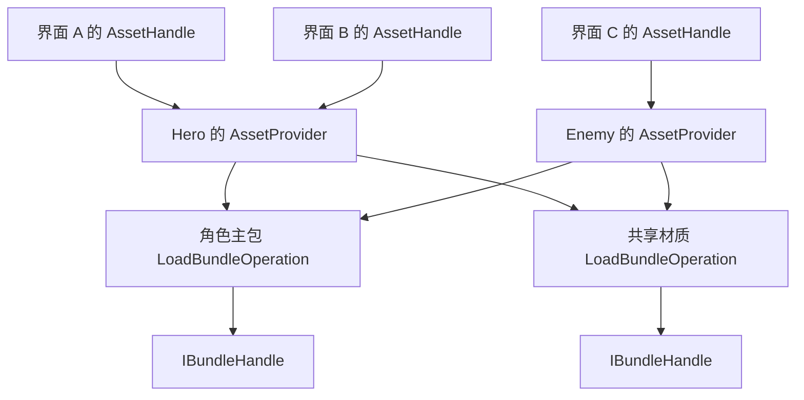
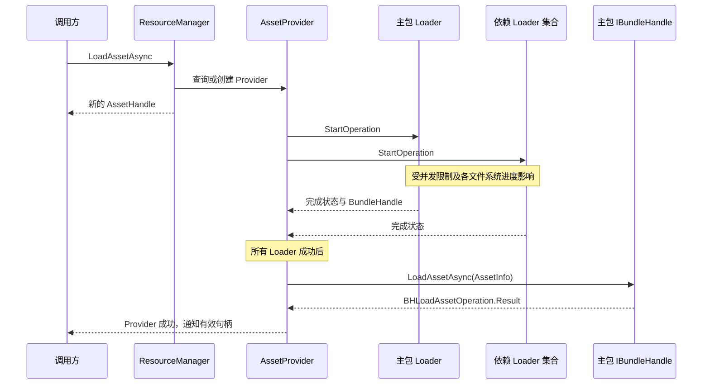

> 专题首页：[YooAsset 资源管理与交付]() · [两个系统的对比与选型]()

同一个资源被两个界面同时请求，应该发生两次加载，还是只做一次工作？某个 bundle 已经下载完成，为什么资源对象仍未返回？这些问题都指向一件事：**调用次数、共享加载工作和物理文件的数量，属于三个不同的计数维度。**

只沿一条箭头从地址画到 AssetBundle，很容易漏掉真正影响行为的部分：第二个请求在哪一层合并，主包与依赖何时启动，以及文件就绪和对象就绪之间还有哪些步骤。

本文聚焦单个 Package 内一次普通资产加载的运行时链路。Package 初始化见[架构与初始化]()，文件来源见[文件系统与运行模式]()，完整的卸载策略见[句柄与资源生命周期]()。

> 源码基线：YooAsset **3.0.6**，固定提交 `3b4cfb36cc2e81b9558ab74d65fee2cf2eac2804`。下文使用该版本的 `AssetHandle`、`ResourceManager`、`LoadBundleOperation` 等真实名称；不把旧版兼容 API 当作主线。本文给出的是源码结论和待执行验证方案，没有在本文环境运行 Unity 或采集耗时。

## 一、先把四种身份分开

资源系统面对的不是一个“加载对象”，而是几种不同身份：

| 身份 | 要回答的问题 | 3.0.6 中的承载者 |
|---|---|---|
| 逻辑资源 | 请求的是哪个资产、什么类型？ | `AssetInfo`，关联 `PackageAsset` |
| 对象加载工作 | 哪些请求可以共享一次对象提取？ | `ProviderBase`，普通资产为 `AssetProvider` |
| bundle 加载工作 | 哪些资产共同等待同一资源包？ | `LoadBundleOperation` |
| 调用方所有权 | 谁仍然需要这次加载结果？ | 每次创建的 `AssetHandle` |

复用粒度沿这四层逐渐变化。两个调用可以有两个句柄、共享一个 Provider；两个不同资源则可能有两个 Provider、共享一个主包或依赖包的 Loader。它们不能用“加载了两次”概括。



图中的资源只是示意配置；能否共享主包，取决于构建时的打包结果。共享的作用域是当前 Package 的 ResourceManager，不能据此推出不同 Package 会共享 Provider 或 Loader。

## 二、定位结束时，得到的还不是文件路径

`ResourcePackage.LoadAssetAsync<TObject>(string location, uint priority = 0)` 先检查初始化状态，再把 location 和请求类型转换为 `AssetInfo`，最后交给 ResourceManager。入口返回的是句柄，后续工作由异步操作推进，并非等整个链路完成才创建句柄。[入口与内部转发源码](https://github.com/tuyoogame/YooAsset/blob/3b4cfb36cc2e81b9558ab74d65fee2cf2eac2804/Assets/YooAsset/Runtime/ResourcePackage/ResourcePackage.cs#L584)

这里有两个边界：

1. Manifest 将 location 解析到资产记录；记录给出主包 ID 和资产依赖包 ID。
2. `FileSystemHost` 将相应 `PackageBundle` 绑定到负责它的文件系统，形成 `BundleInfo`。

因此 Manifest 描述“需要哪个内容”，文件系统决定“从哪里、怎样取得这个内容”。`BundleInfo.CreateBundleLoader()` 实际转发到 `_fileSystem.LoadPackageBundleAsync(options)`，没有在这里把 Host 模式硬编码成某一种网络 Loader。[BundleInfo 源码](https://github.com/tuyoogame/YooAsset/blob/3b4cfb36cc2e81b9558ab74d65fee2cf2eac2804/Assets/YooAsset/Runtime/ResourcePackage/BundleInfo.cs#L43)

定位失败也不是进入下载器重试。无效 `AssetInfo` 会在 ResourceManager 中形成已失败的 `ErrorProvider`，再返回相应句柄。排障时先区分地址未收集、文件未取得和对象提取失败，才能找到正确层。[错误分支源码](https://github.com/tuyoogame/YooAsset/blob/3b4cfb36cc2e81b9558ab74d65fee2cf2eac2804/Assets/YooAsset/Runtime/ResourceManager/ResourceManager.cs#L200)

## 三、复用发生两次：Provider 一次，Loader 一次

### 相同请求不会每次创建 Provider

普通资产加载的 Provider key 在该版本中是：

```csharp
// 摘录：ResourceManager.LoadAssetAsync 内部；省略校验、创建分支和优先级设置。
string providerKey = nameof(LoadAssetAsync) + assetInfo.AssetKey;
ProviderBase provider = GetAssetProvider(providerKey);
// ……仅在 provider == null 时创建 AssetProvider 并登记。
return provider.CreateHandle<AssetHandle>();
```

`AssetKey` 由资产路径与请求类型名组成，具体格式为 `[AssetPath][AssetType.Name]`，类型为空时写入 `[null]`。所以“同一个 address”不是完整复用条件；应以定位后的路径、请求类型、加载方法及当前 Provider 是否仍存在为准。不同别名若落到同一记录和相同类型，也可能汇合到相同 key。[Provider 查询与创建](https://github.com/tuyoogame/YooAsset/blob/3b4cfb36cc2e81b9558ab74d65fee2cf2eac2804/Assets/YooAsset/Runtime/ResourceManager/ResourceManager.cs#L219)、[AssetKey 定义](https://github.com/tuyoogame/YooAsset/blob/3b4cfb36cc2e81b9558ab74d65fee2cf2eac2804/Assets/YooAsset/Runtime/ResourcePackage/AssetInfo.cs#L76)

命中同一个 Provider 后，每个调用仍通过 `CreateHandle<T>()` 创建新句柄，并增加 Provider 的引用计数。**共享工作不等于共享所有权凭证。** 这也是为什么释放一个调用方的句柄，不应该让另一个调用方失去资源。[句柄创建源码](https://github.com/tuyoogame/YooAsset/blob/3b4cfb36cc2e81b9558ab74d65fee2cf2eac2804/Assets/YooAsset/Runtime/ResourceManager/Providers/ProviderBase.cs#L270)

这套普通资产规则不应直接套到场景：`LoadSceneAsync` 在 Provider key 后加递增实例计数，每次场景请求对应独立 Provider。[场景 key 源码](https://github.com/tuyoogame/YooAsset/blob/3b4cfb36cc2e81b9558ab74d65fee2cf2eac2804/Assets/YooAsset/Runtime/ResourceManager/ResourceManager.cs#L177)

### 不同 Provider 可以继续共享 Loader

创建 Provider 时，它立即取得主包和依赖包的 Loader，并增加这些 Loader 的引用计数。3.0.6 特意把这部分放在构造阶段，防止等待异步 Start 时共享 Loader 的引用保护尚未建立。[构造与引用登记](https://github.com/tuyoogame/YooAsset/blob/3b4cfb36cc2e81b9558ab74d65fee2cf2eac2804/Assets/YooAsset/Runtime/ResourceManager/Providers/ProviderBase.cs#L101)

ResourceManager 的 `_bundleLoaderDict` 以 `BundleName` 为 key；存在则复用，不存在才创建 `LoadBundleOperation`。所以它既不是每次请求一个 Loader，也不是跨所有 Package 的全局唯一 Loader。[Loader 查询源码](https://github.com/tuyoogame/YooAsset/blob/3b4cfb36cc2e81b9558ab74d65fee2cf2eac2804/Assets/YooAsset/Runtime/ResourceManager/ResourceManager.cs#L595)

## 四、主包和依赖一起启动，对象提取等待它们全部就绪

依赖的约束是“提取目标对象前必须就绪”，不能自动改写成“依赖下载完成后才允许加载主包”。

在 `ProviderBase.InternalUpdate()` 中，框架对 `_bundleLoaders` 中的主包和依赖包逐个调用 `StartOperation()`，随后更新所有 Loader，并检查它们是否完成、是否成功。只有全部通过，才读取主包的 `BundleHandle` 并进入 `InternalProcessBundleHandle()`。[启动和等待源码](https://github.com/tuyoogame/YooAsset/blob/3b4cfb36cc2e81b9558ab74d65fee2cf2eac2804/Assets/YooAsset/Runtime/ResourceManager/Providers/ProviderBase.cs#L153)



“一起启动”也不表示所有底层请求在同一时刻发出。`LoadBundleOperation` 先经过 `CheckConcurrency`；ResourceManager 正忙时会等待。取得名额后才创建文件系统的加载操作，再等待该操作返回非空 `IBundleHandle`。[并发门槛与文件系统加载](https://github.com/tuyoogame/YooAsset/blob/3b4cfb36cc2e81b9558ab74d65fee2cf2eac2804/Assets/YooAsset/Runtime/ResourceManager/Operations/Internal/LoadBundleOperation.cs#L85)

Loader 成功只说明 bundle 的访问句柄可用。`AssetProvider` 随后调用 `LoadedBundleHandle.LoadAssetAsync(MainAssetInfo)`，等待 `BHLoadAssetOperation`，再把结果赋给 `AssetObject`。普通 AssetBundle 实现才进一步调用 Unity 的 `AssetBundle.LoadAssetAsync(assetPath, assetType)`；其他 BundleHandle 可以有自己的提取方式。[AssetProvider 源码](https://github.com/tuyoogame/YooAsset/blob/3b4cfb36cc2e81b9558ab74d65fee2cf2eac2804/Assets/YooAsset/Runtime/ResourceManager/Providers/AssetProvider.cs#L14)、[AssetBundle 对象提取源码](https://github.com/tuyoogame/YooAsset/blob/3b4cfb36cc2e81b9558ab74d65fee2cf2eac2804/Assets/YooAsset/Runtime/BundleHandle/Services/AssetBundleHandle/Operations/ABHLoadAssetOperation.cs#L58)

由此可以把加载等待拆成：定位、Loader 复用与排队、文件系统取得 bundle、bundle 内对象提取。异步接口仍可能包含网络等待或 Unity 主线程工作，不能仅凭 API 名称推断“没有卡顿”。同步等待分支会绕过这处普通并发门槛，不能把异步请求的并发上限直接解释成同步等待时也成立；WebGL 强制同步提取还需另行核对与测量。

## 五、释放改变的是所有权，不保证当场完成卸载

`HandleBase.Release()` 先调用 `Provider.ReleaseHandle(this)`；Provider 引用归零时尝试 `TryUnloadBundle()`，最后把本句柄的 Provider 置空。`TryUnloadBundle()` 是否主动发起卸载，还受 `AutoUnloadBundleWhenUnused` 控制。[Release 源码](https://github.com/tuyoogame/YooAsset/blob/3b4cfb36cc2e81b9558ab74d65fee2cf2eac2804/Assets/YooAsset/Runtime/ResourceManager/Handles/HandleBase.cs#L28)、[自动卸载条件](https://github.com/tuyoogame/YooAsset/blob/3b4cfb36cc2e81b9558ab74d65fee2cf2eac2804/Assets/YooAsset/Runtime/ResourceManager/Providers/ProviderBase.cs#L313)

即使触发尝试，正在加载的 Provider 不能正常销毁；Loader 也要检查自身引用和资源包反向引用关系，满足条件后才通过 `IBundleHandle.UnloadBundle()` 执行卸载。因此“最后一个句柄 Release 必定立即 `AssetBundle.Unload(true)`”不是该版本的保证。[Provider 销毁条件](https://github.com/tuyoogame/YooAsset/blob/3b4cfb36cc2e81b9558ab74d65fee2cf2eac2804/Assets/YooAsset/Runtime/ResourceManager/Providers/ProviderBase.cs#L258)、[Loader 销毁条件](https://github.com/tuyoogame/YooAsset/blob/3b4cfb36cc2e81b9558ab74d65fee2cf2eac2804/Assets/YooAsset/Runtime/ResourceManager/Operations/Internal/LoadBundleOperation.cs#L242)

两个计数也在不同时间变化：句柄创建和释放改变 Provider 计数，Provider 的构造和销毁才改变它持有的 Loader 计数。排查“Release 后包还在”时，应先查哪一个计数、哪一个销毁条件尚未满足，再讨论内存曲线。

## 六、可复现验证：证明复用和等待，而不是只看耗时

以下方案**尚未执行**。在独立的 YooAsset 3.0.6 测试工程中做，避免改变正在使用的项目缓存或清单。

准备一个已完成初始化、已加载目标版本 Manifest 的 Package。收集 `Hero.prefab` 与 `Enemy.prefab`，让它们引用共享材质，并从构建报告确认主包和共享依赖的实际分组。使用正式构建产物验证 bundle 链；编辑器模拟不能替代这一步。

1. 在 `ResourceManager.LoadAssetAsync` 的 `provider == null` 分支、`GetOrCreateBundleLoader`、`ProviderBase.CreateHandle` 设置断点。连续两次 `package.LoadAssetAsync<GameObject>("hero_prefab")`，保留两个返回句柄。
2. 预期观察：Provider 只创建一次，`CreateHandle` 经过两次，Provider 引用计数变为 2。若 Provider 已提前销毁、路径或类型不同，应先解释 key 差异再判断复用。
3. 再加载 `enemy_prefab`。预期观察：创建另一个 Provider；共享依赖对应的 Loader 从字典复用，而不是再次创建。若打包结果不同，则不应期待图中的共享关系。
4. 在 `ProviderBase` 的 `StartBundleLoader`、`WaitBundleLoader` 和 `AssetProvider.InternalProcessBundleHandle` 记录帧号、bundle 名称和状态。预期观察：主包和依赖均被启动，只有它们全部成功后才进入对象提取。底层请求启动顺序可能受并发上限影响。
5. 加载完成后释放 Hero 的第一个句柄。预期观察：Hero Provider 仍有一个句柄引用，第二个句柄仍有效。释放其余句柄，再结合自动卸载配置和显式卸载操作检查 Provider、Loader 的实际销毁过程。

如果还要研究首次加载延迟，再为同一构建分别记录冷缓存、暖缓存和已加载对象三组结果，并区分网络、文件、Unity 对象提取阶段。未统一资源、设备、压缩与缓存条件之前，不从“链路层数少”推出性能胜负。

读运行时源码最有用的结果，是给每一次等待找到归属：**句柄代表需求，Provider 合并对象工作，Loader 合并 bundle 工作，文件系统完成内容取得。**
