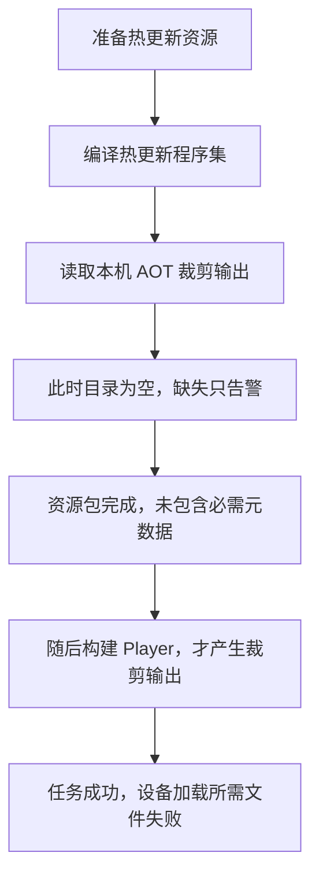

一次 Android 包构建显示成功，装到设备上却在启动阶段失败。沿报错查看，启动流程需要加载的一份 AOT 元数据文件，在对应资源包中找不到。

这次我负责定位和修复。最后发现，问题出在两个构建阶段之间：前面的资源打包读取了尚未生成的输入，缺失文件又只被当作告警跳过。后面的步骤虽然执行成功，也无法补齐已经打完的资源包。

修复后更新包，原问题得到解决。我随后把产物来源、生成与使用步骤、缺失时的处理方式整理成文档，形成可重复执行的流程。这篇记录的重点，就是怎样从一次设备故障，找到构建管线里需要补齐的约束。

> 本文依据历史事故复盘与修复记录，以及本人对职责和修复结果的确认整理。流程图经过脱敏、简化；不展示内部工程路径、任务地址或原始日志。具体工具命令与兼容要求应按项目锁定版本核对。

## 先分清三个不同的成功条件

构建显示成功时，我首先需要确认：它究竟检查了什么。

| 判断 | 需要回答的问题 |
| --- | --- |
| 构建执行成功 | 配置的步骤是否完成，失败是否正确返回给构建系统？ |
| 必需产物完整 | 运行需要的文件是否产生，并进入了本次对应的产物？ |
| 设备关键路径可用 | 设备是否取得并加载了预期内容，实际操作是否完成？ |

一次任务可以正常结束，却没有检查到必需文件缺失；一份包也可以包含预期文件，却仍有加载、兼容或业务行为问题。排查要沿着这些层次往下走，才能知道应该修改哪一处。

因此，收到设备报错后，需要先固定平台、包版本、更新内容、失败操作和首个相关错误。这里的直接线索是文件加载失败，下一步就应当核对这份文件的生成与打包过程，而不是先把问题归为业务代码异常。

## 缺的是什么，应该由谁产生？

这个项目使用 HybridCLR。AOT 是提前编译的代码，热更新程序集则可以单独编译、加载。在需要补充 AOT 泛型元数据的方案中，运行时还要取得相应程序集的元数据。官方对补充元数据的机制有单独说明，见 [AOT 泛型](https://www.hybridclr.cn/docs/7.6.0/basic/aotgeneric)。

对这次构建而言，需要分清两类文件：**编译出来的热更新程序集，以及启动流程要求加载的 AOT 补充元数据。** 热更新代码编译完成，并不会自动证明另一类文件也已准备好。

复盘中涉及三个位置。它们都可能放着程序集文件，承担的角色却不同：

| 位置 | 承担的角色 | 本次需要核对什么 |
| --- | --- | --- |
| 本机生成目录 | 保存某次生成或构建留下的临时输出 | 文件是否已产生，来源是否符合本次要求？ |
| 受控基线 | 保存供构建消费的 AOT 输入 | 目标平台、版本和配套条件是否明确？ |
| 打包收集目录 | 组织本次实际进入资源包的文件 | 必需文件是否复制齐全，并被打包收集？ |

找到了一个目录，只说明有一个可能的来源。还要继续问：本次任务是否负责生成它，生成发生在什么时候，以及后面的步骤实际从哪里读取。

## 沿阶段顺序，找到文件为什么没进包

历史复盘保留的构建记录给出了关键线索：准备热更新资源时，热更新程序集已经编译出来，AOT 元数据收集结果却为空，任务仍继续执行。

顺着这个差异检查，修复前的流程可以简化为：

这里有两个相互叠加的问题。

**第一个是生成与消费的顺序错了。** 资源打包阶段从本机裁剪输出目录取文件，但这次流程直到后面的 Player 构建才产生这些输出。文件后来出现了，已经完成的资源包也不会因此自动补齐。

**第二个是必需输入缺失没有让任务失败。** 原有逻辑遇到缺失文件只记录告警并跳过。构建系统收到的是成功结束的步骤，无法据此知道设备启动所需的内容没有进入包。

这也解释了为什么仅看最终任务状态不够。定位时真正有用的是：读取了哪个来源、当时有哪些文件、缺失如何处理，以及产物何时完成。

## 修复：把产物来源和失败条件说清楚

### 让日常构建消费受控输入

修复记录中的第一项改动，是让 AOT 元数据从 SVN 管理的基线取得，日常打包不再依赖本机临时裁剪目录里恰好留下的内容。

这样，资源打包开始前就有了明确的输入来源。更换执行节点时，也可以从版本库取得这组输入，而不必假设那台机器之前跑过某个生成步骤。

受控输入仍然需要配套。文件进入版本库，只解决了来源和分发的一部分问题；它对应哪个平台、哪组 AOT 输入和生成配置，仍应能查明。基线发生变化后，也要重新判断原有验收结论是否适用。

### 必需文件缺失时，直接终止准备阶段

第二项改动，是将必需 AOT 文件缺失时的“告警并跳过”改为失败退出，让这项失败传回构建系统。

检查应当由预期清单驱动：逐项确认本次需要哪些文件，再检查是否存在并成功交接。只看目录非空，无法发现其中某一项缺失；只数文件数量，也无法判断是否拿到了错误的一组内容。

这里清单检查是完善检查的通用方法，本文历史修复能够确认的是：缺失必需 AOT 文件时不再继续把准备阶段当作成功。

### 将基线刷新设为显式流程

第三项改动，是接入显式生成开关，区分“刷新基线”和“消费已有基线”的构建路径。

生成相关文件以后，还要把它们作为配套输入保存和交接。日常构建则取得受控输入，再组织本次资源包。基线尚未建立或需要更新时，先走生成和交接流程；缺少输入的日常构建应给出明确失败原因。

选择这种方式，需要维护好基线的适用条件。另一种设计是每次构建先完成所需生成，再消费本次输出，但也要承担相应的时间与环境成本。两种方案都必须保证：**消费发生之前，所需输入已经完整、来源明确。**

## 更新包解决故障以后，还留下什么？

完成定位和修复后，更新包解决了这次元数据缺失导致的问题。这是本次确认的定性结果；本文不据此推导所有设备、平台和更新路径都已通过验收。

对我来说，后续还需要把处理过程变成别人能够继续执行的步骤。我将相关内容整理为文档，说明：

- 什么情况下需要生成或刷新基线，日常构建使用什么输入。
- 输入保存在哪里、怎样交给后续构建，哪些配套内容需要一起处理。
- 遇到缺失报错先查哪个来源，再执行什么生成、同步与复检步骤。

文档与检查分别承担一部分工作。检查阻止明确不完整的输入继续流转；文档让维护者知道怎样恢复到可以再次执行的状态。两者结合，才能减少下一次排查对个人记忆的依赖。

## 怎样验证这类修复能继续起作用

后续维护时，可以用下面的验证安排检查同一约束。这是一组可复用的验证建议，本轮写作没有重新执行这些样例：

| 验证样例 | 需要观察的结果 |
| --- | --- |
| 正常、配套的受控输入 | 准备阶段成功，预期文件进入本次收集结果与资源包 |
| 缺少一份必需输入 | 在准备阶段明确失败，报告缺项，不继续形成可交付候选 |
| 清空本机生成目录，保留有效受控输入 | 日常构建按约定取得输入，结果不依赖本机历史残留 |
| 基线来源或目标平台不配套 | 能核对出差异，并按兼容要求处理；仅有文件不能判为可用 |
| 设备更新到修复后的内容 | 确认实际取得的版本、元数据加载与原失败路径，再继续关键操作 |

<!-- DATA-TODO: 若补充量化结果或验证截图，需记录对应包与资源版本、平台和设备、基线身份、更新路径及操作结果；本轮未重跑上述验证样例。 -->

这套思路也适用于协议生成物、配置代码或其他构建输入：先把必需产物的来源与顺序查清，再让缺失在能够修正的位置明确失败，最后验证下游真正使用了什么。

**构建成功应当建立在必需输入与产物约束成立的基础上，设备使用结果再为它补上运行验证。**

## 继续深入

补充元数据和生成步骤的具体机制，可以查阅 [HybridCLR 工程化]()及官方 [Package 手册](https://www.hybridclr.cn/docs/basic/com.code-philosophy.hybridclr)。官方资料用于解释机制，不替代本次事故记录，也不用于推断历史项目的工具版本。

构建输入、环境与产物的组织见[构建自动化]()；从文件检查继续走到运行和兼容验证，可以看[热更新验证]()。

[返回生产管线总览]() · [后续：构建环境（提纲）]() · [后续：发布验收（提纲）]()
