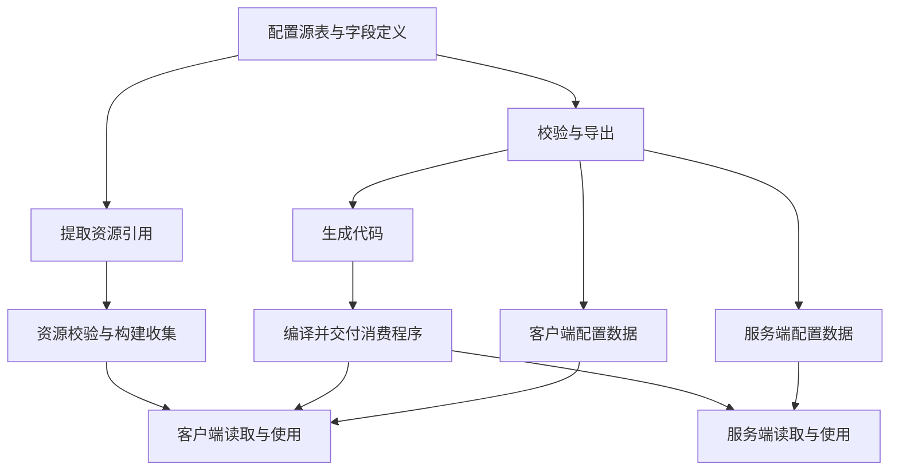

在[资源完整性案例]()中，我介绍了怎样发现资源漏提交，并帮助美术定位和补齐依赖。资源进入版本库以后，内容交付还有下一道问题：策划在配置中引用了它，客户端和服务端能否按同一套约定使用这份内容？

先用一个假设场景说明这个问题。策划新增一件可制作的家具，配置了家具 ID、模型路径和制作材料。导表工具提示成功，但客户端仍然找不到模型；另一次修改后，客户端展示的新配方与服务端实际扣除的材料又不一致。

这两种现象不一定来自同一个错误。前者可能是路径写错、资源未提交或未被收集进包；后者可能是字段含义理解不同，也可能是一端仍在使用旧数据。只看导表任务是否成功，还无法区分这些原因。

**导表之后需要交接的是一组相互配套的内容：配置定义、导出数据、生成代码、资源引用，以及实际使用它们的程序版本。**

## 先分清配置经过了哪些交接

在实际开发入口上，项目用鲁班导表，并通过 TortoiseSVN 提交前客户端钩子接入本地检查，具体见[鲁班与本地 hook]()。这个入口负责让修改尽早取得规则反馈；本篇继续追踪通过检查后，生成物与资源怎样交给消费者。不能因为加了钩子，就认为生成时序、双端版本和运行结果都已一致。

策划编辑的源表、导表工具生成的文件，以及游戏运行时读取的数据，是不同的对象。有些项目还会根据表结构生成代码，再把代码编译进客户端或服务端使用的程序集。

下面是一种包含代码生成的配置管线模型，不代表每个项目都必须采用相同格式或步骤：



排查时，可以先把问题拆成四个层次：

| 层次 | 需要确认什么 | 常见的错配 |
| --- | --- | --- |
| 配置含义 | ID、类型、单位、默认值和跨表关系是否约定清楚 | 两端对同一数值使用不同单位 |
| 资源引用 | 配置指向什么，目标是否存在，是否进入对应产物 | 源表仍引用资源迁移前的路径 |
| 生成物配套 | 数据和生成代码依据什么输入产生，消费程序是否与之兼容 | 新数据配上了按旧定义编译的程序 |
| 实际消费 | 运行中的两端分别读到了哪份内容 | 文件已经生成或分发，一端仍在使用旧版本 |

这个划分决定了接下来该找谁、看什么。字段含义不清，需要策划与程序确认契约；资源路径不对，需要回到配置和资源变更；生成物错配，则要检查生成、编译和交接记录。部署后的加载与切换还要继续核验，本篇只说明它与配置交接的接口。

## 先约定字段的含义，再讨论怎样导出

一张表能被解析，并不意味着消费者理解了同一件事。

以前面的家具为例，`CraftTime` 是秒还是毫秒，`MaterialId` 指向哪张表，数量为零是否合法，空资源字段表示没有表现还是配置遗漏，都需要事先说清。工具可以检查已经定义的规则，却无法替业务团队决定这些含义。

历史项目的配置规范已经区分了字段类型和消费范围，包括客户端、服务端、战斗与编辑器等用途，也用资源字段标记参与构建收集。这些约定把策划输入和程序使用方式连接起来。

双端配套也不要求两份导出文件完全相同。客户端可能需要模型和图标，服务端可能只需要制作条件与状态规则。两端需要共同确认的是共享 ID、共同字段的含义，以及各自负责的行为。

因此，修改字段时要同时看三件事：

1. 谁维护这个定义，哪些消费者会受到影响。
2. 哪些代码、数据和资源声明需要重新生成或修改。
3. 旧消费者还能否使用新数据，旧数据是否仍需兼容。

删除一个字段也一样。源表中不再出现，并不能说明所有读取它的代码和运行中的版本都已退出使用。兼容要求需要在修改前确定，再由样例验证。

## 报告要指回配置的声明位置

配置引用资源时，最容易丢掉的信息是“这条引用从哪里来”。

假如检查只输出一个不存在的 Prefab 路径，策划还得逐张表搜索，美术也不知道应该恢复旧资源，还是通知策划改用新资源。同一路径被多条记录引用时，修复范围会更难判断。

已有的配置资源路径检查材料保留了表、记录 ID、字段和原始路径。这样的报告能把问题带回内容声明的位置。下面用虚构的表名与值说明信息关系，不是实际故障日志：

```text
配置表：Furniture
记录 ID：chair_demo
字段：ModelPath
配置值：Assets/Example/Furniture/Chair.prefab
检查结果：本次检查的工程中未找到该路径
```

收到这条信息后，首先要核对检查使用的配置与工程版本，再判断发生了什么：资源本来应该存在但没有提交，资源已经迁移，还是这条配置已经废弃。对应的修正动作不同，不能见到路径错误就自动删除配置。

工具分工也应沿着这个问题拆开。项目侧负责解释哪些表、哪些字段声明了资源；通用检查负责判断目标是否符合规则；编排层负责关联本次输入、保存报告和通知处理者。通知摘要可以简短，完整报告和本地工具需要提供继续排查的入口。

记录 ID 通常比一个孤立的行号更适合帮助人回查配置。只有能够可靠地从导出结果映射回源表时，才应报告具体行号；不能为了让消息看起来完整而填入猜测的位置。

这里还有一个边界：**路径检查通过，只能说明目标在该检查范围内可识别。** 它没有自动证明 Prefab 内部引用完整，也没有证明目标进入了实际包。资源收集和最终产物仍要分别检查，代码动态拼出的路径也需要额外覆盖。

## 生成代码和数据，需要一起交代来源

配置管线里另一个容易忽略的问题，是各个步骤都执行了，交到一起的却不是同一组内容。

在一份既有导表流程的审查记录中，配置代码的生成与提交、消费程序集的编译与提交，分别由异步任务完成。记录指出了两个需要补证的风险：生成文件集合可能尚未完整，就被后续步骤使用；另一条编译任务也可能使用了不同轮次的源码。

这份历史记录把提交前一致性检查、跨任务的输入与产物关联列为待补，不能直接代表今天的生产状态。它能支持的工程判断是：知道某处会编译 DLL，还不足以确认下游拿到的 DLL 与这次配置配套。

下面是假设的时序，用来解释风险，并非对某次真实事故的复原：

| 时刻 | 导表任务 | 编译与下游任务 |
| --- | --- | --- |
| 1 | 按定义 A 生成代码与数据 | 开始读取 A 的代码 |
| 2 | 新请求按定义 B 更新了部分生成物 | 继续编译先前取得的 A |
| 3 | B 的数据进入交接位置 | A 的程序集随后完成并被取走 |

如果下游只分别获取“最新数据”和“最新程序集”，就有可能把 B 的数据与 A 的程序组合起来。它们是否兼容要另行判断；两个任务分别成功，无法回答这个问题。

针对这类流程，改进可以先围绕三个交接约束展开。现有材料不足以把它们都写成已经上线的能力：

- **先验证生成集合完整。** 明确本轮应有哪些文件，检查漏生成、旧文件残留和生成步骤失败，完整之后再提交并交接。
- **让每份产物携带来源。** 记录源配置与定义版本、生成工具版本、实际编译输入及输出身份，用于核对关联关系。
- **按一组配套输入消费。** 下游选择同一份交接清单里的数据与程序，兼容组合经过明确验证后再接受；避免各自从公共目录取最新文件。

请求号可以串起任务，哈希可以标识文件，但它们本身不能证明来源关系正确。记录必须来自任务实际读取的输入，并在后续交接时核对。给两份文件贴上同一个标签，不能替代这一步。

把生成和编译放在同一任务中，能够简化部分交接；保留异步任务则有利于独立调度和复用。选择哪种方式取决于现有流程，二者都需要管理输入、完整性和失败后的输出，不能仅靠多加一次编译就认定问题已经解决。

## 用一条配置引用错误走通处理过程

现在回到家具模型路径不存在的假设场景。这里先演示处理方法，完整的真实输入、修正与复验记录仍待补充。

策划收到报告后，先按表名、记录 ID 和字段找到配置，并确认自己查看的版本与报告对应。随后与美术核对：这件家具是否仍使用该模型，模型是否移动过，相关变更是否已经提交。

如果模型迁移到了新位置，就修改源配置，再重新导出并检查引用；如果资源漏提交，则先补齐所需文件，再让检查环境取得对应版本。直接修改导出的中间文件会绕过源表，下次导出时还可能被覆盖，因此修正需要回到真正的维护入口。

修改之后，也要按影响范围重新生成。只改变某条资源路径，和改变字段类型、删除跨表记录，所影响的代码、数据及验证范围可能不同。不能固定理解成每次都全量重建，也不能假设重新导一张表就够了。

接着分层确认结果：

1. 配置校验完成，对应的错误在新的有效报告中消失。
2. 被引用的资源进入目标构建的收集结果与产物。
3. 使用配套数据与程序的客户端能够加载并展示该家具。
4. 如果改动涉及共享配方，服务端也使用预期定义，并通过制作条件与扣料样例。

这些结果回答的是不同问题。修改只涉及客户端资源时，可以按影响分析缩小双端验证；涉及共享字段或规则时，则必须把相应消费者纳入验证范围。若检查工具崩溃或没有生成报告，应先处理检查执行失败，不能因为没有收到错误消息就判为修复完成。

操作文档应把这条路径写给使用者：去哪里找源配置，怎样确认报错对应的版本，修改后重新生成什么，以及到哪里看新的检查结果。工具报告提供线索，文档与职责约定帮助人完成后续动作。

## 哪些已有依据，哪些还需要验证

这篇文章使用了两段不同阶段的材料：历史项目的字段与消费范围规范，后续项目的路径检查和导表流程记录。它们说明了不同环节的设计与问题，不代表这些能力已经组成同一套端到端验收系统。

已有材料能够支撑配置契约、报告来源定位和异步生成物风险的分析。成组交接是否已实现、具体错误怎样修正、双端实际加载了什么，仍需要对应版本的记录。因此，这里没有给出缺陷减少或出包效率提升的数字。

后续验证应至少包含正常输入作为对照，再分别引入缺失资源、无效跨表 ID、不配套的代码与数据，以及旧消费者读取新数据等情况。每个样例先写清预期在哪个阶段发现、报告指向哪里、由谁处理，再记录实际结果；未执行的样例保留为验证计划。

**配置交付要让每个消费者拿到含义明确、来源可追溯、彼此配套的内容，并在实际使用中验证它们。**

## 继续深入

不同错误应在哪一层发现、检查在什么时候执行，可以继续看[配置验证]()。将生成与编译组织成受控步骤时，可以参考[构建自动化]()中的参数、环境与产物管理。这里连接的是设计方法，本文提出的生成物一致性改进仍需独立实现和验证。

---

[返回生产管线总览]() · [配置表格式检查]()
