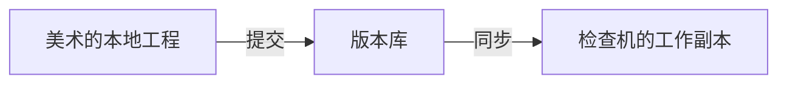
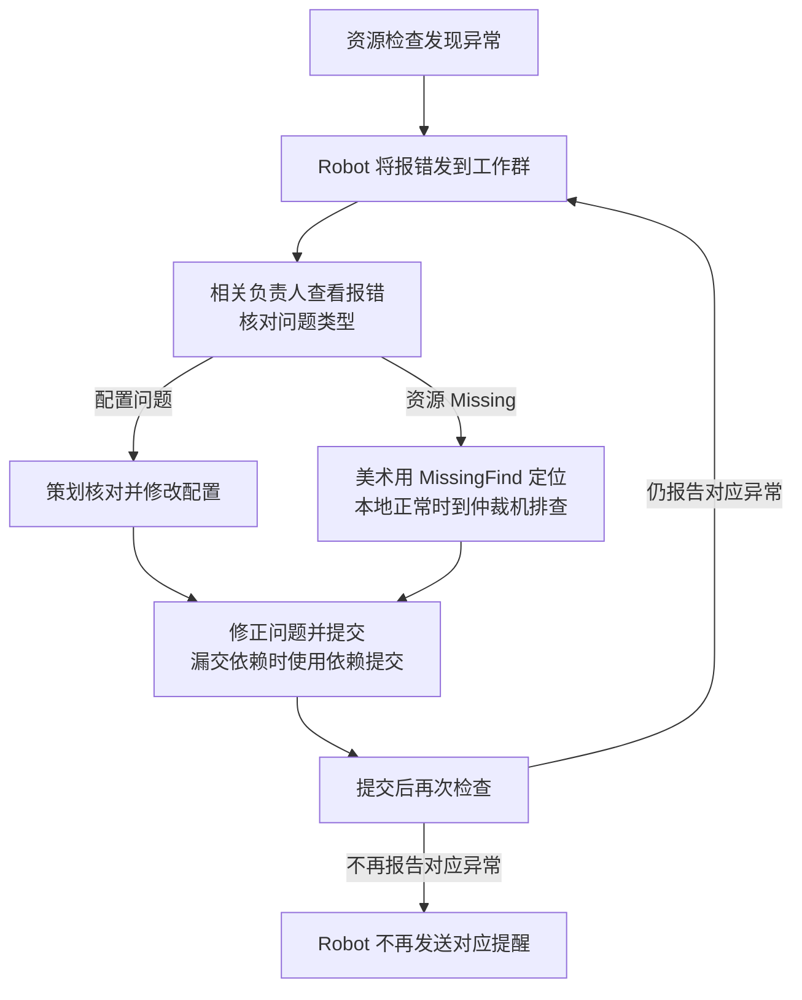

QA 和同事曾经找我排查一个反复出现的问题：手机包里的资源显示不正常，但美术打开自己的工程，看到的内容是完整的。游戏运行时还经常出现各种 Warning，靠人工逐项排查很费时间。

排查后，我发现部分异常是由资源漏提交造成的。场景、Prefab 和特效往往依赖很多文件，美术知道自己改了什么，却不容易确认相关依赖是否都已提交。漏交的文件仍然保留在本地，所以美术自查时可能看不出问题；其他人从版本库更新工程时，却拿不到这些文件。

围绕这个问题，我先后设计并实现了三个工具。每个工具投入使用后，美术的反馈又让我看到下一步需要解决的问题。

## 先让问题在提交后暴露

第一步，我做了 Missing 通知机器人，将资源检查发现的问题发到工作群。

这里需要区分：**美术本地已有的资源，和已经提交到版本库的资源。** 场景可能引用 Prefab，Prefab 又引用模型、材质和贴图。一旦漏交其中某个依赖文件，其他人从版本库同步的场景就可能不完整。



因此，我把检查放在独立的工作副本中执行。Jenkins 先同步 SVN，再调用 Unity 的批处理入口检查资源引用；发现问题后生成报告，并把通知发到工作群。

检查机取得的是已经提交到版本库的内容。即使美术本地显示正常，漏交依赖的问题也可能在检查机上暴露出来。

通知还需要发给能处理问题的人。机器人先根据目录配置匹配相关人员；如果没有匹配到，就借助版本控制记录寻找通知对象。收到通知的同事再根据报告排查，判断具体原因和处理方式。

机器人开始工作后，美术反馈了一个新问题：虽然通知里列出了缺失位置，却还是不知道该在工程里检查什么。

## 收到报错以后，怎样找到那个对象？

群通知会 @ 相关同事，并附上 `AssetPath` 和 `MissingInfos`：前者是需要检查的场景路径，后者列出缺失引用所在的节点、组件和属性。下面是一条根据当时消息格式整理的脱敏示意，已按字段展开，并替换了人员、路径和节点名称：

```text
@相关同事：资源引用缺失

AssetPath: Assets/ArtWork/Scene/ExampleScene.unity
MissingInfos:
  Missing reference found in: Environment/AmbientAudio
  Component: AmbientAudio (UnityEngine.AudioSource)
  Property: m_audioClip
```

这条消息指出，场景中一个 AudioSource 组件的音频引用缺失了。美术还需要打开场景，找到对应节点，再检查组件上的引用。只有文本路径时，这一步仍然需要手工寻找。

为了解决这个问题，我做了 MissingFind。它可以在 Unity 编辑器中检查场景或正在编辑的 Prefab，列出引用缺失的对象、组件和属性，并定位到对应对象。美术打开 `AssetPath` 对应的场景后，就可以用 MissingFind 定位节点，检查音频引用。

有了定位工具，美术又遇到一个困难：自己的工程里资源齐全，MissingFind 也查不出通知中报告的缺失。

为此，我给美术申请了一台仲裁机。这台机器上的工程由人工执行 SVN 更新。本地查不出问题时，美术可以到仲裁机上运行 MissingFind，检查哪些节点存在缺失引用。

找到缺失节点后，美术就能与本地工程对照，进一步核对相关资源是否已经提交。

## 找到缺失以后，怎样补齐依赖？

我实现的第三个工具是依赖提交。使用者选择这次修改的内容，由工具查找关联文件，再组织 SVN 提交。

工具的处理过程分为几步：

1. 从所选资源出发，递归收集依赖。
2. 补齐提交所需的父目录，处理资源及其 meta 文件。
3. 根据 SVN 状态筛出需要提交的候选文件。
4. 将候选文件交给 SVN 提交入口，由使用者确认并提交。

其中，资源依赖用于确定“这个场景还需要哪些文件”，SVN 状态则用于判断“哪些文件需要提交”。Unity 的 meta 文件保存着资源标识与导入设置，提交时也要和对应资源一起处理。这一机制可参见 [Unity 2022.3 的资产元数据说明](https://docs.unity3d.com/2022.3/Documentation/Manual/AssetMetadata.html)；这里引用文档说明 meta 的作用，不据此推定历史项目的 Unity 版本。

美术选择自己修改的场景或 Prefab 后，由工具找出关联文件，再由美术确认提交范围，减少凭记忆逐个查找文件时的遗漏。

工具能收集到哪些依赖，取决于本地的引用关系。引用写错了，仍然需要修正；没有被收集到的资源，也需要另外检查。提交后，检查机重新同步并检查，确认对应的缺失是否还存在。

## 工具交出去以后，还要跟进使用

我同时编写了配套文档，按常见问题说明处理步骤。美术收到通知后，可以查到应该用哪个工具、怎样排查，以及修改后如何检查。

工具推广时，我会组织统一宣讲。对于工作群里长时间没有解决的问题，我会上门跟进并督促处理；临近项目节点时，项目经理也会协同督促相关人员解决。

当时的资产检查流程也明确了各工种的分工：配置问题交给策划核对，工程资源问题由美术处理。需要其他同事协助时，附上报错信息提单记录；修改后再进行自查和工具检查。

从收到通知到提交复检，整个处理过程如下：



图中的结束状态是后续检查不再报告对应异常，机器人不会额外发送“已修复”通知。判断修复时仍需确认检查实际执行，并查看对应结果；仅凭群里没有新提醒，无法确认检查通过，也不能替代包内验证。

## 最后改变了什么

在这段历史工作中，我观察到这些工具和配套措施落地后，Missing 提醒几乎没有了，手机包中因 Missing 导致的异常得到解决。这是当时工作的定性观察，尚无同口径的错误次数与耗时统计，因此不据此给出改善比例，也不将它扩展为所有资源异常都已解决。

回看这段经历，美术的反馈指出了排查过程中一个个具体的困难。工具、排查环境和配套文档，也是在解决这些困难的过程中逐步补齐的。

**一项资源检查要真正发挥作用，还需要让收到报错的人知道去哪里查、怎样修正。**

---

[返回生产管线总览]() · [深入资源引用与资产机制]() · [继续阅读：配置与双端一致性]()
