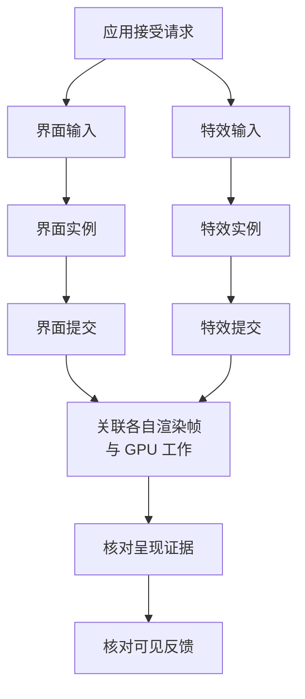

玩家第一次打开奖励界面时，画面停了一下，特效也晚了一拍。程序看到资源加载已经完成，特效同学看到存活粒子不多，测试记录的平均帧率又没有明显异常。三份信息都可能正确，却还不能回答：**这次操作究竟在哪里迟到了，下一步该观察什么？**

问题在于，它们描述的对象、时刻和范围不同。加载完成描述某份资源的状态，粒子数描述某个时刻的工作规模，平均帧率描述一个窗口内的输出节奏。要把这些信息用于同一次判断，先得把业务操作和观测边界接起来。

本文面向准备设计性能测试的客户端程序、TA 和工具开发者。读完后，应能为一次操作写出观测方案，决定先采哪一段、怎样解释缺失数据，以及哪些证据尚不足以认定根因。

> 本文使用引擎无关的教学任务与拟采集方案，没有运行设备实验，也不提供实测耗时或通用阈值。帧、内存与加载的定义分别复用[一帧拆解]()、[内存记账]()和[资源就绪链]()；本篇负责把它们关联到一次具体操作。

## 先把“打开了”拆成几个可观察的目标

先约定教学任务：应用接受一次打开奖励界面的请求，显示本次奖励内容，并播放对应的确认特效。背景场景继续运行。资源可能已在内存中，界面实例也可能被复用。

“打开完成”至少有三种可能的含义：

| 目标 | 本任务的完成条件 | 不能代替它的信号 |
| --- | --- | --- |
| 奖励内容可见 | 画面出现属于本次请求的奖励内容 | 界面对象存在、加载回调触发 |
| 界面可交互 | 约定控件接受操作，且处理的是本次数据 | 画面已经出现，或控件已经注册 |
| 确认特效首次可见 | 本次特效产生可识别的画面变化 | 已开始播放、粒子已生成、命令已提交 |

这三个终点可以分开出现。产品若允许先显示奖励、稍后播放装饰特效，就分别记录各自的反馈；若要求二者共同出现，则按约定观察共同完成点。不能在看完结果后，为了让数字更好看，临时把“特效出现”换成“特效开始播放”。

起点也需要约定。本文从**应用接受打开请求**开始，不把它称为“玩家点击到反馈”：硬件输入、系统派发以及应用接受之前的等待不在这个区间内。若要评价完整的操作延迟，就必须把起点移到相应的输入观测，并补齐关联证据。

因此，第一份产物只需一句明确的任务约定，例如：

> 在指定构建、设备、画质及起始状态下，分别记录应用接受本次打开请求后，奖励内容可见、可交互及确认特效首次可见的完成情况；同时观察相关窗口的应用帧间隔和内存变化。

此时还没有性能合格线。我们先定义要测的量，预算章节再讨论在什么条件下允许花多少成本。

## 用身份把请求、资源、实例与帧连起来

只在日志里写“奖励界面开始”和“奖励界面结束”还不够。用户可能在加载期间关闭界面，再打开一次；第一次请求的结果随后才返回。若按界面名字拼接，两次请求就可能被错误地合成一条很短或很长的链。

这里需要四类身份。它们承担不同的关联职责，不要求使用某一种引擎的对象编号。

| 身份 | 区分什么 | 本任务中的例子 |
| --- | --- | --- |
| 运行与请求 | 哪份构建、哪次运行、哪次打开，以及重试或重新打开的代次 | 同一页面连续打开两次，属于两个请求 |
| 资源与用途 | 哪份内容版本，为哪种用途满足了什么就绪条件 | 同一张纹理同时被界面和特效使用 |
| 运行实例 | 哪个对象正在服务这次请求，是否复用了已有实例 | 页面实例继续保留，但展示数据和请求已更换 |
| 更新、渲染与呈现 | 哪次状态更新进入了哪份绘制结果，哪些结果有呈现证据 | 应用更新编号、渲染帧编号和显示事件各自保留 |

这些关系往往不是一对一：一个请求可以产生多个实例，多次请求可以共享一次资源准备，一次渲染也可能同时包含背景场景、界面和特效。**关联到一个对象，只说明它参与了这次工作，尚未证明这段时间全部由它造成。**

尤其不能给三种“帧”强行使用同一个编号。应用更新、GPU 工作和显示采用的结果可能处在不同阶段；有些输出也可能没有被显示。已有[一帧拆解]()解释了这些关系。本篇要增加的是：为本次请求保存它实际影响的状态与画面身份，未知关系就保留未知。

资源命中也要有记录。如果某份资源在请求之前已经满足用途，就记“请求开始时已就绪”，并保留对应的版本和状态依据。不能因为本次没有出现加载完成事件，就推断资源没有准备，也不能把上一轮加载时间无条件算进这一轮请求。

## 事件图表达依赖，不规定所有引擎的调用顺序

下面只画本任务的一种可能组织方式：界面和特效各自准备，在相应条件满足后进入绘制。资源检查可能直接命中；工作可以并行，部分创建或准备也可能发生在请求之前。

这里把“资产与必要依赖已能交给本次实例准备使用”称为**资源输入就绪**。它只是一个中间条件。前置文章中的 Ready 始终随用途定义；面向完整展示的用途就绪还可能包含实例、渲染和业务准备，不能与这里的输入节点互换。



图中的“输入”包含检查或取得所需数据与资源，“实例”包含创建或复用及本次内容准备，“提交”指对应内容进入绘制提交。两条线进入同一个“关联”节点，表示使用同一种追踪方法，**不表示界面与特效必须在同一帧提交，也不表示必须互相等待**。可交互的业务条件另行记录，不必以 GPU 完成为前提。图中省略了失败分支，后面会单独说明如何保留它们。

沿图向右走，证据的含义也在变化：

- **资源输入就绪**说明后续消费者获得了约定的资产与依赖输入，不说明实例已初始化或画面已出现。
- **绘制提交**说明相应工作进入了提交路径。需要核对是否包含本次内容，不能把一次无关提交当作终点。
- **GPU 区间**描述关联范围内的设备工作；它不能单独证明用户已看到对应画面。
- **系统呈现事件**与**实际画面反馈观测**各有自己的边界。若无法追到本次内容，就不能仅凭时间接近认定二者对应。

如果当前只能观测到一个“界面完成更新”的回调，可以把它作为代理：测量的是请求到这个回调的区间。报告里应直接写这个名字，并注明到可见反馈的区间未覆盖。代理指标能帮助缩小问题范围，但不能通过改名获得更强的证据。

如果目标是物理输入到屏幕发光的延迟，还需要相应的外部观测及其精度说明。普通日志没有覆盖的区间，不能用猜测填齐。

### 能关联身份，不等于能相减时间戳

每条事件至少保留它属于哪个时间域、使用什么单位、事件何时发生，以及记录何时被读到。同一单调时钟下的起止点才能直接构造对应的经过时间；CPU、GPU、系统显示与外部设备使用的时钟，需要先确认映射方法和误差范围。

例如，一个 GPU 结果可能在后续应用帧才被读取。应关联结果所属的工作，不能把“读到结果的这一帧”当成“执行这项工作的那一帧”。即使所有工具都显示毫秒，未经对齐的时间戳仍不能直接相减。

尚未建立时钟关联时，可以分别报告请求到某个应用事件的区间、已知的 GPU 区间及各自缺项；不能拼出一个貌似精确的端到端总时间。即使时钟已经一致，并行和父子区间也不能直接求和。判断目标何时完成，应沿真正阻止它继续的依赖追踪，机制可回读[线程调度与等待]()。

## 为这次任务选择一份最小观测表

指标字典的作用，是让采集者和读报告的人说同一件事。下面选择本任务需要的观测；来源栏是后续采集的候选，**不是已验证的 API 清单**。

每项指标还要绑定本次运行、对象身份、场景与配置。定义不变时可以复用同一份规格，不必把所有条件重复铺进每行。

| 观测 | 对象、单位与边界 | 来源候选及有效条件 | 可以回答什么 |
| --- | --- | --- | --- |
| 请求到目标完成 | 同一请求到分别约定的可见、交互或代理终点，ms | 业务事件、系统或画面观测；起止身份和时间域可关联 | 哪种反馈较晚；缺终点时保留未完成或未观测 |
| 请求到资源输入就绪 | 同一请求所需资产与依赖满足输入条件的区间，ms | 资源状态与任务事件；记录成功条件、已有就绪状态及共享关系 | 资源准备是否赶上消费时机；不等同于纯读盘时间 |
| 应用帧间隔 | 同一循环标记相邻时间戳之差，ms | 应用循环事件；保留连续性、原始编号及丢样 | 操作附近是否出现推进节奏异常；不等同于显示间隔 |
| CPU 工作区间 | 指定线程或任务的起止区间，ms | 插桩或时间线；说明是否含阻塞、抢占与子区间 | 创建、更新或等待发生在哪段；不能单凭墙钟判定 CPU 纯执行成本 |
| GPU 工作区间 | 关联渲染帧或 Pass 的起止范围，ms | GPU 工具或计时结果；说明队列、范围、支持状态与源帧 | 相关设备工作是否延长；整帧结果不能直接归给单个特效 |
| 实例与工作规模 | 指定时刻或窗口的实例、存活粒子等数量，个 | 对象集合或领域计数；说清是否包含子对象和后台实例 | 输入规模怎样变化；数量本身不是时间预算 |
| 内存阶段记录 | 约定层次在请求前、目标完成、关闭后的值及窗口内样本，bytes 或 MiB | 对象/资源清单、引擎或 OS 统计；注明时间、口径、采样方式与共享项 | 驻留、实例和保留量怎样变化；稀疏快照不能证明未采到的峰值不存在 |

时间类指标保留每次请求的结果；帧类保留相关窗口的样本；内存是特定时刻或窗口里的状态。它们不能统一压成一个“本特效耗时”字段。

窗口至少区分请求前的背景、首次操作、出现后的运行、关闭及按明确条件重新打开。窗口应覆盖要判断的阶段，不能用“采几秒”替代阶段定义。没有目标完成事件时，不要把剩下的窗口当成一次正常成功样本。

首次事件尤其需要单独留下。长时间稳定运行产生了大量正常帧，可能使一次首开长间隔对平均值的影响很小；某个分位数也未必覆盖这次稀少事件。统计定义继续使用[帧预算中的窗口约定]()，本任务则保留请求身份、事件区间和附近帧记录。

## 全局结果、共享资源和实例增量分开记

假设界面和特效都引用同一张纹理。资源清单中可以列出两个使用者，但在相同内存口径下合计这份资源时，不能因为存在两个引用就记成两份占用。另一方面，如果实际保留了文件字节、解码缓冲和图形资源等不同表示，也不能仅凭“同一资源”三个字把它们合并掉。

实例也有自己的寿命。关闭界面后，业务不再展示它，但资源缓存或对象池可能仍保留数据。这里至少分别问：

1. 本次请求持有什么，关闭后是否结束了这份持有？
2. 哪些资源还有其他消费者，哪些实例进入了复用池？
3. 分配器和系统统计观察的是同一层、同一时刻吗？

所以，“关闭后内存没有回落”是调查入口，不能仅凭这一点认定泄漏；同样，“对象数量下降”也不证明系统内存已经归还。具体层次见[内存记账]()。

GPU 总时间、全局绘制批次和进程内存也适用这一限制：它们描述了测试窗口内的整体结果，其中可能包含背景场景及共享工作。可以先用它们观察整体成本变化、缩小调查范围，再用对象关联、时间线或受控改变调查来源；体验是否迟到，仍需关联约定的反馈或呈现指标。

若关闭特效后整帧变短，得到的是**该场景和配置下，改变特效状态后的整体差异**。这个变化还可能涉及合批、剔除、资源争用或其他联动，不能直接固化为“该特效每个实例恒定占用这么多时间”，再按数量相乘承诺多人场景通过。

## 用竞争解释决定下一份证据

现在回到开头：资源系统说准备好了，粒子也不多，界面仍然卡。我们先把几种能产生相似现象的解释摆在一起。下表是调查设计，不是已经观察到的根因。

| 候选解释 | 需要什么证据区分 | 什么结果会让这条解释不足以成立 |
| --- | --- | --- |
| 必需资源输入晚于消费时机就绪 | 对齐请求、必要依赖、输入就绪和消费者等待；继续分读取与后处理 | 全部必要输入在消费前已满足且没有相关等待，应继续找其他路径 |
| 创建、内容更新或布局等工作挡住反馈 | 关联本次实例的工作区间、线程调度及其到目标的依赖 | 工作较长却不在目标路径上；缩短后若转由另一依赖限制，应检查关键路径变化，不能据此否定原先的阻塞 |
| 首次渲染准备推迟提交 | 关联首次使用、资源/管线准备与实际提交；核对发生在 CPU、驱动还是 GPU 的哪一侧 | 只有“第一次慢”或第二次快，尚不足以区分读取、对象缓存和渲染准备 |
| GPU 相关工作推迟结果完成 | 对齐目标渲染帧、GPU 区间与呈现证据；检查实际工作和负载 | GPU 区间未覆盖目标，或缺少关联证据，不能把整帧长条归因于目标特效 |
| 排队或呈现节奏使反馈更晚 | 对齐结果完成、队列/呈现事件和画面身份，核对同步与限帧条件 | 仅看到 CPU 的等待标记，还不能分清正常节奏等待与异常延误 |

低粒子数不能排除其中任何一整类解释：读取与初始化不由当前存活量单独决定，渲染还受覆盖范围、材质和同屏组合影响。粒子数有助于描述输入，不能替代目标路径的证据。

同样，CPU 区间、GPU 区间和加载总时长不能相加成一次反馈延迟。它们可能重叠，也可能重复覆盖同一依赖。先找到哪个完成条件尚未满足，再沿该条件向前追；完整诊断和单项对照的方法复用[性能诊断方法]()。

### 先采多少，取决于要区分什么

第一轮可以先记录请求、关键就绪、实例阶段和可观察终点，再关联应用帧间隔。这样能够确定问题更靠近资源、对象准备还是后续反馈，但通常不能解释每段内部的执行原因。

当证据把范围收窄到一个区间，再使用覆盖该区间的线程、资源或 GPU 时间线。与只记录业务事件相比，细粒度采集能够提供更多归因线索，也会增加数据量、分析成本并可能扰动被测过程。若问题很难再次出现，可以在条件允许时预先保留更丰富的记录；选择依据是复现成本和当前缺少的证据。

采集者应注明观测配置，并保留低扰动复测的需要。不能因为图表更细，就假定采集更准确；也不能以一次采样没有捕获到某段工作，直接证明它不存在。

## 把一次请求记完整，包括没有成功的情况

下面是一张可填写的记录单。它描述采集需要交出的信息，暂不规定数据库结构或具体 API。

```text
任务身份：构建/内容版本、运行、请求代次、目标与用途
输入条件：设备/系统、画质/分辨率、背景负载、起始缓存与实例状态
关联对象：资源版本与共享者、实例、更新/渲染/呈现标识
事件记录：事件名、所属对象、发生时间、时间域、读取时间、结果
指标规格：单位、计数或起止范围、窗口、聚合、来源及支持条件
证据有效性：有效/缺失/不支持/关联不明、采集配置与已知盲区
任务结果：成功/失败/超时/取消/过期，最后确认的阶段与清理结果
当前判断：观察到什么、候选原因、还缺什么、下一次改变什么
```

任务结果与证据有效性是两件事。业务可以成功，但呈现时间没有采到；也可能任务已经失败，已有记录却足以解释失败发生在哪个阶段。缺少观测时留空并说明原因，不能写零耗时，也不能从样本清单里静默删除。

取消同样要保存身份。用户关闭界面后，底层准备工作未必立即停止。迟到结果需要按原请求或代次识别，不能算作下一次打开的反馈；清理记录也应说明释放的是本次持有，是否仍有共享消费者。具体退出职责可接着读[资源就绪链的失败处理]()。

“首开”和“重开”也需要状态说明。第一次点击不自动意味着磁盘缓存、资源缓存、管线准备或实例池都为空。重新启动、重新进入页面和重新创建实例改变的条件不同，应记录实际重置了什么；未知的状态明确写未知，不擅自清理设备全局缓存来制造所谓冷态。

## 换一个条件，检查观测方案能否继续工作

试着先回答这个问题：**如果能够确认必要的资产与依赖输入在请求前已经就绪，而且仍被正确持有，首开却依然卡顿，下一步查什么？**

这只能削弱“本次必需资源迟到”的解释，不能证明整个资源系统没有成本。下一步先核对本次实例创建、数据更新与业务激活是否阻止目标继续；若这些已满足，再追首次渲染准备、对应 GPU 工作及反馈链。必须沿同一请求检查，不能拿别的窗口里一条较长的记录替它归因。

如果实例也提前准备好了，仍要确认内容版本、本次数据以及激活后触发的工作。提前准备可能把成本移到进入页面之前，并增加驻留；评估这项改动时，观测窗口需要向前延伸，既检查目标反馈，也记录准备阶段和保留量，不能只看首开窗口变短。

再看另外三个条件变化：

- **先出现界面，稍后出现特效。** 若约定允许，分别评价两个反馈；若不允许，就仍按共同完成要求取证。测量工具不能替产品改写承诺。
- **窗口里背景场景变重。** 全局 GPU 或内存结果仍有意义，但不能沿用单对象归因。需要固定背景条件，或明确把当前组合负载作为新条件。
- **没有可见反馈观测，只剩应用回调。** 方法仍能追踪请求到回调的区间；结论应收窄到这段代理指标，屏幕反馈保持未测。

这份方案到此已经能交给下一步采集：知道记录哪些对象和事件，知道哪些时间可以比较，知道全局结果不能直接分给单体，也知道如何保留失败与未知。下一步应先检查两次记录的条件是否可比，再用具体引擎与平台工具落实采集；阈值、真实根因和优化收益要由相应证据回答。

<!-- DATA-TODO: 后续引擎映射固定可公开输入、引擎/管线/平台与设备；保存请求/资源/实例及帧关联、时钟映射与误差、首开状态、原始时间线和失败样本。本文仅完成观测设计，不填实测时长、性能阈值、已校准工具或收益。 -->
