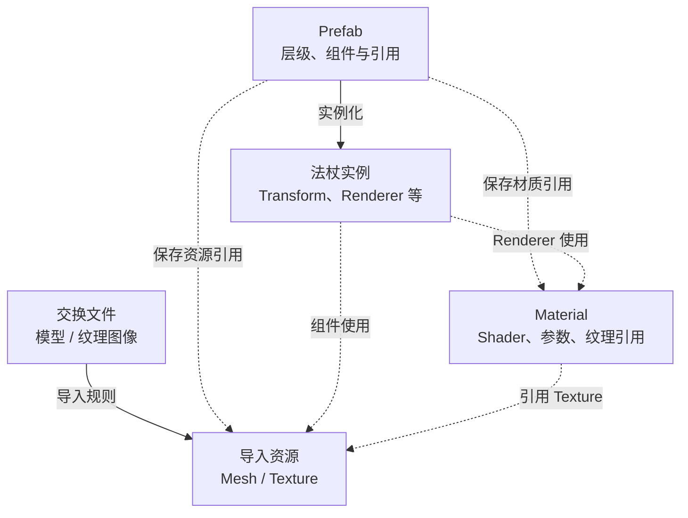
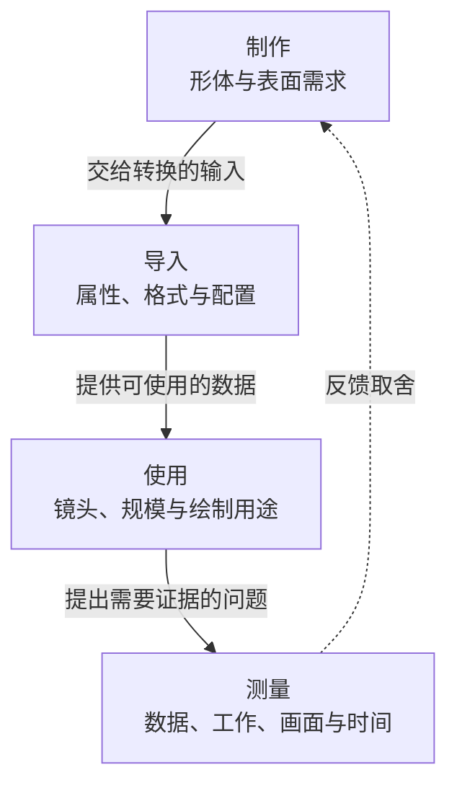

假设你要把一根法杖、一组庭院构件和一个施法圆环接进游戏。交付表上写着模型面数、贴图尺寸和文件大小，你也认识 Mesh、Material、Texture 和 Prefab。接下来，应该查什么？

这些参数能描述资源的一部分，却还不能回答它在游戏中会付出什么成本。法杖可能贴近镜头，也可能只是远处的小物件；一块墙可以只摆一次，也可以组成整个庭院；同一张圆环纹理可以只显示一层，也可以在战斗中重叠使用。资源相同，工作不一定相同。

要理解这种差别，需要把**准备了什么数据、怎样使用这些数据、为了使用它们做了什么工作**连起来。本篇建立的就是这条关系：让程序拿到资产后，能提出有依据的检查问题，再决定是否值得修改。

> 本文以法杖、庭院和圆环作教学情境，示意图表达对象和因果关系。Unity 对照依据 6000.0 官方文档；两张检查卡尚未在配套工程中执行，文中没有导入实测、GPU 捕获或设备性能结果。

## 一、程序接到的到底是什么

### 制作文件、导入资源和实例，回答不同问题

美术说的“一根法杖”，在不同阶段指向不同对象。

制作时，它可能是 DCC（数字内容制作）工具里的工程，例如 Maya 中的模型工程：保存几何、层级、修改历史和制作所需的信息。导出后，它可能是一份 FBX，以及几张颜色或材质参数图。进入引擎后，导入器依据文件内容和导入设置，生成游戏可使用的数据。这里把这类结果称为**导入资源**。

Unity 官方区分原始源文件与供应用使用的导入版本，由 Asset Database 维护它们之间的关系。因此，接入检查既要认源文件，也要认转换后的对象。[资产工作流说明](https://docs.unity3d.com/6000.0/Documentation/Manual/AssetWorkflow.html)

对于法杖，可以先认出三类对象：

- **Mesh** 保存几何及其属性、索引等数据，描述形体和着色需要的输入。
- **Material** 选择 Shader，保存纹理引用及相关参数，参与决定表面怎样绘制。
- **Prefab** 保存层级、组件、属性值和引用，提供可复用的组装模板。场景里使用的是它的实例。[Prefab 的定义](https://docs.unity3d.com/6000.0/Documentation/Manual/Prefabs.html)

一根法杖可能由杆、金属框和核心等部件组成。它们怎样对应 Mesh、Renderer 和材质槽，需要看实际导入和组装结果。DCC 中把部件放进一个组，不能直接推出它们已焊接为一个网格，也不能推出运行时只有一次绘制。

下面的简化示意把“数据转换”和“对象引用”分开。图中的资源是对象类别，不表示每类只有一个对象。

实线表示转换或实例化，虚线表示引用。实际项目还可能创建独立的 Mesh、材质或纹理副本，需要另外追踪。关系图的用途，是让你在看到一个对象时，知道应沿哪条引用继续找。

### 三种“大小”不能互相替代

资源从制作到使用，会经过不同的表示方式，因此至少应分清三种量。

| 看到的量 | 它回答什么 | 还不能回答什么 |
| --- | --- | --- |
| 源文件大小 | 制作或交换文件占多少存储空间 | 导入后的格式与运行时占用 |
| 构建、分发或下载数据量 | 指定打包与压缩条件下需要存储、传输多少字节 | 对象使用时的全部内存与处理工作 |
| 运行时占用 | 指定时刻，哪些数据和对象实际驻留 | 每帧读多少数据、执行多久 |

以颜色图为例，PNG 的文件大小受其编码和图像内容影响；运行时纹理则使用适合 GPU 的格式。Unity 会按导入设置和目标平台选择或指定纹理格式，GPU 不会直接把 PNG 文件当作采样格式。[GPU 纹理格式基础](https://docs.unity3d.com/6000.0/Documentation/Manual/texture-compression-fundamentals.html)

所以，把 PNG 再压小，并不自动减少游戏中的纹理占用。你需要继续问：导入尺寸是什么、实际格式是什么、有哪些 Mip 层、当前驻留哪些层，以及是否存在额外副本。Mip 是同一纹理逐级缩小的图像层级，用于在不同采样尺度下选择合适的数据。格式、Mip 和字节计算可继续看[Mesh 与 Texture 存储基础]()。

同样，Prefab 实例增加，也不能直接把整份纹理占用乘以实例数。多个实例可以引用同一份资源，同时各自拥有位置、组件和其他运行状态。分析时应把**共享资源、实例状态、实际副本**分别列出，再检查加载与引用关系。

### Unity 检查 A：沿一个实例找到资源

1. 选一个法杖实例，沿 MeshFilter 或 SkinnedMeshRenderer 的 Mesh、Renderer 的材质槽，再到材质引用的纹理，记下实际对象与来源。
2. 查看相关模型和纹理导入设置，记录目标平台、尺寸、格式等与当前问题有关的条件；保留设置，不急着修改。
3. 写清每条信息属于源文件、导入资源还是场景实例。需要占用数据时再做内存检查，不从文件大小推断全部运行内存。

这张卡只要求得到一条可追踪的引用关系。它解决“在看什么”，性能问题还要继续往下拆。

## 二、资产参数怎样成为运行工作

### 用四层关系连接参数与成本

制作选择影响资源里有什么，导入规则决定它转成什么，使用条件决定这些数据怎样参与游戏。最后，测量要回答指定条件下实际发生了什么。

这是解释问题的顺序，不是运行时执行时序。导入通常属于制作和构建阶段；游戏运行中的加载、对象创建、上传与每帧渲染，也有各自的调度关系。

这四层各有一个不能跳过的问题：

| 层 | 必须解释的关系 | 法杖上的例子 |
| --- | --- | --- |
| 制作 | 为了哪种表现，选择了哪些输入 | 金属框的轮廓由几何表达，颜色由图像表达 |
| 导入 | 输入经过什么规则，成为何种数据 | 网格带哪些属性，纹理转为何种尺寸和格式 |
| 使用 | 哪些条件让这些数据参与工作 | 手持近景、远处摆放、是否投影、用了哪种材质 |
| 测量 | 什么证据可以回答当前问题 | 导入检查、绘制记录、匹配视角、设备采样 |

如果只看制作参数，就会把“内容里有多少东西”误当成“运行时一定做多少工作”；如果只看一个性能数字，又可能不知道该回到哪份资源或哪个用法修改。

### 数据决定输入，使用决定工作范围

先看数据与处理的联系。

网格的顶点属性提供位置、法线、UV 等输入；索引用来组织几何。绘制它时，相关数据要被访问并参与处理。纹理提供表面数据，Shader 决定怎样读取和使用它们。因此，“顶点多少”“纹理多大”和“材质用了什么功能”，分别打开了不同的问题入口。

但数据存在，不等于每帧所有数据都会被同样处理。例如，一张材质引用的纹理，是否被某个绘制所用的 Shader 变体采样，需要看实际程序和用途；一个资源已经驻留，也不等于当前视角正在显示它。

接着看工作怎样被组织。对于一次场景渲染，引擎要根据可见性、渲染设置和材质等条件安排绘制，并准备相应数据与状态。这包含 CPU 工作。GPU 再执行提交给它的工作，处理几何、形成覆盖并完成相关着色、深度和混合操作。减少资源文件数量，并不能自动减少这两端的所有工作。

几何与表面工作的区别，可以沿一个三角形理解：它的顶点经过变换和投影，光栅化按屏幕覆盖形成候选片元，片元着色再为相关位置计算输出，可能读取颜色、法线等纹理。片元是光栅化产生的处理单位，不能简单当作最终显示的一个像素；同一个像素区域可以先后被多个三角形覆盖。深度等测试可以排除部分工作，具体发生时机与效果取决于状态、程序和硬件，不能把这段描述当成所有设备严格执行的时序。

因此，三角形数与覆盖范围描述不同投入：网格很简单，也可能铺满屏幕并执行复杂着色；网格很密，也可能只贡献很小的画面细节。纹理驻留量同样不等于每帧读取量：实际访问由绘制、采样位置、层级、过滤与缓存等条件共同影响。要回答每帧的数据访问成本，还需要沿使用路径检查。

这里还需要认识 **pass**：Shader 的一个 pass 描述某种绘制使用的程序和状态；渲染管线会按用途调度它们。例如，同一网格可能用于主画面着色，也可能用于生成阴影深度。Shader pass 与管线的渲染阶段并非一一对应。本篇先追踪“为哪个目的使用”，具体对应关系以实际管线和捕获为准。

这就解释了两个常见的断点：**共享一份数据，可以减少重复资源的需求，却仍然需要处理多次使用；主画面中只看到一次，也不能据此断言资源只参与了一次绘制。**

### 把成本写成不同问题，再选择证据

“这个资产很贵”需要进一步说明贵在哪里。

| 观察方向 | 为什么可能产生成本 | 应先查什么 |
| --- | --- | --- |
| 数据与驻留 | 导入数据、运行状态和副本需要空间 | 实际格式、资源共享、驻留范围与副本 |
| CPU 绘制组织 | 可见性处理、状态准备和命令提交需要工作 | Renderer、材质与绘制组织，再看对应 CPU 时间线 |
| GPU 几何 | 参与绘制的几何和属性需要处理 | 哪些网格用于哪些用途、输入与程序是什么 |
| GPU 表面工作 | 覆盖区域需要相关着色、采样、深度或混合 | 投影覆盖、叠层、Shader 功能和渲染状态 |
| 加载与首次使用 | 数据从存储到可使用，可能经历转换、创建和上传 | 工作发生在加载期、首次使用，还是稳定运行期间 |

这些方向并不互斥。例如，增加法线贴图会影响资源占用，也可能增加着色输入与采样工作；为法杖投影，会影响相关绘制用途。表格用于提出问题，不能仅凭某行参数大就判定瓶颈。

尤其要分清**工作量**和**耗时**。耗时还受硬件吞吐、缓存、调度、并行与同步影响。CPU 与 GPU 可以处理不同阶段的工作，帧完成又受到依赖和等待约束，因此不能把文件读取、CPU 提交、顶点处理和片元着色的数字随意相加，得到一个通用“资产毫秒数”。

某项工作减少了，也可能暂时不改变帧率：它没有缩短当前限制帧完成的那段路径。Unity 官方也要求先通过 profiling 区分 CPU 与 GPU 上的问题，再选择修改方向。[渲染工作与问题定位](https://docs.unity3d.com/6000.0/Documentation/Manual/OptimizingGraphicsPerformance.html)

如果问题出现在加载或首次使用，先沿[读盘完成为什么还不等于资源可用]()检查；如果已经需要制定场景约束，再进入[GPU 预算]()。本篇先让“贵”成为可检查的问题。

## 三、同一资产怎样随使用条件改变问题

### 法杖：从手持近景变成远处的小物件

先保持 Mesh、材质与纹理不变，把法杖放到更远的观察位置。

投影变小后，框上的细小倒角和纹理细节可能不再稳定可辨，屏幕覆盖也随之改变。但如果没有切换网格，提交的模型不会仅因为看起来小就自动变成低面版本。此时，“几何仍被处理多少”与“它在当前镜头贡献多少细节”开始成为两个值得比较的问题。

这给了简化一个理由：可以尝试减少对目标画面贡献有限的几何。理由来自视觉贡献，而是否有性能收益，还要看相关工作及当前瓶颈。

纹理也有相似的边界。远处使用较低分辨率的 Mip 参与采样，与高分辨率层是否仍在内存，是两个问题。Unity 的 Mipmap Streaming 可以按条件管理驻留层级，但需要启用并满足相应使用条件；仅把相机移远，不能据此填写“纹理占用已经下降”。[Mipmap Streaming 的工作方式](https://docs.unity3d.com/6000.0/Documentation/Manual/TextureStreaming-introduction.html)

因此，这个情境的下一步是记录相机和实际渲染分辨率，检查轮廓与细节贡献、当前网格和 Mip 使用；需要回答驻留问题时，再确认资源状态。主画面中的贡献有限，也要继续留意阴影等其他用途。

### 庭院：从一组构件变成重复摆放

再保持墙和门框的资源不变，增加场景中的摆放。

如果这些实例引用同一份 Mesh、Material 和 Texture，就存在共享资源的机会。新增摆放仍会增加实例状态；进入相关可见范围的对象，也会影响可见性处理、绘制组织以及 GPU 工作。

这两件事可以同时成立：**没有按实例数复制整套纹理，场景仍然可能因为使用规模增大而付出更多工作。**

共享材质也不保证所有对象成为一次绘制。管线采用哪种组织方式、对象是否满足相应条件、是否有不同材质状态和用途，都需要核对。Unity 的批处理有不同机制和限制，应按当前路径检查。[Draw Call Batching 文档](https://docs.unity3d.com/6000.0/Documentation/Manual/DrawCallBatching.html)

所以，庭院不应只统计“场景总共有多少块墙”。还应看当前视角与阴影等用途需要哪些对象、它们是否共用实际资源，以及被怎样组织。共享关系解释数据是否重复，绘制记录解释工作如何安排，CPU/GPU 采样再回答相应的时间问题。

具体批处理和手动合并的区别，继续看[Draw Call 与 Overdraw]()。在这里，程序先知道为什么“模型相同”和“实际工作相同”之间还缺条件。

### 圆环：从一次反馈变成多次叠加

最后看施法圆环。即使使用简单的面片和同一张纹理，它的成本也不能只从模型面数判断。

先固定圆环数量，增大屏幕中的尺寸。覆盖扩展后，需要处理的表面区域可能增加；再固定尺寸与材质，增加重叠层，某些区域可能参与更多次着色和混合。这是两个不同变量。若两项同时修改，观察到变化也难以知道各自贡献。

透明图像还容易造成另一个误解：看不见的部分就没有工作。纹理中的 Alpha 需要按 Shader 与渲染状态解释；仅把 Alpha 调低，并不等于删掉覆盖该区域的几何，也不能据此保证省去着色。深度、裁剪、排序与具体实现都会影响实际工作。

再增加扭曲、软粒子或额外采样等功能，改变的又是材质与相关依赖。画面看起来仍是“几个圆环”，执行内容却可能不同。因此，需要分别描述**数量、覆盖、叠层和材质功能**，再选择检查方向。

这里的目标也要先讲清：圆环需要怎样的反馈、哪些层次对辨识施法状态有用。叠加可能正是画面需求的一部分。取舍要比较必要表现与成本，不能只以层数更少作为完成依据。

上述三个情境可以共用一句提问方式：**保持什么，改变什么，因此多了哪个问题，用什么证据回答？** 它把资产本体的变化、使用条件的变化和瓶颈的变化分开。

### Unity 检查 B：从一个对象找到相关绘制

1. 在固定视角打开 `Window > Analysis > Frame Debugger`，选择 Editor 或实际连接的 Player 目标并启用，记下目标与渲染配置。
2. 定位目标对象相关事件，记录主画面、阴影等实际存在的用途，以及可见的材质、pass 和相关深度/混合状态。事件名与信息以当前版本为准。
3. 用一句话写“确认了什么工作”。若要回答花了多少时间，再进入 CPU/GPU 采样，不把事件数换算为耗时。

Frame Debugger 可用于逐事件查看绘制构成及相关状态；这张卡的产物是一份用途记录，不是性能报告。[操作入口](https://docs.unity3d.com/6000.0/Documentation/Manual/FrameDebugger-debug.html)与[工具定位](https://docs.unity3d.com/6000.0/Documentation/Manual/FrameDebugger.html)。

## 四、怎样比较一个修改方案

### 先说要改善什么，再解释为什么可能有效

理解了成本来源以后，修改建议就可以从“这个参数应该小一点”，变成一条可检验的因果关系。

例如，“远距法杖值得增加 LOD”还只是候选。把它说完整，需要解释：目标使用条件是什么，哪些几何对画面贡献有限，切换简化网格预计减少哪类数据和处理，以及哪些表现必须保住。

这时也可以发现不同目标之间的差别。想降低下载数据量、减少运行驻留、缩短 CPU 提交时间、减少 GPU 几何工作或改善首次使用卡顿，需要的修改和证据都可能不同。

一个方案应先写成：**在这些条件下，改变这个变量，预计影响这类工作，同时保持这些画面要求。** “预计”保留了待验证的部分，也让其他人知道该检查什么。

### 修改通常会转移成本

| 候选改动 | 预计影响的方向 | 需要一同检查的代价与限制 |
| --- | --- | --- |
| 降低纹理导入尺寸 | 在格式、层级等条件可比时减少纹理数据规模 | 画质、实际驻留和采样行为；不能按存储比例承诺时间收益 |
| 去掉不需要的材质功能 | 相关变体可能减少着色输入或指令、采样 | 编译结果是否确实改变，目标光照与表现是否保住 |
| 手动合并网格或共用图集 | 可能改变绘制组织或资源共用方式 | 合并后的可见性粒度、图集边距、共同驻留范围与维护 |
| 为远距法杖增加 LOD | 不同显示条件可选用更简化的网格 | 额外网格、引用与驻留、切换观感、配置和维护工作 |

例如，手动合并庭院中的多个网格，如果合并后的对象需要作为整体处理可见性，就可能让原本可以独立排除的部分继续参与相关工作。图集把纹理放到一起，也可能把原先不同的使用范围连在一起。因此，减少某个计数之前，应先解释它改变了哪条边界。

法杖 LOD 同样如此。它提供了“让几何随显示条件变化”的选择，却增加了候选网格和切换条件。只有当简化幅度、画面要求和实际使用合适时，这项新增复杂度才可能值得。具体顶点、屏幕三角形和 LOD 取舍，继续看[《模型面数之外的成本》]()；总览先把要比较的内容列全。

### 为每种结论匹配证据

比较至少有三个层面。

**数据层**确认改动是否发生。例如，理论公式可以计算指定格式下的数据量，导入检查可以确认结果采用了哪些数据和设置。它还不能证明设备每帧传输了多少字节。

**画面与工作层**确认改变是否满足目标，以及实际怎样被使用。匹配镜头可以检查轮廓、材质和切换；Frame Debugger 可以帮助定位绘制。事件减少并不自动说明节省了多少时间，画面可接受也不自动说明性能更好。

**设备性能层**才进一步回答指定条件下的时间、驻留或相应硬件指标。需要记录设备、图形 API、实际版本、质量配置、场景路线和采样方法，结论覆盖这些条件。一次成功比较不能自动推广到所有机型和负载。

没有最后一层时，仍然可以形成有用判断：“导入数据按预期改变，目标镜头仍待检查”“画面可接受，设备收益待测”。保持这个边界，比用推导代填实测结果更有助于下一步工作。

## 五、从资产描述走到检查记录

### 用法杖完整走一次

现在定义一份教学输入：法杖包含杆、框和核心，计划同时用于手持近景和庭院远处。程序考虑为远处使用增加一个简化网格，先保持材质和纹理不变。

这些是情境设定，尚未建立对应工程。可以据此组织检查，但不能据此填写导入数量、实际 pass 或耗时。

| 记录项 | 这次已经给出的条件 | 还要检查什么 |
| --- | --- | --- |
| 对象与版本 | 同一法杖的近景和远处用法，准备比较原版与简化候选 | 对应源版本、Mesh、Prefab、实际引用及导入设置 |
| 使用条件 | 需要保住手持表现，希望比较远处细节贡献 | 游戏镜头、投影尺寸、渲染分辨率、出现规模与质量设置 |
| 候选问题 | 远处是否有贡献有限但仍参与处理的几何 | 当前几何、轮廓和细节、主画面及其他绘制用途 |
| 拟改变量 | 远处改用简化网格，材质和纹理保持可比 | 实际是否选到该网格，候选还改变了哪些属性或边界 |
| 预计影响 | 减少相关几何数据与处理的可能性 | 导入差异、切换观感、额外数据与实际工作 |
| 当前判断 | 这是值得检查的候选，尚无采用结论 | 画面接受条件与目标设备证据 |

这张记录也能限制推理范围。既然材质和纹理未改，就不能仅因增加 LOD 宣称纹理驻留下降；如果实际网格没有切换，就还不能用这次观察评价简化方案；如果切换正确但帧时间未变，还需要检查当前限制条件，不能立即说 LOD 原理无效。

它也给出了更清楚的协作语言。程序可以把问题反馈成：“请比较这个远距镜头下框的轮廓和高光，保留核心辨识；候选要单独记录导入属性，之后再查实际绘制和设备成本。”这比只要求一个更小的面数，更能说明修改目的与接受条件。

<!-- DATA-TODO: 制作法杖原版/远距简化候选，记录源版本、Unity 补丁和 URP 包版本、导入设置、镜头/渲染分辨率；补匹配视角与实际绘制记录。若报告性能收益，另补目标设备、API、稳定采样方法与原始数据。未完成前，保留本节为教学设定，不改写成已验证案例。 -->

### 根据缺失的信息决定下一步

如果只知道源文件大小，先沿引用找到导入资源和实际格式；如果已经确认对象参与额外绘制，先判断该用途是否必要，再选择对应成本的测量；如果已有候选，也先确认变量和画面约束是否可比。

继续阅读可以按当前问题选择：

- 数据对象还不清楚：读[几何与表面]()；需要理解格式、Mip 和字节，读[存储基础]()。
- 想追绘制组织或覆盖：读[Draw Call 与 Overdraw]()；再按数据访问或着色问题进入[带宽]()和[Shader]()。
- 想确认附加光照数据和绘制用途：读[光照资产]()与[移动端阴影]()。
- 要把候选变成项目约束：读[GPU 预算]()、[每档资产规格]()和[程序与美术联合验收]()。

本文的三个教学对象延续了美术制作系列的[法杖]()、[庭院构件]()和[特效]()语境。需要制作操作时可以回读相应文章，理解成本模型不要求先完成整套美术课程。

选题来自 [Samsung 对 Arm 美术最佳实践的导读](https://developer.samsung.com/galaxy-gamedev/blog/en/2021/05/19/best-practices-for-mobile-game-developers-and-artists)。本文在此基础上按程序接入资产的观察顺序组织解释，四层模型与教学情境是本篇的分析方法，不是对原文测试结果的转述。

**理解美术资产成本，要把导入后的数据、具体使用条件与实际工作连起来，再用匹配的证据决定取舍。**
