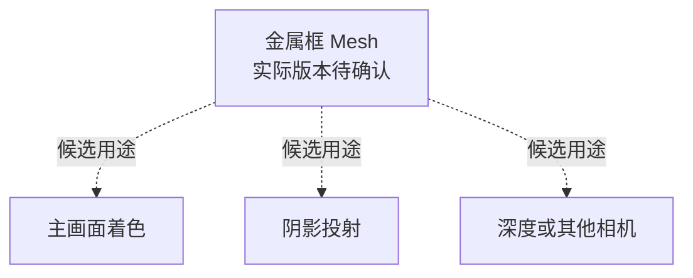

接到一个模型时，程序常会先问“多少面”。这个数字能帮助描述几何规模，但如果要进一步判断它是否需要简化，还缺几条信息：统计的是制作多边形还是导入三角形，带了哪些顶点属性，主要镜头中能看见什么，以及模型实际参与哪些绘制。

前一篇[《程序怎样理解美术资产成本》]()建立了制作、导入、使用和测量的关系。本篇沿几何展开这条关系，回答一个更具体的问题：**知道面数以后，还应该查什么，才能决定保留哪些几何？**

贯穿全文的对象，是[美术制作 03]()中的法杖金属框 `staff_frame`。原练习用四个相交的简单盒体组成框，分组便于编辑，不代表部件已经焊接，也不代表一个 Mesh 或一次绘制。为讨论细节取舍，下面还会提出带倒角、不同属性边界和简化级别的教学变体。

> 文中变体与配套工程尚未制作，三张 Unity 检查卡待执行。几何图表达指定的教学关系，不是法杖的导入截图；没有导入数量、GPU 捕获或设备耗时结果。Unity 对照依据 6000.0 文档，实际检查时还应记录补丁与渲染管线版本。

## 一、“多少面”描述了模型的哪一部分

### 制作中的多边形，要落实成具体拓扑

在 Maya、Blender 等数字内容制作工具中，模型表面可以由三角形、四边形或更多边的多边形组织。制作中的“面数”可能统计这些多边形，而游戏使用的导入网格还会经过导出、三角化和其他处理。

先看框上一块平坦表面。假设它是一个简单四边形 ABCD，指定沿 AC 切开，就得到 ABC 和 ACD 两个三角形。原来的一个多边形与结果中的两个三角形，描述的是不同阶段的量。

这也解释了为什么三角化值得确认。对于非共面四边形或更复杂的多边形，不同切分可能形成不同表面，并改变插值与着色。因此，源模型截图上的线条和引擎实际使用的三角化，需要对应起来；不能认为导入只是在改一个计数单位。

本篇以三角形拓扑为主。Unity 的 Mesh 还支持其他拓扑，索引怎样组成一个图元，要按实际拓扑解释。[Mesh 索引与拓扑说明](https://docs.unity3d.com/6000.0/Documentation/Manual/mesh-index-data.html)

### 三角形引用的是顶点记录

可以把索引理解为“到顶点记录中找哪一条”。在三角形列表中，每三个索引组织一个三角形；多个三角形可以重复引用同一条记录，无需为了每次引用都存一份相同数据。

下面先假设共享位置的完整属性兼容，用四条记录表示 A、B、C、D。两个三角形使用六个索引，其中 A 和 C 对应的记录被共同引用。

<figure role="region" tabindex="0" aria-label="四边形、三角化和索引关系示意，可横向查看" style="overflow-x:auto">
<svg xmlns="http://www.w3.org/2000/svg" viewBox="0 0 900 330" role="img" aria-labelledby="n2-topology-title n2-topology-desc" style="width:100%;min-width:680px;height:auto;display:block">
<title id="n2-topology-title">四边形、三角化与索引的关系示意</title>
<desc id="n2-topology-desc">四边形 ABCD 沿 AC 分成 ABC 和 ACD。假设完整属性兼容，四条顶点记录由六个索引引用。这是教学设定，不是导入结果。</desc>
<rect width="900" height="330" rx="16" fill="#fffaf2"/>
<g font-family="Segoe UI, Microsoft YaHei, sans-serif" fill="#14211f" font-size="18">
<text x="34" y="37" font-size="20" font-weight="600">制作中的一个四边形</text><text x="328" y="37" font-size="20" font-weight="600">指定沿 AC 三角化</text><text x="638" y="37" font-size="20" font-weight="600">共享记录与索引</text>
<path d="M58 91H246V245H58Z" fill="#e7f1ef" stroke="#1e5d5f" stroke-width="3"/>
<text x="36" y="84">A</text><text x="250" y="84">B</text><text x="250" y="267">C</text><text x="36" y="267">D</text>
<path d="M358 91H546V245Z" fill="#e7f1ef"/><path d="M358 91L546 245H358Z" fill="#f4e3d9"/>
<path d="M358 91H546V245H358ZM358 91L546 245" fill="none" stroke="#1e5d5f" stroke-width="3"/>
<text x="336" y="84">A</text><text x="550" y="84">B</text><text x="550" y="267">C</text><text x="336" y="267">D</text><text x="466" y="132">ABC</text><text x="379" y="218">ACD</text>
<path d="M288 160H312M304 152L312 160L304 168M588 160H612M604 152L612 160L604 168" fill="none" stroke="#a14d34" stroke-width="2"/>
<text x="640" y="91">记录 0 → A　记录 1 → B</text><text x="640" y="126">记录 2 → C　记录 3 → D</text>
<rect x="632" y="154" width="242" height="99" rx="8" fill="#e7f1ef"/><text x="647" y="187">三角形一：[0, 1, 2]</text><text x="647" y="226">三角形二：[0, 2, 3]</text>
<text x="34" y="307" font-size="16" fill="#4d615e">教学设定：共享边上的完整属性兼容。记录数、索引数与三角形数描述不同的量。</text>
</g>
</svg>
<figcaption>图 1：指定拓扑下的关系示意。数值来自图中的定义，不是某个导入器的输出。</figcaption>
</figure>

“三角形数乘三”可以描述这种列表的索引数量，却不能直接给出不同顶点记录的数量。同样，把索引数除以三之前，也要确认相关子网格采用的是三角形列表拓扑。

因此，收到一个面数时，先补齐三个条件：**统计阶段、对象范围、拓扑口径**。范围要说明包含哪些 Mesh 或子网格，以及是在统计某个 LOD，还是把多个级别加在一起。只有口径一致，两个数字才适合放到同一张比较表中。

## 二、导入后的数据为什么值得单独检查

### 同一个位置，可能需要不同属性记录

前一张图暂时把顶点写成 A、B、C、D。实际上，供着色使用的顶点除了位置，还可以带法线、切线、UV、颜色等属性。位置回答“在哪里”，法线参与描述表面的光照朝向，UV 指明怎样在纹理中取数据；切线等信息可以参与建立表面的方向参考。

在普通 Unity Mesh 的顶点数据模型中，各种已使用属性按对应的记录组织。一个顶点索引定位的是一套相关属性，不能让同一条记录在一个三角形上使用一种 UV、在另一个三角形上又自动改用另一种 UV。[Mesh 顶点属性说明](https://docs.unity3d.com/6000.0/Documentation/Manual/mesh-vertex-data.html)

回到金属框的转角。两块面虽然在边缘处相接，但如果想让它们保持硬朗的明暗边界，就可能需要在同一位置提供不同的着色法线。若 UV 在此切开，两侧还可能需要不同的纹理坐标。把这些属性保留下来时，仅有“位置一样”就不足以复用一整条记录。

| 教学记录 | 位置 | 法线 | UV | 说明 |
| --- | --- | --- | --- | --- |
| `vA` | 同一个 P | 面 A 所需方向 | 面 A 的坐标 | 供一侧三角形引用 |
| `vB` | 同一个 P | 面 B 所需方向 | 面 B 的坐标 | 供另一侧三角形引用 |

这里不是凭空增加形体上的一个角，而是用不同记录表达该位置两侧需要的属性。若只有法线不同，或只有 UV 不同，也可能需要这样的区别。反过来，所有相关属性相容，才有共享完整记录的条件；能否实际合并，还要看导出、导入和优化过程。

这也是源模型的位置点统计与导入顶点数可能不同的原因之一。实际检查时还应核对法线是导入还是重算、切线怎样生成、UV 是否新增或重排，以及网格是否被拆分或优化。不能把所有差异都归因于某一个接缝。

### 拆分有表现用途，数量变化也有条件

硬边、UV 接缝和材质划分不是同一种边界，它们可能重合，也可能出现在不同位置。某个位置已经因法线不同而分成记录，新增的 UV 边界是否继续增加记录，要看两侧的完整属性组合。不能把几种边界各乘一次，推导出统一的顶点膨胀倍数。

因此，“导入顶点比制作点数多”本身不构成错误。先问这些属性差异是否服务了需要的画面，再问是否存在无用数据、意外边界或不合适的转换。直接抹平法线或焊接 UV，虽然可能改变数据，也可能同时破坏预期的明暗与贴图关系。

属性的种类、格式和布局还会影响数据量。相同顶点数的两个网格，如果一个多带 UV 或其他属性，也不能只按顶点数断言存储相同。字节、索引格式和压缩的详细计算，继续看[存储基础]()。

### 记录数、引用次数与执行次数继续分开

`Mesh.vertexCount` 描述这个 Mesh 的顶点数量，不等于某帧顶点着色器的实际调用次数，更不等于时间。

一方面，同一份 Mesh 可能被多个实例和用途使用；另一方面，一次索引绘制中，顶点数据与处理结果的复用还受到索引顺序、缓存和设备实现等条件影响。Arm 对 Mali 的说明就用变换后缓存解释了为什么重复引用与索引局部性值得关注，也明确区分了验证层的缓存模型与实际硬件。[Arm 的索引复用说明](https://developer.arm.com/community/arm-community-blogs/b/mobile-graphics-and-gaming-blog/posts/arm-best-practice-warnings-in-vulkan-sdk)

这份资料支持“需要检查复用与执行条件”，不能据此为所有 GPU 指定同一缓存行为。本文也不靠记录数估算调用次数：导入数据先回答准备了什么，实际绘制和设备证据再回答它们怎样参与工作。

### Unity 检查 A：看导入的 Mesh

1. 从目标 Renderer 找到实际 Mesh 子资源，在 Inspector/Preview 查看顶点、面类型与数量、子网格和 UV 等信息，区分它与 FBX 总览。
2. 对照导出约定和模型导入设置，查看法线、切线与 UV 的处理；需要比较时，用只改变一类属性边界的教学副本。
3. 记录“看到的差异—可能原因—还需确认”，不把数量变化填写为性能收益，也不为读取数据随意改变运行副本设置。

这张卡只得到导入数据与设置的对应关系，不要求写遍历工具。预览中提供的信息见 [Mesh 数据可视化](https://docs.unity3d.com/6000.0/Documentation/Manual/view-mesh-data-visualizations.html)。

## 三、把网格放进游戏镜头

### 模型数据相同，投影尺度仍会变化

现在保持框的网格不变，把它放进游戏镜头。在透视相机中，距离、视角、视场角以及对象尺寸，共同影响投影；正交相机则不能简单套用近大远小的判断。最终落到多少像素，还与实际渲染分辨率有关。

所以，“离相机多远”并不足以描述视觉要求。相同距离下，更宽的透视视场可能让框显示得更小；相同画面比例下，改变渲染分辨率，又会改变同一部位可使用的像素数量。截图放大后看得见的线条，也不代表玩家在目标显示条件下能稳定辨认。

下面用一块局部表面说明：如果没有切换网格，投影缩小并不会自动删除它的三角形。

<figure role="region" tabindex="0" aria-label="相同拓扑随投影缩小的示意，可横向查看" style="overflow-x:auto">
<svg xmlns="http://www.w3.org/2000/svg" viewBox="0 0 780 480" role="img" aria-labelledby="n2-screen-title n2-screen-desc" style="width:100%;min-width:640px;height:auto;display:block">
<title id="n2-screen-title">相同三角化随屏幕投影缩小的示意</title>
<desc id="n2-screen-desc">三幅同一像素标尺的局部示意中，带中心点的四边形投影逐步缩小，始终使用四个三角形。投影变小不代表自动简化，也不表示耗时按面积变化。</desc>
<defs><pattern id="n2-pixels" width="16" height="16" patternUnits="userSpaceOnUse"><path d="M16 0H0V16" fill="none" stroke="#cbd8d4" stroke-width="0.8"/></pattern></defs>
<rect width="780" height="480" rx="16" fill="#fffaf2"/>
<g font-family="Segoe UI, Microsoft YaHei, sans-serif" fill="#14211f" font-size="18">
<text x="28" y="36" font-size="21" font-weight="600">网格未切换，屏幕中的三角形仍会变小</text>
<text x="28" y="66" font-size="16" fill="#4d615e">同一局部拓扑，同一像素标尺；仅示意投影尺度变化</text>
<text x="93" y="111">近处投影</text><text x="333" y="111">中间投影</text><text x="573" y="111">远处投影</text>
<g fill="url(#n2-pixels)" stroke="#b3c5bf"><rect x="28" y="129" width="224" height="224"/><rect x="268" y="129" width="224" height="224"/><rect x="508" y="129" width="224" height="224"/></g>
<g fill="#1e5d5f" fill-opacity="0.12" stroke="#1e5d5f" stroke-width="2.5"><path d="M60 161H220V321H60ZM60 161L220 321M220 161L60 321"/><path d="M348 209H412V273H348ZM348 209L412 273M412 209L348 273"/><path d="M612 233H628V249H612ZM612 233L628 249M628 233L612 249"/></g>
<text x="28" y="390">每幅均为 4 个三角形；覆盖与新增可辨细节需要分别检查。</text>
<text x="28" y="424" font-size="16" fill="#4d615e">网格线是放大的像素标尺，不表示真实采样点、抗锯齿或 GPU 执行单元。</text>
<text x="28" y="452" font-size="16" fill="#4d615e">这不是法杖的线框截图，也不提供微三角形的统一像素阈值。</text>
</g>
</svg>
<figcaption>图 2：局部三角化的投影示意。应同时记录实际渲染分辨率和目标显示尺寸。</figcaption>
</figure>

### 小三角形为什么值得注意

顶点处理、三角形相关处理与片元着色承担不同工作。即使三角形最后覆盖很少的样本，相关几何仍可能先被读取、处理和组织；画面细节贡献变小，不会让此前所有工作自动归零。

当一个表面被切成许多很小或狭长的三角形时，就值得问：新增的几何工作换来了多少稳定可辨的画面信息？这与“这个对象总共覆盖多大”也不同。整体覆盖不变，内部仍可能有完全不同的三角形密度。

Arm 在其移动 GPU 分析材料中讨论了细小三角形带来的几何和分桶负担，同时提醒相关剔除指标不能单独证明性能是否受影响。[Arm 的几何分析说明](https://developer.arm.com/community/arm-community-blogs/b/mobile-graphics-and-gaming-blog/posts/finding-and-fixing-hidden-performance-problems-in-mobile-games-with-arm-performance-studio)

因此，本篇把“小”作为检查线索，不设统一像素阈值。小于一个像素不代表绝对不可见或完全没有成本：覆盖、抗锯齿、运动与着色都可能影响结果。具体硬件上的吞吐、执行效率和耗时，需要对应资料与设备记录。

### 几何密度应该服务哪些信息

对金属框，先看外轮廓、内部孔洞和曲率，再看倒角形成的高光，以及投影中的形状。这些信息可能在不同镜头和光照下显露，不能只凭一张静态正面图评价。

若在平坦区域继续细分，却没有改变轮廓、形变或需要的表面变化，就有理由把它列为简化候选。若某个倒角虽然很细，却在运动中形成关键高光，也应先保留它的表现要求，再寻找其他表达方式。线框越密并不直接说明越浪费，关键在于密度提供了什么。

这个阶段能得到的判断是：“哪些部位值得做匹配镜头的候选比较”。它还不能单独证明 GPU 已经受几何限制，更不能承诺删去这些三角形就提升帧率。

## 四、模型实际被用在哪些绘制中

### 主画面的大小，只描述一个用途

主相机看见的框很小，并不说明所有使用都同样小。它可能还参与阴影投射、某些深度用途或其他相机；相应的投影、目标分辨率与使用程序也可能不同。

例如，在主视图里难以辨认的轮廓，可能在某个阴影视图中仍需要保留。反过来，一个网格即使为某用途提交，也不保证每个三角形都贡献最终可见结果；裁剪、剔除、深度和其他处理会继续影响工作。

下面全部是待检查的候选引用。虚线不表示已经捕获到这些用途，也不保证每条都存在。

这张图让问题从“模型有多少三角形”变成“哪份几何被哪些用途使用”。阴影路径与级联等具体取舍，继续看[移动端阴影]()。

### 对象、子网格与一次绘制不是同一个边界

框的四个盒体放进一个 DCC 组，是制作层级。导入后对应哪些 Mesh、Renderer、子网格和材质，需要分别确认；即使只有一个 Mesh，也可能有不同子网格和用途。

本篇沿用前文的区分：Shader pass 描述某种绘制使用的程序与状态，管线按用途安排相关工作，二者不能仅凭名称一一等同。是否形成独立绘制，还要看具体管线、批处理和实例化路径。完整机制交给[Draw Call 与 Overdraw]()，这里只检查对应关系。

同理，“模型三角形数 × 固定 pass 数”最多是带假设的粗略描述，不能冒充 GPU 实际处理量。不同用途可能使用不同属性和程序，可见范围也不同，处理结果能否复用还受到实现条件约束。找到多次使用，是为了继续定位成本，不是为了凑出一个精确毫秒数。

### Unity 检查 B：看同一对象的绘制用途

1. 在有目标对象和可投影光源的教学场景中固定视角，打开 `Window > Analysis > Frame Debugger`，记录 Editor/Player 目标与渲染配置。
2. 定位该对象相关事件，记录实际存在的主画面、阴影等用途、子网格与 pass；没有观察到的用途不要按示意图补齐。
3. 将结果对应回用途图，写清确认范围。需要时间结论时，再进行相应 CPU/GPU 采样。

这张卡得到的是用途与事件记录，不是设备性能报告。[Frame Debugger 操作说明](https://docs.unity3d.com/6000.0/Documentation/Manual/FrameDebugger-debug.html)

## 五、几何、法线与 LOD 怎样比较

### 几何保留形体，法线改变着色

删除几何之前，先说清它提供了什么。轮廓、孔洞和相互遮挡直接依赖形体；倒角还会改变表面朝向分布，影响高光随观察和光照的变化。简化不仅可能减少数据，也可能改变这些表现。

普通法线贴图提供另一种选择：在着色时使用变化的法线方向，让表面呈现细节。它不直接移动网格顶点，所以不能自动补回被删除的外轮廓、真实孔洞和几何遮挡。这一点也见 Unity 对法线映射的[原理说明](https://docs.unity3d.com/6000.0/Documentation/Manual/StandardShaderMaterialParameterNormalMap.html)。

例如，可以把金属框表面的浅纹理细节列为法线表达候选；若要保住某个视角下明显的边缘轮廓，只改普通法线贴图就未必满足要求。本文讨论这条常规路径，位移、视差等其他技术需另看其机制和代价。

成本也发生了转移。几何减少，可能减少相关数据和处理；法线表达则需要相应纹理、方向转换及着色工作。材质原本是否已经启用法线功能、纹理尺寸和格式是什么、覆盖多大，都影响新增成本。几何更少并不能单独证明整个方案更便宜。

因此，几何/法线比较无法假装其他一切不变。应明确它是两种表达方案的比较，把几何、材质输入、纹理和画面差异一同记录。TBN 与采样机制可按需读[法线映射]()，着色取舍继续看[Shader 优化]()。

### LOD 把显示条件变成版本选择

LOD（Level of Detail）为同一对象准备不同细节级别，并根据显示条件选择使用哪些 Renderer。它的价值，是允许近处保留必要细节、较小时使用足够表达形体的简化版本。

LOD 本身不是简化结果的质量保证。仅把同样复杂的网格放进不同级别，不会自然产生有意义的几何收益；如果低级别破坏了辨识所需的孔洞或轮廓，也不能因为面数较少就视为可采用版本。

Unity LODGroup 的切换阈值以对象屏幕空间高度占总屏幕高度的比例为基础，而非统一世界距离。对象尺寸、相机投影与质量中的 LOD Bias 等条件，需要结合实际配置确认。[LODGroup 文档](https://docs.unity3d.com/6000.0/Documentation/Manual/class-LODGroup.html)

这里还要分清相对高度与像素大小。画面比例和相机条件不变时，降低渲染分辨率可能不改变相对高度，却会减少对象投影占用的像素。阈值描述级别选择，不能直接当成三角形的像素预算。要决定在哪个条件切换，仍需回到目标显示和画面接受要求。

### 切换、驻留与维护也要进入比较

级别切换可能出现轮廓、高光或纹理表现的突变。检查时应沿游戏实际镜头路线观察，而不只在两个独立截图之间比较。

淡入淡出可以作为过渡方案，但不是零成本开关。Unity 文档描述的相邻级别 Cross Fade，会在过渡区分别渲染两级并进行交叉淡化；实际表现还依赖所用模式与 Shader 支持。不能只看稳定处的低级别网格，就忽略切换期间的工作。

多级网格也增加了构建数据和维护对象。它们是否同时驻留，需要检查引用和加载路径，不能仅因某一级当前未显示就断言已卸载；同样，也不能不看加载方式就声称所有级别始终驻留。增加 LOD 后，每次修改、导入和画面回归还要覆盖相应级别与边界。

这些成本对一个原本就很简单、很少出现的盒框，可能没有足够收益去承担。因此，本文使用带细节的教学变体提出候选，不暗示原练习的简单盒框必须增加 LOD，也不规定级数、阈值或统一减面比例。

| 候选 | 预计改变什么 | 要保住什么 | 还需查什么 |
| --- | --- | --- | --- |
| 删除贡献有限的细分 | 几何数据与相关处理 | 轮廓、曲率、高光和阴影 | 导入数据是否改变，目标镜头是否可接受 |
| 部分细节转为法线 | 几何与表面工作的分配 | 需要的表面细节和材质表现 | 纹理、实际着色、相关视角与用途 |
| 增加简化 LOD | 不同显示条件使用的网格 | 各级画面与切换连续性 | 级别选择、过渡、驻留与后续设备成本 |

### Unity 检查 C：看 LOD 选择与切换

1. 用教学副本准备两个明确不同的网格，放进 LODGroup 对应级别，核对 Renderer 引用及对象参考范围，记录所用材质。
2. 固定相机路线与渲染分辨率，观察当前级别和画面变化，记录相对屏幕高度阈值、LOD Bias 与实际版本。
3. 若检查淡化，先确认模式与 Shader 支持，再观察过渡区相关事件；分别记录选择、观感与工作，不预填时间收益。

这张卡只确认选择和过渡是否符合预期。没有相应工程观察时，不能把步骤改写成已经完成的验证。

## 六、怎样决定保留哪个版本

### 先把候选拆成能解释的比较

现在回到法杖金属框，准备三类不同的比较。它们分别回答问题，不能同时混入一个“优化版”，再把结果归因于面数。

| 比较 | 保持或明确记录的条件 | 主要问题 |
| --- | --- | --- |
| 属性边界对照 | 形体与三角化保持可比，一次改变一类法线或 UV 边界 | 导入记录怎样变化，原因是否符合预期 |
| 几何/法线表达对照 | 目标镜头、灯光和表现一致；记录不同材质输入与纹理 | 哪种表达满足画面，付出哪些不同工作 |
| LOD 使用对照 | 相机路线、显示条件、实例、材质、阴影与切换配置可追溯 | 简化是否被使用，切换是否可接受，代价是否值得 |

这三类材料目前都待制作。已有的定义足以指导准备，但还不足以填入“减少了多少顶点”“实际多了哪个 pass”或“快了多少”。

### 把数据、画面、工作和时间并排

假设以后完成某组对照，可以按以下顺序组织证据；表中是检查与决策关系，不是本篇已取得的结果。

| 要回答的问题 | 需要的证据 | 证据支持到哪一步 |
| --- | --- | --- |
| 导入数据是否按预期改变 | 源版本、导入设置、顶点/索引、属性与子网格 | 材料是否适合继续比较，是否需要解释意外差异 |
| 目标画面能否接受 | 匹配镜头下的轮廓、高光、阴影与运动/切换观察 | 保留哪些细节、调整哪个候选 |
| 实际用了哪份几何 | 当前级别、引用与相关绘制记录 | 是否选到预期网格，参与了哪些用途 |
| 实际成本是否值得 | 对应问题的设备、API、质量条件与稳定采样记录 | 是否采用，以及结论的适用范围 |

例如，导入数据按预期减少，只能先说明数据改动成立；若 LOD 没有实际切换，这次运行就还不能评价简化版本；若画面可接受但时间未变，还应检查当前限制帧完成的路径，而不是立即推断所有几何修改都没有价值。

同样，若只在主相机镜头检查了轮廓，阴影和其他必要用途仍待确认；若数据与设备记录齐全，但低级别破坏了关键辨识，方案也还没有满足接受条件。不同证据补齐不同部分，不能相互代替。

<!-- DATA-TODO: 制作 staff_frame 的属性边界对照、几何/法线候选和显式简化 LOD；分别记录源版本、导出与导入设置、属性/索引、Unity 补丁和管线版本、镜头/渲染分辨率、材质及光照。补匹配视角、实际级别与绘制用途；报告性能收益前另补设备/API、稳定采样方法和原始记录。三类比较分别执行，未完成前保留为教学方案。 -->

最后交给团队的判断，应能说明哪份候选适合哪些用法、保留了什么、改变了哪些数据和工作，以及哪些条件变化后需要复查。完整预算和验收方法，继续看[GPU 预算]()与[程序和美术联合验收]()。

本篇的选题背景来自 Arm 与 Unity 的几何课程，其中[三角形使用](https://learn.unity.com/course/3d-art-optimization-for-mobile-gaming-5474/unit/geometry-7415/tutorial/triangle-and-polygon-usage-8140?version=2019.4)和[LOD](https://learn.unity.com/tutorial/level-of-detail-3653)页面标注 Unity 2019.4。本文按当前选定文档核对 Unity 映射，用法杖组织独立教学推演，不沿用旧课程的固定数值作为项目标准，也不转述其演示为本项目实测。

**几何取舍要同时解释导入了什么、在目标镜头贡献什么、参与哪些工作，再用相应证据决定保留哪个版本。**
