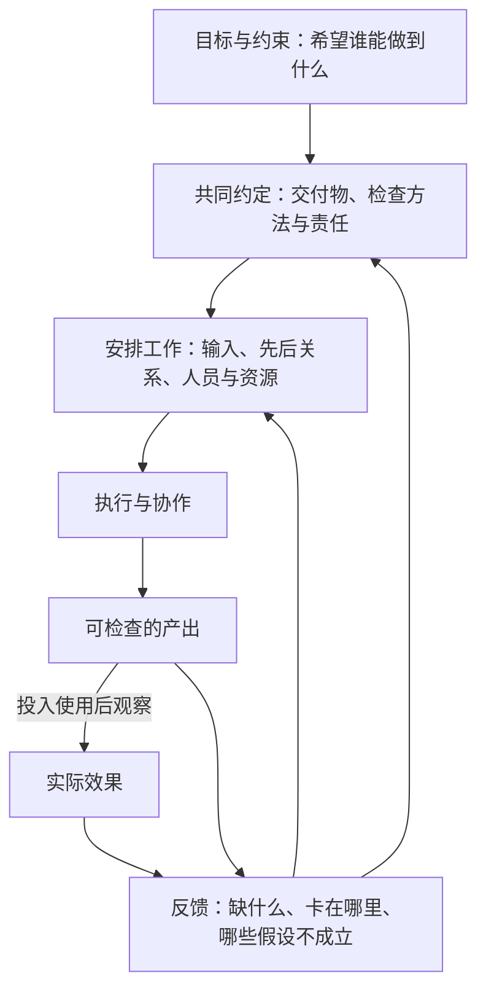

一次培训结束了：通知按时发出，讲义准备齐全，讲师讲完了内容，参加者也签了到。组织者对照清单，发现每一项都已完成。

如果培训的目的是让新成员独立办理物品借用登记，那么还有一个问题没有回答：换一份没见过的借用申请，参加者能不能正确完成登记，遇到缺少物品编号的情况又会怎样处理？

这两个判断可以同时成立：活动按安排办完了，学习目标还没有得到验证。只盯任务清单，容易看不见后一个问题；只喊“必须学会”，却没有安排材料、练习和反馈，也无法让目标发生。

管理工作的起点，是把希望取得的结果与人们每天做的事连接起来，并根据实际情况调整这条连接。本篇先建立这套认识，不要求读者拥有经理头衔，也不要求有软件开发背景。

> 本文的培训活动是虚构教学情境：面向首次办理物品借用登记的新成员，学习完成常规登记，并识别需要补充信息的申请。人物、安排和后文的判断均用于说明方法，不是作者的项目记录或培训效果实测。

## 一、做了什么，交出了什么，带来了什么改变

讨论一项多人工作时，可以先分开三个问题：

| 层次 | 要问的问题 | 培训活动中的例子 | 怎样检查 |
| --- | --- | --- | --- |
| 活动 | 人做了哪些动作？ | 发通知、准备讲义、演示登记、组织练习 | 查看发送记录、准备记录和实际执行情况 |
| 产出 | 活动形成了哪些可交付、可检查的东西？ | 可使用的讲义、完成的培训场次、练习答卷和问题记录 | 检查材料内容、场次记录及练习是否符合约定 |
| 实际效果 | 这些产出被使用后，目标对象发生了什么变化？ | 新成员能独立完成常规登记，知道何时需要补充信息 | 看独立练习和后续实际使用中的表现 |

这里把“产出”用于指直接交付物和服务，把“实际效果”用于指它们带来的改变。这是本文的教学口径；不同管理资料对“产出”“结果”的用词并不完全相同，阅读时要先确认它指哪一层。

这三个层次没有高低贵贱。没有准备材料和组织练习，学习效果就缺少实现条件；没有检查实际效果，又可能把“讲完了”误当成“已经会了”。它们的关系是：前面的工作应当为后面的变化提供支持，但不能仅凭前一层完成就推定后一层成立。

例如，签到能证明参与者到场，不能单独证明其学会了。跟着讲师抄完一份表，能说明在提示下完成了操作；换一份申请并撤去逐步提示，才更接近检查“独立完成”。如果真正关心的是后续工作表现，还要观察实际使用：练习通过也不能直接证明长期都不会出错。

因此，在工作开始前，组织者、使用者和有权确认结果的人需要约定：这次要交出什么、希望谁发生什么改变、用什么方式检查、由谁确认。这里的“结果”就成为一项可讨论的约定，而不只是负责人心中的期待。

## 二、团队结果怎样由多人工作共同形成

把培训交给一位擅长讲解的人，并不意味着组织问题已经解决。

讲师需要知道参加者的起点和实际任务，材料准备者需要确认现行登记规则，参加者需要有可用的练习时间，检查练习的人需要知道哪些错误影响使用。如果规则还没确认，讲义先做完了，后面可能要返工；如果报名时收集到的问题没有传给讲师，课程也可能讲得流畅，却没有回应真正的困难。

这些工作之间存在**依赖**：一项工作需要使用另一项工作的结果。团队结果因此取决于各项工作本身，也取决于它们怎样连接。

图中的箭头表示需要建立和检查的关系，并不表示因果关系已经得到证明。培训后的表现还可能受到原有经验、练习机会、规则变化等因素影响，不能把观察到的变化全部归给一次培训。

“安排工作”也包括承认约束。如果讲师的准备时间有限，目标却覆盖全部复杂情形，就需要讨论缩小范围、增加准备时间或者分次培训。一个人把自己的工作做快，不能自动解决其他人缺少输入或资源的问题。

管理在这里承担的责任，是让目标、工作、人员和约束能够共同成立，并在不成立时推动取舍。具体任务仍由具备相应能力的人完成；管理者也可能同时承担其中一部分执行工作。

## 三、管理活动通过什么影响结果

格鲁夫在《格鲁夫给经理人的第一课》第 3 章里，把经理人的活动与组织产出分开讨论，并把观察范围扩展到直属团队和受到其影响的其他团队。这个视角提醒我们：判断管理工作的价值，需要追到它怎样影响团队工作，而不能只统计管理者本人完成了多少事务。[1]

这种观察范围不等于个人功劳的归属。讲师、材料准备者和参加者都有各自的贡献，组织者不能因为负责协调，就把他们取得的成果都算成自己的成绩。

仍以培训为例，几种常见管理动作的作用可以拆得很具体：

| 管理动作 | 它改变了什么条件 | 预期怎样影响工作 | 要观察什么才能判断有帮助 |
| --- | --- | --- | --- |
| 与使用者确认目标任务 | 让讲师知道哪些能力必须覆盖 | 内容围绕实际任务安排 | 课程与练习是否覆盖约定任务，是否还有关键遗漏 |
| 把报名时的问题交给讲师 | 补上讲师原本不知道的信息 | 讲解和练习回应真实困难 | 这些困难是否被回应，练习中是否仍然出现 |
| 在制作讲义前确认登记规则 | 给材料准备提供稳定输入 | 减少因规则理解不同而返工 | 材料是否采用同一规则，修改原因是什么 |
| 给不熟悉规则的准备者安排支持 | 补充完成任务需要的能力和帮助 | 让其能够正确制作材料 | 能否解释规则并处理新的例子，哪些地方仍需帮助 |
| 先试做一份独立练习 | 提前获得关于理解困难的信息 | 在正式培训前调整内容 | 练习暴露了什么，修改后相同困难是否仍在 |

表中的“预期”还不是效果证据。比如练习表现变好了，需要继续确认题目难度、提示程度是否可比，不能只凭组织者实施了动作就宣布改进有效。

这些动作也不全需要一场会。规则很明确时，一段带示例的说明也许就够了；各方对目标有实质分歧时，讨论和决策才可能是当前需要的工作。先弄清要改变什么，再选择通知、文档、交流或会议这些方式。

## 四、管理杠杆：把有限时间投到会影响工作的地方

格鲁夫用“管理杠杆率”讨论管理活动对组织产出的影响。他举出的方向包括同时影响多人的安排、能产生较深影响的行动，以及能够帮助他人工作的知识和信息，也明确讨论了负面影响。[1]

在本篇的情境里，逐份修正参加者填错的表格，可能有助于完成这批登记；如果多个人都不理解同一个字段，确认原因后改进说明并让他们试填，则可能帮助后续的登记工作。这时，组织者的时间产生作用的路径发生了变化。

但这不意味着每次都应该优先制作说明。假如问题只是某份申请缺少必要信息，修订一整套教材未必有帮助；如果登记规则很快就要调整，投入大量时间制作固定教程也可能造成额外维护。需要比较的是这次工作中的影响、时机和代价。

可以用三个问题帮助自己作选择：

1. **当前限制结果的是什么？** 是目标不清、缺输入、没有时间，还是不会做？先确认困难，避免把所有问题都解释为不够努力。
2. **这个动作通过哪条路径起作用？** 帮到谁，改变哪项工作，何时能看到反馈？如果只能回答“管理更规范了”，还需要往下追问。
3. **它会增加什么负担？** 除了组织者的时间，还包括参加者的填表、开会、等待和后续维护。

管理杠杆在这里用于比较选择，没有足够数据时不必给每个动作编一个精确分数。覆盖的人多，也不自动意味着更有价值：一条没有澄清的统一要求，可能让所有人重复返工；要求每天提交详细报告，也可能挤占本来就不足的准备时间。

《项目管理之美》第 1 章讨论过流程与目标混淆的问题：跟踪和检查应当服务于团队推进项目，不能因为表格越来越完整，就认为项目越来越成功。[2] 本篇采用的任务表也遵守这个原则，用到能支持当前判断的程度即可。

## 五、承担责任，同时看清能决定什么

组织一次活动的人，未必是参与者的直属上司。他可以整理信息、提出方案、协调承诺，却未必有权调整别人的工作安排。把这一点说清楚，才能让“你来负责”变成可以执行的约定。

| 事项 | 在本情境中怎样处理 |
| --- | --- |
| 自己有权决定的事 | 在已确认的范围内安排自己的准备时间，维护问题记录，并说明安排 |
| 需要他人同意的事 | 与讲师协商准备时间；与有关负责人确认参加者能否获得练习时间 |
| 超过现有授权的取舍 | 将目标、资源缺口及可选方案交给有权决定的人，例如缩小范围或调整日期 |
| 目前只能观察的因素 | 记录后续是否有实际使用机会、规则是否变化，再判断是否需要调整后续支持 |

这些边界随组织授权变化，并非固定的岗位定义。需要协商时，应当明确谁回应、何时回应；需要升级决定时，应当说明影响和选择，而不只是转发一句“有风险”。

同样，结果不理想时也不能立刻给成员贴上“不负责”的标签。一个人没有交出预期材料，可能与目标理解、输入信息、可用时间、任务经验或执行选择有关。先核对实际约定和具体困难，才知道需要澄清、补资源、提供指导，还是处理已经确认的责任问题。

管理者对自己的决定、协调和跟进负责，也需要把超出自己控制的因素说清楚。这样既能追问该做的动作有没有做好，也能避免把外部条件包装成个人能力，或者反过来把所有问题都推给环境。

## 六、把一份任务清单改成能指导下一步的记录

假设你接手这场培训，手里只有三项待办：“发通知、准备讲义、提醒大家参加”。先不要增加更多表格，试着为它们补上四项内容：希望支持的结果、检查证据、当前阻碍和下一动作。

下面是一份示范。表中的阻碍是练习预设，不是已经观察到的事实；实际工作中要先核实。

| 原任务 | 希望支持的结果 | 检查证据 | 预设的当前阻碍 | 下一动作与复查点 |
| --- | --- | --- | --- | --- |
| 发通知 | 需要培训的人知道目的，并能确认时间是否可参加 | 目标参加者收到信息，对时间冲突作出回应 | 不确定哪些人首次承担登记工作 | 组织者先与相关负责人确认参加对象；发出通知后检查未回复和冲突情况 |
| 准备讲义 | 讲师能按现行规则解释常规登记和缺信息的情况 | 规则确认人检查关键字段；试讲者能使用例子说明操作 | 新旧两份说明对物品编号的要求不同 | 材料准备者请规则负责人确认；在确认后再检查讲义和练习是否一致 |
| 提醒大家参加 | 参加者获得完成培训与练习所需的时间 | 参加安排已确认；无法参加者有后续安排 | 与其他已承诺工作冲突 | 组织者与有关负责人协商时间或分批安排；在活动前确认结果 |

填完后，再检查有没有被原清单漏掉的工作。这里最明显的缺项是“怎样知道参加者会不会独立办理”。因此还需要安排一份新的练习申请，约定哪些字段必须正确、缺少信息时应采取什么动作，并确定谁检查和怎样提供反馈。

如果讲师会在练习中逐步提示，就应把记录写成“在提示下完成”，不能沿用“独立完成”的结论。如果培训结束后暂时没有实际使用机会，可以先确认练习表现，把后续观察留给有机会使用时；不要为了立即给出成功结论而改变证据含义。

这个练习也有边界。通知、资料留存等活动可能承担合规、交接或风险防范职责，不能因为没有立即可见的效果就删掉。只是表格写上了“预防风险”，也不足以证明预防有效：仍需说明所防范的风险、采取的措施和可检查的执行证据。

换成你自己的工作，先选一项多人参与、最近反复卡住的任务。看看它停在目标不清、输入缺失、资源冲突、能力不足，还是完成情况无法判断，再决定下一步。任务清单由此开始帮助你作选择，而不只是记录忙碌。

下一项要解决的是：怎样把这些期望写成各方都能确认的目标、范围和验收约定。相关问题已列在[PM-04 的阅读提纲](#pm-04)中。

## 来源与延伸阅读

1. Andrew S. Grove，《格鲁夫给经理人的第一课：畅销版》，中信出版社，2017，ISBN 9787508678092，第 3 章“管理杠杆率”，重点为“分内事与结果”“你的日常工作到底是什么？”“什么是高杠杆率？”。本文借用的是区分管理活动与组织产出、观察管理动作影响的思路；活动／产出／实际效果三层划分、培训情境和练习表是本文的教学组织，不是原书原表或原案例。
2. Scott Berkun，《项目管理之美》，机械工业出版社，2009，ISBN 9787111259527，第 1 章“项目管理简史”，重点为“项目管理的角色”“流程与目标相混淆”。本文参考其关于管理职责可以分布在团队成员之间，以及流程应支持团队达成目标的讨论；书中的组织案例不作为本文情境的效果证明。

以上章节依据相应中文 EPUB 正文核对。电子书页码随阅读器变化，采用章名和小节定位；引用范围限于本篇使用的论点，不表示对全书逐项审校。
