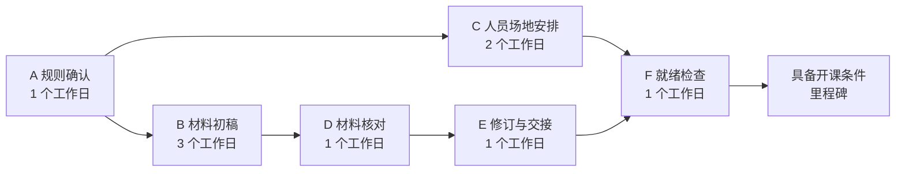

把培训准备工作分好以后，组织者收到了几组数字：规则确认需要 2 小时，材料准备需要 12 小时，人员和场地安排需要 8 小时。能不能把这些工时相加，再除以一天的工作时数，就告诉大家哪天能开课？

还不能。材料准备要等规则确认，讲师每天只能投入一部分时间，规则负责人也可能在另一项工作中。几项事情可以同时推进，另一些事情必须等待。**投入多少劳动、经过多长时间、落在哪个日期，是三个相关但不同的问题。**

[PM-05]() 解决了范围怎样分解成工作包。本篇从工作包中的活动出发，说明怎样结合依赖、资源和日历形成进度，并在假设变化后重新判断。

> 全文继续使用虚构的培训情境。新增的工时、持续时间和人员可用性都是用于计算的模拟条件，不是实际估算结果。本篇只分析“准备到可以开课”的局部网络，不代表整个培训项目的完整计划。

## 一、先问清“要三天”中的三天是什么

同一句“材料要三天”，可能表示三种不同事情：需要三个人日的劳动、从开始到交出材料需要三个工作日，或约定第三天必须交付。后两种甚至可能还没有可靠估算支撑。

| 概念 | 本文采用的口径 | 例子 |
| --- | --- | --- |
| 投入工时 | 人员实际为活动投入的劳动量，可以按人时记录 | 讲师编写材料需要投入 12 小时 |
| 活动持续时间 | 活动从开始到完成，在指定日历上的时间跨度 | 每天能投入 4 小时，且工作可如此安排时，编写需要 3 个工作日 |
| 等待 | 输入、资源或某个外部条件尚未满足的时间 | 材料已交给审核者，但对方明天才有空 |
| 完成日期 | 将活动安排到真实日历后得到的时间点 | 从星期一开始的第 7 个工作日是下周二，假设周末休息且无其他假日 |
| 承诺日期 | 相关人员在理解范围、资源与风险后确认的交付要求 | 是否承诺在下周二前具备开课条件，还需核对实际安排 |

`12 小时 ÷ 每天可投入 4 小时 = 3 个工作日` 只适用于这个简化条件：一个人按稳定节奏处理可分段的工作，没有额外等待，也没有估计之外的返工。它不是所有活动的通用换算公式。

例如，打印设备处理材料需要一定时间，并不等于组织者一直在旁边劳动；两个人共同评审一小时，可能记录为两个人时，经过的时间却是一小时。增加人员也未必能按人数等比例缩短持续时间，因为工作可能有串行部分、协调成本和不可分割的步骤。

等待可以放进活动持续时间，也可以作为明确的等待环节或开始限制来建模，但口径必须一致。如果已经把“审核包含排队共两天”放进持续时间，就不能再额外加一次同样的排队。

## 二、活动之间的箭头，需要有具体理由

依赖关系说明一个活动需要另一个活动提供什么条件。最容易理解的是“完成后才能开始”：讲义初稿可供阅读之后，才进行本轮完整核对。这叫完成到开始关系，英文常写为 FS（Finish-to-Start）。公开教材也介绍了其他关系，但本篇算例只使用无额外时滞的 FS，先把基本计算讲清。[1]

问“为什么要等”，可以帮助分清几类情况：

- **工作本身需要输入**：没有对应版本的草稿，就无法完成针对该草稿的审核。
- **目前选择了这样的组织方式**：约定规则确认后再通知参加者，以避免通知内容反复变化；这项安排可以讨论调整。
- **依赖外部条件**：场地原使用方还未腾出空间，项目组不能只靠催自己来解决。
- **同一资源不能同时满足两项需求**：讲师同时被安排编写材料和准备现场，需要重新分配时间。

这些情况都可能推迟完成日期，但处理方式不同。调整工作组织可以改变某些顺序；缺少业务输入需要先补输入；资源冲突需要协调可用时间。为了让图更短而删除必要依赖，只会让计划失去执行依据。

格鲁夫在第 1 章用早餐准备说明围绕限制步骤安排其他工作，Berkun 第 13 章则提醒读者关注一项工作所依赖的决定与动作。[2][3] 这些视角帮助发现等待和协调问题，但项目网络中的关键路径仍需根据具体关系和持续时间计算，不能直接把最贵、最忙或最重要的人当成关键路径。

## 三、固定一组条件，计算最早完成时间

下面抽取 PM-05 中规则确认、材料制作和开课准备的相关活动。项目范围已事先确认，协调与记录工作仍需在完整计划中安排；这里先只比较这六项活动的时间关系。

本例假设各活动都在工作日边界开始和结束，周末不工作，不考虑法定假日；人员按表中条件投入，初稿、审核和修订各完成一次，没有额外返工。第一轮先假设各角色的资源可用、不互相冲突。

| 活动 | 内容与 WBS 对应 | 前置活动 | 模拟投入 | 模拟持续时间及依据 |
| --- | --- | --- | --- | --- |
| A | 确认本次适用规则，形成 2.1 的规则记录 | 无；本例起点条件已具备 | 规则负责人 2 小时 | 1 个工作日，当天能提供 2 小时 |
| B | 编写讲义与练习初稿，属于 2.2 | A | 讲师 12 小时 | 3 个工作日，每天投入 4 小时 |
| C | 落实参加者、场地与物料安排，属于 3.1 | A | 组织者 8 小时 | 2 个工作日，每天投入 4 小时；假设无额外外部等待 |
| D | 核对材料与检查方法，属于 2.2 | B | 规则负责人 2 小时 | 1 个工作日，草稿就绪后当天有 2 小时 |
| E | 修订、取得确认并交接材料，完成 2.2 | D | 讲师 4 小时 | 1 个工作日；假设必要确认可以在该时间窗内完成，无额外等待 |
| F | 对照条件完成开课前就绪检查，完成 3.1 的检查 | C、E | 组织者 2 小时 | 1 个工作日，当天有 2 小时 |

表中工时仅列用于本次计算的主要执行投入；E 所需的确认支持等配合投入没有另行估算，因此不能把表中工时总和当成完整人员成本。本例的持续时间直接采用最后一列，工时用于解释资源条件。



里程碑表示到达一个重要状态，这里不另加持续时间；完成就绪检查的工作已经计在 F 中，只有检查通过才记为到达该里程碑。它只表示具备开课条件，不表示 90 分钟培训已举行，更不表示 12 人全部通过了 PM-04 的能力检查。

用 `t=0` 表示第一个工作日开始，`t=1` 表示该工作日结束，也就是下一个工作日的起点。时间只累计工作日，因此周末不在这个坐标中占一格。这样计算无需再加减“首尾两天”。

对每项活动，从前向后计算：

```text
最早开始 ES = 所有前置活动最早完成时间中的最大值
最早完成 EF = ES + 本活动持续时间
没有前置活动时，本例 ES = 0
```

合流处取最大值，是因为 F 需要 C 和 E 都完成。C 早做好并不能替代仍未准备好的材料。

| 活动 | ES 最早开始 | EF 最早完成 | 推导 |
| --- | ---: | ---: | --- |
| A | 0 | 1 | 起点 0，加 1 |
| B | 1 | 4 | 等 A 完成，加 3 |
| C | 1 | 3 | 等 A 完成，加 2 |
| D | 4 | 5 | 等 B 完成，加 1 |
| E | 5 | 6 | 等 D 完成，加 1 |
| F | 6 | 7 | 取 C 的 3 与 E 的 6 中较晚者，再加 1 |

六项持续时间相加是 9 个工作日，但网络最早在 `t=7` 到达里程碑，因为 B 和 C 可以重叠。表中主要执行投入相加为 30 小时，它也不能直接给出这个日期：投入来自不同人员，每人的可用时间和依赖位置不同。

## 四、关键路径与总时差，解释哪里会影响终点

在本例这个无环、只含 FS、资源暂不冲突且持续时间固定的网络中，持续时间最长的起点到终点路径决定最早完成时间，这条路径称为关键路径。[1]

两条路径分别是：

- `A → B → D → E → F`：`1 + 3 + 1 + 1 + 1 = 7` 个工作日。
- `A → C → F`：`1 + 2 + 1 = 4` 个工作日。

因此第一条是关键路径。这里的“最长路径”与“最短可能工期”不矛盾：各条必需路径都要完成，最慢的一条约束整个网络最早何时结束。不能在两条路径中挑较短的一条走，跳过另一组必需工作。

如果仍希望在 `t=7` 完成，可以再从终点向前倒推：F 最晚在 `t=6` 开始，E 最晚在 `t=5` 开始，依此类推。对有多个后续活动的节点，取后续最晚开始时间中的最小值。

```text
最晚完成 LF = 所有后续活动最晚开始时间中的最小值
最晚开始 LS = LF - 本活动持续时间
本例末项 F 的 LF = 7
总时差 TF = LS - ES = LF - EF
```

总时差表示在当前网络条件及终点要求下，一项活动可以推迟而不推迟该终点的时间。本例可得到：

| 活动 | ES | EF | LS | LF | 总时差 TF |
| --- | ---: | ---: | ---: | ---: | ---: |
| A | 0 | 1 | 0 | 1 | 0 |
| B | 1 | 4 | 1 | 4 | 0 |
| C | 1 | 3 | 4 | 6 | 3 |
| D | 4 | 5 | 4 | 5 | 0 |
| E | 5 | 6 | 5 | 6 | 0 |
| F | 6 | 7 | 6 | 7 | 0 |

C 可以从 `t=1` 推迟到 `t=4` 开始，在 `t=6` 完成，F 仍可按原时间开始。这里的 3 天是当前逻辑网络留下的余量，不是组织者可以单方面占用的休假额度，也不保证将来资源变化后仍然存在。同一条路径上的时差还可能由多个活动共同消耗，不能逐项相加当作额外储备。

在保持其余条件不变时，关键路径上的 B 多花一天，会把终点推迟到 `t=8`。C 多花一天则仍在 `t=4` 完成，暂时不改变终点。若 C 增长到 5 天，两条路径都会达到 7 天，网络中就同时有两条关键路径。关键路径可能不止一条，也会随持续时间、关系与资源安排变化。

上面的零时差结论依赖本例条件。实际排期若加入强制日期、不同日历和其他依赖关系，时差解释也要相应核对，不能把本表直接当成任何软件中所有红色任务的判定规则。

## 五、画成甘特图后，再检查谁能同时做什么

把前面的最早安排放到工作日时间轴上，就是一份简版甘特图。每格代表一个工作日，`█` 表示该活动在这个工作日持续，**不表示此人全天都在工作**：A、D、F 各只安排了 2 小时主要执行投入。

```text
工作日    1  2  3  4  5  6  7
A         █  ·  ·  ·  ·  ·  ·
B         ·  █  █  █  ·  ·  ·
C         ·  █  █  ·  ·  ·  ·
D         ·  ·  ·  ·  █  ·  ·
E         ·  ·  ·  ·  ·  █  ·
F         ·  ·  ·  ·  ·  ·  █
```

网络图便于看先后与合流，甘特图便于看时间安排与重叠。两者表达的是同一组活动，画图本身不会解决资源冲突。

现在单独改变一个条件：组织者没有时间执行 C，经过协商改由讲师承担，假设讲师具备相应能力；F 仍由组织者完成。讲师每天总共只有 4 小时可用于这些工作，所以 B 与 C 不能继续并行，E 也要使用这同一份时间。

一种可执行安排是让讲师先完成 B，在规则负责人执行 D 时处理 C，再完成 E：

| 活动 | 原来安排 | 资源调整后的安排 | 为什么变化 |
| --- | --- | --- | --- |
| A | 0—1 | 0—1 | 不变 |
| B | 1—4 | 1—4 | 先让材料进入审核 |
| C | 1—3 | 4—6 | 等讲师做完 B；其中 4—5 可与另一人的 D 并行 |
| D | 4—5 | 4—5 | 规则负责人独立完成核对 |
| E | 5—6 | 6—7 | 虽然审核在 5 完成，讲师还要到 6 才可接手 |
| F | 6—7 | 7—8 | 等 C、E 都完成 |

终点现在是 `t=8`。原先 C 的 3 天总时差不能保证项目仍在第 7 个工作日结束，因为 C 占用了 E 需要的资源。逻辑上可以并行与实际有资源并行，需要分别检查。

这次安排中的“B 做完再做 C、C 做完再做 E”，是资源分配后的选择，不是材料业务逻辑天然要求的顺序。保留这个理由，未来恢复组织者的可用时间时，才知道哪些约束可以重新评估。如果改成先做 C 再做 B，在同样条件下会到 `t=9` 才完成；不同的资源顺序会产生不同结果。

再回到最初人员不冲突的版本，单独增加一天审核前等待：草稿在 `t=4` 完成，但规则负责人只能从 `t=5` 开始 D。此时 D、E、F 分别移到 `5—6`、`6—7`、`7—8`。执行投入没有因此自动增加，终点却同样变成 `t=8`。这与上面的资源改派是两个分别计算的情境，不是在同一个计划中重复加延迟。

## 六、估算需要依据，承诺需要共同决定

前面的数字是固定假设，适合学习计算；真正排期时，还要问这些数字从哪里来。《项目管理之美》第 2 章把进度看作需要不断检查和调整的预测，并讨论需求、设计信息和执行者参与对估算的影响。[2]

几种常见估算方式可以互相补充：

| 方式 | 怎样使用 | 需要注意什么 |
| --- | --- | --- |
| 类比估算 | 参考同类培训的准备记录，再比较人数、材料成熟度和审核要求 | 不能只复制上次总天数；相似条件与差异要说清 |
| 分解后估算 | 由执行者分别估计编写、核对、修订等工作，再结合依赖安排 | 加总投入后仍需检查等待、并行和人员可用时间 |
| 区间或情境估算 | 分别讨论规则稳定、需要澄清或需要大改时的投入和条件 | 区间不是承诺，也不能没有统计依据就附上成功概率 |

例如，若讲师认为编写可能需要 8—16 小时，在每天可投入 4 小时、无额外等待的条件下，对应 2—4 个工作日。接下来需要了解导致差异的原因：规则是否明确、样例是否现成、哪些内容需要核对。不能只取中间值放进表格，就把未知项当成消失。

如果目标是第 5 个工作日具备开课条件，而当前网络最早需要 7 天，首先要指出缺口。团队可以评估缩小本次范围、提前准备可独立的输入、改变工作组织或增加适合的支持；每项选择都要检查是否影响质量、资源和原有承诺。单纯把 B 从 3 天改成 1 天，只有表格变短，没有产生新的依据。

计划进入执行后，应更新实际开始与完成、尚需投入、等待原因和资源变化，再重新计算剩余安排。遇到“完成 80%”时，可以继续问：具体哪些结果已经可检查，还剩哪些活动，谁提供最后的输入？只填百分比，很容易遮住最后一次审核或交接。

可以用前面的网络做一个复算练习：C 从 2 天增加到 6 天，其余条件保持最初版本不变。此时 `A → C → F` 为 `1 + 6 + 1 = 8` 天，终点变为 `t=8`，它成为新的关键路径；原材料路径仍为 7 天。接下来应关注 C 的新增困难和输入条件，而不是继续只催原来最长的 B。

一份可用的进度安排，需要能解释活动、依赖、估算、资源与日历怎样共同形成日期。后续的[资源与成本提纲](#pm-07)会继续讨论支持条件；[风险与问题提纲](#pm-08)则接着处理执行中的不确定性。

## 来源与延伸阅读

1. Adrienne Watt、Merrie Barron、Andrew Barron，[《Project Management – 2nd Edition》第 10 章：Project Schedule Planning](https://opentextbc.ca/projectmanagement/chapter/chapter-10-project-schedule-planning-project-management/)，2014。核对 *Defining Activities*、*Activity List*、依赖与时滞相关小节、*Milestones*、*Creating the Gantt Chart*、*Creating the Network Diagram*、*The Critical Path*。用于活动、依赖、进度表达及关键路径概念；没有复制来源中的婚礼或目录出版算例。
2. Scott Berkun，《项目管理之美》，机械工业出版社，2009，ISBN 9787111259527。第 2 章“进度表的原理”，重点为“进度为什么会失败”“进度是一种几率”“估算是困难的”“好的估算来自于好的设计”“常见疏忽”；第 13 章“如何让事情发生”，小节“了解关键路径”。本文采用其中有关估算信息、更新与依赖关注的讨论，不把书中经验比例当作本项目成功概率；“最长依赖路径”与“最短可能工期”按本篇固定模型分别解释。
3. Andrew S. Grove，《格鲁夫给经理人的第一课：畅销版》，中信出版集团，2017，ISBN 9787508678092，第 1 章“‘生产’包含什么？”中的“限制步骤”。用于理解协调与限制条件的思考视角，不把生产中的限制步骤直接等同于任意项目的关键路径。

本篇网络、时间表、资源调整和练习均为自行设计的教学推演。前推、后推公式与结果按文中固定假设复算；它们不证明真实项目能在相同天数完成，也不表示已在某种管理软件中配置并验证。
