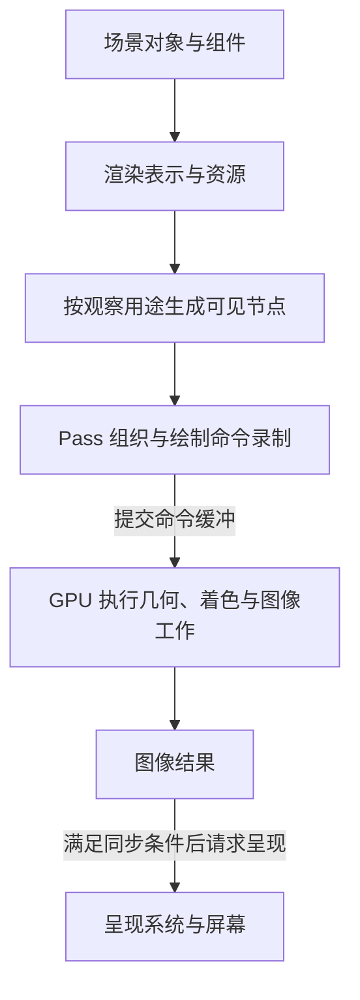
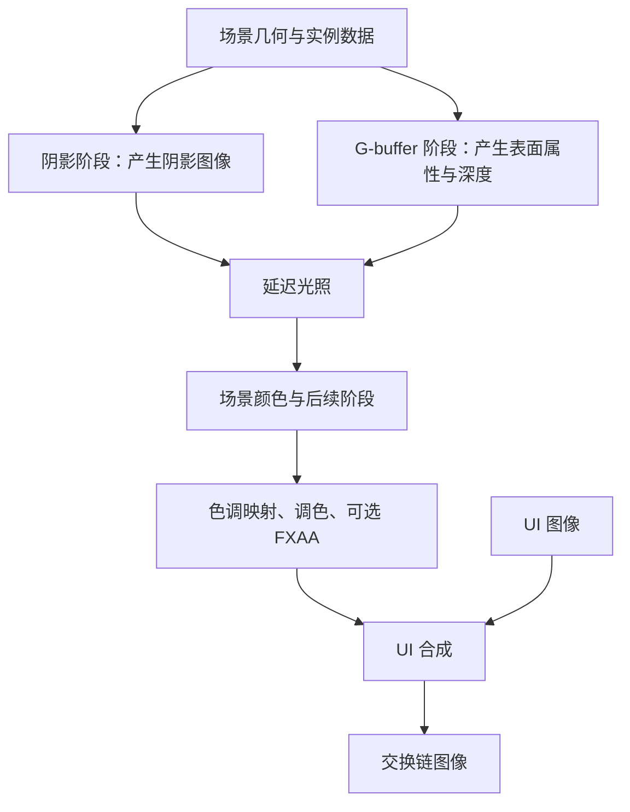

在场景里移动一个物体，屏幕上的物体也跟着移动，看起来像是坐标变化直接改变了画面。但对于引擎，改坐标只是起点：它还要把状态交给渲染系统，决定哪些内容值得绘制，准备资源和命令，让 GPU 计算图像，最后把图像交给呈现系统。

读渲染代码时，最容易卡住的地方也在这里。一个对象为什么同时出现 Mesh、Material、RenderEntity 和 Shader？一个 `draw()` 为什么没有直接操作屏幕像素？光照、后处理和 UI 为什么还要经过不同阶段？

这篇先把整条链建立起来，再沿 Piccolo 的实际代码定位各个环节。位置变化会作为入口，但我们会继续追到 Pass、绘制、GPU 执行与呈现。

> **读这篇之前**：可以先读 [Piccolo 架构地图]()。若对基类指针或宏调用不熟悉，按需回看 [类、继承与虚函数]() 与 [模板、宏与反射代码生成]()。
>
> 源码基线：[BoomingTech/Piccolo，固定提交 `f5053707fed4`][revision]。本篇核对源码与图形 API 语义，选取默认延迟渲染的主画面路径讲解；尚未构建、运行 Piccolo 或进行 RenderDoc 捕获，图中没有实测 GPU 时序。

## 先把场景状态、命令和图像分开

先想象一个场景里有两个使用相同网格的箱子。游戏逻辑需要区分它们的位置和交互状态；渲染系统关心它们使用哪些几何、材质和变换；GPU 则根据收到的工作和资源，计算被覆盖的采样位置与图像结果。

这三层处理的东西不同：

| 层次 | 处理什么 | 本层完成后，能确认什么 |
| --- | --- | --- |
| 场景与逻辑状态 | 对象、组件、位置、动画等 | 世界中的状态已经更新 |
| CPU 侧渲染组织 | 渲染表示、可见列表、资源、Pass 和命令 | 已经准备或录制了要执行的图形工作 |
| GPU 执行与呈现 | 几何、着色、图像读写和呈现请求 | 图形工作按同步约束执行，结果再交给呈现系统 |

因此，逻辑更新成功不等于已经生成图像；命令录制完成不等于 GPU 已执行完；呈现请求返回也不等于显示器此刻已经扫描到这一帧。[Vulkan 执行模型][vk-fundamentals]、[呈现请求][vk-present]

阅读时固定问三件事：**当前拿的是什么数据，谁把它交给下一层，下一层完成的证据是什么。**

## 先认清几个会反复遇到的词

下面这些词不是相互替代的对象，而是在回答不同问题：

| 概念 | 最小含义 | 在本篇中怎样理解 |
| --- | --- | --- |
| Mesh | 顶点、索引及相关几何属性 | 画什么形状；两个对象可以复用同一份网格 |
| Material | 表面参数与纹理等资源的组合 | 用什么表面数据参与当前着色 |
| Shader | 在 GPU 相应阶段执行的程序 | 怎样变换顶点、处理片元或计算结果 |
| RenderTarget | 当前阶段写入的图像目标 | 写到哪张颜色、深度或中间结果图像 |
| Draw Call | 一条绘制命令 | 按当前管线状态与资源绘制指定几何和实例 |
| Pass | 引擎对一段渲染工作的组织 | 读什么输入，做什么工作，写什么结果，依赖谁 |

“画一个箱子”通常需要这些因素共同配合。Mesh 不决定全部外观；Material 不等于 Shader；Draw Call 也不是直接传入一个游戏对象就能独立完成所有工作的函数。

在 Piccolo 中，[VulkanMesh][render-common] 保存顶点与索引缓冲等资源；`VulkanPBRMaterial` 保存纹理、材质数据和描述符相关资源。具体使用哪些 Shader 与图形管线状态，还要读 [MainCameraPass 的管线创建与绑定][main-pass]。

这里的 RenderTarget 是解释图像用途的通用概念，不要求工程中恰好有一个同名类。到 Vulkan 层，要继续辨认图像、图像视图，以及它们在渲染中的 attachment（附件）角色。

## 整条链先走一遍

下面的箭头表示主画面相关数据与工作的交接。前四步发生在 CPU 侧，提交后进入 GPU 执行与图像结果，再交给呈现系统；这条链不表示调用后立即同步完成。



这也是两个“管线”容易混淆的地方：**引擎渲染管线**组织场景、资源和多段工作；**GPU 图形流水线**处理某次绘制中的顶点、图元、片元及输出。一个引擎 Pass 可以录制许多绘制命令，多次使用 GPU 图形流水线。

接下来逐段把这张图落到 Piccolo。

## 第一步：场景对象把变化整理成渲染描述

[MeshComponent::tick()][mesh-component] 读取父对象的变换与动画相关组件。在变换脏标记满足条件时，它遍历网格的各个 part，组合对象变换与 part 自身的变换，整理 `GameObjectPartDesc`，再把变化交给逻辑侧的交换数据。相关调用为：

```cpp
logic_swap_data.addDirtyGameObject(GameObjectDesc {m_parent_object.lock()->getID(), dirty_mesh_parts});
```

这里传递的是渲染需要的描述，仍然不是一张图像。组件没有在这一行调用光栅化，也没有为屏幕中的每个像素赋值。

[RenderSwapContext][swap-h] 保存逻辑侧与渲染侧两份交换数据，通过索引区分读写角色；[实现][swap-cpp] 会检查渲染侧数据是否已消费，并在交换时处理重置与索引交换。

尤其要看 [PiccoloEngine::tickOneFrame()][engine-cpp] 的实际顺序：逻辑更新之后调用 `swapLogicRenderData()`，再进行渲染更新，这段源码还明确标注了 `single thread`。因此，逻辑上下文与渲染上下文的分工、两份数据的存在，本身不证明另起了一条渲染线程。这里的上下文交接，也不同于后面用于呈现的交换链图像。

## 第二步：渲染侧维护自己的对象表示和资源

[RenderSystem::processSwapData()][render-system] 消费变化描述。对一个对象的每个 part，它使用对象 ID 与 part 索引组成标识，创建或更新相应的 [RenderEntity][render-entity]。

这个实体主要保存实例矩阵、网格与材质资源 ID、包围盒和动画相关状态。它不是一份完整的游戏对象副本。一个场景对象有多个 part 时，也可能对应多个渲染实体。

这里还把两类数据分开了：

- **实例数据**：这个 part 放在哪里、采用什么变换、关联哪份资源。
- **共享资源**：网格缓冲、纹理和材质相关 GPU 资源，可以由多个实例复用。

`processSwapData()` 检查资源是否已经加载，必要时读取网格和材质数据，并通过 [RenderResource][render-resource] 取得或创建图形资源。后续收到位置变化时，不应据此推断每次都重新从磁盘加载网格、上传所有纹理。

这一步解释了为什么“世界里有对象”还不足以让它出现在画面中：它需要有有效的渲染表示和可用资源，然后才能进入后面的筛选与绘制。

## 第三步：按相机和光源生成可见列表

[RenderSystem::tick()][render-system] 在进入管线绘制前，按源码顺序进行以下工作，节选如下：

```cpp
processSwapData();
m_rhi->prepareContext();
m_render_resource->updatePerFrameBuffer(m_render_scene, m_render_camera);
m_render_scene->updateVisibleObjects(std::static_pointer_cast<RenderResource>(m_render_resource),
                                     m_render_camera);
m_render_pipeline->preparePassData(m_render_resource);
```

这几行分别处理变化、准备命令上下文、更新每帧数据、计算可见节点，再准备各 Pass 数据。`prepareContext()` 不能单凭名字就读成“已经画完了一帧”。

[RenderScene::updateVisibleObjectsMainCamera()][render-scene] 计算相机的投影与观察矩阵，构造视锥，对变换后的实体包围盒做相交测试，通过后建立 `RenderMeshNode`，关联模型矩阵、网格与材质资源。

**视锥可以先理解为相机观察的空间范围。** 包围盒测试用于粗筛：完全在范围外的内容不必进入这份主相机列表。但通过测试不表示对象的每一部分都在屏幕内，更不表示它一定贡献最终可见像素。它还可能被其他物体挡住，在后续裁剪、深度测试或其他条件下不留下结果。

同一个函数族还分别生成方向光、点光源等用途的节点列表。主相机不可见与阴影阶段无关并不能画等号；判断某个物体是否参与某个阶段，要读对应的筛选路径。

## 第四步：按 Pass 组织一帧主画面

[RenderSystem 的默认成员值][render-system-h] 选择延迟渲染；运行时更新也可以根据管线类型进入前向分支。本篇先沿 [RenderPipeline::deferredRender()][render-pipeline] 的正常主画面路径走。

先补一个模型：前向渲染通常在绘制表面时直接结合光照求颜色；延迟渲染先把表面属性记录到若干图像，再由后续阶段读取这些属性计算光照。**G-buffer 就是这组几何与表面信息缓冲的统称**，不是最终屏幕颜色图。

固定版本的主要阶段可以这样读：

| 阶段 | 主要输入 | 主要结果或作用 |
| --- | --- | --- |
| 方向光、点光源阴影 | 对应光源用途的可见节点与几何 | 阴影相关图像，供后续着色使用 |
| 主相机 G-buffer | 主相机节点、网格、材质、实例变换 | 表面法线、基础颜色、金属度/粗糙度等编码数据，以及深度 |
| 延迟光照 | G-buffer、深度、光源和阴影等数据 | 场景颜色 |
| 粒子等当前前向子阶段工作 | 对应资源与阶段数据 | 继续处理场景颜色；具体内容以该分支为准 |
| Tone Mapping、Color Grading | 前一阶段的场景颜色 | 将场景颜色映射到后续显示处理范围，并进行调色 |
| FXAA | 处理后的颜色 | 按开关执行的图像抗锯齿 |
| UI 与合成 | 场景颜色、UI 相关图像 | 输出到交换链图像，准备呈现 |

这张表依据 [MainCameraPass::draw()][main-pass] 的调用和附件组织，不是对所有引擎的固定要求；各阶段是否产生实际绘制，还受开关、可见节点与资源状态影响。其中还有坐标轴绘制等编辑辅助内容；外层在提交主画面之前还录制 debug draw。`deferredRender()` 提交之后也有粒子图像复制和模拟调用，所以本篇总图不能当成全部粒子工作或全帧唯一提交序列。

### Pass 类、Vulkan render pass 和 graphics pipeline 是三个层次

Piccolo 的 `MainCameraPass::draw()` 在一个 Vulkan render pass 范围内，用 `cmdNextSubpassPFN()` 推进多个 subpass。若干独立的 C++ Pass 对象，也会在这些子阶段中录制命令。

因此，不能按照“一个 C++ Pass 类等于一个 Vulkan render pass”等方式机械计数。Vulkan render pass 的附件、subpass 和依赖关系描述这一组图像使用；graphics pipeline 则组合某次绘制所用的 Shader 与相关图形状态。它们和引擎中负责阶段调度的 `RenderPipeline` 也不是同一个概念。[Render pass 的组织][vk-renderpass-create]、[图形管线][vk-pipelines]

## RenderTarget 把前后阶段接成图像数据流

为什么不能一路直接画到屏幕？因为后面的工作需要读取前面的中间结果。阴影要先有深度信息，延迟光照要读取表面属性，后处理又要读取已经得到的颜色。

下图箭头表示图像的生产与消费，简化了具体缓冲与条件分支，不表示每个框都必须对应独立的 Vulkan render pass。



[MainCameraPass::setupRenderPass()][main-pass] 定义 G-buffer、深度、颜色处理中间附件与交换链附件；合成 UI 子阶段的输出附件指向交换链图像，其最终布局采用 `PRESENT_SRC_KHR`。

Shader 中也能看到这个交接：[mesh_gbuffer.frag][gbuffer-frag] 把材质与法线相关数据编码到三个 G-buffer 输出；[deferred_lighting.frag][lighting-frag] 则通过 `subpassInput` 与 `subpassLoad()` 读取 G-buffer 和深度，再进行后续计算。

阅读“读上一阶段的图像”时，不要自动认定存在一次把整张图复制到新纹理的操作。图像如何成为附件、怎样被后续阶段读取，以及必要的布局与同步关系，要结合具体 API 组织判断。

## 第五步：把可见节点变成具体绘制命令

到 [MainCameraPass::drawMeshGbuffer()][main-pass]，源码先把节点按 `VulkanPBRMaterial*` 和 `VulkanMesh*` 两层分组，再为一组网格实例整理绘制数据。

在录制绘制之前，它需要绑定图形管线、描述符、顶点缓冲和索引缓冲，并提供每帧或每批实例的数据。描述符可以先理解为 Shader 访问缓冲和图像资源的接线信息；绑定描述符不等于每次把整份纹理重新上传。

实际索引绘制调用为：

```cpp
m_rhi->cmdDrawIndexedPFN(m_rhi->getCurrentCommandBuffer(),
                         mesh.mesh_index_count,
                         current_instance_count,
                         0,
                         0,
                         0);
```

沿 [VulkanRHI 的包装][vulkan-rhi] 继续追，它接到 `vkCmdDrawIndexed`。这里的索引数描述本次绘制的几何索引范围，实例数描述同一份几何画多少个实例。API 将命令录入命令缓冲；这一行返回时，不能据此确认 GPU 已经处理完这些几何。[索引绘制命令][vk-draw-indexed]

这也打破了两个常见的一一对应假设：

- 一个对象有多个 part，可能需要不同网格或材质，不能天然只算一次绘制。
- 多个节点使用相同材质与网格时，可以在容量允许的批次里，用一次实例化绘制处理多个实例。

源码还会按单批可容纳的实例数量拆批。所以，场景对象数、渲染实体数、某个 Pass 的 Draw Call 数和全帧绘制命令数，应该分别统计。

## GPU 怎样把几何变成图像中的结果

前面读的是 CPU 如何组织工作。命令真正执行时，传统顶点绘制路径可以先按下面这个简化模型理解：

```text
顶点/索引输入与图元拓扑
  → 顶点 Shader 变换
  → 图元裁剪与屏幕映射
  → 光栅化产生片元与覆盖信息
  → 片元着色及深度/模板、混合等处理
  → 图像附件中的结果
```

这是理解职责的顺序，不是断言所有硬件都按一条串行步骤执行；例如部分测试可以提前进行。片元也不应直接等同于最终屏幕像素：覆盖、采样、测试、写入与后处理还会影响最终结果。[顶点后处理][vk-vertex-post]、[光栅化][vk-raster]、[片元操作][vk-fragment]

### 顶点变换决定几何投到哪里

在 Piccolo 的 [mesh.vert][mesh-vert] 中，实例数据提供模型矩阵；非蒙皮情形下，可以把这段变换理解为局部位置经对象变换进入世界，再经相机观察与投影进入裁剪空间。源码中有：

```glsl
out_world_position = (model_matrix * vec4(model_position, 1.0)).xyz;
gl_Position = proj_view_matrix * vec4(out_world_position, 1.0f);
```

常见的 `P × V × M × p` 就在说明这几段空间关系。它还不是屏幕二维坐标，后面仍有裁剪、透视除法和视口映射。

### 着色与附件输出决定记录什么

同一份几何在不同阶段不一定输出同一种信息。G-buffer 阶段记录表面属性；阴影阶段关注相应的深度；延迟光照阶段读取已有图像求场景颜色。

这也是 Shader 与 Material 要分开看的原因：表面纹理和参数是数据，当前阶段使用的 Shader 决定怎样解释与使用这些数据。[MainCameraPass][main-pass] 的管线创建中，可以分别找到网格 G-buffer Shader 与延迟光照 Shader。

甚至一条 Draw Call 也不一定在画某个场景网格。`drawDeferredLighting()` 使用三个顶点的绘制处理屏幕区域；[CombineUIPass::draw()][combine-ui] 也录制三个顶点的绘制，把输入图像用于输出合成。不能看到 `draw()` 就默认它对应一个游戏对象。

## 第六步：录制、提交与呈现分别完成什么

回到 [RenderPipeline::deferredRender()][render-pipeline]，它在绘制之前等待当前帧槽的 fence、重置命令池，再调用 `prepareBeforePass()`。后者在 [VulkanRHI][vulkan-rhi] 中获取交换链图像，并在正常分支开始命令缓冲录制；遇到交换链过期或不再理想等情况，还有重建相关处理。

把正常主画面路径压缩成四个动作：

1. **Acquire**：取得可用于这一轮工作的交换链图像索引，并通过约定的同步对象约束使用时机。[获取图像][vk-acquire]
2. **Record**：CPU 将资源绑定、render pass/subpass 和 draw 等命令写入命令缓冲。
3. **Submit**：`submitRendering()` 结束录制，通过 `vkQueueSubmit` 提交命令缓冲，并配置等待、信号量与 fence。[队列提交][vk-submit]
4. **Present**：调用 `vkQueuePresentKHR`，请求呈现指定交换链图像，等待对应的渲染完成信号量。[呈现语义][vk-present]

当前源码中的呈现请求等待 `m_image_finished_for_presentation_semaphores`；后续 CPU 重用帧槽资源之前，会通过对应 fence 等待相关提交完成。可以先把信号量理解为约束设备侧工作衔接的工具，把这里的 fence 理解为 CPU 观察提交完成的工具；完整同步分析还需要逐一核对资源与 API 规则。

这些等待也说明，CPU 函数的顺序返回与 GPU 完成时间不是同一张时间表。GPU 可能仍在执行已提交工作，呈现系统还可能按呈现模式与显示节奏处理图像。没有图形捕获与同步观察时，本篇只能确认代码如何组织请求，不能给出实测执行耗时或显示延迟。

## 不启动引擎，先做一次纸上追踪

假设四个静态对象都只有一个网格 part，资源已经就绪，两个材质名称确实对应两份不同的材质资源。它们使用同一网格，没有骨骼动画，单批实例容量至少为二：

| 对象 | 网格 | 材质资源 | 通过主相机包围盒测试 |
| --- | --- | --- | --- |
| A | Cube | Red | 是 |
| B | Cube | Red | 是 |
| C | Cube | Blue | 是 |
| D | Cube | Red | 否 |

沿 `updateVisibleObjectsMainCamera()` 与 `drawMeshGbuffer()` 的分组规则推导：主相机节点为 A、B、C；Red/Cube 一组有两个实例，Blue/Cube 一组有一个实例。在这些假设下，该 G-buffer 绘制段对应两条实例化索引绘制命令。

这只是源码规则下的纸上推导。它没有算阴影、光照、后处理、UI 或其他绘制，也没有证明最终一定有三个对象留下可见像素。D 也不能仅因为被主相机筛掉，就直接判定不参与阴影阶段。

再沿固定源码回答五个问题，就能检验是否真正读通了链路：

1. 找到对象变化进入逻辑交换数据的位置，写出传的是什么描述。
2. 找到 `RenderEntity` 的更新位置，区分实例矩阵与共享网格、材质资源。
3. 从主相机节点找到分组、绑定和 `cmdDrawIndexedPFN()`，记录一次命令的索引数与实例数来自哪里。
4. 从 G-buffer Shader 的输出找到光照 Shader 的输入，说明两者靠什么图像接起来。
5. 从 `submitRendering()` 找到提交与呈现的不同调用，以及呈现等待的信号量。

这篇建立完整地图。后续“改一个位置”的案例会沿某个对象逐值追踪；Pass 与 Vulkan 深挖再展开局部资源、依赖和提交细节。实际调试与图形捕获留到工程实践时补充。

## 继续阅读

- [从启动走到第一帧：初始化、世界加载与退出怎样衔接]()：把渲染链接回程序入口，核对默认世界何时加载、首帧由谁推进以及怎样退出。
- [Piccolo 架构地图]()：把渲染放回世界、资源与编辑器的协作关系。
- [游戏图形系统]()：继续理解引擎、图形 API、驱动与 GPU 的职责。
- [图形数学]()：按需补矩阵、空间变换与几何判断。
- [Piccolo 阅读入口]()：返回系列目录。

Piccolo 源码节选版权：Copyright (c) 2022 Contributors to the Piccolo Engine，按 [MIT License][license] 提供。简化图与纸上推导已在对应位置说明。

**从对象到画面，要连起场景数据、渲染命令、图像结果与呈现条件。**

[revision]: https://github.com/BoomingTech/Piccolo/tree/f5053707fed4d3f94d270a436fb0d3a8ae54e3e5
[engine-cpp]: https://github.com/BoomingTech/Piccolo/blob/f5053707fed4d3f94d270a436fb0d3a8ae54e3e5/engine/source/runtime/engine.cpp
[mesh-component]: https://github.com/BoomingTech/Piccolo/blob/f5053707fed4d3f94d270a436fb0d3a8ae54e3e5/engine/source/runtime/function/framework/component/mesh/mesh_component.cpp
[swap-h]: https://github.com/BoomingTech/Piccolo/blob/f5053707fed4d3f94d270a436fb0d3a8ae54e3e5/engine/source/runtime/function/render/render_swap_context.h
[swap-cpp]: https://github.com/BoomingTech/Piccolo/blob/f5053707fed4d3f94d270a436fb0d3a8ae54e3e5/engine/source/runtime/function/render/render_swap_context.cpp
[render-system-h]: https://github.com/BoomingTech/Piccolo/blob/f5053707fed4d3f94d270a436fb0d3a8ae54e3e5/engine/source/runtime/function/render/render_system.h
[render-system]: https://github.com/BoomingTech/Piccolo/blob/f5053707fed4d3f94d270a436fb0d3a8ae54e3e5/engine/source/runtime/function/render/render_system.cpp
[render-entity]: https://github.com/BoomingTech/Piccolo/blob/f5053707fed4d3f94d270a436fb0d3a8ae54e3e5/engine/source/runtime/function/render/render_entity.h
[render-common]: https://github.com/BoomingTech/Piccolo/blob/f5053707fed4d3f94d270a436fb0d3a8ae54e3e5/engine/source/runtime/function/render/render_common.h
[render-resource]: https://github.com/BoomingTech/Piccolo/blob/f5053707fed4d3f94d270a436fb0d3a8ae54e3e5/engine/source/runtime/function/render/render_resource.cpp
[render-scene]: https://github.com/BoomingTech/Piccolo/blob/f5053707fed4d3f94d270a436fb0d3a8ae54e3e5/engine/source/runtime/function/render/render_scene.cpp
[render-pipeline]: https://github.com/BoomingTech/Piccolo/blob/f5053707fed4d3f94d270a436fb0d3a8ae54e3e5/engine/source/runtime/function/render/render_pipeline.cpp
[main-pass]: https://github.com/BoomingTech/Piccolo/blob/f5053707fed4d3f94d270a436fb0d3a8ae54e3e5/engine/source/runtime/function/render/passes/main_camera_pass.cpp
[mesh-vert]: https://github.com/BoomingTech/Piccolo/blob/f5053707fed4d3f94d270a436fb0d3a8ae54e3e5/engine/shader/glsl/mesh.vert
[gbuffer-frag]: https://github.com/BoomingTech/Piccolo/blob/f5053707fed4d3f94d270a436fb0d3a8ae54e3e5/engine/shader/glsl/mesh_gbuffer.frag
[lighting-frag]: https://github.com/BoomingTech/Piccolo/blob/f5053707fed4d3f94d270a436fb0d3a8ae54e3e5/engine/shader/glsl/deferred_lighting.frag
[combine-ui]: https://github.com/BoomingTech/Piccolo/blob/f5053707fed4d3f94d270a436fb0d3a8ae54e3e5/engine/source/runtime/function/render/passes/combine_ui_pass.cpp
[vulkan-rhi]: https://github.com/BoomingTech/Piccolo/blob/f5053707fed4d3f94d270a436fb0d3a8ae54e3e5/engine/source/runtime/function/render/interface/vulkan/vulkan_rhi.cpp
[license]: https://github.com/BoomingTech/Piccolo/blob/f5053707fed4d3f94d270a436fb0d3a8ae54e3e5/LICENSE
[vk-fundamentals]: https://docs.vulkan.org/spec/latest/chapters/fundamentals.html
[vk-present]: https://docs.vulkan.org/refpages/latest/refpages/source/vkQueuePresentKHR.html
[vk-renderpass-create]: https://docs.vulkan.org/refpages/latest/refpages/source/VkRenderPassCreateInfo.html
[vk-pipelines]: https://docs.vulkan.org/spec/latest/chapters/pipelines.html
[vk-draw-indexed]: https://docs.vulkan.org/refpages/latest/refpages/source/vkCmdDrawIndexed.html
[vk-vertex-post]: https://docs.vulkan.org/spec/latest/chapters/vertexpostproc.html
[vk-raster]: https://docs.vulkan.org/spec/latest/chapters/primsrast.html
[vk-fragment]: https://docs.vulkan.org/spec/latest/chapters/fragops.html
[vk-acquire]: https://docs.vulkan.org/refpages/latest/refpages/source/vkAcquireNextImageKHR.html
[vk-submit]: https://docs.vulkan.org/refpages/latest/refpages/source/vkQueueSubmit.html
