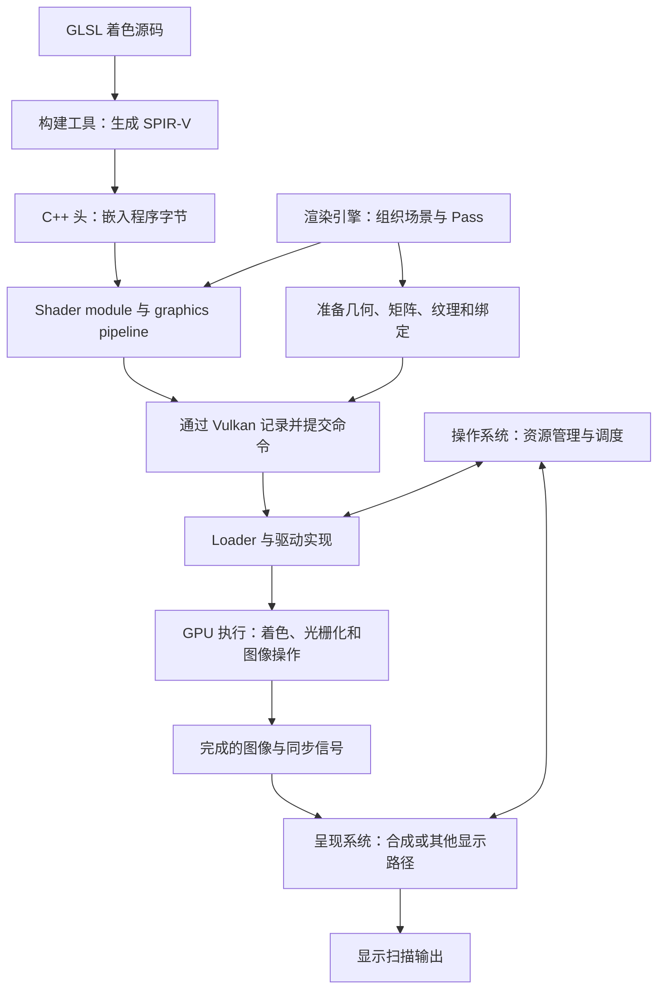

改一段着色代码，为什么有时要重新构建引擎，有时要检查资源绑定，有时还需要换设备观察？同样是物体显示错误，问题可能出在程序、输入数据、绘制状态，也可能出在提交与同步。只知道“引擎调用 API，GPU 负责画图”，还不足以决定下一步应该检查哪里。

Piccolo 提供了一条可以沿代码核对的路线：着色源码经过构建工具成为编译产物，渲染系统把它与资源和状态组织起来，再通过 Vulkan 提交工作。本篇用 Piccolo 的具体实现解释沿途需要的概念与证据边界，并区分通用约束、API/平台前提和项目选择。

> **读这篇之前**：先用 [从场景对象到一帧画面]() 认识 Mesh、Material、Pass、Draw 和 RenderTarget。若想逐项追 Wall_1 的实例数据，可以配合 [主线 07：Pass 与 Vulkan 提交]() 阅读。
>
> **版本与证据**：源码固定为 [BoomingTech/Piccolo@f5053707fed4][revision]。本篇已独立编译 `mesh.vert` 与 `mesh_gbuffer.frag`，核对 SPIR-V 接口信息和 C++ 嵌入字节；没有运行 Piccolo、捕获 GPU 帧或测量显示延迟。系统部分引用官方资料，不当作本机运行观察。完整引擎的构建状态见 [构建与调试基线]()。

## 一次绘制需要程序、数据和任务共同到场

以一个带纹理的物体为例，可以先拆成三件事：

- **程序**：怎样变换顶点，怎样使用纹理和表面参数计算输出。
- **数据**：顶点、索引、模型矩阵、相机参数和纹理分别在哪里，以什么布局存放。
- **任务**：使用哪些程序与状态，绑定哪些资源，绘制多少索引和实例，把结果写到哪张图像。

着色语言主要描述第一件事，同时声明读取数据的接口。图形 API 提供资源、管线、命令和同步等契约。引擎决定怎样把这些能力组织成阴影、主相机、后处理等工作。驱动和操作系统协作，把应用提交的工作落实到设备与系统环境中；GPU 执行相应工作。

因此，HLSL、GLSL 不应被画成“引擎与 API 之间必经的一层”。引擎既准备着色程序，也准备数据与命令，这些输入在绘制中汇合。



图中箭头表示依赖和交接，不表示每一帧都会重新编译 Shader，也不表示每个 API 调用都会单独进入内核。图中的 GPU 节点合并了可编程单元、固定功能单元和存储系统；其内部并不按这些方框一一对应。

## 从一份 GLSL 文件追到程序里的字节

### 语言声明不能代替编译目标

打开 Piccolo 的 [mesh.vert][mesh-vert] 和 [mesh_gbuffer.frag][gbuffer-frag]，开头都是：

```glsl
#version 310 es
```

这说明源码使用的语言版本与 profile。接下来还要看它由什么工具处理、面向什么环境生成产物。

[ShaderCompile.cmake][shader-compile] 中实际使用的编译命令是：

```cmake
COMMAND ${GLSLANG_BIN} -I${SHADER_INCLUDE_FOLDER} -V100 -o ${SPV_FILE} ${SHADER}
```

这里走的是面向 Vulkan 的 SPIR-V 生成路径。随后运行时创建 Vulkan Shader module，使用的是生成后的字节。因此，不能看到 `310 es` 就认定这个引擎正在调用 OpenGL ES。

[engine 的 CMake][engine-cmake] 还明确指定了各平台的 glslangValidator 路径。本文 Windows 编译使用仓库自带的程序，其版本输出为 `Glslang Version: 10:11.7.0`，不是根据系统 SDK 环境变量猜测工具版本。

### 生成 C++ 头，不等于把 Shader 改成 CPU 程序

构建链分为两步：

| 输入 | 处理 | 输出 |
| --- | --- | --- |
| `mesh.vert` | glslangValidator 编译 | `generated/spv/mesh.vert.spv` |
| SPIR-V 文件 | `GenerateShaderCPPFile.cmake` 读取二进制并生成字节列表 | `generated/cpp/mesh_vert.h`，变量 `MESH_VERT` |

[嵌入脚本][shader-embed] 生成的是 `static const std::vector<unsigned char>`。C++ 编译器负责把这些数据编入宿主程序，并不会把顶点变换翻译成 CPU 端可直接调用的 C++ 函数。

运行时，[MainCameraPass::setupPipelines][main-camera] 从 `MESH_VERT` 和 `MESH_GBUFFER_FRAG` 创建两个 module。[VulkanUtil::createShaderModule][vulkan-util] 再把字节数量和指针填入 `VkShaderModuleCreateInfo`，调用 `vkCreateShaderModule`。

到这里可以确认的是：**构建得到的着色程序已经通过 API 交给 Vulkan 实现。** 不能继续推断“这些字节就是某张显卡的原生机器码”或“创建 module 时已经完成全部硬件编译”。SPIR-V 是中间表示；具体实现怎样生成和缓存目标代码，不能只从这个调用点得出结论。[Khronos 的语言与 SPIR-V 说明][vk-hlsl]、[Shader module 接口][vk-module]

## Shader 能计算什么，还取决于它接入哪份管线

Piccolo 为 G-buffer 绘制准备了顶点和片元两个阶段，并分别指定 `main` 入口。随后把它们与顶点输入描述、图元装配、光栅化、深度测试、颜色输出等状态一起传给 graphics pipeline 创建接口。

同一段初始化还将三个 descriptor set layout 按顺序放入 pipeline layout：

| Set | Piccolo 中的职责 | 本例的输入 |
| --- | --- | --- |
| 0 | 全局与当前批次 | 相机参数、实例矩阵、骨骼矩阵等 |
| 1 | 当前网格 | 蒙皮所需的关节索引与权重 |
| 2 | 当前材质 | 表面参数和纹理 |

graphics pipeline 关联了当前 render pass 与 G-buffer 所在的 subpass。这让程序入口、数据接口、图形状态和输出环境共同组成一次绘制所需的约束。[固定源码][main-camera]

这里也能分清三个同名概念：

- `RenderPipeline::deferredRender` 是引擎安排工作顺序的 C++ 实现。
- Vulkan graphics pipeline 是程序和图形状态的组合。
- GPU 图形流水线是理解顶点处理、光栅化与片元处理等工作的逻辑模型。

引擎可以在一帧里使用很多份 graphics pipeline。逻辑流水线也不要求硬件为每个框都提供一块独立电路。[Vulkan 流水线说明][vk-pipelines]

## 矩阵和纹理怎样抵达正确的 Shader 输入

只确认“程序已经编译”不够。程序读错输入，同样会产生错误画面。

### `location` 和 `set/binding` 解决不同问题

`mesh.vert` 的实例数据声明如下：

```glsl
layout(set = 0, binding = 1) readonly buffer _unused_name_per_drawcall
{
    VulkanMeshInstance mesh_instances[m_mesh_per_drawcall_max_instance_count];
};
```

同一个文件还把顶点位置放在输入 `location = 0`，把 UV 传到输出 `location = 3`。片元程序从对应的输入位置取得插值后的 UV，再通过 `set = 2, binding = 1` 的纹理采样器读取基础颜色纹理。

前者描述阶段输入输出接口，后者定位资源绑定。顶点输出 `location = 0` 也不代表写入屏幕的第 0 个颜色附件；片元输出的位置才会参与当前颜色输出的对应关系。阅读源码时，要同时看变量所在阶段、方向和声明，不能只看相同数字。[顶点源码][mesh-vert]、[片元源码][gbuffer-frag]

### Descriptor 指向资源，动态偏移选择当前批次

在 [drawMeshGbuffer][main-camera] 中，CPU 把当前批次各实例的模型矩阵写进上传环形缓冲。set 0 的 binding 1 声明为动态 storage buffer descriptor，记录绑定命令时还会传入这批数据的动态偏移。

因此可以按下面的交接链检查一个模型矩阵：

```text
RenderMeshNode 指向的模型矩阵
→ 当前批次的 mesh_instances[i].model_matrix
→ 缓冲资源 + descriptor 的范围/偏移 + 当前动态偏移
→ set 0 / binding 1
→ mesh_instances[gl_InstanceIndex].model_matrix
```

本段 Draw 的 `firstInstance` 传入 0，shader 使用实例索引选择批次槽位。详细分组、对齐与绑定调用见 [主线 07]()。复制到 CPU 可访问内存，并不能单独证明 GPU 已按预期读到它；访问范围、可见性和资源复用仍需满足相应约束。

### 用实际布局解释“该不该转置”

Piccolo 的 [constants.h][shader-constants] 写得很明确：

```glsl
#define CHAOS_LAYOUT_MAJOR row_major
layout(CHAOS_LAYOUT_MAJOR) buffer;
layout(CHAOS_LAYOUT_MAJOR) uniform;
```

CPU 侧 [Matrix4x4][matrix] 用 `float m_mat[4][4]` 保存矩阵，按行列索引访问；[实例结构][render-common] 与 [GLSL 结构][shader-structures] 都在矩阵前声明了一个控制值和三个填充值。

本轮生成的顶点 SPIR-V 中，可以实际观察到模型矩阵成员的 `RowMajor`、偏移 16、`MatrixStride 16`，以及实例数组的 `ArrayStride 80`。这些是本次编译产物的布局信息，不是所有 GLSL 程序的默认规则。

shader 中仍然使用 `model_matrix * vec4(model_position, 1.0)`。它表达的是数学乘法；缓冲内如何排列矩阵元素是另一个问题。检查时应把 CPU 布局、Shader 编译后的布局和数学表达式一起核对，不能套用“GLSL 都是列主序”或“上传前总要转置”的口诀。本篇没有用实际 CPU/GPU 运行证明整个矩阵通路正确。

## 先读清 Piccolo 的接口，再扩展着色语言

本篇的 Piccolo 路线是 GLSL → SPIR-V → Vulkan。HLSL 也能生成面向 Vulkan 的 SPIR-V，因而它和 Direct3D 并不是不可拆开的组合；真正需要匹配的是编译目标、资源接口和 API 环境。[Khronos HLSL 指南][vk-hlsl]

当前先围绕 Piccolo 整理下面这张接口检查表。每一项都应能回到实际声明、编译产物或绑定调用，而不是先背两种语言的语法对照。

| 要理解的内容 | Piccolo 中观察什么 | 要回答的问题 |
| --- | --- | --- |
| 入口与阶段 | `main`、顶点/片元 module 与 pipeline stage | 哪份程序被接到了哪个阶段？ |
| 顶点和阶段接口 | `layout(location=...)`、`in/out` | 输入输出的位置、类型和来源是否匹配？ |
| 资源绑定 | `set`、`binding`、buffer、sampler | 当前 Draw 实际关联了哪份资源？ |
| 数据布局 | 成员偏移、数组步长、矩阵布局 | CPU 写入的位置与着色程序读取的位置是否一致？ |
| 纹理与采样器 | 本例 `sampler2D` 的组合资源 | 纹理和采样状态怎样一起进入当前绑定？ |
| 坐标约定 | 投影构造、viewport 与目标 API 环境 | 哪段代码决定了当前变换与输出约定？ |

这些交接可以进一步提炼为不依赖引擎类名的程序和资源契约；本篇用 Piccolo 的 GLSL/Vulkan 实现作为具体案例。完整语言对照可作为独立选题按需展开，阅读当前路径只需要理解实际使用的声明、编译目标与绑定关系。

## 命令离开引擎以后，驱动与操作系统分别做什么

### Vulkan API 是契约，Loader 和驱动提供实际路径

Piccolo 的 `cmdDrawIndexedPFN` 最终调用 Vulkan 的绘制命令记录入口。此刻 CPU 在构造命令缓冲，不能把函数返回理解为“GPU 已经画完这些三角形”。

Windows 构建中，[engine CMake][engine-cmake] 指向 `vulkan-1.lib`，[Runtime CMake][runtime-cmake] 链接该库。Vulkan Loader 负责把应用连接到 layers 与可安装的驱动实现；Piccolo 中还可以看到用 `vkGetDeviceProcAddr` 取得命令入口的过程。[VulkanRHI][vulkan-rhi]、[Loader 官方说明][vk-loader]

Validation Layer、Loader 和厂商驱动的职责不同。校验层可以帮助发现部分 API 使用错误，Loader 负责分派连接，驱动实现负责设备相关处理。不能因为都出现在 API 调用附近，就把它们统称为“GPU 编译器”。

### 操作系统贯穿资源与调度

以 Windows 为例，WDDM 的系统组件 VidMm 管理 GPU 内存资源，VidSch 参与 GPU 调度，并与用户态和内核态驱动协作。这解释了为什么应用已经准备好命令，仍然要面对资源驻留和多进程共享 GPU 的问题。[Microsoft 内存与调度说明][wddm]

但 Piccolo 的 `vkQueueSubmit` 不会展示这些内部实现。也不能从两个 `VkQueue` 推出设备上有两条必然并行的硬件通道；API 队列怎样映射到底层硬件由实现决定。[Khronos 队列说明][vk-queues]

这里至少有三种“调度”：引擎安排本帧的 Pass，系统与驱动安排应用提交的工作，GPU 内部安排执行单元上的任务。它们处在不同层级。Linux、Android 还要分别查对应系统实现，不能把 WDDM 名称直接套过去。

### GPU 不是只会调用片元函数

本例顶点程序读取实例矩阵并输出位置与属性；图形流水线继续进行裁剪、光栅化、插值和片元处理，片元输出再参与附件更新。深度、覆盖和颜色处理等规则也影响最后写入的结果。[Vulkan 流水线说明][vk-pipelines]

因此，Shader 的一次调用、屏幕一个像素和一个硬件执行核心并不是一一对应关系。Compute 工作也有自己的执行模型，不经过这条光栅化流程。进一步学习线程组、wave/subgroup、寄存器和访存时，要把语言/API 的可见模型与具体 GPU 实现分开。

仅凭 Piccolo 源码，不能得到这两个 Shader 在某设备上的寄存器数量、实际分支成本或执行单元利用率。它们需要目标驱动的编译信息和设备分析工具，不应由代码行数推算。

## Present 怎样把图像接到窗口和屏幕

Piccolo 通过 `glfwCreateWindowSurface` 把窗口接入 Vulkan surface，然后建立交换链。主画面的正常路径可以压缩成四个边界：

| 边界 | Piccolo 中观察什么 | 应怎样理解 |
| --- | --- | --- |
| 获取 | `prepareBeforePass` 中获取交换链图像 | 选出本轮图像，后续使用还受同步约束 |
| 录制 | 绑定状态、资源并记录 Draw | CPU 构造将提交的工作 |
| 提交 | `submitRendering` 中的 `vkQueueSubmit` | 提交命令缓冲，并声明信号量与 fence 关系 |
| 呈现请求 | `vkQueuePresentKHR` 等待呈现信号量，使用交换链图像索引 | 把图像排入呈现流程，不是显示器已扫描完成的通知 |

这里有两个不同索引：`m_current_frame_index` 选择循环复用的帧资源，`m_current_swapchain_image_index` 选择本次交换链图像。该版本还给主画面提交设置了两个完成信号量，其中一个供后续纹理复制工作使用；[渲染流程][render-pipeline] 在主画面提交后仍调用粒子复制和模拟。上表只解释主路径，不能当成整帧唯一的提交清单。[VulkanRHI 源码][vulkan-rhi]

CPU 等待关联提交的 fence、GPU 工作完成、呈现请求被接受和屏幕扫描到图像，是不同的观察点。`vkQueuePresentKHR` 定义的是排队呈现操作。[Vulkan 呈现接口][vk-present]

到了显示系统，图像可能参与桌面合成，也可能在满足条件时采用其他显示路径。Microsoft 的 DXGI flip model 文档说明了 Windows 中合成与直接显示路径的条件差异，但这份文档不是 Piccolo 当前 Vulkan 会话采用某条内部路径的证据。要回答本机实际怎么显示、排了几帧、延迟多少，还需要系统时间线和相应测量。[Windows 显示路径说明][flip-model]

## 本轮验证到了哪一步

本轮保持 Piccolo 阅读副本不变，把产物放在独立临时目录，使用其自带的 Windows glslangValidator 和原 CMake 嵌入脚本。两个阶段的结果如下：

| 输入 | 编译退出码 | SPIR-V 字节数 | 嵌入头与 SPIR-V |
| --- | --- | --- | --- |
| `mesh.vert` | 0 | 10,348 | 字节一致 |
| `mesh_gbuffer.frag` | 0 | 6,688 | 字节一致 |

两份产物的魔数均为 `0x07230203`，版本字段均为 `0x00010000`。编译器的 SPIR-V 文本输出分别显示 Vertex/Fragment 的 `main` 入口，以及本文引用的资源绑定和阶段位置；顶点产物还包含前述行主序与步长信息。产物大小仅描述这次固定工具和输入的结果，不是性能指标。

若要复现这一小步，先按 [构建基线]() 取得固定源码，再执行原 `ShaderCompile.cmake` 中对应命令，把输出定向到独立目录。这个验证不需要先构建完整编辑器。

从这里到“渲染关系已经实测闭环”，仍有几步：

1. **程序与数据核对**：构建并运行编辑器，捕获对应 G-buffer Draw，检查 pipeline、阶段程序、descriptor、动态偏移与实例槽位。
2. **输出核对**：比较变换前后的顶点和目标附件内容，再检查后续光照、合成是否使用了预期结果。
3. **执行核对**：取得 GPU 时间线，分析资源依赖和执行耗时；不能把源码中的 Pass 顺序当作硬件时序图。
4. **显示核对**：用相应系统工具观察呈现路径；如果要讨论输入到显示的延迟，需要额外测量设计。

<!-- DATA-TODO: 完整编辑器可运行后，记录 GPU、驱动、OS、API、场景和工具版本，补 G-buffer Draw 资源截图、GPU 时间线及呈现观察；不可将独立 Shader 编译登记为引擎运行成功。 -->

本轮已经验证编译产物和嵌入方式，没有验证实际绘制、同步正确性、硬件性能或显示时序。

## 放回现有学习路线

先读 GFX-01 建立一帧总图，再用本篇理解程序、数据与命令的跨层交接，随后沿主线 06—07 追具体实例。需要动手时，从构建基线进入设备验证。

这组内容包含引擎无关的原理篇和 Piccolo 源码篇：前者解释职责、接口与备选方案，后者留下可回查的实现与证据。两者按问题衔接，Piccolo 的具体做法需要标明适用范围。下列通用文章作为按需补充，可选择当前需要的主题阅读。

- [主线 06：位置怎样进入渲染表示]()：补齐矩阵到达本篇入口之前的路径。
- [主线 15：网格与纹理的 GPU 资源路径]()：补齐文件解码、资源缓存、staging 上传、Image/mip 与描述符的来源。
- [主线 16：材质、光照与阴影]()：进入具体 Shader 的表面属性、光照与遮挡计算，核对声明、绑定与最终颜色之间是否闭合。
- [主线 17：后处理与最终画面]()：继续追曲线、颜色编码、FXAA 与 UI 输出，区分图像格式、颜色空间和呈现请求。
- [主线 11：相机跟随与渲染视图]()：从角色状态追观察、投影和每帧矩阵的来源，区分相机更新、描述覆盖与最终 Shader 输入。
- [主线 07：Pass 与 Vulkan 提交]()：展开本篇略去的批次、缓冲偏移、附件与提交细节。
- [游戏图形系统 05：操作系统与驱动]()：从具体实现回看平台责任分工。
- [GPU 硬件基础]()：继续理解执行与存储成本。
- [RenderDoc 阅读入口]()：在可运行环境中学习如何核对一笔绘制。

理解这条关系的关键，是逐次说明程序、数据和任务交给了谁，以及有什么证据证明下一层已经正确接收。

Piccolo 源码与脚本节选版权：Copyright (c) 2022 Contributors to the Piccolo Engine，按 [MIT License][license] 提供。本文关系图为解释性模型；编译产物观察、源码事实和后续验证任务分别注明。

[revision]: https://github.com/BoomingTech/Piccolo/tree/f5053707fed4d3f94d270a436fb0d3a8ae54e3e5
[mesh-vert]: https://github.com/BoomingTech/Piccolo/blob/f5053707fed4d3f94d270a436fb0d3a8ae54e3e5/engine/shader/glsl/mesh.vert
[gbuffer-frag]: https://github.com/BoomingTech/Piccolo/blob/f5053707fed4d3f94d270a436fb0d3a8ae54e3e5/engine/shader/glsl/mesh_gbuffer.frag
[shader-compile]: https://github.com/BoomingTech/Piccolo/blob/f5053707fed4d3f94d270a436fb0d3a8ae54e3e5/cmake/ShaderCompile.cmake
[shader-embed]: https://github.com/BoomingTech/Piccolo/blob/f5053707fed4d3f94d270a436fb0d3a8ae54e3e5/cmake/GenerateShaderCPPFile.cmake
[engine-cmake]: https://github.com/BoomingTech/Piccolo/blob/f5053707fed4d3f94d270a436fb0d3a8ae54e3e5/engine/CMakeLists.txt
[runtime-cmake]: https://github.com/BoomingTech/Piccolo/blob/f5053707fed4d3f94d270a436fb0d3a8ae54e3e5/engine/source/runtime/CMakeLists.txt
[main-camera]: https://github.com/BoomingTech/Piccolo/blob/f5053707fed4d3f94d270a436fb0d3a8ae54e3e5/engine/source/runtime/function/render/passes/main_camera_pass.cpp
[vulkan-util]: https://github.com/BoomingTech/Piccolo/blob/f5053707fed4d3f94d270a436fb0d3a8ae54e3e5/engine/source/runtime/function/render/interface/vulkan/vulkan_util.cpp
[vulkan-rhi]: https://github.com/BoomingTech/Piccolo/blob/f5053707fed4d3f94d270a436fb0d3a8ae54e3e5/engine/source/runtime/function/render/interface/vulkan/vulkan_rhi.cpp
[render-pipeline]: https://github.com/BoomingTech/Piccolo/blob/f5053707fed4d3f94d270a436fb0d3a8ae54e3e5/engine/source/runtime/function/render/render_pipeline.cpp
[shader-constants]: https://github.com/BoomingTech/Piccolo/blob/f5053707fed4d3f94d270a436fb0d3a8ae54e3e5/engine/shader/include/constants.h
[shader-structures]: https://github.com/BoomingTech/Piccolo/blob/f5053707fed4d3f94d270a436fb0d3a8ae54e3e5/engine/shader/include/structures.h
[matrix]: https://github.com/BoomingTech/Piccolo/blob/f5053707fed4d3f94d270a436fb0d3a8ae54e3e5/engine/source/runtime/core/math/matrix4.h
[render-common]: https://github.com/BoomingTech/Piccolo/blob/f5053707fed4d3f94d270a436fb0d3a8ae54e3e5/engine/source/runtime/function/render/render_common.h
[license]: https://github.com/BoomingTech/Piccolo/blob/f5053707fed4d3f94d270a436fb0d3a8ae54e3e5/LICENSE
[vk-hlsl]: https://docs.vulkan.org/guide/latest/hlsl.html
[vk-module]: https://docs.vulkan.org/refpages/latest/refpages/source/vkCreateShaderModule.html
[vk-pipelines]: https://docs.vulkan.org/spec/latest/chapters/pipelines.html
[vk-loader]: https://docs.vulkan.org/guide/latest/loader.html
[vk-queues]: https://docs.vulkan.org/guide/latest/queues.html
[vk-present]: https://docs.vulkan.org/refpages/latest/refpages/source/vkQueuePresentKHR.html
[wddm]: https://learn.microsoft.com/en-us/windows-hardware/drivers/display/video-memory-management-and-gpu-scheduling
[flip-model]: https://learn.microsoft.com/en-us/windows/win32/direct3ddxgi/for-best-performance--use-dxgi-flip-model
