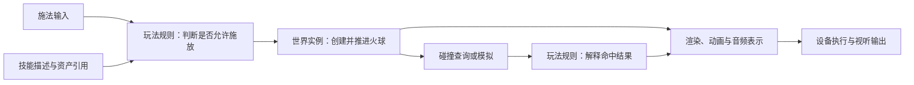

玩家按下施法键，屏幕上出现一团飞向敌人的火球。这个动作看似简单，却要把两类东西接起来：团队提前制作的技能规则、模型、材质、动画与声音，以及运行时才知道的角色位置、目标、冷却和碰撞结果。

理解引擎可以从这里开始：**内容提供可用的描述与规则，运行时维护当前状态，专业系统把状态变成模拟与视听结果。** 玩家输入是状态变化的一种来源，时间推进、AI、网络消息和脚本也可以驱动变化。

> 本篇用一个假想的火球技能解释职责与数据交接，不对应某台引擎的完整调用链。Unity 2022.3 官方资料用于核对模板、更新与 GPU 计算的具体概念；本文没有执行引擎实验。

## 按键之前，团队已经准备了什么

策划定义施法条件、速度、伤害与冷却。美术制作模型、纹理和动画。程序把规则接进对象创建、更新、碰撞和表现接口。编辑器与加工工具将这些产出组织为运行时能引用的内容。

要区分“火球的描述”和“这一次施放的火球”。描述可以规定初始速度并引用同一份材质；某个运行实例还需要自己的位置、剩余寿命、施法者和命中状态。十个火球可以共享网格，却不会因此共享同一个当前位置。

Unity 的 Prefab 是这种区分的一个具体例子：它把 GameObject、组件、属性和子对象保存为可复用资产，再由模板创建场景实例。实例也可以保留自己的覆盖项。这里可借鉴的是模板与实例的关系，不要求所有引擎都采用 Prefab 模型。[Unity 2022.3：Prefabs](https://docs.unity3d.com/2022.3/Documentation/Manual/Prefabs.html)

源文件也不等于运行时直接消费的表示。图片可能先经过压缩和目标平台加工，网格需要相应的运行数据；加载后还可能需要建立设备对象。这些处理可以在制作期、构建期或运行期发生，具体分工取决于引擎和内容类型。

## 从施法意图到当前世界状态

下面的箭头表示这个例子中的**因果与数据交接**。它没有声明线程、函数调用顺序或屏幕帧号。

按下一个键，只能先说明玩家表达了施法意图。角色可能正在眩晕，技能可能还在冷却，也可能缺少施法资源。**是否允许生成火球，由游戏规则决定。** 输入系统不需要知道这套技能的伤害公式，渲染系统也不应代替玩法判断施法是否成功。

通过规则检查后，框架创建或取得一个可用实例，连接它需要的组件与专业表示。随后，运动逻辑根据时间推进位置，物理查询或模拟提供接触信息。命中谁、是否友伤、是否重复扣血，仍要由玩法解释；“发生接触”和“造成伤害”不是同一个结论。

可以用一张交接表检查是否漏了责任：

| 交接 | 传递的内容 | 接收方要决定什么 |
| --- | --- | --- |
| 输入 → 玩法 | 施法意图、瞄准信息 | 能否执行，怎样计算初始参数 |
| 玩法 → 世界框架 | 模板或描述、初始位置、实例关联 | 怎样创建、注册并管理这次实例 |
| 运动/物理 → 玩法 | 新位置、命中对象、接触信息 | 怎样更新业务状态、产生后续事件 |
| 世界/玩法 → 表现系统 | 可见状态、姿态、材质参数、声音事件 | 怎样更新各自的专业表示 |
| 表现系统 → 设备后端 | 绘制或计算命令、资源引用、音频数据 | 怎样提交并满足设备执行条件 |

这些责任可以暂时写在同一个程序里。分开解释的目的，是让读者知道改规则、换表现、修生命周期问题时，应追哪份状态和哪段协议。

## 屏幕上出现的，不是世界对象的直接投影

渲染系统需要从当前可用的场景表示中组织画面：选用相机视角，判断可见内容，取得网格、材质、光照等数据，准备并提交设备工作。火球对象的“伤害值”未必进入这个过程；它的位置、外观和可见性则可能参与。

因此，至少有三种状态需要分别理解：

- **玩法与世界状态**：这个火球是否存在、属于谁、已经命中过什么。
- **专业表示**：渲染器可读的位置和材质信息、粒子实例、正在播放的声音等。
- **设备工作与输出**：已经提交的命令、设备仍在使用的资源、最终呈现的图像与声音。

它们通过协议同步，并不天然是同一份对象。世界状态已经删除一个火球，之前提交的绘制仍可能持有相关设备资源；资源回收需要遵守执行完成条件，而不能仅凭游戏对象消失就立即释放。

这里也不能把 GPU 简化成“只负责画图”。GPU 可以运行计算着色器，处理粒子、模拟或其他通用计算。Unity 2022.3 的 Compute Shader 文档明确覆盖正常渲染管线之外的 GPU 计算。真正需要由引擎和游戏程序定义的是规则、数据表示和交接协议；CPU 或 GPU 执行哪部分工作，是实现选择。[Unity 2022.3：Compute shaders](https://docs.unity3d.com/2022.3/Documentation/Manual/class-ComputeShader.html)

## 一条因果链，不等于在同一显示帧完成

为了讲清楚，我们从按键一直写到了画面。但实际运行时，输入采样、固定步长模拟、动画更新、渲染提交和显示可以处于不同节奏。数据还可能经过队列、缓冲或异步加载。

Unity 2022.3 中，固定更新与每帧更新就有不同节奏：在一次帧更新中，固定更新可能执行零次或多次；这也不等于显示器完成了一次呈现。这个例子提醒我们，“逻辑更新一次，然后必然立刻显示一次”不是通用规律。[Unity 2022.3：Order of execution for event functions](https://docs.unity3d.com/2022.3/Documentation/Manual/ExecutionOrder.html)

同样，玩家不再操作，也不意味着世界停止变化。火球还会飞行，动画会继续播放，AI 会行动，计时器会到期。输入只提供变化来源之一；世界是否继续推进，还取决于时间、暂停状态、调度策略和外部事件。

要判断一条真实路径用了几帧、跨了哪些线程，需要检查具体引擎的调度、数据发布和同步机制。可以接着读[初始化、帧循环与退出]()，把因果关系进一步落实到时间与生命周期。

## 用三个变化检验自己是否读懂

假设现在要修改这个技能：

1. **伤害翻倍，外观保持一致。** 先找规则和配置的使用方，解释为什么不需要修改网格或图形后端。
2. **外观变成冰球，命中规则一致。** 追资产引用、资源准备和专业表示更新；注意旧资源是否仍有使用者。
3. **施法者退出时，加载还没完成。** 确认谁作废实例绑定，回调怎样识别失效目标，以及共享请求是否还有其他使用者。

能说清这三个变化，就已经开始从“引擎有哪些功能”转向“状态由谁持有，变化怎样传递”。接下来读[架构总论]()建立职责地图，再读[00A：接口依赖与资源边界]()。如果想跟进具体实现，可沿[Piccolo：从场景对象到一帧画面]()核对实际数据路径。
