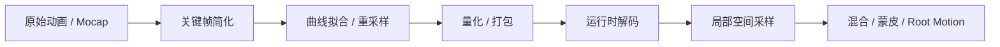
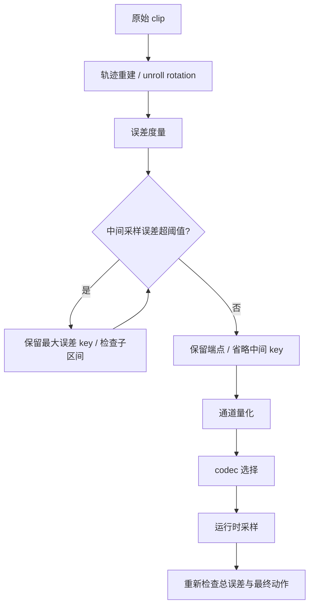
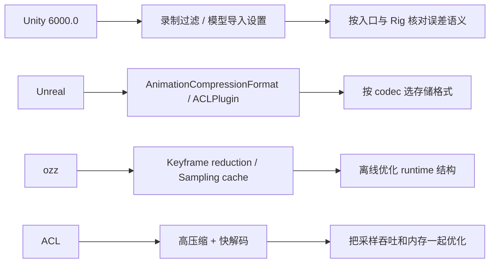

---
title: "游戏与引擎算法 11｜动画压缩"
slug: "algo-11-animation-compression"
date: "2026-04-17"
lastmod: "2026-10-26"
description: "解释关键帧简化、曲线拟合、量化和运行时解码如何共同把动画数据从‘又大又慢’变成‘足够小且足够快’。"
tags:
  - "动画压缩"
  - "关键帧简化"
  - "曲线拟合"
  - "量化"
  - "ACL"
  - "ozz-animation"
  - "Mecanim"
  - "Unreal"
series: "游戏与引擎算法"
weight: 1811
---

**一句话本质：动画压缩不是把数据“变少”这么简单，而是在可接受的误差预算内，把存储、加载和采样成本重新分配。**

> 读这篇之前：建议先看 [游戏与引擎算法 09｜旋转插值：Slerp、Nlerp、Squad]()、[游戏与引擎算法 38｜四元数完全指南：旋转表示、Log/Exp、奇异性]() 和 [游戏与引擎算法 41｜浮点精度与数值稳定性]()。动画压缩的核心误差，几乎总会落到插值和量化上。

> 版本与证据范围：数学与代码是教学模型，Unity 映射按 6000.0 文档区分录制 API、ModelImporter 和 Rig 类型；ACL/ozz 的公开数据仅属于所列版本与度量。C# 片段仅在独立 .NET 10 合成数据下做了有限检查，没有执行 Unity 导入、真实片段、采样性能或设备画面/玩法验证，不把这些证据混写成本项目结果。

## 问题动机

动画数据在引擎里很容易成为隐形大户。

动画可能包含位移、旋转、缩放、BlendShape 或其他属性曲线，也可能带事件。动作库、骨架、附加片段与资源驻留范围都会影响数据量；事件与对象引用不应直接当作连续数值曲线交给同一种有损压缩。

动画还涉及查找关键帧、插值、局部姿态重建，以及后续层级变换、混合与蒙皮。表示、访问方式、缓存、求值频率和活动对象共同决定工作，不能由文件更大直接推导采样更慢，也不能把删 key 等同于减少每帧活跃通道的求值次数。

因此要在接受条件内比较存储、加载和求值的取舍，不能预设压小以后吞吐必然更高。

### 压缩管线要平衡三件事



## 历史背景

动画压缩的历史，和视频压缩很像：先有原始采集数据，再有离线处理，再有按硬件预算选择表示法。

在早期 DCC 和游戏管线里，动画往往以较密的关键帧存储。那时存储贵、内存小、CPU 也慢，所以大家先学会的是“删掉冗余关键帧”。Unity 的 `Keyframe Reduction`、`Animation Compression` 选项都延续了这条思路。

后来，游戏开始追求更大的角色库、更长的动作片段和更快的运行时采样，单纯删帧不够了。必须把曲线表示、量化策略、运行时 codec 和数据布局一起考虑。

`ozz-animation` 和 `ACL` 都把离线表示与运行时采样结合设计。[ACL UE 插件仓库](https://github.com/nfrechette/acl-ue4-plugin)说明自 UE 5.3 起插件随引擎分发并由 Epic 维护；“随引擎分发”不能直接写成“该版本每个项目已默认采用”，具体选择仍需检查所用引擎与项目设置。

## 数学基础

### 1. 误差预算

压缩本质上是在最小化误差，同时控制比特数。

对一个标量轨迹 `x(t)`，压缩后的近似曲线 `\hat x(t)` 的最大误差可以写成：

$$
\varepsilon_{\infty} = \max_{t \in [t_0, t_n]} |x(t) - \hat x(t)|
$$

对位置向量 `p(t)`：

$$
\varepsilon_p = \max_t \|p(t) - \hat p(t)\|
$$

对单位四元数旋转，最自然的误差度量是测地角：

$$
\varepsilon_q = \max_t 2\arccos\left(|q(t) \cdot \hat q(t)|\right)
$$

这是本篇使用的姿态角度度量，计算时先归一化并把点积绝对值限制到 `[0,1]`。分量误差可以服务某些编码步骤，但不能直接代替最终旋转角度误差。

这些式子首先约束所选空间的轨迹。父关节的小角度误差可能随骨链放大成手脚或挂点的位置偏移；局部通道通过不等于最终姿态、重定向、混合、脚接触或玩法命中通过。连续区间的最大误差还需检查区间内部，不能只比较原始 key 时刻。

### 2. 关键帧简化

最常见的简化问题是：在一条离散轨迹里删掉尽量多的点，但删掉后误差不能超标。

对线性插值的简化，可以递归地检查一段 `[i,j]` 的中间点是否都落在误差阈值内。若超标，就在最大误差处切开。

这和 Ramer-Douglas-Peucker 很像，只是误差度量不再是平面折线距离，而是标量、向量或四元数距离。

### 3. 曲线拟合

本篇的简化示例用端点线性插值恢复标量轨迹；删 key 本身不规定恢复一定是折线，实际动画曲线还可能有切线等语义。Hermite、Bezier 或分段样条是另一类可比较表示，不保证对每条动作都更好。

拟合的好处，是可以用更少的控制点表达更平滑的曲线；坏处是拟合阶段更复杂，运行时还得付更多插值成本。

### 4. 量化

量化把连续值映射到有限比特宽度。

标量 `x` 的常见映射是：

$$
 u = \operatorname{round}\left(\frac{x - x_{\min}}{x_{\max} - x_{\min}} (2^b - 1)\right)
$$

解码时再反算回去：

$$
\hat x = x_{\min} + \frac{u}{2^b - 1}(x_{\max} - x_{\min})
$$

单位四元数可省略一个可恢复分量，但不同编码对符号、被省略分量的索引与量化范围有不同约定。固定省略 W 时可以先把四元数翻到 W 非负的等价表示，再由单位长度恢复 W；这不等于所有编码都额外存一个符号位。

这就是为什么很多引擎里的旋转 codec 都会写成 `NoW`：不是不管 `W`，而是把它从显式存储改成隐式恢复。

## 算法推导

### 为什么“删关键帧”是第一步

动画轨迹里常常有大量冗余帧。对于缓慢变化的关节，连续帧之间差别很小，留着只会增加存储和采样成本。

关键帧简化可以先降低 key count；查找、读取和插值成本是否降低还需看运行表示。下面的离散检查只限制所检查时刻的简化误差，后续量化仍会增加误差，需要解码后重新检查总误差。

### 为什么“单一误差阈值”不够

位置、旋转和缩放的误差感知方式不同。1 厘米的位置误差和 1 度的旋转误差，视觉影响完全不是一个量级。

Unity 6000.0 的 [CurveFilterOptions](https://docs.unity3d.com/6000.0/Documentation/ScriptReference/Animations.CurveFilterOptions.html)分别给出这些字段，但它用于 `GameObjectRecorder.SaveToClip` 的录制曲线过滤，不是所有模型导入压缩的统一入口。其旋转字段以度计，位置、缩放和 float 字段以百分比计；不能把数学示例的长度单位阈值直接填进去，或把百分比解释成通用厘米误差。

### 为什么量化通常要和运行时 codec 绑定

只做简化仍可能减少数据量；是否还有量化、布局或查找方面的收益，需要按实际运行表示检查，不能一概认定简化收益有限。

真正的压缩体系会把表示法也一起变掉：例如把旋转改成 48/32 位格式，把常量轨迹单独剥离，把索引和时间点压缩掉，把相邻帧的读取顺序也优化掉。

`ozz-animation` 0.15.0 的 release note 里就明确提到：keyframe 结构重排后，keyframe size 因为时间索引收缩而减少了 17% 到 25%。这说明“结构设计”本身就是压缩的一部分。

### 为什么 root motion 要单独处理

Root motion 在采用动画驱动位移的系统里可能参与角色运动；碰撞、网络同步和最终位移怎样应用，还取决于角色控制器与玩法代码。

根运动轨迹变化可能影响接触、位移和回放，需要沿实际消费者单独确认。根运动提取、混合与省略可恢复的默认姿态数据是不同机制，不能用 bind-pose stripping 证明根运动处理正确；默认轨道被省略也不等于骨骼、蒙皮或挂点可以删除。

## 结构图 / 流程图





## 算法实现

下面是独立 C# 教学片段，用 `System.Numerics`、`record struct` 等语法表达离散关键帧简化和标量量化。它不是 Unity 内置压缩实现，也没有曲线拟合、完整二进制编解码、动画绑定、事件或性能验证；不能直接当作可接入的 Unity 脚本。

假定时间有限且严格递增、标量值有限、旋转为可归一化的非零四元数、阈值非负。常量轨道要检查所有保留值，首尾相等并不能证明中间不动。`ushort` 码字仍各占 16 位，`QuantizationBits < 16` 本身不会把容器自动打包成相应位宽；XYZ 示例也只展示数值格点，没有完成存储压缩或四元数恢复。

```csharp
using System;
using System.Collections.Generic;
using System.Numerics;

public readonly record struct Keyframe<T>(float Time, T Value);

public sealed class AnimationCompressionSettings
{
    public float PositionError = 0.0025f;
    public float RotationErrorDegrees = 0.5f;
    public float FloatError = 0.01f;
    public int QuantizationBits = 16;
}

public sealed class CompressedTrack<T>
{
    public readonly List<float> KeyTimes = new();
    public readonly List<ushort> QuantizedValues = new();
    public float RangeMin, RangeMax;
    public int Bits;
    public T DefaultValue = default!;
    public bool IsConstant;
}

public static class AnimationCompression
{
    public static CompressedTrack<float> CompressScalarTrack(
        IReadOnlyList<Keyframe<float>> source,
        AnimationCompressionSettings settings)
    {
        var reduced = SimplifyScalarTrack(source, settings.FloatError);
        var track = new CompressedTrack<float>();
        if (reduced.Count == 0) return track;

        if (IsConstant(reduced))
        {
            track.IsConstant = true;
            track.DefaultValue = reduced[0].Value;
            return track;
        }

        track.RangeMin = Min(source);
        track.RangeMax = Max(source);
        track.Bits = settings.QuantizationBits;
        foreach (var k in reduced)
        {
            track.KeyTimes.Add(k.Time);
            track.QuantizedValues.Add(QuantizeFloat(k.Value, track.RangeMin, track.RangeMax, track.Bits));
        }

        return track;
    }

    public static List<Keyframe<float>> SimplifyScalarTrack(IReadOnlyList<Keyframe<float>> keys, float maxError)
    {
        if (keys.Count <= 2) return new List<Keyframe<float>>(keys);
        var keep = new bool[keys.Count];
        keep[0] = true;
        keep[^1] = true;
        SimplifyScalarRec(keys, 0, keys.Count - 1, maxError, keep);

        var result = new List<Keyframe<float>>();
        for (int i = 0; i < keys.Count; i++)
            if (keep[i]) result.Add(keys[i]);
        return result;
    }

    public static List<Keyframe<Quaternion>> SimplifyRotationTrack(IReadOnlyList<Keyframe<Quaternion>> keys, float maxErrorDegrees)
    {
        if (keys.Count <= 2) return new List<Keyframe<Quaternion>>(keys);
        var unrolled = UnrollQuaternionSign(keys);
        var keep = new bool[unrolled.Count];
        keep[0] = true;
        keep[^1] = true;
        SimplifyRotationRec(unrolled, 0, unrolled.Count - 1, maxErrorDegrees, keep);

        var result = new List<Keyframe<Quaternion>>();
        for (int i = 0; i < unrolled.Count; i++)
            if (keep[i]) result.Add(unrolled[i]);
        return result;
    }

    public static float RotationErrorDegrees(Quaternion a, Quaternion b)
    {
        a = Quaternion.Normalize(a);
        b = Quaternion.Normalize(b);
        float dot = Math.Clamp(MathF.Abs(Quaternion.Dot(a, b)), 0f, 1f);
        return 2f * MathF.Acos(dot) * 180f / MathF.PI;
    }

    public static ushort QuantizeFloat(float value, float min, float max, int bits)
    {
        if (bits <= 0 || bits > 16) throw new ArgumentOutOfRangeException(nameof(bits));
        if (Math.Abs(max - min) < 1e-8f) return 0;

        float t = (value - min) / (max - min);
        t = Math.Clamp(t, 0f, 1f);
        uint levels = (1u << bits) - 1u;
        return (ushort)Math.Round(t * levels);
    }

    public static Vector3 QuantizeQuaternionXYZ(Quaternion q, int bitsPerComponent)
    {
        if (bitsPerComponent <= 0 || bitsPerComponent > 16)
            throw new ArgumentOutOfRangeException(nameof(bitsPerComponent));
        q = Quaternion.Normalize(q);
        if (q.W < 0f) q = Negate(q);
        float scale = (1 << bitsPerComponent) - 1;
        return new Vector3(
            MathF.Round((q.X * 0.5f + 0.5f) * scale) / scale,
            MathF.Round((q.Y * 0.5f + 0.5f) * scale) / scale,
            MathF.Round((q.Z * 0.5f + 0.5f) * scale) / scale);
    }

    private static void SimplifyScalarRec(IReadOnlyList<Keyframe<float>> keys, int i0, int i1, float maxError, bool[] keep)
    {
        float t0 = keys[i0].Time;
        float t1 = keys[i1].Time;
        float v0 = keys[i0].Value;
        float v1 = keys[i1].Value;
        float max = 0f;
        int split = -1;

        for (int i = i0 + 1; i < i1; i++)
        {
            float u = (keys[i].Time - t0) / (t1 - t0);
            float predicted = v0 + (v1 - v0) * u;
            float error = MathF.Abs(keys[i].Value - predicted);
            if (error > max)
            {
                max = error;
                split = i;
            }
        }

        if (max > maxError && split >= 0)
        {
            keep[split] = true;
            SimplifyScalarRec(keys, i0, split, maxError, keep);
            SimplifyScalarRec(keys, split, i1, maxError, keep);
        }
    }

    private static void SimplifyRotationRec(IReadOnlyList<Keyframe<Quaternion>> keys, int i0, int i1, float maxErrorDegrees, bool[] keep)
    {
        float t0 = keys[i0].Time;
        float t1 = keys[i1].Time;
        Quaternion q0 = keys[i0].Value;
        Quaternion q1 = keys[i1].Value;
        float max = 0f;
        int split = -1;

        for (int i = i0 + 1; i < i1; i++)
        {
            float u = (keys[i].Time - t0) / (t1 - t0);
            Quaternion predicted = SlerpShortest(q0, q1, u);
            float error = RotationErrorDegrees(keys[i].Value, predicted);
            if (error > max)
            {
                max = error;
                split = i;
            }
        }

        if (max > maxErrorDegrees && split >= 0)
        {
            keep[split] = true;
            SimplifyRotationRec(keys, i0, split, maxErrorDegrees, keep);
            SimplifyRotationRec(keys, split, i1, maxErrorDegrees, keep);
        }
    }

    private static List<Keyframe<Quaternion>> UnrollQuaternionSign(IReadOnlyList<Keyframe<Quaternion>> keys)
    {
        var result = new List<Keyframe<Quaternion>>(keys.Count);
        if (keys.Count == 0) return result;

        Quaternion prev = Quaternion.Normalize(keys[0].Value);
        result.Add(new Keyframe<Quaternion>(keys[0].Time, prev));

        for (int i = 1; i < keys.Count; i++)
        {
            Quaternion q = Quaternion.Normalize(keys[i].Value);
            if (Quaternion.Dot(prev, q) < 0f) q = Negate(q);
            result.Add(new Keyframe<Quaternion>(keys[i].Time, q));
            prev = q;
        }

        return result;
    }

    private static bool IsConstant<T>(IReadOnlyList<Keyframe<T>> keys)
    {
        if (keys.Count == 0) return false;
        for (int i = 1; i < keys.Count; i++)
            if (!EqualityComparer<T>.Default.Equals(keys[0].Value, keys[i].Value))
                return false;
        return true;
    }

    private static float Min(IReadOnlyList<Keyframe<float>> keys)
    {
        float m = float.PositiveInfinity;
        foreach (var k in keys) m = MathF.Min(m, k.Value);
        return m;
    }

    private static float Max(IReadOnlyList<Keyframe<float>> keys)
    {
        float m = float.NegativeInfinity;
        foreach (var k in keys) m = MathF.Max(m, k.Value);
        return m;
    }

    private static Quaternion SlerpShortest(Quaternion a, Quaternion b, float t)
    {
        a = Quaternion.Normalize(a);
        b = Quaternion.Normalize(b);
        float dot = Quaternion.Dot(a, b);
        if (dot < 0f) b = Negate(b);
        dot = Math.Clamp(MathF.Abs(dot), -1f, 1f);
        if (dot > 0.9995f)
            return Quaternion.Normalize(LerpRaw(a, b, t));

        float theta = MathF.Acos(dot);
        float sinTheta = MathF.Sin(theta);
        float w0 = MathF.Sin((1f - t) * theta) / sinTheta;
        float w1 = MathF.Sin(t * theta) / sinTheta;
        return Quaternion.Normalize(Add(Scale(a, w0), Scale(b, w1)));
    }

    private static Quaternion LerpRaw(Quaternion a, Quaternion b, float t)
        => new(
            a.X + (b.X - a.X) * t,
            a.Y + (b.Y - a.Y) * t,
            a.Z + (b.Z - a.Z) * t,
            a.W + (b.W - a.W) * t);

    private static Quaternion Add(Quaternion a, Quaternion b)
        => new(a.X + b.X, a.Y + b.Y, a.Z + b.Z, a.W + b.W);

    private static Quaternion Scale(Quaternion q, float s)
        => new(q.X * s, q.Y * s, q.Z * s, q.W * s);

    private static Quaternion Negate(Quaternion q)
        => new(-q.X, -q.Y, -q.Z, -q.W);
}
```

这段骨架故意把“删关键帧”和“量化”分开写。原因很简单：它们解决的是不同层次的成本。

简化减少保留 key；实际位打包才改变存储位宽；曲线拟合需要另一套表示与误差检查。本片段只检查原始时刻的简化误差，尚无完整轨道解码后、区间内部或模型空间验证。示例阈值不是 Unity Importer 默认值，也不是项目已接受的误差。

本轮把该 C# 块放进独立 .NET 10 控制台，编译并检查了 8 组合成情况：首尾相同但中间运动、范围元数据、常量轨道、线性简化、101 个标量量化往返点、四元数符号等价、旋转简化及非法位宽。通过仅覆盖这些离散样例；标量量化往返不等于完整轨道 codec、连续误差或 Unity 兼容性验证。

## 复杂度分析

本例递归简化每次扫描区间寻找最大误差，最坏时间为 `O(n^2)`，保留标记和输出为 `O(n)`，递归栈最坏也为 `O(n)`；这不是所有压缩算法的复杂度。

量化本身通常是 `O(n)`，而且主要是一次范围映射和位打包。

曲线拟合和更复杂的 codec 可能会把离线构建成本推到更高，但它们把压力从运行时移开了。

所以动画压缩的核心不是“有没有计算成本”，而是“把成本放在哪个时点、哪个设备、哪条数据路径上更划算”。

## 变体与优化

- **Keyframe reduction**：删掉误差阈值内的冗余帧，最容易落地。
- **Curve fitting**：用分段样条或 Hermite 拟合控制点，减少 key 数。
- **Quaternion unroll**：先把符号连续化，再做简化和量化。
- **Track-wise quantization**：不同通道用不同位宽，不要一刀切。
- **默认/绑定姿态数据省略**：在解码器能恢复所需默认值的契约下省略冗余轨道；不是直接删除未运动骨骼。
- **Sampling cache**：保留轨道与时间区间相关的采样状态，减少重复查找或准备；具体含义依 codec，不等于缓存所有已解码姿态。

## 对比其他算法

| 路线 | 核心思路 | 优点 | 缺点 | 典型代表 |
|---|---|---|---|---|
| 原始浮点存储 | 保留原数值表示 | 避免额外有损量化 | 数据量可能较大，但无解码或规则访问也可能更快 | 教学对照表示 |
| 关键帧简化 | 删掉冗余点 | 容易实现、收益明显 | 对高频动作不够狠 | Unity keyframe reduction |
| 曲线拟合 | 少量控制点拟合整段 | 平滑、控制力强 | 离线成本高 | 样条 / Hermite 轨迹 |
| codec / quantization | 改表示法和位宽 | 内存和速度一起优化 | 误差预算更难调 | ACL、Unreal codec |

## 批判性讨论

动画压缩没有“免费午餐”。压得越狠，foot sliding、肩部塌陷、手腕抖动、root motion 漂移就越容易出现。

另一个误区是把压缩当纯存储优化。存储、解码、采样、混合和蒙皮要分别观察；减少 key 不等于减少骨骼数，也不保证后续每一阶段都更快。

所以真正成熟的方案，都会把离线构建和运行时表示一起设计。`ozz-animation` 和 ACL 都是在这条线上做文章，而不是只删几个关键帧就结束。

还有一个事实必须承认：压缩不是为了让“所有 clip 都一样好”。有些动作非常适合压缩，比如缓慢循环、程序生成动作、远景 NPC；有些动作则不适合过度压缩，比如近景手部表演、精确击打、root motion 极强的过场。

## 跨学科视角

动画压缩和信号压缩本质上很像。

关键帧就是采样点，删帧相当于稀疏采样，曲线拟合像带约束的重建，量化就是把连续值映射到离散码字。误差预算、码率和重建质量之间的关系，和视频编码、音频编码一模一样。

它也像统计里的模型选择：你不是单纯追求拟合误差最低，而是在更少参数和更高泛化之间找平衡。一个更短的轨迹编码，不一定比原始序列“更真”，但它可能更适合引擎。

## 真实案例

- [Unity 6000.0 CurveFilterOptions](https://docs.unity3d.com/6000.0/Documentation/ScriptReference/Animations.CurveFilterOptions.html)是录制保存时的曲线过滤配置，不能与 ModelImporter 混称。
- [Unity 6000.0 ModelImporterAnimationCompression](https://docs.unity3d.com/6000.0/Documentation/ScriptReference/ModelImporterAnimationCompression.html)列出压缩枚举，但枚举存在不代表每种 Rig 都适用全部选项。[Animation tab](https://docs.unity3d.com/6000.0/Documentation/Manual/class-AnimationClip.html)说明 `Keyframe Reduction and Compression` 仅适用 Legacy，额外压缩影响文件存储，运行内存与仅 Keyframe Reduction 相同；`Optimal` 适用 Generic/Humanoid，在关键帧简化与 dense 表示间选择。不能把这些选项排成跨 Rig 通用的“压缩越高越省内存”档位。
- [ACL UE 插件仓库](https://github.com/nfrechette/acl-ue4-plugin)说明 UE 5.3 起的分发与维护关系，不据此认定所有版本和项目都使用同一默认 codec。
- [Unreal AnimationCompressionFormat](https://dev.epicgames.com/documentation/en-us/unreal-engine/API/Runtime/Engine/AnimationCompressionFormat)在本次查阅时显示 UE 5.8，列出 `ACF_Float96NoW`、`ACF_Fixed48NoW`、`ACF_IntervalFixed32NoW` 等枚举。这里只作编码格式背景，不将它当成 UE 5.3 的配置证据，也不据名称推导 ACL 或 Unity 的实际表示。
- [ACL UE plugin repository](https://github.com/nfrechette/acl-ue4-plugin) 和 [ACL core repository](https://github.com/nfrechette/acl) 都把“压缩比、解码速度、准确性”列成明确目标。
- [ozz-animation Release 0.15.0](https://github.com/guillaumeblanc/ozz-animation/releases/tag/0.15.0)记录了时间索引、反向读取、采样缓存和运行格式变化；该版本说明要求重建运行时动画，不能只替换库就假设旧产物兼容。

## 量化数据

以下均为特定来源的公开说明，不是本篇复测，更不是项目性能预测：

- ACL UE 插件 README 所述 ACL **2.1.0** 集成对比 **UE 5.2.0**：最多 2.9x 更小、2x 更准确、2x 更快压缩、6.3x 更快解压；原文说明结果依平台与数据变化。这些是不同指标的最大值，不是同一片段同时获得的保证，准确度也不能当作最终玩法验收。
- ozz-animation **0.15.0**：时间索引变化省下的是每个 keyframe 的 **16–24 bit、约 17%–25% 的 keyframe 结构大小**，依片长而异；共享时间点等开销另计，不是整个动画包、进程内存或 CPU 等比例降低。
- Unity **6000.0 CurveFilterOptions** 的旋转误差用度、位置/缩放/float 用百分比；这是 API 参数语义，不是压缩收益。[ModelImporter.animationPositionError](https://docs.unity3d.com/6000.0/Documentation/ScriptReference/ModelImporter-animationPositionError.html)与[animationRotationError](https://docs.unity3d.com/6000.0/Documentation/ScriptReference/ModelImporter-animationRotationError.html)需分别按文档解释，不能把录制过滤、模型导入和本文绝对误差公式直接等同。
- Unreal 枚举中的 96/48/32 等名称提示要检查存储表示，但名称本身不是整个轨道/片段的字节统计，更不是本项目测量。

这些数字放在一起，说明压缩不是单一技术，而是一整套从误差预算到存储格式再到解码器布局的系统设计。

Unity 检查保持三步：固定版本/Rig/片段和原始对照；一次改变一种压缩候选；分别记录导入曲线、构建体积、运行驻留/采样与最终动作。还要检查根运动、混合、重定向、脚接触、武器/挂点、属性曲线与事件消费者，方法可接[动画制作]()和[联合验收]()。这三步尚未执行。

<!-- DATA-TODO: 在合成离散检查之外补输入合法性、完整轨道编解码与连续区间误差验证；固定 Unity 补丁、Rig、模型比例、片段与运行控制器，先比较原始/简化，再检查量化后的区间与最终姿态。分别记录构建字节、驻留、解码/采样及画面和玩法；第三方 benchmark 若作比较，另固定库/codec 版本、数据集、硬件与误差指标，未复测前不填收益。 -->

## 常见坑

1. **忘记先做 quaternion unroll。**  
   错因：相邻帧符号翻转会让简化算法误判为大跳变。  
   怎么改：先做短弧连续化，再做简化和量化。

2. **所有通道共用一个误差阈值。**  
   错因：位置、旋转和缩放的视觉敏感度不同。  
   怎么改：按通道分别设置误差预算，至少把旋转和位移分开。

3. **只看磁盘，不看采样。**  
   错因：离线压小了，运行时解码却更慢。  
   怎么改：把采样缓存、codec 结构和 cache locality 一起算。

4. **对 root motion 和普通关节一刀切。**  
   错因：根骨压坏了，脚底就滑，网络回放也容易偏。  
   怎么改：root motion 单独建轨迹、单独设阈值、单独验证。

## 何时用 / 何时不用

**适合用动画压缩的场景：**

- 大量角色、长动作库、跨平台发布。
- 需要降低磁盘占用、内存占用和采样带宽。
- 运行时采样和混合频繁，缓存命中率重要。

**不适合过度压缩的场景：**

- 近景高精度表演。
- 手部、面部、道具交互等对细节极敏感的动作。
- 需要完全可逆、完全无损的离线分析。

## 相关算法

- [游戏与引擎算法 09｜旋转插值：Slerp、Nlerp、Squad]()
- [游戏与引擎算法 38｜四元数完全指南：旋转表示、Log/Exp、奇异性]()
- [游戏与引擎算法 41｜浮点精度与数值稳定性]()
- [游戏与引擎算法 10｜逆向运动学：CCD、FABRIK、Jacobian]()

## 小结

动画压缩的本质，是把“原始采样数据”变成“更适合引擎消费的运行时表示”。

关键帧简化解决冗余，曲线拟合解决平滑，量化解决位宽，运行时 codec 解决采样和缓存效率。

如果你只记住一句话，那就记住：**压缩不是删数据，而是让每一比特都更值钱。**

## 参考资料

- [ACL core repository](https://github.com/nfrechette/acl)
- [ACL UE plugin repository](https://github.com/nfrechette/acl-ue4-plugin)
- [Unity 6000.0 CurveFilterOptions](https://docs.unity3d.com/6000.0/Documentation/ScriptReference/Animations.CurveFilterOptions.html)
- [Unity 6000.0 ModelImporterAnimationCompression](https://docs.unity3d.com/6000.0/Documentation/ScriptReference/ModelImporterAnimationCompression.html)
- [Unity 6000.0 Animation tab](https://docs.unity3d.com/6000.0/Documentation/Manual/class-AnimationClip.html)
- [Unreal `AnimationCompressionFormat`](https://dev.epicgames.com/documentation/en-us/unreal-engine/API/Runtime/Engine/AnimationCompressionFormat)
- [ozz-animation features](https://guillaumeblanc.github.io/ozz-animation/documentation/features/)
- [ozz-animation release 0.15.0](https://github.com/guillaumeblanc/ozz-animation/releases/tag/0.15.0)
