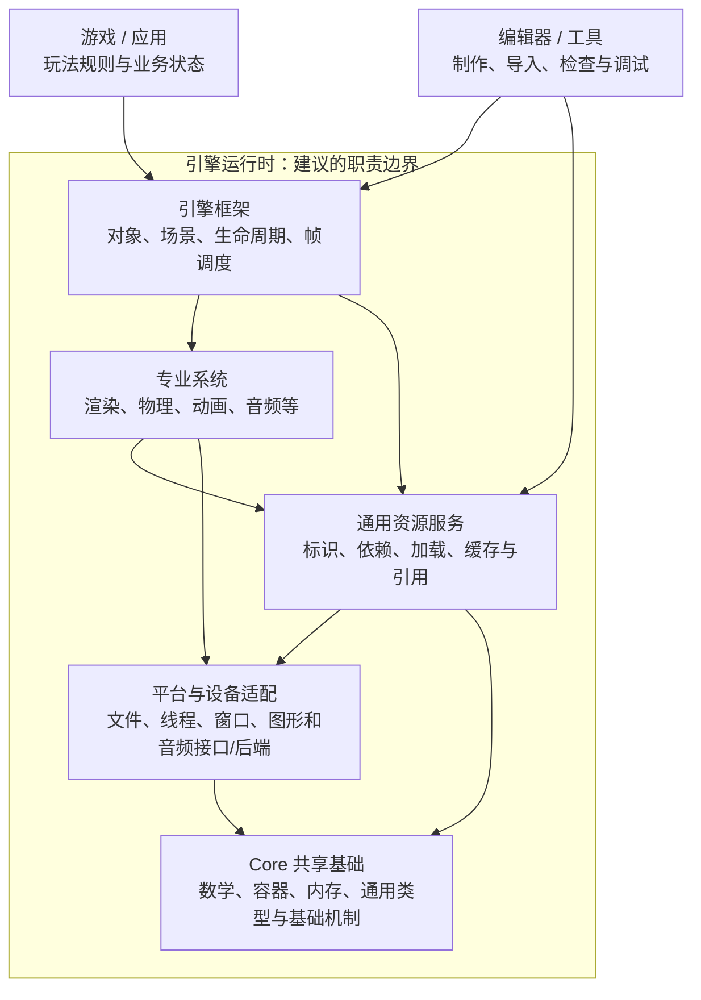
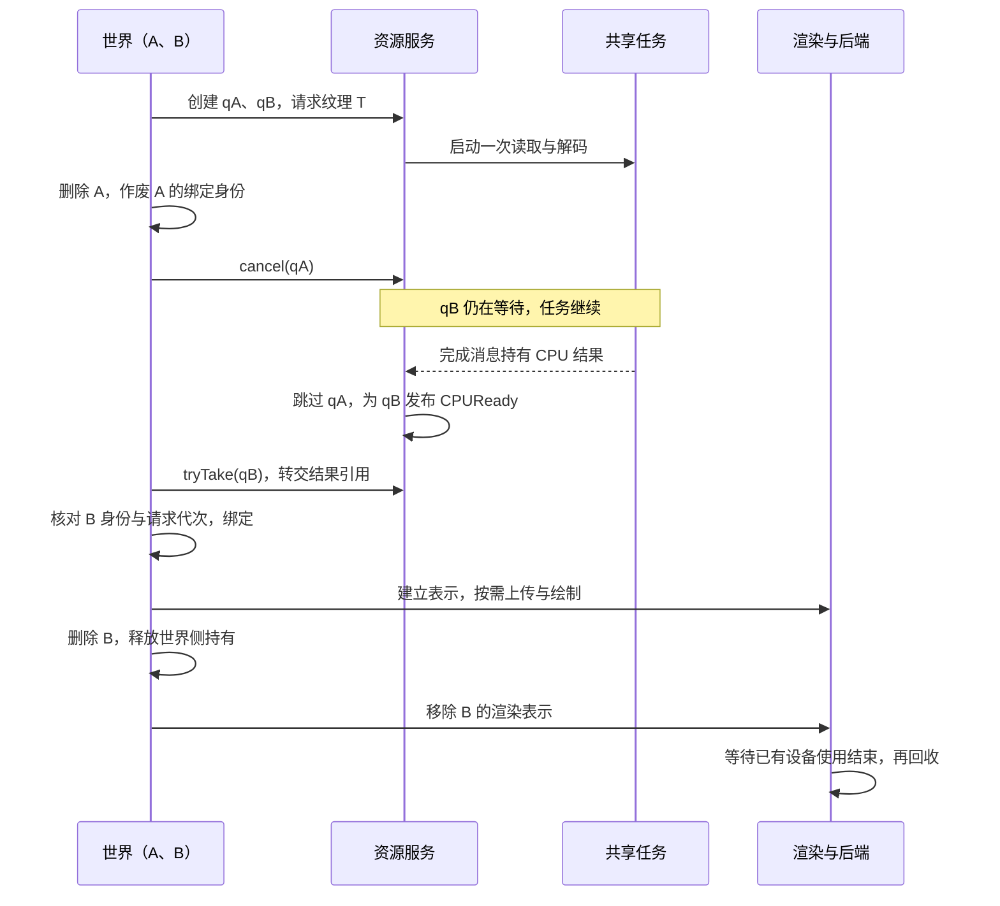

给引擎建几个目录很容易：Tool、Function、Resource、Core、Platform。真正困难的是，后来加一个纹理格式、换一个图形后端、删除一个角色时，应该改谁的代码，又由谁负责把旧状态清理干净。

如果资源管理器开始创建场景对象，平台文件模块开始理解角色配置，编辑器窗口又直接销毁仍在绘制的 GPU 对象，目录名字即使齐全，依赖和生命周期仍然会缠在一起。

本篇给出一套引擎无关的参考模型：**应用与工具使用引擎框架，框架组织专业系统；资源服务与 Core 提供共享能力，平台后端承接具体环境。** 用这张地图检查职责和依赖，再用一次角色外观加载检查数据交接与清理责任。

> **阅读位置**：本篇是 [00 总论]() 后的原理补篇。00 的职责分类用于认识引擎覆盖的问题，本篇进一步讨论接口依赖；两张地图的箭头与用途不同。
>
> 下文模型和例子是设计建议，不是某台引擎的源码依赖审计，也不是统一行业标准。公开架构资料用于核对常见边界，资料查看日期为 2026-10-25；本文没有执行引擎或资源上传程序。

## 先说明分层图到底在表达什么

讨论架构时，下面几种关系经常被画成同一根箭头：

| 关系 | 要回答的问题 | 需要找的证据 |
| --- | --- | --- |
| 职责分类 | 谁解决哪类问题？ | 输入输出、持有状态、变化原因 |
| 代码与模块依赖 | 谁引用谁的类型和接口？ | 头文件、程序集引用、模块构建规则 |
| 运行调用 | 谁在什么时候调用谁？ | 调用栈、接口实现、注册与回调 |
| 数据流 | 内容经过了哪些表示？ | 描述、CPU数据、设备对象、世界实例 |
| 线程与执行 | 哪些工作可以并行，怎样同步？ | 任务、线程、队列、屏障与完成事件 |

按“渲染、物理、动画”分类，只能先得到职责分组。把它们分别编译成库，也不保证依赖就合理；按顺序调用三个系统，更不能证明它们分别占用三个线程。

因此，先给每张图标出关系。本篇分别用依赖图说明接口使用、数据流图说明表示交接、时序图说明共享加载中的事件先后，不用一张图兼任所有解释。

## 一张主线与共享服务的参考图

可以先沿四组职责理解主要的接口使用关系：

```text
应用 / 工具 → 引擎框架 → 专业系统 → 平台与设备后端
```

Core 是公共基础能力，资源服务负责跨系统的资产身份、依赖和加载协作。它们值得单独画出，避免将所有东西硬排成只有相邻层可以访问的阶梯。

下面 `A → B` 表示 **A 使用 B 提供的接口或公共契约**。它是本文建议的主要依赖方向，不代表文件夹位置、每帧执行顺序或线程数量。



图中省略了框架、专业系统和上层程序对 Core 的直接使用。上层也可以通过明确的专业系统接口直接发起查询；不需要为每个调用机械地补齐中转层。

“平台与设备适配”在这里是一组职责，内部接口和具体后端可以分成多个模块。操作系统、驱动、图形 API 和第三方库是这些实现使用的外部设施，不要求它们也落入上述引擎目录。

### 每部分负责什么，在哪里停止

| 部分 | 主要输入与输出 | 持有的典型状态 | 应停下来的边界 |
| --- | --- | --- | --- |
| 游戏 / 应用 | 玩家意图与业务数据 → 玩法操作 | 任务、胜负、角色业务状态 | 通用引擎不应依赖某个产品的任务规则 |
| 编辑器 / 工具 | 编辑动作、源文件与设置 → 内容描述、加工产物、诊断 | 选中项、撤销记录、导入任务 | 修改运行对象应遵守运行时接口；工具不必随游戏发行 |
| 引擎框架 | 场景描述与系统服务 → 世界实例、更新与销毁请求 | 对象身份、场景成员资格、组件关系与调度 | 组织协作，不把碰撞求解和光照算法搬进场景管理器 |
| 专业系统 | 专业描述与世界变化 → 姿态、模拟结果、绘制等 | 物理世界、动画实例、渲染表示等 | 不承担具体任务剧情；向其他系统发布明确的数据 |
| 通用资源服务 | 资产标识与请求 → 共享条目、加载结果与状态 | 依赖记录、进行中请求、缓存、引用和驻留策略 | 不自行决定往哪个世界生成什么角色，不硬编码所有专业类型 |
| 平台与设备适配 | 平台无关请求 → 环境操作与完成信息 | 文件句柄、线程、设备及原生命令资源 | 不理解世界对象或游戏规则；能力差异仍要显式报告 |
| Core | 通用值与契约 → 可复用机制 | 容器、分配器、类型描述等基础状态 | 不藏入具体场景、材质或角色前提 |

这里的“框架”也不要求采用同一种对象模型。场景树、GameObject/Component 或 ECS，都可以承担世界组织职责，只是身份、存储和更新协议不同。

## 为什么要从 Function 中拆出引擎框架

一个 Function 目录同时放世界、渲染和物理，可以作为源码定位方法。但如果要解释依赖，最好继续区分两件事：

- **世界怎样存在和推进**：谁创建对象，谁连接组件，什么时候更新和销毁。
- **专业能力怎样计算**：如何求碰撞、混合姿态、组织可见数据或生成像素。

例如，场景框架知道某个对象挂有物理组件，负责在生命周期边界通知物理系统；物理系统维护自己的模拟表示和查询接口。它不必知道该对象是主角、路人还是任务目标。

这种拆分允许专业能力在不同环境下复用：编辑器预览可以使用渲染系统，离线工具可以使用部分网格处理能力，测试可以构造简化的物理输入。是否值得拆成独立库，再由规模、团队和构建成本决定。

同样，帧调度与任务执行机制也应分开。框架决定本轮推进哪些系统；通用任务机制解决怎样分派和等待工作；平台线程实现承接操作系统能力。不能因为都涉及“执行”，就全部放在一个大管理器里。初始化、帧循环和退出的时间关系可接着读[引擎怎样启动、推进与停止]()。

### 脚本、反射和 GC 怎么放

这些名字通常横跨多种职责，不适合强迫一个完整目录只占一格。

语言 VM、通用类型描述、内存管理和任务基础可以作为共享运行机制，按规模从 Core 旁边拆出专门模块；脚本怎样获得场景对象、何时接收帧回调，则是框架接线；某个玩法脚本如何计算伤害，属于应用规则。

反射的字段访问机制也不应自动吞掉“改值后重建碰撞、置渲染 dirty、保存文件”的业务协议。机制定位字段，使用方决定怎样合法改变状态。执行与对象机制的进一步讨论见 [03 运行时底座]()。

## 依赖方向由接口归属决定

只有一张职责表，还不足以保证代码没有依赖环。需要继续说明接口由哪个模块定义，具体实现怎样接入。

先区分两个接口：资源契约模块定义面向使用者的 `IResources`，以及面向类型加载器的 `IAssetLoader`。世界只需要前者；纹理加载器实现后者。资源服务实现使用者接口，并通过加载器接口委托专业处理：

```text
代码依赖：
  世界模块 → 资源契约模块中的 IResources
  资源服务模块 → 资源契约模块中的 IResources、IAssetLoader
  纹理加载器模块 → 资源契约模块中的 IAssetLoader、纹理数据契约
  装配模块 → 世界、资源服务、纹理加载器及所需平台实现

运行时调用：
  世界 → IResources → 资源服务 → IAssetLoader → 纹理加载器
```

资源服务在运行时进入了专业实现，不代表它在编译时必须引用纹理加载器的具体类型。契约模块也可以暂时与资源服务放在同一个库中；关键是公共接口没有带入具体加载器或世界类型。

如果通用资源管理器直接包含渲染器头文件，并在加载结束时调用“向当前世界添加角色”，那么专业类型和世界操作已经进入了它的依赖。这时，仅把调用包进回调并不能消除问题。

### 用一个启动入口把三个对象装起来

假设游戏要加载角色外观中的一张纹理。下面用原创伪代码说明一种装配方式，名称不对应 Piccolo、Unity 或 Unreal 的真实 API，也不是可以直接编译的程序。

例子只有一个世界，纹理加载器只把文件字节解码为 CPU 数据。资源服务负责读取与任务协调；GPU 创建留给后面的专业系统。`EngineSession` 是应用启动入口中的装配对象：它知道各个具体实现，将它们接起来，并负责结束这次运行会话。

先约定所有权，否则 `register` 和 `get` 很容易被误读成“交出了对象”或“延长了寿命”。

| 对象或记录 | 谁创建并拥有 | 谁使用它，使用到什么时候 |
| --- | --- | --- |
| 文件服务、任务执行器 | `EngineSession` | 资源服务借用；所有读取、任务与完成处理结束前不能关闭 |
| `ResourceService` | `EngineSession` | 世界借用它的 `IResources` 接口；世界及其请求、资源引用必须先退出 |
| `TextureLoader` | `EngineSession` | 注册表借用其 `IAssetLoader`；任务执行或缓存数据清理仍可能进入加载器代码 |
| `World` | `EngineSession` | 持有请求票据和已取得的资源引用，管理它们与世界对象的绑定 |
| 注册记录 | 资源服务保存，装配入口保管注销令牌 | 将类型键映射到加载器；本例注册不转移加载器所有权 |

这里的“借用”表示可以调用、不能销毁，也不会自动延长寿命。资源引用则按本例协议维持 CPU 数据可用，必须在资源服务销毁前释放。两种关系不能因为都表现为一个句柄就混为一谈。

```text
EngineSession.start():
  files     = own FileService()
  jobs      = own TaskExecutor()
  resources = own ResourceService(borrow files, borrow jobs)
  texture   = own TextureLoader()

  registration = resources.registerLoader(TextureKind, borrow texture)
  require registration succeeded

  world = own World(borrow resources.asIResources())
  world.beginScene(sceneDescription)
  publish world to the frame loop
```

`registerLoader` 在这里登记的是“纹理类型由谁处理”，并没有加载某张纹理，也没有创建世界。类型键重复时注册失败；如果纹理是场景的必需能力，注册成功后才允许世界开始请求。世界的构造函数只接收依赖，`beginScene` 才开始产生请求，便于分别处理装配失败和场景加载失败。

装配入口因此可以认识多种具体实现。这是它的工作；不能再把它当成通用底层能力，让资源服务反过来调用它取得当前世界。

### 世界获取服务，与服务获取加载器，是两次不同的接线

世界在构造时已经拿到 `IResources`，不用每帧重新查找全局服务。运行时，它按资产标识发起请求；资源服务再根据资产类型查询已经登记的加载器：

```text
World.beginScene(description):
  pending = resources.request(description.textureAssetId)

ResourceService processes pending:
  resolve asset identity and type
  loader = registry.lookup(TextureKind)
  bytes  = read through files
  result = run loader.decode(bytes) through jobs
  record CPUReady(assetReference) or Failed(error) in the request state

World.tick():
  if pending is CPUReady and the target binding is still valid:
    keep its assetReference for the target binding
  if pending is Failed:
    apply the world's fallback or report the scene-loading failure
```

本例选择**世界主动检查请求状态**，后台工作只写入资源服务维护的完成状态，不捕获或调用 `World*`。状态发布必须经过同步；具体用锁还是完成队列，是资源服务内部的实现选择。完成队列若需要主线程处理，正常帧与退出阶段都必须继续处理它。

这样，资源服务只需要知道资产和请求，不需要知道纹理最终属于哪个角色。纹理加载器只需要知道字节与纹理数据契约，不需要取得世界。类型未登记、读取失败或解码失败都会成为请求错误，是否使用占位外观由世界一侧决定。`CPUReady` 也只表示 CPU 数据可消费，不能据此声称纹理已在 GPU 上可绘制。

如果改用回调，仍需补上回调目标寿命与执行环境的契约；把轮询换成回调，本身不会解决这些问题。

### 退出先结束使用关系，再拆掉服务

现在假设纹理还在解码，用户就退出了。此时直接销毁世界、加载器和任务执行器，可能留下仍在执行的加载器代码或无人接收的完成结果。反过来，先关闭执行器再等资源服务完成，也可能让等待永远无法结束。

本例采用一条容易检查的退出协议：停止新的外部请求，让已经接受的工作收尾，然后释放数据与实现。

```text
EngineSession.stop():
  remove world from the frame loop
  world.stopRequestsAndInvalidateBindings()
  resources.closeExternalRequests()

  await resources.drainAcceptedWork()

  destroy world                     # 释放请求票据与所有资产引用
  resources.clearUnusedCache()       # 清理可能使用加载器代码的 CPU 数据
  resources.unregister(registration)
  destroy texture
  destroy resources
  jobs.stopAndJoin()
  destroy jobs
  destroy files
```

这段顺序成立，需要把几个名字的含义说完整：

- **停止请求**：世界不再产生新工作，并作废待绑定目标；关闭资源服务的外部入口后，新请求立即得到关闭错误。已接受加载所需的内部依赖工作仍可收尾。
- **等待收尾**：`drainAcceptedWork` 返回时，已接受的读取、解码、依赖任务和完成状态发布都已结束。等待期间文件服务与执行器保持可用，并继续处理必要的完成队列；它不是阻塞主线程后什么都不做。取消只能作为加速手段，“已提出取消”不能充当任务已停止的证据。
- **注销实现**：本例 `unregister` 要求没有活动调用，也没有仍需该实现清理的缓存数据，然后才移除映射。它既不销毁加载器，也不负责让已运行的任务消失。注销令牌标识这次注册，避免误删同类型的另一条注册记录。

这里没有其他资源使用者，所以世界释放引用后可以清空剩余缓存。如果编辑器预览等使用者仍存活，就必须把它们纳入退出协议，或保留共享服务直到最后一个使用者退出。若工作无法收尾，退出协议尚未完成；不能因为等待超时就继续卸载仍可能被调用的实现。

启动失败也按已经成功建立的关系回收：注册失败时不启动世界；世界已开始加载后失败，则先执行上述停止与等待，再清理注册及其依赖。把这些对象包在自动析构容器里有助于回收，但“离开作用域”不能替代异步任务已经停止的条件。

所以，退出不只是把创建清单倒着执行。**先消除仍可能调用对象的工作，再释放对象及其依赖**，才是这条装配链真正需要维护的顺序。GPU 对象还要满足设备完成条件，后文再讨论其持有关系。

### 如果改成全局 Context，哪些责任仍然存在

上述例子选择构造时注入，是为了让世界的依赖直接出现在入口上。其他获取方式也能使用，但不会自动改变所有权：

| 获取方式 | 依赖在哪里可见 | 装配与退出仍需保证什么 |
| --- | --- | --- |
| 显式参数 / 构造注入 | `World(IResources&)` 等入口 | 先创建服务，再创建世界；世界结束使用后才能释放服务 |
| 显式传入窄的上下文 | `World(WorldServices&)` 及其字段 | 上下文只提供所需能力，说明字段是拥有还是借用；上下文本身也要活得足够久 |
| 全局 Context / 服务定位器 | 函数内部的 `get<IResources>()` 或字段访问 | 保证查询时已注册、作用域正确，并在停止使用者后撤销公开入口；此前取出的借用仍须单独收尾 |

服务定位器中登记 `IResources → resources`，与资源服务内部登记 `TextureKind → texture`，是两张用途不同的表。前者解决使用者怎样找到服务，后者解决服务怎样选择类型实现；移除前者的入口，也不会自动取消后者正在处理的请求。

如果同一个编辑器同时打开多个世界，还要回答全局入口返回的是哪次会话的服务。可以共享一个资源服务，也可以按会话隔离；选择必须明确。头文件里只出现 `Context`，并不能证明模块不再依赖其中的世界、编辑器或渲染器。

### Core 与平台后端的关系

向量和容器通常不需要操作系统；平台实现反而会使用这些基础类型。因此主图让平台适配使用 Core，不把 Core 解释为统一压在所有平台代码上方的一层。

当基础服务确实需要外部能力，可以分离通用契约与实现。例如日志机制接受一个输出接口，平台适配提供文件输出实现，装配代码将两者连接。纯数学和容器不必因此依赖整个文件或窗口系统。

图形、音频也可以保留各自的后端模块，不要求所有平台代码集中在一个目录。重要的是上层依赖的契约稳定、能力差异显式存在，具体平台实现不反向理解场景业务。进一步讨论见 [06 平台抽象]()。

## 资源服务为什么要单独画出来

资源既被工具处理，也被框架和专业系统使用。把它当成所有功能下面的一只“大仓库”，容易混掉五种不同东西：

| 对象 | 例子 | 建议由谁解释和管理 |
| --- | --- | --- |
| 源文件与加工设置 | 模型文件、图片、压缩设置 | 工具与资产生产管线 |
| 可引用的资产描述或产物 | 材质描述、模型产物及依赖清单 | 资源服务管理身份/依赖，类型处理器理解内容 |
| CPU 专业数据 | 顶点、骨骼、像素、碰撞描述 | 对应类型加载器和专业系统 |
| 设备对象 | GPU Buffer/Image、音频设备缓冲 | 专业系统与设备后端共同遵守创建和释放协议 |
| 世界实例 | 穿着某套外观的角色、带组件的场景对象 | 框架管理身份与生命，专业系统管理其内部表示 |

多个人物可以引用同一份网格资产，同时拥有不同的世界位置、动画状态和可见性。删除其中一个人物，只能先结束这个实例的使用关系，不能据此立即销毁共享网格或还在被设备使用的缓冲。

### 通用部分与类型部分分别负责什么

建议通用资源服务负责：

- 按明确的资源键定位内容；平台变体、子资源和版本是否属于键的一部分，应由项目定义。
- 维护资源依赖、进行中的请求、共享条目与缓存策略。
- 发布加载状态和错误，记录使用者引用与驻留要求。
- 定义类型处理器的接入契约，协调销毁或回收请求。

类型处理器和专业系统则解释格式与运行表示：纹理数据怎样解码、碰撞描述怎样构造形状、动画数据怎样变成可采样片段，以及是否需要创建或上传设备资源。

它们可以通过注册接入通用服务，具体代码也可能分布在工具、资源和专业模块中。上述是职责划分，不要求“一种资产的全部处理代码只能属于一个目录”。

尤其要避免让资源加载器悄悄执行世界操作。场景描述可以作为资产读入，但恢复哪些对象、怎样连接组件、何时加入活动世界，应由框架的实例化过程决定。场景专用加载器也可以承担这件事，但它就属于了解世界语义的上层模块。

## 用一套角色外观检查这些边界

假设一个角色外观引用网格、骨架、材质和纹理。下面是**一种设计的数据交接示意**，箭头表示产生或使用数据，不再表示代码依赖。


这不是所有引擎共有的严格流水线。有些产物无需 GPU 上传，有些场景先建占位实例再补资源，有些依赖会并行处理；常驻或缓存的数据还会跳过若干步骤。

沿这个例子，可以检查三个关键交接。

### 请求返回、资产就绪和设备可用

返回一个资源引用，可能只是为请求建立了身份。文件读完，可能还没有完成解码；CPU 对象创建后，设备数据也可能仍在上传。

因此“完成”需要明确主语：本次请求是否结束、资产数据是否可读、必要依赖是否满足、设备操作是否达到可消费条件。一个名为 Ready 的状态可以覆盖其中若干条件，但必须由具体协议定义，不能从名字推断全部成立。

这个区别也适用于画面：资源可以使用，不代表场景表示已经发布，更不代表显示器已经显示它。具体的加载状态与预算留给资源专题展开，参见 [读盘不等于可用]()。

### 资产变了，使用者还要处理自己的派生状态

工具重新加工了一份材质或网格，资源服务可以发现新版本并发布通知。但渲染系统复制过的描述、角色绑定、动画实例和设备对象，不会因为通知存在就自动全部更新。

合理的接线需要规定：谁接收变更、何时切换版本、旧表示继续有效多久、失败时保留什么。把热重载写成“资源管理器重新读一次文件”，会漏掉真正的使用者协议。

### 使用者退出与最后释放

前面的退出例子结束整次运行会话。现在缩小到一个仍在运行的世界：角色 A、B 请求同一个版本、同一目标变体的纹理 T，资源服务将两份请求合并到一次读取与解码。解码尚未结束，A 就被删除；B 仍需要纹理。

这里继续使用原创设计模型。**A 不再需要结果、A 的请求结束、共享任务停止、纹理最终释放，是四个不同的事件。** 要把它们接起来，先区分谁持有哪一种状态。

#### 两份请求共用一份工作，持有关系分别记

| 记录或对象 | 本例中的持有者 | 结束或转交的条件 |
| --- | --- | --- |
| 请求票据 `qA`、`qB` | 世界分别保管；资源服务维护各自状态 | 各自取消、失败或领取结果；取消一份票据不关闭另一份 |
| 共享加载任务 `J(T)` | 资源服务 | 读取、解码及完成交接结束；即使没有等待者，执行中的任务也要有收尾责任人 |
| CPU 数据与结果引用 | 完成消息、就绪票据、已绑定的使用者；缓存可另行持有 | 每份持有按协议释放或转交；多个引用可指向同一份纹理数据 |
| 世界中的纹理绑定 | A、B 各自的外观状态 | 删除、换装或绑定失败时结束；世界负责判断结果还能否绑定 |
| GPU 纹理及提交中的使用 | 渲染系统与设备后端 | 停止新的使用，且已有设备工作满足完成条件后回收 |

本例把请求状态记为 `Pending`、`CPUReady`、`Taken`、`Cancelled` 或 `Failed`。`CPUReady` 时票据持有一份结果引用；`Taken` 表示这份引用已经转交给调用者，票据不再替调用者保管它。票据状态与共享任务状态分开维护。

世界在取消、失败处理或领取结果后关闭不再使用的票据，服务回收对应记录；关闭 `Taken` 票据不会释放已经转交的引用。

为了讲清竞态，本例进一步选择：**取消、完成发布、领取结果和世界对象修改，都在同一个控制线程上串行处理；后台只通过同步队列投递完成消息。** 消息在被处理之前拥有其结果，不保存角色裸指针。来自其他线程的删除或取消意图也先排队；每个处理段中途不让出执行权，也不调用可能重入世界修改的用户回调。这是本例的同步条件，不是所有引擎的线程安排。

#### A 退出后，B 仍然可以取得结果

下面的箭头表示事件与数据交接先后，参与者不是一人一条线程。图中省略失败分支，展示 A 先取消、B 正常取得结果的路径。



删除 A 时，世界先使 A 的绑定身份失效，再取消 `qA`，并释放 A 已经取得的引用。资源服务撤销的是 A 的等待关系；`qB` 仍然有效，所以不能因为 A 离开就停止共享任务。完成消息到达后，服务只向仍在等待的票据发布结果，处理完后释放消息自身的持有。

若 A、B 都提前取消，本例允许服务尝试取消底层工作，但必须等执行方确认停止或正常完成才能清理任务。无法取消的读取或解码继续收尾，结果返回时已没有接收者：服务按明确的缓存策略保留它，或释放完成消息中的结果。取消失败不会让“谁负责清理”变成未知。

#### 取消与完成相遇时，谁负责释放

所谓“同时发生”，在这套串行协议中会落成三种可检查的顺序：

- **取消先处理**：票据从 `Pending` 进入 `Cancelled`，脱离等待集合。之后完成处理跳过它，不为它建立结果持有；其他票据与共享结果仍按自己的协议处理。
- **完成先处理，但结果尚未领取**：票据从 `Pending` 进入 `CPUReady` 并持有结果。随后取消将它改为 `Cancelled`，同时释放票据中的引用。不能只改一个取消标志，留下无人再领取的结果。
- **结果已经领取**：`tryTake` 把引用从票据移到调用者，票据进入 `Taken`。此后取消票据不能追回这份引用；调用者必须把它转交给有效绑定，或者释放它。删除已绑定对象时，则由对象的清理路径释放。

这要求状态转换和持有权变化在同一个受保护的操作里完成。重复取消是无操作，`tryTake` 只能成功一次；加载失败时，仍在等待的票据进入 `Failed`，任务负责清理未形成可交付结果的中间数据。其他并发实现也可以采用锁或原子协议，但必须提供同样清楚的单次转交规则，不能只靠一个跨线程读取的布尔值。

世界侧领取结果的最小伪代码如下。这里的 `take` 表示转移持有权，`scopeOwned` 表示未被转走的引用会在离开作用域时释放：

```text
World.consume(ticket, targetKey, expectedAppearanceRevision):
  # 整段在控制线程执行，中途不挂起、不重入世界修改
  result = scopeOwned(resources.tryTake(ticket))
  if result is empty:
    return

  target = world.resolve(targetKey)   # 世界身份 + 对象槽位 + 实例代次
  if target is absent:
    return                           # 作用域释放未被接收的结果
  if target.appearanceRevision != expectedAppearanceRevision:
    return                           # 对象仍在，但已不需要这次外观

  target.texture.replace(take result) # 转交新引用，并释放旧绑定的引用
```

仅检查“指针非空”不够：对象槽位可能已被新角色复用，原角色也可能已经发起第二次换装。实例代次识别是否还是那个对象，外观请求代次识别是否还是那次需求。实际工程还要让这些标识在旧请求存活期间保持可区分；若在检查与绑定之间允许删除或换装并发发生，就必须另外保护这段访问，不能照搬这段伪代码。

#### B 也退出后，CPU 与 GPU 分别等待什么

假设 B 已领取纹理，渲染系统也已建立 GPU 表示。B 删除时，世界释放自己的 CPU 资产引用，并通知渲染系统移除表示、停止产生新的使用。此后仍须分别检查：

- CPU 数据是否还被缓存、其他实例或上传过程持有。上传路径需要继续读取的源数据，应由该路径持有到不再访问为止；若已经复制到独立上传缓冲，原 CPU 数据与上传缓冲又有不同的寿命。
- GPU 对象是否还被已提交的工作使用。渲染系统和后端把待销毁对象保留到设备完成条件满足，再执行回收；不能只看世界侧的引用已经归零。

因此，删除 B 不要求立即让内存数值下降。缓存驻留可以是主动选择，设备延迟回收也有自己的条件；需要核对的是每份剩余持有是否有明确用途和释放时机。本例用“引用”表达持有关系，不要求所有引擎采用同一种引用计数实现，也不要求通用资源服务直接读取 GPU fence。

把这个例子落回分层职责：**世界作废绑定意图，资源服务管理票据与共享工作，加载任务交还结果，专业系统和后端完成设备回收。** 其中任何一方退出，都不能替其他方宣布“资源已经全部释放”。资源句柄配对、缓存与泄漏排查可继续阅读[资源加载与生命周期]()。

## 业内更接近共同原则，而非统一层数

公开引擎能提供有用的参照，但不能直接当成本文模型的证明。

| 官方材料明确说明什么 | 对本篇的启发 | 不能据此推广的结论 |
| --- | --- | --- |
| Godot 区分 Scene、Server、Drivers/Platform，并把 Core 与 Main 单独呈现 | 世界组织、专业能力、平台适配与共享基础可以分别讨论 | 所有引擎都采用这些层名，或本文框架与其目录逐项相等 |
| UE 建议将相关功能拆成配套的 Runtime 与 Editor 模块 | 制作工具可以依赖运行能力，发行目标可以排除编辑器代码 | 所有工具都必须依赖完整场景框架 |
| O3DE 资产管线从源资产生成运行时产物 | 离线加工和运行时消费有明确的输入输出边界 | 所有引擎的导入、缓存和打包粒度相同 |
| O3DE 的运行时资产系统分别讨论引用、异步加载、依赖行为与重载处理 | 请求身份、就绪语义与使用者更新协议值得分开 | 其具体引用、取消或就绪策略是引擎通则 |

资料分别见 [Godot 架构说明][godot]、[UE 编辑器模块][ue-editor]、[O3DE 资产管线][o3de-pipeline]和[O3DE 运行时资产系统][o3de-runtime]。

例如，Godot 的 Core 包含 Object、ClassDB 和文件 I/O 等职责，并不等于本文为了讲清依赖而划出的较窄 Core。O3DE 文档还区分不同依赖加载行为，重载后的使用者也要自行处理更新。因此，阅读具体引擎时，应追实际协议，不能按参考图补出它没有声明的保证。[Godot Core][godot]、[O3DE 依赖与重载][o3de-runtime]

基于这些案例，本文采用的设计原则是：把稳定机制与易变规则分开，限制平台差异扩散，分离制作与运行职责，并让资源身份、状态与生命周期可解释。它们比固定的“五层”或“六层”更适合拿来检查工程。

## 用这些问题审查自己的地图

面对一份陌生引擎目录，或者准备拆分自研模块时，可以先选一条实际路径，逐项追问：

1. **改一种业务规则会影响谁？** 如果平台文件读取必须一起改，先检查语义是否漏到底层。
2. **接口由谁定义？** 如果两边都包含对方的实现头文件，只有回调形式还不够，应重新检查契约与装配位置。
3. **每份状态归谁持有？** 区分资产条目、世界实例、专业表示和设备对象，不用同一个“资源对象”名称掩盖差异。
4. **完成与失败由谁判定？** 写清文件、数据、依赖、设备和实例绑定各自的完成条件及清理者。
5. **谁可以独立运行？** 尝试解释一个离线加工任务、一个专业系统测试或一个无编辑器发行目标需要哪些依赖。
6. **图上的关系是什么？** 分清职责、模块、调用、数据与线程，不由双缓冲或文件夹数量推断并行。

以刚才的装配例子检查一次：能否从 `EngineSession` 找到创建者，从注册记录找到实际加载器，从世界构造入口找到资源接口，再从退出协议证明最后一次调用发生在销毁之前？如果其中一步只能靠“应该已经结束”解释，这条边界就还没有讲清楚。

小型引擎可以把若干职责放在同一个库中，用清楚的接口和所有权维持边界；规模扩大后，再按测试、替换、编译成本或团队协作需要拆分。模型服务于解释变化和约束依赖，不要求为了凑齐层数先建出所有管理器。

## 继续阅读

- [00：现代游戏引擎到底该怎么分层]()：按问题覆盖面认识内容生产、世界、执行与专业能力。
- [02：GameObject 与 Actor 的世界模型]()：继续看对象身份与生命周期如何落地。
- [03：运行时底座]()、[04：专业子系统]()：分别展开通用执行机制与专业内部结构。
- [05：资产与发布]()、[06：平台抽象]()：继续追制作产物和目标平台的边界。
- [Piccolo 架构地图]()：把公共问题落回固定源码，分别检查职责、构建与数据流；本文图不充当 Piccolo 的实际依赖图。

**分层的价值，是让职责、接口依赖、状态持有和清理责任能对应起来，而不只是在目录里放齐几个名字。**

[godot]: https://docs.godotengine.org/en/stable/engine_details/architecture/godot_architecture_diagram.html
[ue-editor]: https://dev.epicgames.com/documentation/en-us/unreal-engine/setting-up-editor-modules-for-customizing-the-editor-in-unreal-engine
[o3de-pipeline]: https://docs.o3de.org/docs/user-guide/assets/pipeline/
[o3de-runtime]: https://docs.o3de.org/docs/user-guide/assets/runtime/
