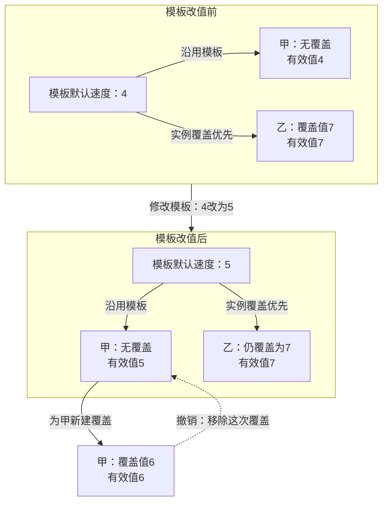

设计师把角色模板的移动速度从 4 改成 5，场景里有一百个角色。有人希望所有角色一起变化，有人已经给其中一个角色设了独立数值；修改还需要能撤销、保存、重新打开，并在预览时得到一致结果。

这些要求会决定引擎必须保存哪些数据、区分哪些身份、暴露怎样的修改接口。内容生产因此是一项架构职责：**它让团队的编辑意图成为可以复用、追踪和持续消费的游戏内容。** 标题里的“首先”强调观察引擎时要把这项职责纳入视野，不表示所有引擎都先开发编辑器，也不规定工具必须与运行时编进同一个程序。

> **范围与依据**：本文用自有教学例子解释职责，具体映射依据 Unity 2022.3 与 Unreal Engine 5.6 官方资料；未进行两台引擎的源码或运行验证。两个版本用于举例，不代表能力一一对应。“内容生产层”是一组职责，不能据此推断编译模块、调用顺序或线程。完整依赖读法见 [00A：职责、依赖与资源服务的边界]()。

## 内容生产要留下什么

如果只把编辑器理解为“把数据改掉的界面”，就很难解释为什么做一个批量修改工具，也会牵动撤销、模板、序列化和预览系统。

一个可持续的内容工作流至少要保留四种信息：

| 信息 | 角色模板的例子 | 解决的问题 |
| --- | --- | --- |
| 可编辑描述 | 组件装配、移动速度、网格引用 | 下次打开时怎样恢复编辑结果 |
| 复用与覆盖关系 | 模板默认速度为 5，某个实例覆盖为 7 | 集中修改会影响哪些使用者 |
| 编辑操作记录 | 哪个目标、哪个字段、修改前后值 | 怎样撤销、重做和批量处理 |
| 运行预览状态 | 角色当前位置、动画进度、物理表示 | 怎样观察结果而不误写回内容 |

它们可以共享类型和部分字段，却不能不加区分地当成同一份状态。角色在预览中跑到了十米外，不意味着下次打开场景也应该从十米外开始；将模板速度改成 5，也不意味着所有实例自己的覆盖值都应被抹掉。

因此，内容生产负责组织**可编辑的事实与修改意图**，运行时负责在世界中消费这些描述。保存什么、如何传播、何时刷新预览，是两者之间必须约定的协议。

## 教学例子：一次模板改值怎样经过系统边界

下面设计一个最小工作流。它不复刻某台引擎的内部实现，箭头只表示本例中的操作和数据交接。

```text
编辑动作：把角色模板的速度改成 5
  → 定位模板及字段，校验新值
  → 建立可撤销的编辑操作，修改内容描述
  → 标记待保存，并通知预览使用者
      ├─ 保存：将需要持久化的描述写入资产
      └─ 预览：重新求有效属性，再更新运行实例
```

保存与预览是两个消费方向。预览已经刷新，磁盘上的文件仍可能没有保存；保存成功，也不保证某个已打开的预览实例已经切换到了新值。

### 先确定改的是模板，还是场景中的实例

假设模板默认值是 4，甲实例沿用模板，乙实例把速度覆盖为 7。本例把模板改为 5 后，甲的有效值变成 5，乙仍为 7。

工具应把目标身份和修改范围表达清楚。否则，用户看到的只是同一个“速度”输入框，底层却可能修改共享模板、场景实例，甚至临时预览对象，后果完全不同。

本例选用“实例覆盖优先”的协议；其他模板系统可以采用别的合并规则。无论规则怎样，编辑器都应能回答一个值从哪里来，以及修改会传播到哪里。

把数值和关系一起画出来，就能看到“值相同”为什么不一定代表“状态相同”。图中的“沿用/覆盖”箭头表示取值关系，“修改/撤销”箭头表示编辑操作；两组是同一批对象在模板改值前后的状态，不是两套同时存在的实例。



### 撤销恢复的是一次编辑语义

撤销不仅需要旧数值，还可能需要旧的覆盖关系。假设甲原本继承模板，用户把甲单独改成 6；撤销时仅把甲写成 5，会留下一个数值相同的覆盖。模板以后再变，甲就不再跟随。

因此，本例的操作记录至少包含目标身份、字段、原先是否覆盖、旧值和新值。撤销撤掉的是“新建覆盖”这件事，不能只恢复屏幕上看到的数字。

对批量操作也一样：修改过程中有对象被删除或类型发生变化，应有明确的失败与恢复方式。是否采用整批事务、逐项成功或预检后提交，是工具协议的选择。

### 持久化保存描述，预览更新派生状态

文件应保存稳定标识、属性和必要引用；预览世界里的对象地址、临时任务和设备句柄不适合作为下一次启动时的恢复依据。具体资产如何导入和生成目标产物，交给 [05：资产与发布]() 展开。

预览一侧则要处理消费者自己的状态。速度只影响下一次移动计算时，可以更新配置；如果改的是碰撞形状，物理系统可能需要重建表示。通用属性编辑器不应自行猜测所有专业系统的刷新算法，而应调用明确的修改接口或发布约定的变更。

这样，一次改值同时检验了三个边界：工具解释编辑意图，内容模型保存复用关系，运行时使用者负责更新派生状态。

## Unity：模板覆盖与编辑协议怎样接起来

Unity 的 Prefab 为可复用对象提供模板关系。对本文最关键的事实，是**实例的属性覆盖优先于 Prefab Asset 的对应值**；模板修改不会覆盖已经被实例覆盖的属性。因此，“改了 Prefab 就会更新所有实例的所有字段”并不成立。[Unity 2022.3：Instance overrides](https://docs.unity3d.com/2022.3/Documentation/Manual/PrefabInstanceOverrides.html)

这恰好落在前面的“有效值从哪里来”。排查改值不生效时，应先检查自己改的是哪个目标、该实例是否存在覆盖，再考虑运行时是否读取了新值。

编辑协议也不等于普通赋值。Unity 的 `SerializedObject / SerializedProperty` 用于通用地修改序列化字段，并接入 Undo、字段脏标记和 Prefab override 的编辑器表现。官方示例特意对比了直接修改对象属性与经过序列化编辑接口的差别。[Unity 2022.3：SerializedObject](https://docs.unity3d.com/2022.3/Documentation/ScriptReference/SerializedObject.html)

这个入口并不会替团队完成所有业务规则。字段是否合法、修改后是否需要重建专业表示、是否允许将预览结果写回资产，仍须由对应协议处理。自定义工具需要接上这些协议，不能把“Inspector 已经显示新值”当成撤销、保存与运行消费都已完成。

Unity 的 Package Manager 则管理另一种边界：包可以承载编辑器工具、运行时库、资产或项目模板，并通过窗口、API 和 manifest 等入口管理。[Unity 2022.3：Package Manager](https://docs.unity3d.com/2022.3/Documentation/Manual/Packages.html)

由此可以作一个工程判断：**包是交付和依赖管理单位，内容生产是职责，二者不能直接画等号。** 一个包里可能同时有导入器和运行组件，但两者进入的构建目标、使用的数据和生命周期仍然不同。

## Unreal：对象类型的制作与运行实例的使用

Unreal 的 Blueprint 能从 C++ 类或其他 Blueprint 类继续扩展，组织组件、变量、事件和逻辑；其 Construction Script 可以根据参数构造 Actor 实例。这说明 Blueprint 同时涉及对象结构的制作与行为定义。[Unreal Engine 5.6：Blueprints Technical Guide](https://dev.epicgames.com/documentation/en-us/unreal-engine/technical-guide-for-blueprints-visual-scripting-in-unreal-engine?application_version=5.6)

因此，它与 Prefab 有可比较的生产职责，但不能把二者理解成完全相同的模板系统。讨论前面的角色例子时，应分别追问：哪些内容属于类型定义，哪些属于实例设置，构造逻辑何时执行，哪些预览变化允许保存。具体覆盖、撤销与重建规则要沿各自实现继续查，不能把本例协议直接当作 Unreal 的实现说明。

Unreal 的 Plugin 可以为编辑器增加菜单、工具和工作模式，也可以按项目启停。它把特定的制作能力接入团队环境，但“插件被启用”本身不会证明它里面的每个模块都应该进入游戏发行目标。[Unreal Engine 5.6：Working with Plugins](https://dev.epicgames.com/documentation/en-us/unreal-engine/working-with-plugins-in-unreal-engine?application_version=5.6)

两台引擎在这里值得比较的，是制作过程如何与对象、资产和扩展契约连接。编辑窗口数量、工具所在文件夹、某项能力是否随主程序安装，都不足以单独说明架构边界。

## 把制作工具从运行时中拿走，哪些能力仍要留下

可以用一个检验来检查自己的设计：同一份角色描述，除了编辑器预览，还能否交给独立客户端或自动验证程序使用？

运行时仍需要理解对象描述、资产引用和合法的状态变化；撤销栈、选中对象、属性面板布局等编辑状态则应由工具负责。编辑器可以通过运行时接口构造预览世界，运行时不应为了移动角色而依赖某个属性窗口是否打开。

这不要求小项目立刻拆成很多库。更实际的起点是分清数据和接口：谁有权修改模板，谁保存实例覆盖，谁重建运行表示，以及谁报告操作完成。模块是否独立编译，再根据发行目标、测试和协作需求决定。

继续看 [02：GameObject 与 Actor 的世界模型]()，可以把这里的模板、实例和组件关系落到世界组织；[00：总论]() 则提供整个系列的问题地图。

**内容生产成为引擎的重要职责，是因为一次编辑必须可靠地连接复用关系、持久化结果与运行时消费者。**
