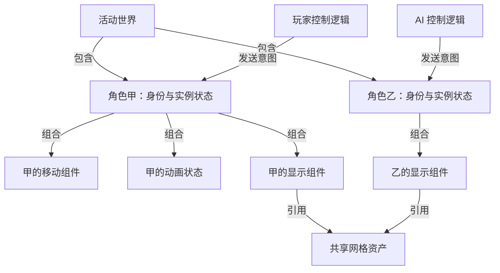

场景里有两个外观相同的角色：甲由玩家控制，乙由 AI 控制。它们共用一份网格和动画资产，位置、血量和当前动作却不同。玩家换人时，我们希望控制关系转移，而不是把角色、输入和世界状态一起拆掉重建。

这个例子比“GameObject 是否等于 Actor”更能暴露问题。理解对象世界，需要分清**世界成员、组件组合、空间关系、控制关系和共享资产**；这些关系有时连接同一批对象，却不是同一种关系。

> **范围与依据**：本文先给引擎无关模型，再用 Unity 2022.3 与 Unreal Engine 5.6 官方资料映射。结构图是自有教学例子，未进行源码或运行验证。本文讨论的世界组织职责不等于统一编译层级，也不决定所有对象的更新、线程或销毁顺序；接口依赖的读法见 [00A]()。

## 先问清楚对象之间是哪一种关系

一个角色进入场景以后，通常要回答下面的问题：

| 关系 | 在角色例子中的含义 | 不应自动推出的结论 |
| --- | --- | --- |
| 世界成员关系 | 甲属于当前活动世界或场景 | 磁盘上的模板也是一个活动角色 |
| 组件组合关系 | 甲有移动、动画和显示能力 | 每个组件都拥有独立线程 |
| 空间父子关系 | 武器位置跟随角色的某个节点 | 被挂接对象的业务寿命一定完全相同 |
| 控制关系 | 玩家或 AI 向甲发送意图 | 输入来源必须存放在角色身体内部 |
| 资产引用关系 | 甲、乙使用同一网格和动画 | 两者共享当前位置、血量或动画播放进度 |

这些关系的实现可以是对象指针、句柄、标识表，也可以是 ECS 查询。世界模型首先需要给出稳定的身份与操作规则：对象怎样进入世界、系统怎样找到它、何时允许修改，以及离开世界后旧引用怎样失效。

组件组合解决能力如何分配；游戏框架则进一步规定角色之间如何合作。例如，移动组件可以接受方向和速度，而“这个方向来自玩家还是 AI”可以由另一段控制逻辑决定。通用组件机制与默认玩法分工因此是两个比较维度。

## 教学例子：两个角色怎样共享内容、保持独立状态

下面是一种设计。箭头上的文字标明关系；它们不表示函数调用、更新先后或 C++ 继承。



图中只画了乙的一部分组件，避免重复。甲的移动组件保存本次移动所需状态，动画组件保存当前片段和播放位置；共享网格保存可复用内容。两个角色可以使用相同资产，同时处在不同位置、播放不同动作。

如果甲被删除，框架先结束甲参与世界活动的资格，并安排它的组件和专业表示退出。乙仍然使用网格时，共享资产不能因为甲离开就立即销毁；即使没有角色使用，缓存与设备任务也可能继续持有它。具体资源边界见 [00A 的资源服务讨论]()。

如果玩家改为控制乙，本例只改变“控制逻辑→角色”的关系。是否还要转移镜头、输入上下文或 UI，由应用规则决定，不应从一次控制关系切换推断所有对象的寿命都相同。

再加一把武器时，要另外决定它是角色内部组件、子对象，还是可独立存在的世界对象。空间上跟随角色，无法单独回答丢弃武器后谁继续持有它。由此也能看出，画一棵对象树还不足以说明全部生命周期。

## Unity：场景成员与 Transform 层级分开理解

Unity 的 GameObject 是组件容器，功能由挂接的组件表达；每个 GameObject 带有 Transform。角色能力可以通过移动脚本、动画、碰撞和显示组件组合起来。[Unity 2022.3：GameObject](https://docs.unity3d.com/2022.3/Documentation/Manual/class-GameObject.html)

从世界模型看，可以先这样拆：

```text
Scene：包含场景中的 GameObject
GameObject：挂接各类 Component
Transform：表达位置、旋转、缩放及父子关系
MonoBehaviour：提供用户脚本组件的回调入口
```

这里没有把 Hierarchy 窗口放进运行时对象链。Hierarchy 是显示和操作场景对象的编辑器视图；父子关系通过 Transform 建立。窗口还可以同时显示多个 Scene，因此不能把“窗口里的整棵树”直接视为一个独立运行时世界容器。[Unity 2022.3：Hierarchy 中的对象与父子关系](https://docs.unity3d.com/2022.3/Documentation/Manual/Hierarchy.html)

把前面的例子映射到 Unity，可以让角色根 GameObject 挂移动脚本，外观子对象负责模型显示，独立的控制代码把意图交给移动逻辑。这个结构是项目设计，不是 Unity 要求所有角色必须采用的固定模板。

它的优势在于可以从通用组件组合开始；相应地，团队需要明确玩家、身体、控制来源和比赛规则之间的关系。如果这些职责最初都写在一个 MonoBehaviour 中，后续“切换控制角色”可能就会同时触发输入、相机和角色状态的修改。问题来自项目契约的耦合，不能仅凭类名归因于组件化模型。

### 生命周期给出阶段保证，不给出任意对象间的总顺序

Unity 通过 `Awake`、`OnEnable`、`Start` 等回调暴露对象初始化和启用阶段。需要保留条件：`OnEnable` 要求对象处于活动状态且行为启用；同一对象的 `Awake` 在它的 `OnEnable` 之前。场景初始对象的阶段关系，也不能原样套到运行时任意创建的对象上。[Unity 2022.3：事件函数执行顺序](https://docs.unity3d.com/2022.3/Documentation/Manual/ExecutionOrder.html)

例如，甲在自己的 `OnEnable` 中访问乙，不能仅因为两者同属一个 Scene，就假定乙已完成所有初始化。跨对象依赖应通过明确的装配、就绪条件或阶段协议表达。Transform 的父子关系同样不保证父子脚本的同名更新函数按树顺序执行。

## Unreal：World、Actor 与玩法框架分别提供什么

Unreal 显式区分 World、Level 与 Actor：World 组织 Levels 并涉及流式加载和动态 Actor 创建；Actor 是可放入 Level 的对象。组件为 Actor 提供能力，而 Pawn、Controller、GameMode、GameState 又进一步提供玩法分工。[Unreal Engine 5.6：术语与对象框架](https://dev.epicgames.com/documentation/en-us/unreal-engine/unreal-engine-terminology?application_version=5.6)

这里最值得保留的差别，是 Unreal 为“谁控制身体、谁管理规则、谁承载共享游戏状态”提供了内建角色：

- Pawn 表达可被控制的游戏化身，Controller 与其建立控制关系。
- GameMode 表达游戏规则；具体项目继续定义规则内容。
- GameState 承载需要向客户端同步的游戏状态；它并不代替每个角色自己的状态。

在前面的换人例子中，Pawn 与 Controller 的分工给出一个现成的检查入口。实际项目仍要定义镜头、输入与角色能力切换时的行为；存在框架类，不代表这些产品规则会自动齐备。

这也不意味着所有 Actor 都是 Pawn。关卡道具或环境对象可以有完全不同的用途；“世界里可存在的对象”和“可被控制的角色”必须保留各自范围。

### 创建路径与结束使用都要沿生命周期解释

Unreal 的 Actor Lifecycle 文档区分从磁盘加载、编辑器中复制到游玩世界、动态生成等路径，并列出相应初始化阶段；这些路径不能压成一个对所有场景都成立的构造函数顺序。文档也区分 EndPlay 与后续垃圾回收等阶段。[Unreal Engine 5.6：Actor Lifecycle](https://dev.epicgames.com/documentation/en-us/unreal-engine/unreal-engine-actor-lifecycle?application_version=5.6)

这给对象阅读提供了一个实用问题：我们现在追的是“内存里有了一个对象”，还是“对象已经加入可运行世界”，抑或“对象已结束参与但内存尚未回收”？若混成同一时刻，就很难解释清理回调、旧引用以及延迟释放。

Unity 同样有创建、启用、停止使用和内存回收之间的区别。真正要比较的是两边分别暴露了哪些契约，以及项目代码依赖了哪项保证，而不是用回调数量判断哪一方的生命周期更完整。

## 怎样比较两种默认对象世界

| 要解决的问题 | Unity 的常见落点 | Unreal 的常见落点 |
| --- | --- | --- |
| 对象属于哪里 | Scene 与场景对象 | World、Level 与 Actor |
| 怎样组合能力 | GameObject 上的组件 | Actor 上的组件 |
| 怎样表达空间关系 | Transform 父子关系 | 场景组件及其挂接关系 |
| 谁组织玩家与身体的关系 | 项目建立控制契约 | 可从 Controller / Pawn 分工继续扩展 |
| 怎样进入和退出运行 | 对象与组件的生命周期协议 | Actor 与组件的世界接入协议 |

表格比较职责，不构成逐项替换清单。两边都能建立复杂游戏框架，区别之一在于哪些角色关系由引擎直接命名、哪些需要项目选择。即使使用同一台引擎，不同项目也可能采用不同的控制与状态组织方式。

读陌生对象代码时，可以带着角色例子检查三个动作：**生成一个角色、转移它的控制来源、删除它**。每个动作都写下世界身份、组件关系、共享资产和专业表示分别发生了什么。这样得到的模型，比一张 GameObject/Actor 词汇对照表更能支持后续调试。

[01：内容生产]() 解释角色描述如何制作；[03：运行时底座]() 接着解释对象和执行机制。以后读 [07：DOTS 与 Mass]()，再检查身份、存储和更新方式怎样改变。

**对象世界的差别，要从容器、关系、状态归属与生命周期契约中读出来，类名只是进入这些问题的入口。**
