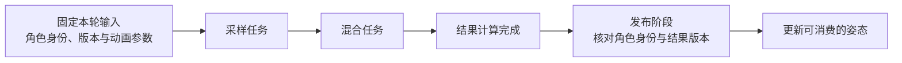

角色的动画任务已经算完，画面却还没使用新姿态；脚本对象已经退出场景，内存仍然存在；字段可以通过反射找到，改完以后碰撞体却没有更新。这些现象提醒我们：“代码能执行”“对象仍然活着”“业务状态已经交接”是不同的条件。

脚本、反射、GC 和任务系统提供共享机制，使不同专业系统能够执行、识别数据和管理寿命。但它们各自提供的保证有限。读懂这一组能力，关键是找出**机制负责什么、调用者还必须决定什么**。

> **范围与依据**：本文的职责划分与动画交接例子是教学模型；实现映射依据 Unity 2022.3 与 Unreal Engine 5.6 官方资料，未进行源码、引擎运行或性能验证。两个版本用于说明不同落点。“运行时底座”是职责群，不是单一编译模块、严格上下层或线程图；依赖原则沿用 [00A]()。

## 运行时机制怎样支撑上层系统

先把容易堆在一起的名词拆成问题：

| 问题 | 机制提供的能力 | 使用方仍需决定什么 |
| --- | --- | --- |
| 代码怎样执行 | 编译后端、语言运行时、脚本调用入口 | 哪个对象在什么阶段调用哪段逻辑 |
| 类型怎样被识别 | 类型描述、字段与方法访问、反射 | 哪些字段允许编辑、持久化或同步 |
| 内存怎样存活 | 分配器、持有关系、GC 等回收机制 | 对象何时停止业务活动，外部资源怎样清理 |
| 工作怎样完成 | 任务依赖、调度、等待与同步设施 | 输入属于哪一轮更新，结果何时允许发布 |

例如，反射能够定位角色的碰撞半径字段，不意味着通用字段写入函数知道如何重建物理形状；GC 能管理其负责的对象内存，也不意味着任务退出、文件关闭和 GPU 对象释放都已经完成。

这些机制可以被世界框架、工具和专业系统共同使用。其代码可能分散在 Core、对象系统、脚本模块及平台适配中。把它们放在一个章节里讨论，是为了建立共同的阅读问题，不能据此推断实际引擎的目录与依赖。

## 帧策略、回调、任务和线程要分开看

“谁让这段代码运行”至少包含四种不同职责：

| 职责 | 决定的事情 | 例子 |
| --- | --- | --- |
| 帧推进策略 | 本轮推进哪些系统，哪些结果必须先就绪 | 先准备动画输入，再允许发布姿态 |
| 对象回调接入 | 哪些有效对象在指定阶段收到调用 | 已激活组件参与本轮更新 |
| 通用任务机制 | 工作的依赖、排队、执行与完成条件 | 采样任务结束后才运行混合任务 |
| 平台执行设施 | 怎样使用线程、等待原语与计时能力 | 工作线程运行任务，事件唤醒等待者 |

它们之间有调用和协作，但不要求每次工作都依次经过四层。小型引擎可以在主线程同步完成动画；大型系统可以将一批动画工作交给任务设施。无论哪种方式，“当前角色是否应该更新”和“哪个线程执行这段计算”都不是同一个决策。

因此，PlayerLoop 一类帧组织入口，不能简单与语言运行时或 GC 画成等价物；任务系统也不能自行推出游戏期望的所有先后关系。调用者必须把依赖表达出来。

启动、时间推进、固定步长和退出流程已经由 [GEF-02：游戏为什么能够持续运行]() 展开。本篇继续检查这些阶段内部怎样借助共享机制交接状态。

## 教学例子：动画任务结束以后，谁来发布姿态

假设采用下面的设计：框架在本轮动画阶段收集角色输入；动画系统产生采样与混合任务；完成后，在约定发布阶段更新供渲染使用的姿态。箭头表示本例要求满足的执行依赖，不是某台引擎的真实线程分布。

输入不能一边被任务读取、一边被逻辑任意修改。这个设计可以复制小参数，也可以持有受协议保护的只读数据；复制与共享的选择会改变成本，却不改变“读者看到哪份状态必须明确”的要求。

计算结果同样需要寿命。发布完成前，结果缓冲不能被下一轮写入覆盖；消费者还在读时，也不能因为任务句柄已经释放就认定数据可以回收。任务的完成对象与业务结果的持有关系需要分别解释。

最后还要处理一个常见变化：角色在任务执行期间被删除，或者同一角色已经发出更新版本的请求。任务正常完成，只能证明这份计算结束；发布方仍应核对目标身份与版本。本例选择丢弃过期结果。其他系统可以选择继续缓存或复用，但不能无条件写入原来的对象地址。

这条路径可以落实成四个调试问题：

1. 任务读取的是哪轮输入，期间谁有权修改？
2. 任务之间的依赖在哪里声明，消费者怎样确认完成？
3. 输出由谁持有，何时交给下一个系统？
4. 目标已失效或结果过期时，谁丢弃结果并结束持有？

一次任务完成通知不会替代这四项协议。反过来，采用双缓冲、回调或共享指针，也不能单凭形式证明它们已经成立。

## Unity：编译后端、托管对象和任务数据分别看

### JIT/AOT 先区分编译发生的时间

Mono 的 JIT 路径在运行时按需将 IL 编译为机器码。IL2CPP 的 AOT 路径则在构建期把 IL 转成 C++，再由原生工具链生成目标机器码。JIT/AOT 在这里首先描述编译时机与执行路径，不是“谁负责动态生成 IL”的定义。[Unity 2022.3：IL2CPP 与编译过程](https://docs.unity3d.com/2022.3/Documentation/Manual/IL2CPP.html)

动态生成代码是需要另行检查的能力约束。Unity 的 .NET 概览说明 Mono/JIT 支持运行时动态 IL，而 IL2CPP/AOT 不支持动态代码生成；同一份第三方库可能因此需要不同路径。不能从“支持反射”推出“支持运行时生成任意可执行代码”。

同一文档还解释了托管对象与原生对象的区别：`UnityEngine.Object` 连接原生对应对象；销毁原生对应对象，与 C# 包装对象后来被 GC 回收，是不同过程。[Unity 2022.3：.NET 运行时与对象行为](https://docs.unity3d.com/2022.3/Documentation/Manual/overview-of-dot-net-in-unity.html)

因此，读到一个 C# 引用还存在时，仍需要检查对象的引擎有效性。GC 机制可以解释托管内存的存活，不能替代世界成员资格或专业资源的清理协议。

### 反射提供描述，改变状态需要业务协议

反射回答的是运行时能否查询某个类型、字段或方法。编辑器如何把字段呈现给用户、资产如何持久化、修改后哪个系统需要重建状态，是使用类型信息的不同场景。

前一篇 [02 对象世界]() 已说明回调的阶段保证；[01 内容生产]() 也说明一次编辑如何连接撤销与预览。把它们串起来，就能看清为什么“写入字段成功”不能成为所有消费者已经更新的证据。

### Job 数据的复制与共享需要不同的读写约定

任务可以处理独立的数据副本，也可以通过受约束的容器访问共享数据。Unity 的 `NativeContainer` 包装原生内存，使 Job 能访问与主线程共享的数据；只读和写入访问需要遵守相应安全与依赖规则。因此，不能把 Job 概括成“所有数据都会完整复制，各任务彼此完全隔离”。[Unity 2022.3：Job 的线程安全数据类型](https://docs.unity3d.com/2022.3/Documentation/Manual/JobSystemNativeContainer.html)

映射到动画例子，参数快照、输出缓冲和共享动画片段可能采用不同持有方式。具体使用哪个容器、怎样建立 Job 依赖、何时完成交接，要看调用点；“已经放进 Job”不是任意修改对象或共享内存的许可。

## Unreal：对象运行时与任务设施也各有边界

`UObject` 派生类型通过引擎对象系统接入反射、序列化和 GC 等能力；UHT 处理相关头文件元信息。这个体系不是所有 C++ 值与对象的统一内存模型。[Unreal Engine 5.6：Objects](https://dev.epicgames.com/documentation/en-us/unreal-engine/objects-in-unreal-engine?application_version=5.6)

例如，用 `USTRUCT` 声明的结构体值本身不是由 UObject GC 独立管理的对象。这里讨论的是结构体的实例数据；支持反射，不等于所有数据都采用 UObject 的生命管理方式。[Unreal Engine 5.6：Structs](https://dev.epicgames.com/documentation/en-us/unreal-engine/structs-in-unreal-engine?application_version=5.6)

因此，读一个原生结构体、一个 UObject 引用和一块任务输出内存时，应分别查明持有规则。对象系统提供通用识别与管理能力，不会自动把任意外部句柄、未登记引用和业务活动全部纳入同一种寿命协议。

Blueprint 则是对象体系之上的脚本入口之一，其制作与对象类型定义已在 [01 内容生产]() 讨论。同一个名称会连接编辑器表达、类型信息与执行入口，不能因为它有可视化编辑器就把整个系统只放进工具一格。

任务方面，UE 5.6 的 Tasks System 支持有依赖的任务图、等待和结果获取；官方也说明它与 TaskGraph 共用调度器和工作线程后端。[Unreal Engine 5.6：Tasks System](https://dev.epicgames.com/documentation/en-us/unreal-engine/tasks-systems-in-unreal-engine?application_version=5.6)

这支持把它们理解为通用执行设施，却不支持推断任何动画或渲染路径都采用同一套具体 API。业务调用者仍须声明依赖、管理结果持有，并确定发布阶段；它们与 Unity Job System 的数据限制和使用方式也不应一一等同。

## 怎样沿这张地图读实际代码

遇到陌生的脚本调用或异步任务，可以先标记四个位置：**入口在哪里、输入由谁固定、完成条件在哪里、结果由谁消费。** 然后再查类型信息与内存管理怎样为这些交接提供支持。

如果一段代码同时判断玩法状态、遍历世界对象、创建工作线程并直接修改渲染数据，问题不在于它“用了底层 API”，而在于几个独立协议集中在了一个地方。是否需要拆模块，要看测试、替换和变化成本；但各自的责任应该能先说清楚。

接下来，[04：专业子系统]() 会把共享机制落回渲染、物理和动画各自的数据与调度；[07：DOTS 与 Mass]() 则继续讨论身份、存储和执行组织怎样共同变化。

**运行时底座的价值，是提供可复用的执行、识别与内存机制；系统怎样合法交接状态，仍要由明确的上层协议决定。**
