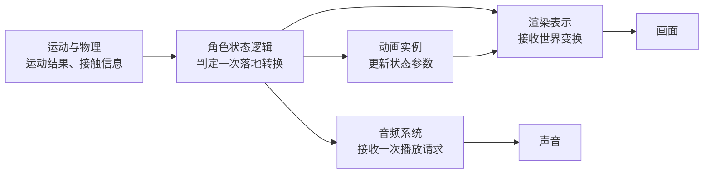

角色落地时，物理已经检测到接触，动画却还在下落，音效又播放了两次。把它们统称为“物理、动画、音频三个模块”并不能帮助定位问题：我们还要知道谁判断落地，谁持有状态，谁消费哪一次结果。

**专业子系统之所以像半台小引擎，是因为它们各自管理一类数据及其求值过程；整台引擎则必须为这些表示建立明确的交接协议。**

> 阅读位置：先用 [00A 职责与依赖图]() 定位框架和专业系统。本文采用引擎无关模型；实现对照依据 Unity 6.0（6000.0）与 Unreal Engine 5.6 官方资料。角色落地是设计示例，不代表两台引擎的默认执行时序，也未作运行验证。

## 同一个角色，为什么需要几套表示

世界里的“一个角色”，到了不同系统手里，关注点会发生变化。

物理需要碰撞形状、速度和接触；动画需要骨架、播放时间和混合参数；渲染需要网格、材质、姿态与可见性。它们可以关联同一个对象身份，却没有理由共享一份无所不包、任意修改的对象结构。

从职责上，可以先按下面的模型阅读实现。这是分析框架，不要求实际引擎采用表中相同的类名或模块拆法。

| 系统 | 主要输入 | 主要持有的状态 | 输出或对外结果 |
| --- | --- | --- | --- |
| 物理 | 形状、运动请求、约束、时间步 | 模拟体、速度、接触与查询结构 | 运动结果、接触信息、查询结果 |
| 动画 | 动画资产、状态参数、时间 | 动画实例、播放进度、混合权重 | 骨骼姿态、曲线、约定的动画事件 |
| 渲染 | 相机、几何与材质、对象变换、姿态 | 渲染表示、可见列表、绘制资源 | 绘制命令与画面 |
| 音频 | 声音资产、播放请求、位置和混音参数 | 播放实例、声部、混音图 | 音频样本与播放状态 |
| UI | 展示数据、用户输入、布局与样式 | 控件树、焦点、布局和交互状态 | 绘制结果与操作意图 |

这些系统还会长出自己的制作工具和诊断能力：动画图编辑器编辑的是动画领域的数据，UI 调试器观察的是控件和事件流。**属于同一个专业领域，不等于这些工具都编译进运行时模块。** 在 00A 的依赖图中，作者工具仍属于工具一侧，运行时求值属于专业系统一侧，两者通过数据格式和接口连接。

这也解释了“半自治”的含义：每个系统可以独立组织自己的计算，但创建、销毁和交接必须服从整台引擎的协议。

## 设计示例：把一次落地拆成几次交接

下面假设这是一个单机角色，移动模块使用物理接触结果确认运动；玩法状态决定落地反馈；动画不直接改写最终世界位置。项目若采用 Root Motion、网络预测或回滚，需要另外规定运动结果的权威来源。

先画数据的因果关系。箭头表示结果或通知的交接，**不表示所有节点在同一帧、同一线程顺序执行**。

### 接触事实怎样成为落地事件

物理系统知道“发生了接触”，却不应替玩法决定所有接触的含义。撞到墙和站到地面可能都产生接触；持续站在地上也可能在多个更新中反复报告接触。

示例中的运动模块先根据接触方向和移动规则更新 `grounded`；角色状态逻辑再比较更新前后的状态，只在“空中 → 落地”的转换上生成一次落地事件。若项目把这段逻辑放在角色控制器中，也应能找到这一明确边界。

这样，声音重复播放时就有可查的交接点：是持续接触被误当成重复落地，还是同一个落地事件被订阅者消费了两次？音频系统本身只需处理播放请求，不必重新推理角色是否离地。

### 一次玩法变化怎样分成几种专业输入

落地事件可以携带对象身份、接触位置、表面类型和强度。示例中的反馈逻辑据此选择声音、更新动画参数；专业系统接收自己需要的数据。

| 交接 | 谁负责决定 | 接收方应该得到什么 |
| --- | --- | --- |
| 接触是否算落地 | 运动规则与角色状态逻辑 | 一次状态转换及其上下文 |
| 播什么落地反馈 | 玩法或表现规则 | 声音资产标识、位置、强度 |
| 怎样得到落地姿态 | 动画实例及其动画图 | 状态参数、动画资产与求值时间 |
| 怎样生成画面 | 渲染系统 | 已发布的世界变换、姿态与渲染属性 |

选择落地音效可以属于玩法表现层，也可以由独立的反馈系统承担。关键是物理求解器不需要依赖“主角落地音效”这个业务概念，音频混音器也不负责改变角色状态。

动画状态机决定怎样混合动画，不因此自动拥有角色能否再次起跳的玩法规则。如果 UI 要展示受击或生命变化，它接收展示数据和交互请求；伤害结算仍应有自己的权威入口。

### 数据正确，为什么画面仍可能晚一步

因果关系确定以后，还需要框架约定“何时发布、何时消费”。例如：模拟以固定时间步推进，而渲染按显示帧读取已完成结果；动画求值也可能经过任务调度。具体引擎必须回到实际执行链核对，不能由这张图推断。

读代码时，先检查三个问题：

- 接收方读取的是当前正在写入的数据，还是已经完成的快照？
- 变换和骨骼姿态来自相容的更新批次吗，插值发生在哪里？
- 对象在请求排队后被销毁，接收方怎样识别失效身份？

这些协议不要求一开始就多线程。即使单线程，事件队列、延后一帧的消费和对象删除也会产生同样的生命周期问题。帧调度与通用任务机制的区别，可回看 [03 运行时底座]()。

## 专业系统应在哪里停下来

分工成立的标志，不是每个模块都有一个 `Manager`，而是状态归属和修改入口清楚。

- **框架管理身份与成员关系。** 它把世界对象接入专业系统，退出时撤销关联。物理体或渲染表示可以使用各自的内部句柄，不必等同于世界对象。
- **专业系统管理自己的表示。** 动画负责求值姿态，渲染负责消费姿态并绘制；直接修改对方的内部数组，会绕过更新和失效协议。
- **共享资产与运行实例分别管理。** 两个角色可以使用同一动画资产，却有不同播放进度。删除一个动画实例，不等于可以销毁仍被其他实例使用的资产。
- **业务决定结果的含义。** 接触、声音完成、按钮点击都是输入事实；任务推进、伤害和胜负属于应用规则。

系统之间也不必全部改成事件。即时查询可以直接调用稳定接口；延迟消费可以使用队列或快照。选择依据是结果时效、所有权和执行环境，而不是为了让架构图看起来没有连线。

## 对照 Unity 和 Unreal，应该看哪些地方

官方实现的价值，是让前面的模型有真实落点。下面只选能说明边界的例子，不要求两台引擎的系统严格一一对应。

### Unity：从资源、实例和求值过程找边界

Unity 的渲染管线文档按剔除、绘制和后处理解释画面生成，并提供不同管线及自定义路径。它说明渲染内部本身存在执行骨架；不能只把它理解成世界对象的一个绘制开关。[Unity 6.0：渲染管线](https://docs.unity3d.com/6000.0/Documentation/Manual/render-pipelines-overview.html)

动画体系同时包含导入、编辑与运行时状态机；Mecanim 通过 Animator 组件及相应编辑工具组织动画。阅读项目时，可以沿“使用了什么动画数据 → 哪个实例持有播放状态 → 参数怎样进入求值”追踪，而不止停在一次播放调用。[Unity 6.0：动画系统](https://docs.unity3d.com/6000.0/Documentation/Manual/AnimationSection.html)

UI Toolkit 则提供 UXML/USS、UI Builder、事件处理和 UI Renderer。这里能看到同一个领域如何贯穿制作与运行，同时保持自己的数据与交互模型。[Unity 6.0：UI Toolkit](https://docs.unity3d.com/6000.0/Documentation/Manual/UIElements.html)

### Unreal：图本身也有输入、实例与输出

Animation Blueprint 用于控制 Skeletal Mesh 的动画，通过图逻辑混合动画、控制骨骼并形成每帧使用的姿态。它是“专业系统从状态输入计算专业结果”的实际例子，但文档并未因此规定所有项目的玩法状态都必须由动画图拥有。[Unreal Engine 5.6：Animation Blueprints](https://dev.epicgames.com/documentation/en-us/unreal-engine/animation-blueprints-in-unreal-engine?application_version=5.6)

MetaSounds 使用 DSP 图生成声音，提供音频缓冲层面的控制，也能通过参数接口接收玩法数据。游戏事件与音频求值由接口连接，因此不宜把“触发一次声音”和“音频系统完成一次混音”看成同一个执行时刻。[Unreal Engine 5.6：MetaSounds](https://dev.epicgames.com/documentation/en-us/unreal-engine/metasounds-the-next-generation-sound-sources-in-unreal-engine?application_version=5.6)

这些例子支持的是共同的阅读方法：找数据、找实例、找求值、找交接。它们不证明每个领域都必须拆成独立库，也不证明所有专业系统具有相同的线程模型。

## 用这张地图读实现

下次遇到角色表现不一致，可以先画出“世界身份 → 各系统实例”的关联，再给每次交接标出数据、发布时机和失效条件。这样就能区分三个不同的问题：业务状态算错了，专业结果算错了，还是正确结果交接错了。

专业系统的独立性来自对数据和计算的清晰负责；整台引擎的正确性来自它们之间可追踪的交接。

继续阅读 [05 资产与发布]()，看这些专业数据在进入运行时之前怎样被加工和交付。
