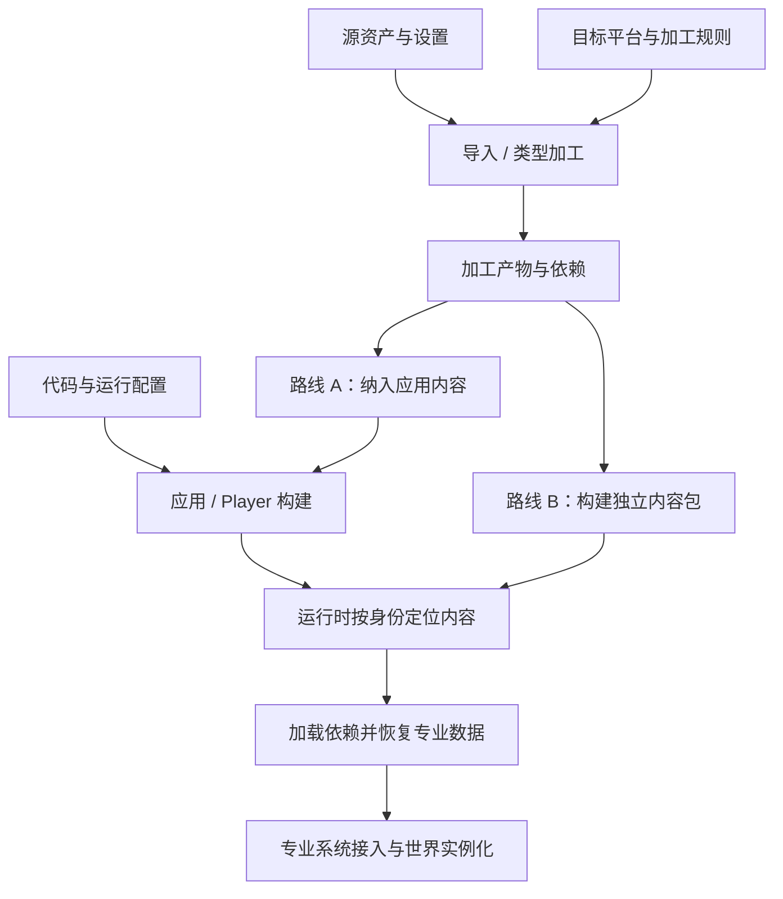

编辑器里能看到角色，发布包里却缺了一张纹理。源文件明明还在工程中，为什么运行时找不到？问题可能出在依赖没有被收集、目标产物没有生成，也可能是索引与内容包版本不一致。

要理解这些问题，需要把“工程里有一份内容”和“运行时能够使用这份内容”分开。**资源导入、Cook、Build、Package 共同解决的是内容如何被转换、组织和装配；这些操作的产物又构成了运行时加载的前提。**

> 阅读位置：本文承接 [04 专业子系统]()，职责定位见 [00A 资源服务边界]()。实现对照依据 Unity 6.0（6000.0）与 Unreal Engine 5.6 官方资料；文中的角色外观链路是设计示例，未作引擎构建或运行验证。

## 先分清五种东西

“资源”这个词常常同时指源文件、引擎资产、下载包和已经加载的对象。如果不先拆开，讨论缓存、更新和释放时就会不断换对象。

| 对象 | 回答的问题 | 示例与边界 |
| --- | --- | --- |
| 源资产与加工设置 | 作者提供了什么、应该怎样处理 | 模型源文件、贴图、压缩和导入设置 |
| 资产身份与描述 | 谁引用谁、请求的是哪份内容 | 资产标识、类型、材质对纹理的依赖；身份不等于磁盘位置 |
| 加工产物 | 为特定用途生成了什么数据 | 转换后的网格、纹理、碰撞数据；同一源资产可以对应不同目标产物 |
| 交付单元与索引 | 哪些产物一起交付、运行时怎样定位 | 随应用内容、独立内容包、位置与依赖清单 |
| 运行数据与世界实例 | 谁正在使用、还要存在多久 | 共享的网格数据、设备对象、各自有位置和姿态的角色实例 |

序列化是这些过程会使用的一类机制：它把需要保存或传输的状态变成可重建的数据。**通用序列化机制不因此拥有所有资产策略，更不等于世界对象的完整创建流程。** 字段恢复以后，依赖是否到齐、设备资源能否创建、对象应属于哪个世界，仍有各自的负责方。

本篇沿用“资产与发布层”这个名称描述一组工程职责。它横跨离线工具和运行时服务，不能直接当成所有模块下面的一层运行时调用栈。

## 从加工产物到交付内容，存在两条路线

一个项目可以把所需内容随应用交付，也可以将部分内容做成独立资源包。两种方式还能共存：基础角色随安装包提供，追加外观以后再下载。

下面是一张简化的数据流图。箭头表示产物交接；实际构建可以并行、复用缓存或增量执行，并不要求照图串行跑完。

“独立内容包”描述的是构建与内容组织边界，不等于必须远程下载。它也可以随首包装入本地目录。同样，“随 Player”不意味着构建工具一定把所有资源放进一个文件。

两条路线共同需要解决的是：运行时请求某个资产标识时，能定位到与当前代码和目标兼容的产物，并获得它所需的依赖。是否采用内容包，是项目交付策略的选择，不能把它写成所有项目的必经步骤。

## 设计示例：一套角色外观怎样进入游戏

假设一套外观引用模型、材质和纹理。目标是桌面与移动平台；第一版随应用提供基础外观，后续增加独立交付的外观。

### 第一步：身份保持稳定，产物允许不同

上层请求的是“这套外观”，不应在每处玩法代码里写死最终压缩纹理文件的路径。

加工工具根据目标规则生成产物，构建清单把资产身份映射到可定位的数据，并保留必要依赖。同一个纹理资产，在不同目标下可以采用不同格式；若设置、源内容或加工工具改变，相关产物就可能需要重建。

这里的工程要求是**身份、内容版本和加工目标能被分别辨认**。不能仅凭“文件名相同”认定产物兼容，也不能因为改了存放位置就随意破坏所有引用。

### 第二步：按使用关系划分交付单元

基础外观可以纳入应用构建。追加外观可以形成独立内容包，但它引用的材质和纹理必须随之可达：放在同一包、公共依赖包，或依赖已经交付的基础内容，都需要明确规则。

分包不是把目录压缩一下就结束。把共享纹理复制进多个包可能增加体积；让过多内容依赖一个公共包，又可能扩大下载和更新范围。这些都是构建组织的取舍，不能让运行时加载器靠猜测补全。

构建完成以后，还需要把索引和内容作为相容的一组发布。新索引指向尚未上传的包，或者旧应用误读不兼容的产物，都可能造成“编辑器有、玩家没有”。上传、签名和发布切换可以由外部交付系统执行；引擎工具应提供它需要的产物与契约。

### 第三步：加载资产与生成角色分别完成

运行时先根据标识定位内容，加载依赖并恢复专业数据。渲染系统随后按协议准备需要的设备表示；世界框架负责将外观装配到具体角色。

这几个状态必须分别观察：

- 能找到条目，不代表所有依赖已经加载。
- CPU 数据已经恢复，不代表设备准备已经完成。
- 资产已经可用，不代表角色实例已经加入世界。

两个角色可以共享同一份外观资产，却有不同位置和动画状态。删除一个角色应先结束它的使用关系；共享数据何时释放，还要看其他使用者以及设备侧尚未完成的工作。离线内容包的生命周期与这些运行时对象也不相同。

## 这条链的职责在哪里停止

| 负责方 | 应负责的事情 | 应交给谁 |
| --- | --- | --- |
| 类型加工工具 | 理解源格式、设置与依赖，生成专业产物 | 交付组织由构建规则决定；世界生成由框架决定 |
| 构建与装配 | 收集所需内容、确定目标产物、生成可交付组合 | 分发平台执行上传和版本投放；运行时负责实际使用 |
| 通用资源服务 | 标识解析、定位、请求协作、缓存与使用关系 | 专业类型解释交给相应加载器；设备对象遵守后端协议 |
| 专业系统 | 消费专业数据并管理内部表示 | 角色属于哪个世界、承担什么玩法由框架与应用决定 |

因此，资源管理器可以把具体解码工作交给注册的类型加载器，也可以参与依赖调度；它不需要知道“加载完就把主角生成到当前关卡”。类似地，构建成功只能证明产物生成过程完成，不能替代运行时对加载和实例化的验证。

## 在 Unity 与 Unreal 中怎样找对应落点

### Unity：导入之后，可以随 Player，也可以单独构建内容

Unity 的 Asset Database 维护源资产与导入结果的关系；导入会把多数源格式转换为适合创作和运行使用的格式。这里对应的是内容加工与同步，还没有决定一切最终交付策略。[Unity 6.0：Asset Database](https://docs.unity3d.com/6000.0/Documentation/Manual/AssetDatabase.html)

随 Player 内容的一个明确例子是 Resources：其中的资产会进入 Player build，运行时可通过相应接口加载。这说明独立 AssetBundle 并非构建 Player 的必要前提；这个例子只用于说明路线，并非建议所有项目采用 Resources。[Unity 6.0：Resources 系统](https://docs.unity3d.com/6000.0/Documentation/Manual/LoadingResourcesatRuntime.html)

AssetBundles 则把非代码资产组织成面向目标平台的内容包，可用于 DLC、减小初始安装内容等场景。开发者可使用低层 API，也可通过 Addressables 组织和构建这类内容。具体包配置和版本兼容应另行核对，不能从“资产都要导入”推出“资产都必须进 Bundle”。[Unity 6.0：AssetBundles](https://docs.unity3d.com/6000.0/Documentation/Manual/AssetBundlesIntro.html)

### Unreal：资产组织与平台装配也是两种职责

Unreal 的 Asset Manager 同时存在于 Editor 和 packaged game，提供 Primary Asset 等组织方式，并帮助安排 Cooking、Chunking 与使用量审计。它说明资产身份和组织可以贯穿编辑与运行，但不意味着获取资产就自动在世界中创建角色。[Unreal Engine 5.6：Asset Management](https://dev.epicgames.com/documentation/en-us/unreal-engine/asset-management-in-unreal-engine?application_version=5.6)

Packaging 文档区分 Build、Cook、Stage、Package：代码面向目标编译，资产转换为目标可用格式，随后进入暂存与可分发产物的装配。这里的 Cook 和 Unity 的导入/内容构建可以在职责层面比较，不能把术语、缓存边界和包格式直接等同。[Unreal Engine 5.6：Packaging](https://dev.epicgames.com/documentation/en-us/unreal-engine/packaging-your-project?application_version=5.6)

## 当编辑器正常、发布包异常时

可以按身份追踪同一份内容：源资产是否正确，目标产物是否存在，依赖是否纳入交付，运行时索引指向哪里，专业数据和实例分别停在哪个状态。每一步都检查实际产物或状态，而不只确认工程目录里有没有文件。

资产与发布体系连接的是内容身份、目标产物和运行时使用；清楚地区分它们，才能解释一份内容怎样真正成为可用的游戏对象。

继续阅读 [06 平台抽象]()，区分离线目标描述与运行设备能力。
