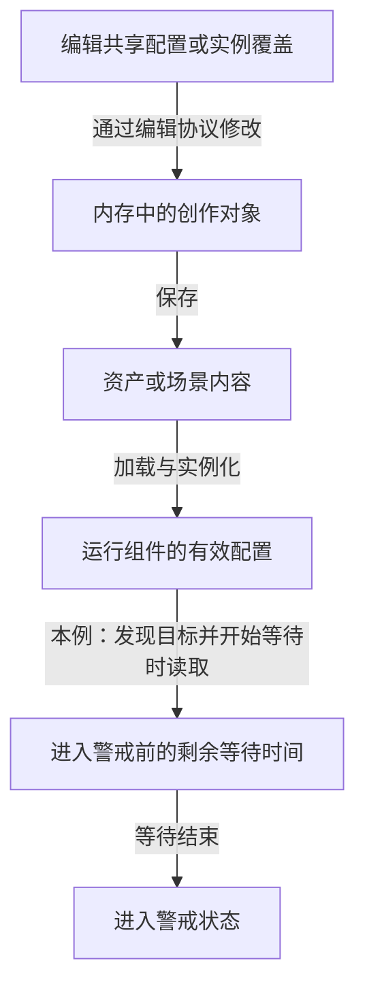
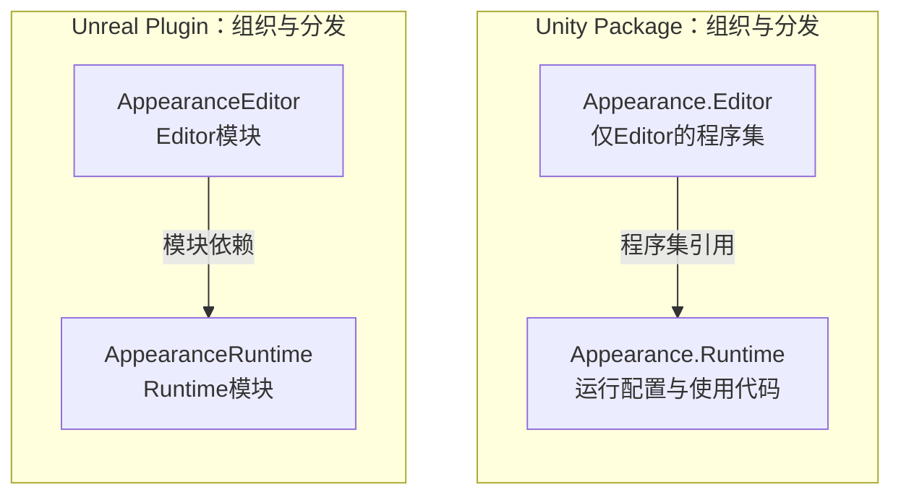

熟悉 Unity 以后再看 Unreal，很容易先做一张名词表：GameObject 对 Actor，Prefab 对 Blueprint，Package 对 Plugin。它能帮助我们找到文档入口，但遇到真正的需求，往往还差几步。

例如，策划要给守卫增加“发现目标后等待多久才进入警戒”的参数。两边都能在面板里显示一个浮点数，接着却要回答：改的是共享配置还是某个实例？撤销恢复哪份数据？保存到哪里？正在进行的倒计时会不会跟着改变？同样是“增加一个字段”，这些问题涉及的对象和接口并不相同。

本文用两个任务贯穿比较：**给守卫增加可编辑、可保存的警戒参数；把一套新外观交付到运行版本。** 再给外观加一个编辑器检查按钮，看看工具代码与运行代码怎样划开。每次都先确定需求，再到两台引擎中找承担相同责任的入口。

> 资料范围：Unity **2022.3**、Unreal Engine **5.6**。代码片段是本文自拟的声明示意，路径图是依据公开文档整理的解释模型；未执行引擎编译、编辑器操作或打包实验。本文不依赖额外 Package，其他篇章中的版本以各篇说明为准。
>
> 已读过[00职责地图]()和[00A依赖与资源边界]()，可以把这篇当作一次使用地图的练习。

## 比较之前，先固定同一组问题

所谓“同一任务”，需要固定业务含义和完成条件。警戒参数的单位统一为秒；外观任务先限定为随首个运行版本交付，不在一边讨论内置内容、另一边讨论热更新。

对每项任务，都按下面的顺序找证据：

| 问题 | 要找的具体东西 |
| --- | --- |
| 什么输入触发了变化 | 面板改值、工具命令、导入文件、构建请求 |
| 谁持有当前有效状态 | 资产模板、场景实例、运行组件、构建配置 |
| 谁能修改，怎样通知消费者 | 属性编辑接口、业务方法、序列化与刷新协议 |
| 结果交给谁，以什么形式交接 | 字段值、资产引用、目标产物、已加载对象 |
| 怎样知道完成，失败后查哪里 | 保存结果、重载值、内容清单、运行时实际绑定 |
| 谁结束这次使用 | 运行状态重置、实例销毁、外观替换与资源引用释放 |

这组问题是阅读方法，不要求两台引擎都存在一个同名管理器。还要区分两类箭头：配置进入实例属于**数据关系**，编辑器程序集引用运行程序集属于**代码依赖**。把它们画在同一条“从上到下执行”的线上，就会重新混淆分层与流程。

## 任务一：给守卫增加警戒等待参数

假设守卫组件上有两个数：

- `AlertDelaySeconds`：设计者配置的等待时长。
- `remainingDelay`：这一次进入警戒前还要等待多久。

本例选择一条简单玩法规则：**发现目标并开始等待时读取当前实例的配置，检查合法范围，再初始化剩余时间；等待结束后进入警戒。之后修改配置，只影响下一次等待。** 如果产品希望改值立即影响当前等待，就另外实现重算规则。

这条规则由项目决定。引擎提供字段编辑和对象恢复能力，不会替我们决定倒计时该怎样变化。

### Unity：从组件字段追到 Prefab 与场景实例

在 Unity 中，可以把配置放在角色的一个 MonoBehaviour 上。以下只示意数据声明，省略进入警戒和计时逻辑：

```csharp
using UnityEngine;

public sealed class GuardAlert : MonoBehaviour
{
    [SerializeField] private float alertDelaySeconds = 2.0f;

    public float AlertDelaySeconds => alertDelaySeconds;

    private float remainingDelay;
}
```

这里有意同时放了一个字段和一个 C# 属性。进入 Unity 序列化的是满足规则的字段 `alertDelaySeconds`；只读属性给业务代码提供读取入口。Inspector 修改序列化字段时，不经过 C# 属性访问器。因此，不能把计时器刷新藏在一个 setter 里，然后期待面板改值一定调用它。[Unity 2022.3：Script serialization](https://docs.unity3d.com/2022.3/Documentation/Manual/script-Serialization.html)

接着确定编辑对象。Prefab Asset 可以保存 GameObject、组件、属性值和子对象的可复用组合；场景中的 Prefab 实例可以保存自己的覆盖。这里的 Prefab 是内容模板，并没有因为新增一个 Prefab 就新增一个 C# 子类。[Prefabs](https://docs.unity3d.com/2022.3/Documentation/Manual/Prefabs.html)

用一组值说明这条关系：

| 编辑模式下的对象 | 资产值为2秒时 | 将资产值改为3秒后 |
| --- | --- | --- |
| Prefab Asset 中的组件 | 2 | 3 |
| 场景实例A，没有该字段的覆盖 | 2 | 3 |
| 场景实例B，覆盖为5秒 | 5 | 5 |

表格是按规则推演的例子：实例覆盖优先于资产上的对应值。修改实例B、保存场景、把B的覆盖应用回 Prefab Asset，是三个不同操作；最后一个才会改变共享模板。[Prefab Instance overrides](https://docs.unity3d.com/2022.3/Documentation/Manual/PrefabInstanceOverrides.html)

如果要做自定义 Inspector，就还需要接入编辑协议。常见路径是：用 `SerializedObject.Update()` 更新编辑数据，找到目标 `SerializedProperty`，修改后调用 `ApplyModifiedProperties()` 写回对象。这套接口处理 Undo、脏状态跟踪等编辑行为，但写回对象并不代表文件已经保存。[SerializedObject](https://docs.unity3d.com/2022.3/Documentation/ScriptReference/SerializedObject.html)

保存时仍要看对象身份：

- 修改现有 Prefab Asset，`SavePrefabAsset` 是对应入口之一；它接受属于现有 Prefab Asset 的 GameObject，不能随手传入场景实例，也不会替我们决定是否应用实例覆盖。[SavePrefabAsset](https://docs.unity3d.com/2022.3/Documentation/ScriptReference/PrefabUtility.SavePrefabAsset.html)
- 修改场景中的实例覆盖，应保存对应场景，并检查保存结果；这不会因此改写共享 Prefab Asset。[SaveScene](https://docs.unity3d.com/2022.3/Documentation/ScriptReference/SceneManagement.EditorSceneManager.SaveScene.html)

运行时的守卫最后读取的是**自己的组件实例**。资产值的修改如何传播、实例是否有覆盖、当前计时器采用哪次读取的配置，分别是模板关系、实例状态和玩法规则的问题。

### Unreal：从反射字段追到组件模板与实例

在 UE 中，本例选择自定义 ActorComponent 承担警戒逻辑，再将它装配到守卫 Actor。下面的成员位于一个已经正确声明的组件类中，省略类声明、生成头和业务方法：

```cpp
public:
    UPROPERTY(EditAnywhere, BlueprintReadOnly, Category = "Guard")
    float AlertDelaySeconds = 2.0f;

private:
    float RemainingDelay = 0.0f;
```

两项属性说明控制的是不同入口：`EditAnywhere` 允许在相应默认对象和实例的属性窗口中编辑；`BlueprintReadOnly` 允许 Blueprint 图读取字段，限制图中的直接写入。后者不是 C++ 的 `const`，与“策划能在属性窗口改值”并不矛盾。[UE 5.6：Properties](https://dev.epicgames.com/documentation/en-us/unreal-engine/unreal-engine-uproperties?application_version=5.6)

随后要辨认默认配置到底属于谁。UE 的每个 UObject 类都有类默认对象（CDO），反射属性参与序列化与默认值处理；但守卫由 Actor 和组件组合而成，不能把所有配置笼统叫成“Actor 的默认值”。[Unreal Object Handling：默认值与序列化](https://dev.epicgames.com/documentation/en-us/unreal-engine/unreal-object-handling-in-unreal-engine?application_version=5.6)

在这个例子里，至少要识别以下对象：

| 正在看什么 | 它回答的问题 |
| --- | --- |
| 警戒组件类型的默认对象 | 该组件类型从什么默认配置起步 |
| 守卫 Blueprint 内选中的警戒组件模板 | 这类守卫采用什么组件配置 |
| 关卡里某个守卫的组件实例 | 这个守卫是否使用单独的值 |
| 运行中守卫的组件实例 | 此刻玩法逻辑实际读取哪份数据 |

这里还有一个不能靠名词表跨过去的差别：**Blueprint Class 是基于父类定义新类的内容资产，Prefab 主要保存可复用的对象组合。** 两者都能支持内容复用，却没有相同的类型语义。[Blueprint Class](https://dev.epicgames.com/documentation/en-us/unreal-engine/blueprint-class-assets-in-unreal-engine?application_version=5.6)

因此，既不能把 CDO 直接叫作 UE 的 Prefab，也不能用“读取 Actor 类默认值”代替“读取当前组件实例”。官方 `Get Class Defaults` 说明还明确限制了对象引用默认值的访问，不能借它直接取得组件模板内部的默认属性。[Blueprint Editor Defaults Tab](https://dev.epicgames.com/documentation/en-us/unreal-engine/blueprint-editor-defaults-tab?application_version=5.6)

自定义编辑工具同样需要修改协议。UE 的编辑器 Python 文档提供了一个容易观察的区别：`set_editor_property()` 会触发修改前后的编辑器处理；直接赋值不自动经过同样路径。可撤销操作可以用 `ScopedEditorTransaction` 组织成一次事务。通知和事务解决编辑过程，保存则还要落到受影响的资产或关卡内容上。[编辑器 Python 的属性修改与事务](https://dev.epicgames.com/documentation/en-us/unreal-engine/scripting-the-unreal-editor-using-python?application_version=5.6)、[资产与保存](https://dev.epicgames.com/documentation/en-us/unreal-engine/working-with-assets-in-unreal-engine?application_version=5.6)

这里不需要硬凑一份与 Unity 相同形状的调用列表。应先查清编辑目标是组件模板还是关卡实例，再选择合适的编辑、撤销和保存入口；对象在内存里变了，仍不是保存成功的证据。

### 两条路径最后汇合在哪里

下图抽出的是本例的**配置与状态关系**。箭头表示数据保存、恢复或读取，不表示线程、单帧时序或代码模块依赖。



两台引擎都要走到“运行组件消费配置”，中间承担责任的对象和工具各有区别。比如发现“文件重开后值正确，但当前等待没有改变”，就应检查运行实例和计时规则；继续反复保存文件未必能解决问题。

**编辑器保存与玩家存档也要分开。** 前面的路径保存角色模板和场景配置；如果玩家退出后还要恢复“已经等了多久、正在追踪谁”，就需要另行定义进度数据与恢复流程。UE 的 `USaveGame` 体系也要求组织存档对象和保存、加载调用，给字段加一个 `SaveGame` 标志不会自动完成整套世界恢复。[Saving and Loading Your Game](https://dev.epicgames.com/documentation/en-us/unreal-engine/saving-and-loading-your-game-in-unreal-engine?application_version=5.6)

## 任务二：让新外观出现在运行版本里

现在给守卫增加一套盔甲，包含网格、材质和纹理。先假设它随初始版本交付；加载以后怎样绑定角色、怎样在替换时放弃旧外观引用，由项目的外观逻辑负责。这里关注内容从工程到运行目标的边界。

共同链路可以写成：

```text
源文件与导入设置
    → 工程中可引用的资产
    → 被目标构建选中并处理的内容
    → 实际交付到目标环境的产物
    → 运行时加载结果
    → 角色正在使用的外观
```

这是内容加工与消费的关系。导入结果、构建结果和内存对象分别回答不同问题，不能用“编辑器里已经能看见”代替其余检查。

### Unity：纳入构建与按需加载分别安排

Unity 的导入使源文件成为编辑器可以使用的资产；构建与分发产生面向目标平台的文件。采用单独内容包时，还需要生成并交付对应包，不能只构建 Player。[Unity Asset workflow](https://docs.unity3d.com/2022.3/Documentation/Manual/AssetWorkflow.html)

为了把“收集”与“加载”区别说清，本文选择一个规则明确的小例子：将盔甲 Prefab 放在 `Assets/Resources/Appearances/ArmorA.prefab`，由它引用网格、材质和纹理。

`Resources` 中的资产及其依赖会进入 Player；运行时通过 `Resources.Load` 请求其中的资源。即使某张纹理在 Resources 目录外，也可能作为依赖被收集；这不意味着它因此获得了一个可直接用于 `Resources.Load` 的路径。[Loading Resources at Runtime](https://docs.unity3d.com/2022.3/Documentation/Manual/LoadingResourcesatRuntime.html)

这个例子展示两项独立约定：**目录及引用关系决定本例怎样纳入内容，运行代码决定何时请求和使用。** 选择 Resources 只是为了缩小比较范围，实际项目可以采用场景引用或独立内容包等路径。

如果把盔甲改为独立 AssetBundle，就多出了内容包构建、分发与运行加载的接点。是否随安装文件交付、何时下载、何时释放，都需要在选定方案中明确。相关分支已由[05资产与交付]()解释，这里保留检查入口即可。

### Unreal：资产进入工程后，还要进入目标内容集合

UE 可以把外部网格和纹理导入为工程资产，保存到相应的资产文件；导入和保存后的资产仍是制作阶段的输入。官方导入示例就将导入完成与保存资产分成了两个步骤。[Importing Assets Directly](https://dev.epicgames.com/documentation/en-us/unreal-engine/importing-assets-directly-into-unreal-engine?application_version=5.6)

本例选择：让目标关卡中的守卫配置引用盔甲资产，再追这组引用及其依赖怎样进入 Cook 的内容集合。构建目标中的代码由 Build 处理，Cook 处理目标平台内容，Stage 汇集需要的代码与内容，Package 组织可分发产物。这些是职责划分，实际命令可以分阶段执行，不能据此认定每次操作都按一套不可拆分的固定步骤重做。[Packaging Projects](https://dev.epicgames.com/documentation/en-us/unreal-engine/packaging-your-project?application_version=5.6)

对“运行时找不到盔甲”的问题，下一步应核对地图选择、引用、Cook 配置及最终产物。代码能拼出资产路径，只说明请求指向哪里，不能单凭这行代码证明内容已经被收集、交付并可用。

也不能把这个原则简化成“硬引用会打包，软引用不会打包”。软引用涉及延迟解析与加载选择；官方 Cook 资料也考虑软引用的收集。是否进入本次内容集合，要按所选构建路径和配置核对。[Content Cooking](https://dev.epicgames.com/documentation/en-us/unreal-engine/cooking-content-in-unreal-engine?application_version=5.6)

### 把故障停在具体交接处

比较这两条路径的价值，在于得到相同的排查顺序：

| 观察到的现象 | 下一项要查的证据 |
| --- | --- |
| 工程里有资产，构建产物里没有 | 本次收集入口、引用与构建规则 |
| 构建产物有内容，目标环境却找不到 | 实际部署的版本、文件及内容定位方式 |
| 找到了内容，但加载失败 | 标识、类型、依赖和加载结果 |
| 加载成功，角色外观仍没变 | 实例绑定、使用时点，以及旧外观是否仍被使用 |

这些是从职责边界推导出的检查方向，不预判哪台引擎出错。若目标平台改变，还要重新核对代码目标和内容格式；平台能力与离线目标配置的分工见[06平台抽象]()。

## 再加一个检查按钮，模块边界就具体了

假设希望在编辑器里增加“检查盔甲配置”按钮，检查网格、材质和纹理引用是否完整。按钮只供制作使用，但外观配置与加载代码要进入运行程序。

下面是一种**项目拆分建议**。箭头只表示代码依赖：工具引用运行侧的配置声明与接口。



Unity Package 可以包含代码、工具和资产，`asmdef` 则定义脚本程序集及其引用。检查按钮所在程序集可以只包含 Editor 平台，并引用运行程序集。尤其要注意：父目录已经由 asmdef 管理时，下面一个叫 `Editor` 的文件夹并不会自动获得预定义编辑器程序集的隔离，需要明确配置相应程序集边界。[Custom packages](https://docs.unity3d.com/2022.3/Documentation/Manual/CustomPackages.html)、[Assembly definitions](https://docs.unity3d.com/2022.3/Documentation/Manual/ScriptCompilationAssemblyDefinitionFiles.html)

UE Plugin 同样可以包含多个代码模块及内容；模块类型区分 Runtime、Editor 等使用场合。因此，给同一个外观插件拆出运行模块和编辑器模块，是有明确配置入口的组织方式。[Plugins](https://dev.epicgames.com/documentation/en-us/unreal-engine/plugins-in-unreal-engine?application_version=5.6)

这张图只比较“把制作工具留在编辑环境、让运行代码独立使用”的责任。C# 程序集与 UE 原生模块具有不同的编译、链接和加载机制，不能因为图形相似就视为同一种产物。

更不能从“插件模块标成 Runtime”推出盔甲一定已被 Cook，或从“Package 已装进工程”推出所有内容都会进入 Player。**分发容器、代码边界和资产交付是三个检查面。** 工具要读运行配置时，可以向运行侧依赖；如果运行侧反过来要调用检查按钮才能取得配置，应该先调整接口和状态归属。

## 用同一组观察收束比较

经过这两个任务，回到[系列地图]()时，就能把职责放回具体位置：

- 内容生产负责编辑、撤销和保存；世界中的组件持有实例配置，玩法逻辑消费它。
- 资产交付负责生成并提供目标内容；加载服务取得资源，外观逻辑将结果用于角色。
- 包、插件、程序集与模块帮助组织这些实现；它们的边界需要通过引用、目标配置和生命周期确认。

如果要继续动手，最小验证可以只做三组观察。以下是实验设计，不是本文已经执行的结果。

| 验证 | 应记录什么 |
| --- | --- |
| 共享配置与实例覆盖 | 修改默认值，保留一个实例覆盖；撤销、保存并重开后，记录各实例实际值 |
| 配置与运行状态 | 开始等待后改参数；观察本次和下次等待，核对是否符合所选玩法规则 |
| 工具与运行交付 | 在目标程序中加载并使用盔甲，核对内容产物、运行结果，以及编辑器专用代码的目标隔离 |

第一次失败就停在对应交接处：是改错对象、没保存、没按规则消费，还是没进入交付物？读源码时再沿这个问题找字段、调用点与结果，远比从目录顶端逐个读模块更容易建立判断。

**跨引擎理解的落点，是能为同一个需求找出状态持有者、修改入口、交付产物和完成证据；名称对应只是开始。**
