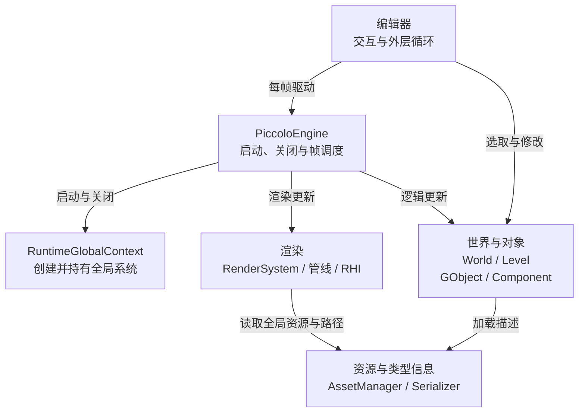
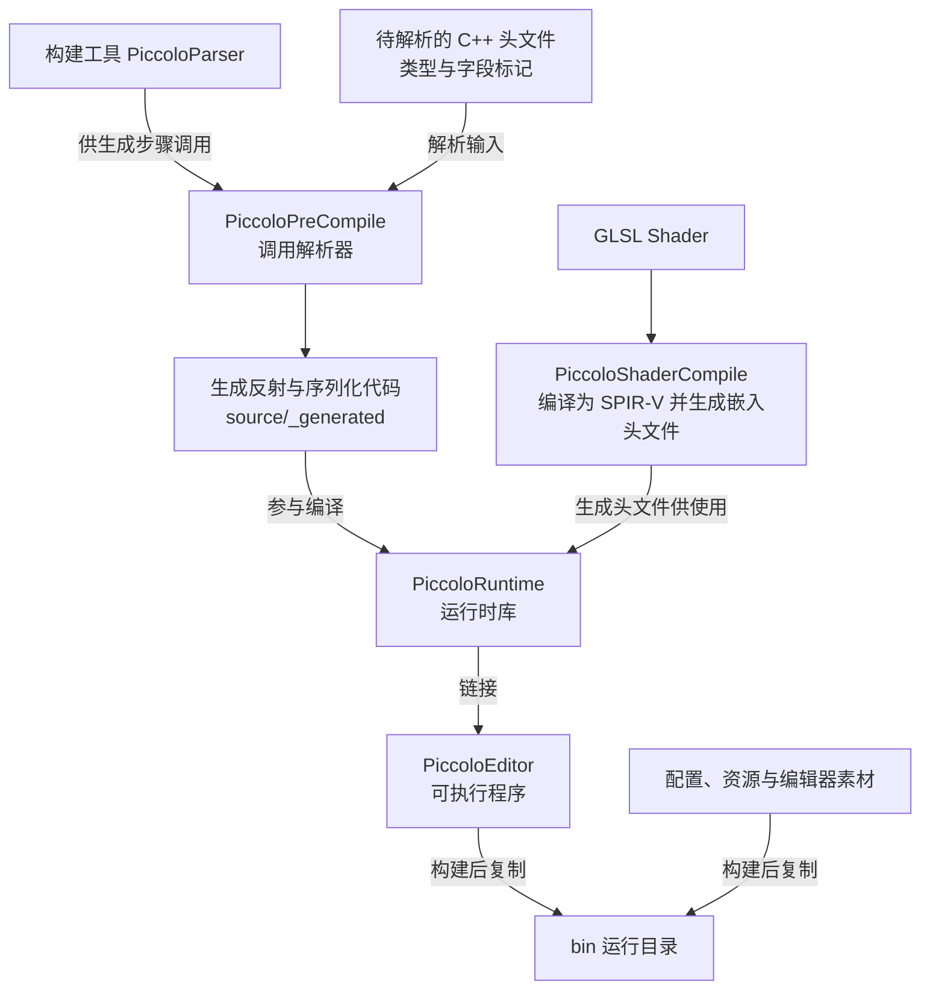
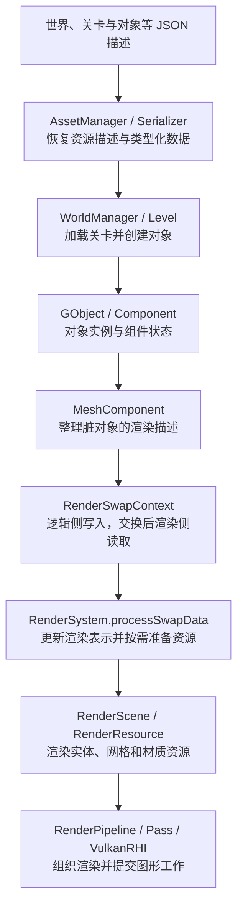

面对一台陌生引擎，即使已经熟悉 C++ 和调试器，也可能出现这样的情况：断点命中了，调用栈看得懂，但不知道这一段代码为什么属于这个系统，更不知道下一步应该跟谁。

例如，场景中的一个物体位置变了。我们可以找到修改坐标的函数，但还需要回答：是谁调用它，变更存在哪里，渲染系统怎样获知，以及这次修改会不会写回磁盘。只有把这些关系连起来，局部代码才开始成为一台可以理解的引擎。

因此，进入 Piccolo 的第一步，是先建立一张地图：**谁负责内容编辑，谁组织世界，谁恢复资源，谁推进一帧，谁把状态变成画面。** 后面再用断点逐条核对这些关系。

> 源码基线：本文依据 [BoomingTech/Piccolo 的固定提交 `f5053707fed4`][revision]，提交日期为 2024-09-30。图和调用关系来自源码核对；Piccolo 的本机构建、断点观察与图形捕获尚待开展。下文的调试任务是待执行练习。

## 先分清三种架构关系

读引擎时，至少会遇到三种不同的问题。

| 视角 | 要回答的问题 | 在代码里找什么 |
| --- | --- | --- |
| 职责与协作 | 哪个系统负责什么，谁使用谁？ | 类的职责、持有成员、服务访问、系统之间的接口 |
| 构建与产物 | 哪些代码生成哪些文件，最终链接成什么？ | CMake target、代码生成器、库、程序与资源部署命令 |
| 执行与数据流 | 某个操作按什么顺序发生，状态经过哪些表示？ | 实际入口、调用链、数据结构、状态变化与交接点 |

这三种关系可以相互解释，但应分别画。编辑器链接运行时库，说明的是构建关系；编辑器每帧调用运行时，说明的是执行关系；逻辑侧向渲染侧提交描述，说明的是数据关系。它们都不能单独证明存在另一条线程。

架构图也需要控制粒度。第一张图先保留职责和关键协作；每个 Pass、每种组件和每个第三方库，等研究对应问题时再展开。

## 最小模型：同一个物体会有不同表示

先暂时放下 Piccolo 的类名。一个可编辑、可保存、可运行、可显示的物体，至少涉及几种表示：

- **资源描述**：磁盘上保存哪些字段、引用哪些资源，供后续恢复。
- **世界对象**：运行时有哪些对象和组件，怎样更新、管理生命周期。
- **渲染表示**：画面需要哪些网格、材质、变换和可见性数据。

编辑器是操纵这些内容的工作台。一帧调度负责让逻辑更新和渲染处理在合适的时机推进；构建链则提供程序运行所需的生成代码和其他产物。

这几种表示之间需要转换。读取了一个 JSON，并不意味着对象已经完成创建；世界里创建了对象，也不意味着 GPU 所需的资源已经准备好。同样，编辑器中修改了位置，与将位置保存到文件，是两个需要分别追踪的动作。

这套模型会决定后面断点怎么放：每经过一种表示，就找一次转换入口，并核对输入、输出和对象身份。

## 第一张图：系统职责与协作

下面省略局部细节，只保留当前编辑器入口中的关键关系。箭头上的文字说明关系含义，图中位置不代表严格的依赖层级。

先沿三个问题阅读这张图。

### 谁拥有最外层循环

当前 [程序入口][main] 先创建引擎、启动系统，再创建编辑器并调用 `editor->run()`。[编辑器循环][editor] 每轮更新编辑器场景管理与输入管理，然后调用运行时的 `tickOneFrame()`。

`PiccoloEngine` 也提供 `run()`，但当前编辑器入口选择的是前一条路径。因此，查到一个看似主循环的函数之后，还要回到可执行程序的实际入口，确认它有没有被使用。

编辑器和运行时在这里协作于同一个程序中。世界、渲染、窗口等能力被编辑器使用；这个职责划分本身不意味着两个独立进程。

### 谁创建系统，谁推进工作

在 [全局系统上下文][global] 中，`startSystems()` 创建并初始化配置、资源、世界、窗口、渲染等系统；`shutdownSystems()` 组织关闭。`PiccoloEngine` 调用它们完成系统生命周期管理，再在一帧中组织逻辑更新和渲染更新。

但每个专业系统的逐帧工作并不都直接挂在 `PiccoloEngine` 上。例如，`WorldManager` 更新活动 `Level`，`Level` 再更新对象、角色和物理场景；组件内部还会继续推进各自行为。

所以，读一帧时既要看最外层调度，也要继续找系统内部的更新入口。只看最外层函数，会漏掉真正执行工作的部分。

### 系统怎样互相访问

源码中大量通过 `g_runtime_global_context` 取得系统。例如世界管理器访问资源管理器，Mesh 组件访问渲染系统，渲染系统又使用资源管理器解析资源路径。

这意味着图中的分组是职责分组，不能直接当成严格单向依赖的分层架构。目录的名称也不能替代依赖检查。

从工程角度看，全局访问让这个规模的工程可以较直接地连接系统，也让初始化前提和依赖关系散落在使用点。后续阅读某个模块时，值得同时记录两项：它由谁创建，以及它从全局上下文拿了哪些服务。

## 目录怎样对应这张图

有了职责地图，再看目录就容易确定用途。

| 目录 | 主要内容 | 第一次阅读时的用途 |
| --- | --- | --- |
| `engine/source/editor` | 编辑器入口、界面、交互和场景操作 | 找真正的启动路径与编辑操作入口 |
| `engine/source/runtime/function` | 世界对象、渲染、输入、物理、动画等运行功能 | 跟踪系统执行和状态交接 |
| `engine/source/runtime/resource` | 资源描述类型、资源与配置管理 | 分清文件格式、资源描述和运行对象 |
| `engine/source/runtime/core` | 数学、日志、反射与序列化等基础能力 | 研究上层系统依赖的共同机制 |
| `engine/source/runtime/platform` | 文件与路径等平台相关服务 | 确认资源定位和平台边界 |
| `engine/source/meta_parser`、`precompile` | 类型解析、代码生成及其构建接入 | 解释生成文件怎样参与编译 |
| `engine/shader`、`engine/asset`、`engine/configs` | Shader、内容资源和运行配置 | 对照运行所需的内容与构建产物 |
| `engine/3rdparty` | GLFW、ImGui、Jolt、Lua、Vulkan 相关依赖等 | 判断哪些能力由外部库承接 |

这里的 `core / resource / function / platform` 可以作为定位线索，但实际依赖仍要沿头文件和调用检查。比如序列化在 `core` 中，具体资源类型在 `resource` 中，连接它们的部分代码又来自生成链。

## 第二张图：构建链怎样补齐运行时

陌生引擎里，找不到某个函数实现或头文件，可能是因为它需要先生成。Piccolo 至少有两条值得单独认识的生成链。

### 类型代码生成服务于运行时

[引擎构建配置][engine-cmake] 让 `PiccoloRuntime` 依赖 `PiccoloPreCompile`，再让这个生成步骤依赖 `PiccoloParser`。[生成步骤][precompile] 调用解析器，[反射生成器][reflection-generator] 和 [序列化生成器][serializer-generator] 分别向 `source/_generated/reflection` 与 `source/_generated/serializer` 输出代码。

运行时会包含这些生成文件，例如 [反射注册实现][register] 包含汇总的反射与序列化实现。启动时再执行类型注册，供后续对象恢复等操作使用。

这里要区分两个时机：**构建时生成 C++ 代码，运行时注册并使用这些代码提供的能力。** [编辑器界面][editor-ui] 会查询类型的字段信息，序列化则会按类型恢复对象，两者都可以继续沿这条关系研究。

### Shader 也有自己的生成产物

[Shader 构建函数][shader-cmake] 先调用编译工具得到 SPIR-V，再生成供 C++ 使用的头文件。[运行时构建目标][runtime-cmake] 依赖 Shader 编译目标，并添加生成头文件的搜索路径。

因此，Shader 文件、Shader 编译结果和运行时里的图形资源需要分别看待。找到一份 GLSL，只确定了其中一项输入。

### 库、程序和运行目录分别是什么

这份配置通过 `add_library` 创建 `PiccoloRuntime`，通过 `add_executable` 创建 `PiccoloEditor`，后者链接前者。[根配置][root-cmake] 默认关闭共享库构建；本文据此讨论默认配置下的库与程序关系。

[编辑器构建配置][editor-cmake] 还组织了程序、配置、素材与资产到 `bin` 的复制。开发配置和部署配置中的 `BinaryRootFolder` 取值不同，也说明启动位置与配置内容要配套检查。

后续建立调试基线时，需要同时记录：正在运行哪个程序、使用哪份配置、从哪里解析资源路径，以及生成代码对应哪份源码。构建出一个程序文件，只完成了其中一部分。

## 第三张图：资源怎样经过世界对象进入画面

现在选取一个具体问题：**关卡里一个带 Mesh 组件的对象，是怎样获得渲染表示的？**

图中每个节点表示一次数据形态或职责变化。这里先跟踪对象描述和变换，网格与纹理的底层加载留到渲染专题展开。

### 从文件恢复到对象，需要经过两步

[AssetManager 的 `loadAsset()`][asset] 读取 JSON 文件，解析后交给 `Serializer::read()` 恢复目标数据。[序列化实现][serializer] 还会按类型名恢复多态对象，连接到反射注册的类型信息。

但资源描述恢复后，世界还需要完成自己的工作。[WorldManager][world] 读取世界描述，再加载默认关卡；[Level][level] 读取关卡描述，创建 `GObject`；[GObject][object] 恢复实例组件、合并对象定义中的组件，并调用组件的 `postLoadResource()`。

这里应区分：序列化负责把描述恢复成相应数据，世界与组件的加载过程负责将这些数据接入运行状态。直接把整条链叫作读取文件，会掩盖对象创建、组件依赖和资源准备的时机。

### 世界对象与渲染实体分别维护

[MeshComponent][mesh] 在变换脏标记满足条件时，读取对象变换、网格部件和可用的动画结果，整理成 `GameObjectDesc`，写入逻辑侧交换数据，随后清除变换脏标记。

一帧推进到交换点后，[RenderSystem 的 `processSwapData()`][render] 消费这些描述，按对象和部件身份创建或更新 `RenderEntity`，并在需要时加载、上传网格或材质资源。

所以，调试时要分别找世界侧的 `GObject` 和渲染侧的 `RenderEntity`，并追踪它们之间的身份映射。对象本身存在，不足以证明它已经拥有正确的渲染表示。

这也提供了一个实用排查顺序：对象状态是否变化，脏描述是否提交，交换后的数据是否被消费，渲染表示是否更新，最后才继续进入 Pass 与图形后端。

### 编辑器中的变化怎样进入这条链

[编辑器场景管理器][editor-scene] 在操纵对象时调用变换组件的设置接口；[TransformComponent][transform] 更新状态并设置脏标记。后续 Mesh 组件再把相关状态整理为渲染描述。

这条链说明一次编辑操作怎样接近画面更新。保存和重新加载需要另外追踪，不能仅凭编辑画面发生变化就判断磁盘内容已经更新。

## 把架构图落回一帧

有了三张图，再打开 [PiccoloEngine::tickOneFrame()][engine]，就可以把局部调用放回相应职责：

1. `logicalTick()`：先更新世界，再更新运行时输入系统。
2. 计算帧率。
3. `swapLogicRenderData()`：交换逻辑侧与渲染侧的数据。
4. `rendererTick()`：推进渲染系统。
5. 编译选项开启时，执行物理调试渲染。
6. 轮询窗口事件、更新标题并检查关闭状态。

在外层，编辑器循环还有自己的场景管理和输入管理更新。编辑器输入、运行时输入系统和窗口事件轮询因此是三个需要分别定位的环节。

这一实现还有三个适合作为后续调试起点的事实：

- **世界初始化与世界加载分开。** `WorldManager::initialize()` 记录默认世界地址并设置未加载状态；`tick()` 再在尚未加载时调用世界加载。
- **编辑模式会影响组件更新。** `GObject::tick()` 通过 `shouldComponentTick()` 判断组件是否更新；编辑器构造时将 Transform、Mesh 注册到编辑模式更新集合。读组件行为时必须核对当前模式。
- **这条外层逻辑与渲染路径顺序执行。** `tickOneFrame()` 先推进逻辑、交换数据，再调用渲染。交换结构提供了数据边界；这条路径本身没有因此变成独立逻辑线程和渲染线程。第三方库内部线程、GPU 执行与同步仍需各自核对。

这里先记录代码明确呈现的顺序。输入何时影响对象、编辑模式怎样切换，以及实际线程和画面表现，留到对应实验中观察。

## 用地图设计第一次调试任务

熟悉调试器后，最需要准备的是可以被证据回答的问题。先从下面四个任务开始；构建与运行基线在后续篇目补齐。

| 要验证的问题 | 建议断点 | 应记录的证据 |
| --- | --- | --- |
| 系统在哪里创建，编辑器使用的是哪一组系统？ | `main`、`startSystems`、`PiccoloEditor::initialize` | 调用栈、系统实例地址、传入编辑器的运行时对象 |
| 默认世界什么时候真正加载？ | `WorldManager::initialize`、`tick`、`loadWorld`、`Level::load` | 加载状态、世界地址、首轮调用顺序与失败返回值 |
| 编辑器拖动对象后，数据怎样接近画面？ | `TransformComponent::setPosition`、`MeshComponent::tick`、`RenderSystem::processSwapData` | 对象 ID、脏标记、交换描述、渲染实体的变换 |
| 逻辑与渲染实际在哪些线程推进？ | `logicalTick`、`rendererTick` | 命中时的线程 ID、调用栈及当前构建配置 |

先预测断点顺序，再实际运行；每遇到不符合预测的行为，就回到源码检查分支、模式和状态前提。比如 Mesh 更新的前提包括父对象有效、相关组件存在以及变换脏标记成立，断点没有经过预想路径时，应先检查这些条件。

这轮任务暂时只围绕对象变换和 CPU 侧渲染表示。进一步证明图形命令和最终画面，需要继续进入渲染阶段并补充图形捕获。

<!-- DATA-TODO: 在固定提交上记录真实工具链与构建配置；补首帧调用栈、线程 ID、默认世界加载顺序，以及一次对象变换经交换数据进入 RenderEntity 的观察。必要截图放入 static/images/piccolo/，实验完成前不将上述练习表述为实测结果。 -->

## 从这份实现里可以先看到哪些取舍

下面是基于已核对实现作出的工程判断，适合作为继续阅读时的问题，不代表对原作者设计意图的断言。

| 实现选择 | 当前能获得的便利 | 深入时要继续检查的代价 |
| --- | --- | --- |
| 全局上下文连接系统 | 系统访问直接，生命周期集中可见 | 隐含初始化前提、替换依赖与隔离验证的成本 |
| 世界对象与渲染实体分开 | 两种职责可以维护各自所需表示 | 对象身份、删除与更新传播的一致性 |
| 通过交换描述交接变化 | 逻辑到渲染的数据边界清晰可查 | 数据完整性、清理时机，以及若引入并发需要增加的同步约束 |
| 生成反射与序列化代码 | 类型与字段信息接入多个运行能力 | 构建顺序、生成覆盖范围与源码版本的一致性 |
| 编辑器使用运行时能力 | 编辑操作能围绕已有世界和渲染系统组织 | 编辑模式与运行模式的行为分支 |

这些取舍应结合实际工程规模判断。首篇先把关系和代价提出，后续再沿对象生命周期、资源恢复和渲染更新逐项验证。

## 接下来怎样读

下一步先建立源码、生成文件、配置和程序一致的构建与调试基线，再沿启动走到第一帧。随后从一帧中的世界更新进入对象与组件，从资源恢复进入类型信息，最后追到渲染表示、Pass 和图形后端。

相关前置可以按需要查阅：

- [游戏引擎架构地图]()：补充内容生产、世界模型和运行时基础的通用边界。
- [构建与调试前置]()：需要核对构建产物、符号和调试配置时使用。
- [图形 API 基础]()：准备进入命令、资源与 GPU 提交时使用。
- [Piccolo 阅读入口]()：查看当前正文与后续阅读方向。

**读懂引擎，先分清职责、产物和状态怎样衔接，再用执行证据验证它们。**

[revision]: https://github.com/BoomingTech/Piccolo/tree/f5053707fed4d3f94d270a436fb0d3a8ae54e3e5
[main]: https://github.com/BoomingTech/Piccolo/blob/f5053707fed4d3f94d270a436fb0d3a8ae54e3e5/engine/source/editor/source/main.cpp
[editor]: https://github.com/BoomingTech/Piccolo/blob/f5053707fed4d3f94d270a436fb0d3a8ae54e3e5/engine/source/editor/source/editor.cpp
[global]: https://github.com/BoomingTech/Piccolo/blob/f5053707fed4d3f94d270a436fb0d3a8ae54e3e5/engine/source/runtime/function/global/global_context.cpp
[engine-cmake]: https://github.com/BoomingTech/Piccolo/blob/f5053707fed4d3f94d270a436fb0d3a8ae54e3e5/engine/CMakeLists.txt
[precompile]: https://github.com/BoomingTech/Piccolo/blob/f5053707fed4d3f94d270a436fb0d3a8ae54e3e5/engine/source/precompile/precompile.cmake
[register]: https://github.com/BoomingTech/Piccolo/blob/f5053707fed4d3f94d270a436fb0d3a8ae54e3e5/engine/source/runtime/core/meta/reflection/reflection_register.cpp
[shader-cmake]: https://github.com/BoomingTech/Piccolo/blob/f5053707fed4d3f94d270a436fb0d3a8ae54e3e5/cmake/ShaderCompile.cmake
[runtime-cmake]: https://github.com/BoomingTech/Piccolo/blob/f5053707fed4d3f94d270a436fb0d3a8ae54e3e5/engine/source/runtime/CMakeLists.txt
[editor-cmake]: https://github.com/BoomingTech/Piccolo/blob/f5053707fed4d3f94d270a436fb0d3a8ae54e3e5/engine/source/editor/CMakeLists.txt
[asset]: https://github.com/BoomingTech/Piccolo/blob/f5053707fed4d3f94d270a436fb0d3a8ae54e3e5/engine/source/runtime/resource/asset_manager/asset_manager.h
[serializer]: https://github.com/BoomingTech/Piccolo/blob/f5053707fed4d3f94d270a436fb0d3a8ae54e3e5/engine/source/runtime/core/meta/serializer/serializer.h
[world]: https://github.com/BoomingTech/Piccolo/blob/f5053707fed4d3f94d270a436fb0d3a8ae54e3e5/engine/source/runtime/function/framework/world/world_manager.cpp
[level]: https://github.com/BoomingTech/Piccolo/blob/f5053707fed4d3f94d270a436fb0d3a8ae54e3e5/engine/source/runtime/function/framework/level/level.cpp
[object]: https://github.com/BoomingTech/Piccolo/blob/f5053707fed4d3f94d270a436fb0d3a8ae54e3e5/engine/source/runtime/function/framework/object/object.cpp
[mesh]: https://github.com/BoomingTech/Piccolo/blob/f5053707fed4d3f94d270a436fb0d3a8ae54e3e5/engine/source/runtime/function/framework/component/mesh/mesh_component.cpp
[render]: https://github.com/BoomingTech/Piccolo/blob/f5053707fed4d3f94d270a436fb0d3a8ae54e3e5/engine/source/runtime/function/render/render_system.cpp
[editor-scene]: https://github.com/BoomingTech/Piccolo/blob/f5053707fed4d3f94d270a436fb0d3a8ae54e3e5/engine/source/editor/source/editor_scene_manager.cpp
[transform]: https://github.com/BoomingTech/Piccolo/blob/f5053707fed4d3f94d270a436fb0d3a8ae54e3e5/engine/source/runtime/function/framework/component/transform/transform_component.cpp
[engine]: https://github.com/BoomingTech/Piccolo/blob/f5053707fed4d3f94d270a436fb0d3a8ae54e3e5/engine/source/runtime/engine.cpp
[root-cmake]: https://github.com/BoomingTech/Piccolo/blob/f5053707fed4d3f94d270a436fb0d3a8ae54e3e5/CMakeLists.txt
[reflection-generator]: https://github.com/BoomingTech/Piccolo/blob/f5053707fed4d3f94d270a436fb0d3a8ae54e3e5/engine/source/meta_parser/parser/generator/reflection_generator.cpp
[serializer-generator]: https://github.com/BoomingTech/Piccolo/blob/f5053707fed4d3f94d270a436fb0d3a8ae54e3e5/engine/source/meta_parser/parser/generator/serializer_generator.cpp
[editor-ui]: https://github.com/BoomingTech/Piccolo/blob/f5053707fed4d3f94d270a436fb0d3a8ae54e3e5/engine/source/editor/source/editor_ui.cpp
