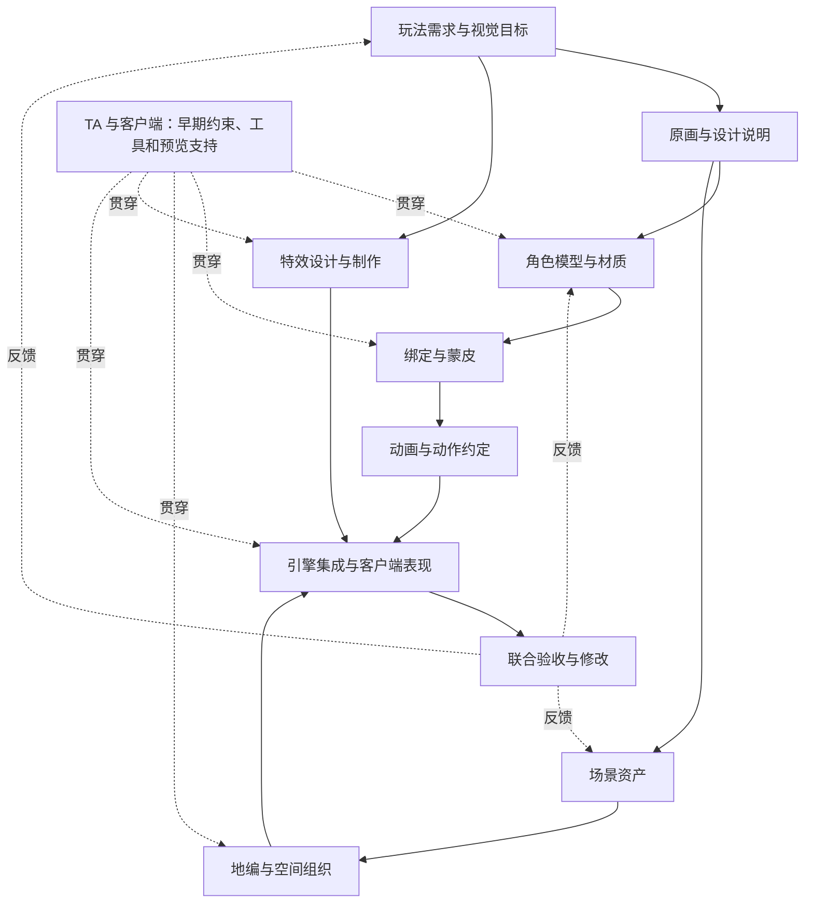

# 游戏美术生产与客户端协作：系列规划

> 创建：2026-10-25。用户已选择 **12 篇正文 + 1 个系列首页**；用户于同日确认本设计并要求落地；首页与 12 篇章节提纲现已建立。
> 状态：首页、12 篇章节及前两篇正文与工具补充已推送；第 03 篇正文已成稿，其余 9 篇为提纲。2026-10-25 用户进一步明确：需要介绍各工种工具，并讲清资产怎样制作、导出、进入游戏及修改回流。现有内容包括 01 工具地图、02 Photoshop 操作方案及 03 Maya 建模到 Unity 接入方案；具体软件实操、素材与运行验证待完成。
> 本文件是本系列唯一的篇级规划。根 `doc-plan.md` 只保留系列路由；具体开写时再建立单篇执行提纲。

## 1. 定位、读者与边界

**主问题：原画、角色、绑定、动画、场景、地编、特效、TA 和客户端，怎样把一个视觉与玩法需求共同做成游戏内容？**

读完后，读者应能解释每个环节为什么存在、主要怎样制作、交付什么、下游怎样使用，以及修改怎样传播。岗位名称用于帮助认识工作；职责按项目规模、外包方式和团队能力变化，不把示例分工写成行业统一规定。

### 本轮已确定与建议

| 项目 | 当前决定 |
| --- | --- |
| 正文规模 | 用户已选择 12 篇；首页不占正文编号 |
| 重点岗位 | 地编、特效、动画、角色、原画、TA 与客户端；补齐绑定及场景资产制作两个交接环节 |
| 主要读者 | 建议以希望理解美术制作的客户端工程师为主，同时服务希望理解上下游的美术与 TA |
| 示例范围 | 建议采用实时 3D 游戏；2D、影视和 UI 仅在必要时说明边界 |
| 引擎与工具 | 用户已明确需要覆盖 3ds Max、Maya、Photoshop 等工具：讲职责、典型操作、可编辑原稿、导出物和引擎接入。以 Unity 作为现有示例主线，Unreal 按需对照；具体版本与每个例子的主操作工具在写作时固定 |
| 教学深度 | 既解释制作判断，也提供一份小资产从工具操作、保存原稿、导出、导入、组装到运行观察及修改的可跟随路径；完整职业训练和整套软件课程另行规划 |
| 本轮产物 | 首页、12 篇章节提纲、分组目录、前后导航及四处站内入口已落地；正文后续逐篇写 |

### 内容边界

- 主线覆盖需求理解、视觉设计、资产制作、引擎预览、接入、联调、验收与修改。
- 02—08 的主体必须是实际制作过程及其判断依据。工程约束通过具体步骤讲解，不能把这些文章都写成资源规范和提交清单。
- 原画覆盖角色与场景设计信息；角色篇聚焦模型与表面制作；绑定篇负责形变基础；动画篇负责动作与时序。
- 场景资产篇负责可复用构件的制作；地编篇负责空间组织及其与关卡设计的协作；光照与氛围放在地编篇，只解释相关制作接口。
- 特效篇讲表现设计、制作和触发约定；完整技能判定、战斗规则与网络权威由技能系统专题承担。
- TA 篇涵盖效果研发、制作工具、绑定/动画支持及技术规则等不同方向，明确不同团队的组合差异。
- 客户端篇限定在美术内容接入与运行时表现。完整游戏客户端架构、资源框架源码、图形算法和发布系统由已有专题承接。
- UI、音频、过场、动捕、角色布料/毛发、程序化大世界为按需延伸，不扩张本轮 12 篇主线。

## 2. 首页方案

### 2.1 组织方式与取舍

前一轮比较过 8 篇精简版、10 篇主线版和 12 篇展开版；用户选择 12 篇，将绑定与场景资产制作独立出来。

首页有两种可行组织方式：

| 方式 | 优点 | 代价 |
| --- | --- | --- |
| 按岗位平铺入口 | 熟悉岗位的读者容易直接定位 | 容易忽略上下游依赖，首次阅读需要自行拼接流程 |
| 按制作过程分组，保留岗位名称 | 能同时看见岗位与工作关系，便于形成连续阅读 | 需要额外提供按问题跳转，方便只查一处的读者 |

**本设计建议第二种。** 正文划为四组，首页另给角色、场景及客户端三条快捷路线。分组是学习顺序，不表示 TA、客户端或验证工作只在最后参与。

### 2.2 首页可用文案

**标题：游戏美术生产与客户端协作**

**导语：从一张设计稿，到游戏里能行动、能交互的角色与场景。**

**简介：**

一款游戏的画面，由许多相互依赖的工作共同形成。原画建立视觉方案，角色与场景美术制作资产，绑定和动画让角色运动，地编组织空间，特效表达动作与反馈，TA 和客户端把这些内容接入可运行、可迭代的系统。

本系列用 12 篇文章，沿制作过程认识各岗位的工作方法、交付物和协作接口，并用一个小型场景串起从设计到验收的完整过程。你可以顺着读，也可以从当前正在交接或排查的环节进入。

**阅读说明：**

- 主要面向希望理解美术制作的客户端工程师，以及需要认识上下游工作的美术与 TA。
- 以实时 3D 游戏为主要语境，先讲通用模型，再落到具体工具和引擎。
- 首页当前显示：**第 01—03 篇已有正文，其余 9 篇为提纲。** 状态随实际成稿进度更新，教学工程验证单独说明。

### 2.3 页面从上到下的结构

| 顺序 | 区块 | 内容与行为 |
| --- | --- | --- |
| 1 | 系列首屏 | 标题、导语、两段简介；旁侧简短显示适合谁、如何读、当前状态 |
| 2 | 快速入口 | “查看 12 篇目录”“按问题查找”两个页内入口；01 有可读页面后再提供“从第 01 篇开始” |
| 3 | 内容怎样汇合 | 一张简洁关系图，展示角色与场景两条支线、特效，以及 TA/客户端的贯穿参与 |
| 4 | 四组章节目录 | 01—12 按下表展示；每项包含编号、题名、一句学习目标、提纲/正文状态 |
| 5 | 按当前问题进入 | 用读者的问题跳到对应章节，避免重复另一份长目录 |
| 6 | 贯穿示例 | 介绍“小型遗迹庭院 + 持杖角色 + 一次施法”，说明各章会逐步增加哪些产物 |
| 7 | 延伸阅读 | 少量链接连接已有资产、渲染、动画、技能及交付文章，按需要深入 |

视觉延续站内现有阅读系列：清晰标题、适度留白、分组编号列表。移动端将阅读说明移到简介下方；章节标题和摘要纵向排列，不使用横向滚动大表格。

关系图表达内容依赖，不表达固定排期或所有项目的岗位归属：

### 2.4 首页章节目录

| 组别 | 编号 | 题名 | 首页摘要 |
| --- | --- | --- | --- |
| 从需求到视觉方案 | 01 | 全貌：一个美术需求怎样成为游戏内容 | 认识岗位、输入输出和协作关系，理解设计、制作、接入与验收怎样反复迭代。 |
| 从需求到视觉方案 | 02 | 原画：怎样把视觉想法变成可制作的设计 | 从需求与参考走到轮廓、结构、色彩和材质说明，让后续制作获得足够信息。 |
| 让角色成形与运动 | 03 | 角色：从设计稿到模型与材质 | 连接建模、拓扑、UV、烘焙与贴图，理解角色制作的主要判断及其对后续工作的影响。 |
| 让角色成形与运动 | 04 | 绑定与蒙皮：怎样让模型能够正确变形 | 分清骨架、控制器和蒙皮权重，认识动作制作之前需要建立的形变基础。 |
| 让角色成形与运动 | 05 | 动画：从动作制作到游戏里的运动表现 | 解释动作姿态、时间节奏、循环衔接及导出，接到运行时位移、混合和打断。 |
| 搭建场景与动态反馈 | 06 | 场景资产：怎样制作可以组合的环境构件 | 从场景设计拆出模块、道具和材质，让资产在尺度、接缝、复用与视觉上能组合。 |
| 搭建场景与动态反馈 | 07 | 地编：怎样把资产组织成可玩的空间 | 从灰盒和路线走到地形、摆放、光照与氛围，连接关卡意图和实际运行约束。 |
| 搭建场景与动态反馈 | 08 | 特效：怎样把动作与状态做成可读的反馈 | 用形状、颜色和节奏组织效果，再连接挂点、触发、空间、结束及回收。 |
| 集成、协作与验收 | 09 | TA：怎样把视觉方案变成团队可用的技术能力 | 认识效果研发、制作工具与技术规则，理解 TA 怎样帮助内容持续生产与迭代。 |
| 集成、协作与验收 | 10 | 客户端：怎样把美术资产接成运行中的表现 | 串起导入、组装、引用、驱动和生命周期，建立可以预览、定位和修改的接入方式。 |
| 集成、协作与验收 | 11 | 综合示例：角色进入关卡并释放一次技能 | 用同一个小场景汇合所有产物，展示交接记录、集成顺序和一次修改传播。 |
| 集成、协作与验收 | 12 | 联合验收：画面、玩法和性能怎样一起检查 | 固定观察条件，区分问题与原因，确定修复责任、影响范围和重新验收的内容。 |

### 2.5 阅读路线与问题跳转

- **首次系统阅读**：01 → 02，再依次阅读四组；学习顺序不要求实际生产串行完成。
- **理解角色制作与接入**：01 → 02 → 03 → 04 → 05 → 10 → 11；遇到效果及工具问题回看 08、09。
- **理解场景与地编**：01 → 02 → 06 → 07 → 09 → 10 → 12。
- **客户端快速建立协作认识**：01 → 09 → 10 → 11 → 12；再回查具体资产的制作章节。

| 当前问题 | 首页跳转 |
| --- | --- |
| 一张概念图还缺什么，建模才能继续？ | 02、03 |
| 静态模型看着正常，为什么一抬手就变形？ | 03、04；动作表达再查 05 |
| 动作能播放，角色为什么滑步或打断不自然？ | 05、10 |
| 场景建模、关卡设计和地编分别负责什么？ | 01、06、07 |
| 特效在预览里正常，接入技能后为什么错位或残留？ | 08、10、11 |
| 哪些问题需要 TA 提供方案，哪些需要修改资源或运行代码？ | 09、10、12 |
| 改了骨架、材质或动作时长，需要重新检查哪些内容？ | 04、05、09、11、12 |

## 3. 统一的章节写法与贯穿示例

02—08 每篇使用“接到需求 → 理解关键概念 → 看制作过程 → 看交付物 → 进入引擎观察 → 修改与协作”的结构。每个专业术语先用中文说明用途，再给英文名；工具名称落在相应步骤中，不把软件列表当正文主线。

每篇至少留下一张核心关系图或过程对比、一组具体交付物示例，以及一个能检查理解的小问题。工具操作和工程建议分别注明适用条件。

### 3.1 工具与资产生产：本轮明确补齐的内容

原设计已包含制作、导出、导入和接入的大框架，但未明确各软件的职责、具体操作与文件传递。这一层现在作为正文要求，保持 12 篇数量。

工具介绍先回答它在当前步骤解决什么问题，再展示一组能够跟随的小操作。每个例子应保留输入、主要步骤、可编辑原稿、导出设置、输出目录、引擎导入/组装和观察结果；截图与操作按实际软件版本补齐。只列软件名称，不算完成本项。

3ds Max 与 Maya 都需要介绍，但不要求同一资产依次经过两套软件。每个示例选择一套主操作工具，再说明另一工具的对应职责和差异；具体选择由示例环境决定。Photoshop 在原画、纹理、遮罩和特效素材中的用途应分别解释。

| 章节 | 要介绍的工具及工作位置 | 小资产与完整传递范围 |
| --- | --- | --- |
| 01 全貌 | Photoshop、3ds Max、Maya 与引擎编辑器的分工；解释数字内容创作工具（DCC）的含义 | 软件、原稿、导出物、引擎资产与运行实例的地图已补；含动画制作/运行驱动及场景构件/地编的区别，未实操 |
| 02 原画 | 用 Photoshop 示例讲参考整理、图层、轮廓草案、色彩和结构标注；其他绘图软件可按需对照 | 已补 PSD 分层、PNG 参考图导出、目录、建模使用与版本修改方案；实际 PSD、安装版本操作与截图待补 |
| 03 角色 | Maya 2024 为主操作方案，说明 3ds Max 2024 UV 对应入口；Photoshop 做颜色图，Substance 3D Painter 烘焙为可选扩展 | 已写简化法杖原稿 → UV / 颜色图 → FBX / PNG → Unity 6000.0 / URP 17 材质、Prefab 与静态 Play 模式观察；素材与实操待补，绑定动作接 04—05 |
| 04 绑定 | 以 Maya 或 3ds Max 中的骨架、控制器与蒙皮工具展示制作步骤 | 原始绑定工程 → 变形检查 → 按方案准备和导出骨架/网格 → 引擎检查；区分制作端控制系统与导出数据 |
| 05 动画 | Maya / 3ds Max 的时间轴、关键帧、曲线、烘焙与动作片段导出 | 待机/施法动作原稿 → 约定范围的导出片段 → Unity 动作导入与预览 → 状态驱动和衔接检查 |
| 06 场景资产 | 3ds Max / Maya 的模块建模、枢轴和 UV；Photoshop / 材质工具制作贴图 | 墙、门、地面模块及原稿 → 模型与纹理导出 → Unity 材质/模板 → 拼装测试场景 |
| 07 地编 | Unity 场景、地形、光照等编辑工具怎样消费上游资产；Unreal 作为按需对照 | 从导入的模块开始摆放、组织空间，检查碰撞/导航与镜头，保存场景并在运行中走查 |
| 08 特效 | Photoshop 制作形状贴图与遮罩，Unity 粒子/材质编辑工具组织效果；VFX Graph 等按版本与需求选读 | 素材原稿 → 纹理导出 → 导入设置 → 效果组装 → 挂点播放、取消与回收；不要只讲抽象节奏 |
| 09 TA | 材质/Shader 编辑工具、DCC 脚本或引擎编辑器工具的不同位置 | 选一个小需求展示原型、参数开放、导出辅助/校验与预览，解释哪个操作由工具自动完成 |
| 10 客户端 | Unity 的导入面板、Prefab、动画系统与最小 C# 表现驱动；按需对照 Unreal | 收到模型/纹理/动作 → 配置导入 → 组装模板及引用 → 创建实例 → 用输入/状态驱动动画与特效 → 退出清理 |
| 11 综合示例 | 汇合前述工具和项目，不重新讲全套软件 | 从原画原稿到角色、场景、动作、特效文件，再到运行场景；保留目录、版本、导出物、接入配置及一次修改回流 |
| 12 验收 | 制作软件预览与引擎观察/Profiler/Frame Debugger 等工具的不同证据范围 | 用同一资产定位源文件、导出、导入或运行问题；记录条件和修正后的复查，不以单个工具结果替代完整验收 |

### 3.2 全过程要区分的三条文件路径

下列是准备采用的教学路径，具体格式、导出参数和步骤须在相应版本核对后落地：

1. **设计参考线**：Photoshop 可编辑原稿 → 评审/结构说明图片 → 建模、绑定与场景制作参考。设计图不会自动成为游戏角色或完整场景。
2. **模型与动作线**：3ds Max / Maya 可编辑工程 → 按用途导出的模型、骨架或动作交换文件 → 引擎导入 → 材质/动画引用和模板组装 → 场景中的运行实例。FBX 是候选交换格式，不意味着所有制作属性、控制器和渲染效果都原样保留。
3. **纹理与特效素材线**：Photoshop / 材质工具原稿 → 约定格式的纹理或遮罩 → 引擎导入设置 → 材质、粒子或其他表现引用 → 游戏中可观察的效果。

每条路径都还要补一次反向修改：在原稿中改什么、重新导出什么、引擎怎样采用变化、哪些引用需要检查，以及运行时怎样确认新内容生效。资源构建与分发继续链接已有资源专题；本系列至少在综合篇说明编辑器预览、Player 运行和资源交付之间的关系。

原稿保存与发布输入需要分别说明；不能为了教学方便把唯一可编辑工程丢掉，也不强制所有工程把 DCC 原稿直接放进 Unity 资产目录。文件组织方案随工具链选择，例子必须把实际路径说清楚。

### 3.3 已写与待补的状态

- 01 已完成工作关系与产物层次，已补工具地图、文件格式及三条传递路径；未执行软件或引擎实验。
- 02 已完成原画思考与设计交接，已补 Photoshop 分层、画笔、标注、原稿保存、PNG 导出、建模使用和修改回流的操作方案。实际 PSD/PNG 素材、安装版本与实操截图待补；原创 SVG 几何示意不替代软件操作证据。
- 03 正文已成稿，解释角色体块、拓扑与表面，再用法杖尺寸、UV、贴图、FBX、Unity 材质与 Prefab 串起操作方案；新增原创原理图。没有实际模型、纹理工程或运行验证。
- 04—12 正文待写，须按上表纳入工具和文件传递。章节编号与主题边界保持不变。
- 后续写作若未实际操作工具，应明确标为操作设计或待验证步骤；不能用本轮规划更新宣称软件或引擎验证完成。

**本轮核对的原始资料**：Adobe [PSD 原稿与 PNG 导出说明](https://helpx.adobe.com/photoshop/desktop/save-and-export/save-files/save-in-png-and-gif-formats.html)、Autodesk [Maya FBX 导出（2024）](https://help.autodesk.com/cloudhelp/2024/ENU/Maya-Interoperability/files/GUID-C64CFD18-517C-47A2-9E5D-489EC5D6480C.htm)及 [3ds Max 游戏 FBX 导出（2022）](https://help.autodesk.com/cloudhelp/2022/ENU/3DSMax-Data-Exchange/files/GUID-70DBCE92-4D55-4CD6-A2E9-23E48E571068.htm)。这些资料确认了教学路径可参考的能力范围；旧版本菜单和默认值不能直接写成当前版本保证。

**统一教学场景：一名持杖角色进入小型遗迹庭院，对目标释放一次短距离施法技能。** 这是拟制作的教学示例，不是已发生的项目案例。

- 角色线：简化设计稿、可变形模型、基础材质、骨架、待机/移动/施法动作、武器挂点。
- 场景线：地面、墙、门和少量装饰模块；一段入口、通行区域与目标区域；固定观察摄像机。
- 表现线：起手提示、施法反馈、目标反馈；效果绑定与结束约定。
- 集成线：一个最小角色表现对象、一套技能表现配置、可重复执行的预览与验收步骤。
- 02—08 各自可用局部示例讲清主问题，不要求等整套资产完成后才能写作；11 再进行汇合。

## 4. 十二篇的具体内容

### 01｜全貌：一个美术需求怎样成为游戏内容

**当前状态：** 正文已写。公开岗位资料和 Unity 6000.0 手册已核对；关系图与交接、披风变更为教学解释，未执行 DCC、引擎或设备实验。

**核心问题：** 一项需求怎样经过多个专业，最终形成玩家可以体验的内容？

1. 从“增加一个可操作角色和一个场景”拆出视觉目标、玩法行为、摄像机条件与目标设备。
2. 认识原画、角色、绑定、动画、场景美术、地编、特效、TA、客户端，以及策划、美术负责人和 QA 的协作位置。
3. 区分设计稿、制作源文件、导出资源、引擎资产、场景/角色组装结果及运行时实例。
4. 画出输入输出、依赖与反馈；解释哪些工作可并行、哪些交接需要先获得稳定信息。
5. 比较概念认可、单资源可用、集成可玩和联合验收几种完成状态。
6. 用小团队兼任与分工较细的团队说明职责差异；项目示例保留最终决策和验收责任。

**拟配图/产物：** 工作关系图、一页交接记录样例；读者能为“角色增加一件披风”指出需要协商和重新检查的环节。

**边界：** 本篇建立地图；制作方法分别进入 02—08，流程门禁深入阅读已有交付专题。

### 02｜原画：怎样把视觉想法变成可制作的设计

**当前状态：** 正文已写，含原创轮廓与庭院几何示意；参考公开原画资料，未执行灰模、DCC 或引擎验证。

**核心问题：** 下游需要哪些设计信息，才能持续制作而不是反复猜测？

1. 接到需求：角色定位、场景用途、风格、世界观、实际镜头距离与可读性。
2. 从参考整理到轮廓草案：比较比例、形状语言、色彩关系及识别重点，说明选择理由。
3. 从视觉方向到结构说明：必要视角、遮挡处结构、连接方式、可动部位与材质分区。
4. 分别看角色和场景设计：角色服装/装备怎样连接，建筑尺度与场景模块怎样拆解。
5. 与模型、绑定、动画和 TA 提前确认：夸张比例、软硬材质、透明/发光效果及运动要求。
6. 组织交付：设计图、标注、参考来源、版本和待定项；用灰模或引擎预览反馈更新设计。

**拟配图/产物：** 同一持杖角色从轮廓草案到结构标注的对比，以及庭院设计的模块拆解草图；读者能找出一份交接稿中尚不明确的信息。

**边界：** 解释设计思考和生产沟通；宣传插画、绘画基本功与统一要求三视图等内容不作为通用规定。

### 03｜角色：从设计稿到模型与材质

**当前状态：** 正文已成稿。主路径为 Maya 2024 → Photoshop 颜色图 → Unity 6000.0 / URP 17，并解释 3ds Max 的对应职责；文档已核对，操作、素材、烘焙及运行实验未执行。

**核心问题：** 一个角色怎样获得合适的外形、表面和后续可用性？

1. 从主视角确认比例、体块、剪影和重点；用初步模型检查设计是否在游戏镜头下成立。
2. 解释造型、高模、低模与重拓扑各自解决的问题；区分可采用高低模流程与直接制作低模的情形。
3. 拓扑怎样服务轮廓、关节形变和拆件；角色、服装、装备如何安排连接关系。
4. UV、纹素密度与接缝；法线等烘焙结果怎样把表面细节转给运行时模型。
5. 贴图、材质与 Shader 的分工；颜色、粗糙度等表面信息如何在约定光照和色彩设置下预览。
6. 导出、材质槽、LOD、部件命名和版本交付；初步姿势检查后交给绑定继续验证。

**配图/产物：** 已有原创圆杆网格、UV 与引擎引用原理示意，法杖部件参数与交付目录示例；实际造型、线框、UV 和表面效果截图待补。读者能解释“面数更少”为什么不能独立代表角色可用性。

**边界：** 蒙皮权重细节归 04；动作归 05；渲染方程和 Shader 实现通过现有渲染专题延伸。

### 04｜绑定与蒙皮：怎样让模型能够正确变形

**核心问题：** 静态模型怎样成为动画师可操控、引擎可使用的角色？

1. 用抬手动作分清网格、骨架、关节变换、动画控制器与蒙皮权重。
2. 根据动作需求设计骨架层级、关节位置、初始姿势，以及根节点和武器挂点约定。
3. 控制器、约束、FK/IK 如何帮助制作动作；区分制作端控制系统和实际导出内容。
4. 解释权重分配与关节变形：肩、肘、膝等位置怎样检查塌陷、拉伸和穿插。
5. 介绍修正形变、Blend Shape、装备与换装的关联，说明不同方案的适用范围。
6. 用姿势组验证后交给动画；导出骨架、烘焙结果和骨架版本变化需要怎样通知下游。

**拟配图/产物：** 骨架/控制器/网格关系图、权重可视化与错误/修正姿势对照；骨架和挂点约定表。

**边界：** 重点是制作与交接；GPU 蒙皮实现作为选读。绑定可以由独立绑定师、角色人员或动画 TA 等承担，按示例说明。

### 05｜动画：从动作制作到游戏里的运动表现

**核心问题：** 动作怎样同时表达意图，并适应玩家操作和运行时状态变化？

1. 从动作需求确定姿态、重心、节奏和反馈重点，解释待机、移动和施法的不同目标。
2. 用关键姿势、动作草稿、曲线调整和细化串起制作步骤；动捕仅作为另一种输入来源说明。
3. 制作循环、转向、起止与动作衔接；检查脚步、武器轨迹和身体运动。
4. 区分动画携带位移与运行时驱动位移，解释选择及两者配合需要明确的约定。
5. 约定动作片段、起手/释放/收势时点、速度变化和中断；玩法逻辑权威与动画事件分别说明。
6. 导出后在引擎中检查混合、重定向和状态切换，观察单段预览正常但组合异常的情况。

**拟配图/产物：** 施法关键姿势与时间线、移动循环及脚步对比；动作清单和时点说明。

**边界：** 制作端 FK/IK 在 04 解释；运行时状态驱动归 10。完整动画系统算法及战斗状态机另行深入。

### 06｜场景资产：怎样制作可以组合的环境构件

**核心问题：** 怎样制作一组能反复组合、并维持视觉一致性的环境资产？

1. 从场景设计拆出建筑、地面、道具、植被和独特视觉元素，区分复用模块与专用资产。
2. 约定尺度、网格步长、枢轴、朝向与拼接边界，以墙、门、地板组成最小模块组。
3. 模型制作如何保留轮廓与功能；碰撞代理等辅助数据怎样与地编/程序约定。
4. UV、平铺纹理、条带贴图、贴花和共享材质分别适合什么情况，如何减少重复感。
5. LOD、光照用 UV 等内容按采用的引擎和光照方案说明；不将某种制作流程写成统一要求。
6. 在测试场景拼接、换光照、换距离检查；交付模块库、材质与使用示意。

**拟配图/产物：** 庭院模块拆分、枢轴和拼接示意、材质复用对照；最小模块套件清单。

**边界：** 本篇回答“构件怎样制作”；路线、空间节奏和整体场景摆放归 07。程序化生成只说明可选接口。

### 07｜地编：怎样把资产组织成可玩的空间

**核心问题：** 怎样让关卡中的空间同时支持行走、观察、交互和视觉表达？

1. 解释地编/场景搭建与关卡设计、场景建模、灯光工作的交点，按团队说明分工。
2. 从灰盒与玩法路线出发确认尺度、区域关系、可达性、视线和摄像机活动范围。
3. 用模块、地形、植被、装饰和重点物体建立空间层次；观察重复、遮挡和视觉引导。
4. 用光照、雾、色彩与环境效果组织氛围，同时保持交互目标和路线的可辨识性。
5. 与客户端共同检查碰撞、导航、遮挡关系、场景划分和加载边界；按实际方案检查烘焙数据。
6. 在目标镜头与移动路径中走查，整理场景交付和变更影响；用实际观察决定后续优化方向。

**拟配图/产物：** 同一庭院的灰盒、首轮搭建和细化对照，路线/视线叠图；场景走查清单。

**边界：** 本篇解释环境搭建如何响应玩法意图，完整关卡设计理论归 GamePlay；单个资产的建模归 06。

### 08｜特效：怎样把动作与状态做成可读的反馈

**核心问题：** 效果怎样表达发生了什么、影响哪里、什么时候发生变化？

1. 从玩法与镜头确定效果职责：提示、施法、命中、持续状态或环境氛围。
2. 用形状、颜色、对比、运动和时间节奏构成视觉层次，明确主要信息和辅助装饰。
3. 解释粒子、网格、拖尾、贴图序列与材质在效果中的用途，按目标选择组合。
4. 分解一次施法的准备、释放和消散；用可重复预览检查节奏、遮挡与画面可读性。
5. 与动画和客户端约定挂点、本地/世界空间、缩放、触发参数、跟随方式、取消与结束。
6. 解释叠加数量、屏幕覆盖、材质和粒子模拟等成本来源；性能判断须回到指定设备与场景测量。

**拟配图/产物：** 效果分层图和时间序列、挂点与空间对照；效果配置及播放/结束约定。

**边界：** 技能伤害与命中判定不由视觉效果自动决定；完整特效工具课程、流体模拟等作为延伸。

### 09｜TA：怎样把视觉方案变成团队可用的技术能力

**核心问题：** 哪些反复出现的制作难题，需要形成技术方案、工具或共同规则？

1. 从“想做的效果”“现有制作方式”“目标平台约束”三者之间的差距识别任务。
2. 区分渲染/效果、资产管线、程序化、绑定/动画等常见工作方向，说明团队里的不同组合。
3. 效果原型怎样经过比较和验证成为材质模板或共享能力；哪些参数适合开放给创作者。
4. 用导出预设、检查器和预览工具减少重复操作；工具错误需要定位到可修复的输入。
5. 共同制定质量分档、资产规则和例外处理；区分可静态判断的规则与需要运行验证的目标。
6. 用一个小需求说明与美术、图形程序、工具程序和客户端的协作、决策与维护责任。

**拟配图/产物：** 从效果需求到可复用方案的过程图；一个材质参数说明或检查结果样例。

**边界：** 现有 TA 职责文章作为前置/延伸。本篇重点补实际工作过程，避免把 TA 定义成唯一预算负责人或所有视觉问题的接收者。

### 10｜客户端：怎样把美术资产接成运行中的表现

**核心问题：** 一组交付资源怎样成为可驱动、可释放、可调试的游戏表现？

1. 分清源文件、导入对象、Prefab/场景组装和运行时实例；解释资源交付与运行行为之间需要的连接。
2. 约定组件层级、稳定引用、挂点、材质和动作映射，避免仅靠目录和口头命名推断关系。
3. 用角色移动与施法驱动动画、特效和视觉状态；分清逻辑结果、表现触发及反馈。
4. 处理加载、初始化、显示、复用与退出；用取消、目标销毁和切场景说明生命周期边界。
5. 提供预览入口、状态显示和日志，让美术、TA 能共同观察接入后的实际行为。
6. 固定一次集成所用的资源与配置版本，记录替换资源后需要重新检查的引用及行为。

**拟配图/产物：** 资源到运行实例的关系图、最小表现配置和生命周期表；读者能说明某个效果由谁创建和结束。

**边界：** 原理先行，Unity 实现放在示例段；AssetBundle/YooAsset、完整客户端架构及网络协议通过原专题深入。

### 11｜综合示例：角色进入关卡并释放一次技能

**核心问题：** 前十篇的交付物怎样在一个具体需求里汇合？

1. 固定最小目标：一名持杖角色、一段可行走庭院、一次施法与目标反馈；列出范围和已知限制。
2. 汇总设计稿、角色/场景资产、绑定、动作、特效和表现配置，记录版本与交接依赖。
3. 从简单占位内容开始接入，逐步替换正式教学资产；每次替换检查行为是否保持。
4. 对齐移动、动作、武器挂点、特效触发和目标反馈；同时检查场景尺度与摄像机观察。
5. 设计一次“施法动作时长改变”的修改，追踪动作、事件、特效、配置与验收步骤的影响。
6. 整理可复现材料、检查结果和仍待验证的项目，把综合观察送回对应制作环节。

**拟配图/产物：** 完整产物关系图、版本清单、修改前后时间线及复现步骤。

**边界：** 本篇不重新教学所有工种。示例尚未执行时只能发布为流程推演或实验设计，不能写成实战结果；可运行工程和记录具备后再升级描述。

### 12｜联合验收：画面、玩法和性能怎样一起检查

**核心问题：** 多个岗位怎样针对同一份内容判断完成，并把问题送回正确位置？

1. 定义视觉、功能、体验和性能各自的观察目标，指定参与人员和最终决定的归属。
2. 固定资源/配置/程序版本、镜头、光照、质量档、场景规模与设备，使观察可对照。
3. 按“现象 → 复现 → 候选原因 → 证据”组织问题，区分制作、导入、组装、驱动和运行环境等层次。
4. 用角色形变、材质观感、特效残留和场景通行等候选问题展示排查方法；未经实验的根因只作假设。
5. 讨论视觉收益、制作成本、运行成本和改动风险；预算及取舍基于具体项目，不给统一面数或耗时阈值。
6. 明确修复、复查、依赖变更通知与接受例外的记录；把重复问题反馈给制作方法和工具。

**拟配图/产物：** 联合验收表、问题记录样例、修改影响检查表；读者能够区分“已观察到异常”和“已证明原因”。

**边界：** 本篇建立跨岗位验收方法；Profiler 等工具的完整使用、性能方法论和版本发布分别链接已有系列。

## 5. 与已有内容的分工

以下链接已确认当前工作区有对应文件。它们是备料与延伸入口，复用前仍需核查相关段落和版本；旧文中的例子、数字与结论不自动成为本系列的验证证据。

| 现有材料 | 本系列如何使用 |
| --- | --- |
| [美术资源生产管线](../content/delivery-engineering/delivery-content-pipeline-02-art-production.md) | 为 01、10 补导出/提交/导入/验证的背景；本系列增加制作过程和岗位之间的内容交接 |
| [资源规范与准入](../content/delivery-engineering/delivery-content-pipeline-03-asset-standards.md) | 09、12 的工程延伸；制作章节只解释规则影响当前步骤的部分 |
| [TA 职责与协作接口](../content/rendering/ta-role-boundaries-and-deliverables.md) | 09 的已有职责材料；新篇增加从需求、原型到工具/方案落地的过程，并说明不同 TA 方向 |
| [骨骼蒙皮与 Blend Shape](../content/rendering/unity-rendering-03-skeletal-animation.md) | 04 的渲染机制选读；绑定制作方法由本系列负责 |
| [Importer 的职责](../content/engine-toolchain/unity-importer-what-does-it-do-and-why-source-file-is-not-just-a-file.md) | 03、04、06、10 的按需前置；避免重复完整导入机制 |
| [技能表现交付标准](../content/system-design/skill-system-28-artist-vfx-delivery-standard.md) | 05、08、11 衔接时序、挂点和生命周期；该文示例约定须按具体案例采用，不当作统一行业标准 |
| [角色化选题规划](role-based-topic-planning-2026-03.md) | 参考美术与 TA 的协作问题；规划不作为已执行流程的证据 |
| [旧美术协作主题归档](doc-plan-archive-v26.md) | 仅作历史候选来源；本系列接管岗位制作与客户端协作主线，旧工具专项不自动纳入这 12 篇；归档只读 |

## 6. 文件、页面与状态约定

### 6.1 实际页面落点

已归入 `content/delivery-engineering/`，作为独立阅读系列，以“游戏研发总览”的策划/美术/程序协作阶段为主要入口，并在技术目录的交付相关分组提供入口。渲染与工具链作为延伸链接，不另建一套相同章节。

- 系列标识：`game-art-production-collaboration`。
- [专栏首页](../content/delivery-engineering/game-art-production-collaboration-series-index.md)。
- 复用 `reading-series` 页面风格；四个阅读组分别覆盖 1—2、3—5、6—8、9—12。
- 首页的简介、分组摘要和读者说明来自第 2 节；篇级正式题名、范围和状态以本文件为准。
- 首页与 12 个提纲页已经同步建立；章节均为 `content_stage: outline`，通过 `primary_series` 与固定的 `series_order` 加入分组目录。
- 提纲页必须说明“正文待写”，保留本篇主问题、具体内容和拟制作例子；存在文件不等于正文完成。
- 后续转正文时再更新页面状态；不使用会因提纲/正文数量变化而改变章节身份的动态编号。
- 页面验证记录见[网站落地执行记录](game-art-production-collaboration-execution-plan.md)；站点构建和阅读导航检查不代表教学示例已经执行。

### 6.2 篇级页面与状态

以下页面已建立；第 01—03 篇为正文，其余 9 篇为提纲。前缀统一为 `game-art-production-`，均位于上述栏目。

| 编号 | 章节页面 | 状态 |
| --- | --- | --- |
| 01 | [game-art-production-01-overview.md](../content/delivery-engineering/game-art-production-01-overview.md) | 正文与工具地图已写，未作软件与引擎运行验证 |
| 02 | [game-art-production-02-concept-art.md](../content/delivery-engineering/game-art-production-02-concept-art.md) | 正文与 Photoshop 操作方案已写，素材/版本实操待补 |
| 03 | [game-art-production-03-character-assets.md](../content/delivery-engineering/game-art-production-03-character-assets.md) | 正文已写；工具操作方案与原理示意，实操/素材/运行验证待补 |
| 04 | [game-art-production-04-rigging-skinning.md](../content/delivery-engineering/game-art-production-04-rigging-skinning.md) | 提纲已建立；正文待写 |
| 05 | [game-art-production-05-animation.md](../content/delivery-engineering/game-art-production-05-animation.md) | 提纲已建立；正文待写 |
| 06 | [game-art-production-06-environment-assets.md](../content/delivery-engineering/game-art-production-06-environment-assets.md) | 提纲已建立；正文待写 |
| 07 | [game-art-production-07-level-art.md](../content/delivery-engineering/game-art-production-07-level-art.md) | 提纲已建立；正文待写 |
| 08 | [game-art-production-08-vfx.md](../content/delivery-engineering/game-art-production-08-vfx.md) | 提纲已建立；正文待写 |
| 09 | [game-art-production-09-technical-art.md](../content/delivery-engineering/game-art-production-09-technical-art.md) | 提纲已建立；正文待写 |
| 10 | [game-art-production-10-client-integration.md](../content/delivery-engineering/game-art-production-10-client-integration.md) | 提纲已建立；正文待写 |
| 11 | [game-art-production-11-integrated-example.md](../content/delivery-engineering/game-art-production-11-integrated-example.md) | 提纲已建立；正文待写 |
| 12 | [game-art-production-12-joint-acceptance.md](../content/delivery-engineering/game-art-production-12-joint-acceptance.md) | 提纲已建立；正文待写 |

## 7. 写作顺序、证据与完成标准

**建议写作顺序：** 先写 01，固定用语、案例需求和依赖；随后写 02，并用 10 的执行提纲明确接入所需信息；再完成角色线 03—05、场景线 06—07 和特效 08；以具体制作问题写 09，完成 10 后汇合为 11；12 随各篇积累验收材料，最后收束。写作顺序不改变读者编号。

每篇开写时确定所需证据：

- 制作方法和术语参考可追溯的专业第一手资料；具体 DCC/引擎行为核对对应版本官方资料。
- 工具截图、文件和资源说明来源及可公开范围；教学素材使用可授权公开的内容。
- 示意、建议、设计中的实验、实际运行观察分别标注；读者练习不预先填写“验证通过”。
- 涉及性能时记录设备、内容规模、镜头、质量设置、版本和测量方法；不把资产数量或某个单项参数直接等同于性能结论。
- 实际案例必须有对应的过程记录与证据；缺少证据时使用明确标注的教学推演。

单篇完成标准：主问题有回答，制作步骤有因果，产物和下游有对应，例子与证据状态明确，前后章节边界清楚，链接和站点构建通过。Hugo 构建只验证文档生成，不代表工具、示例、引擎和设备验证完成。

后续维护顺序：先回写本系列规划，再同步首页与章节状态；根路由只更新整体进度。本轮已按用户确认的设计落地；具体工具版本、示例制作和后续运行证据仍在单篇写作时确定。
